# RustRobotics

[](https://github.com/rsasaki0109/rust_robotics/actions/workflows/ci.yml)
[](https://codecov.io/gh/rsasaki0109/rust_robotics)
[](https://crates.io/crates/rust_robotics)
[](https://docs.rs/rust_robotics)
[](https://rsasaki0109.github.io/rust_robotics/)
[](LICENSE)

Robotics algorithms in Rust: planning, localization, SLAM, control, and manipulation.
Try them in your browser, then use the same library in your own project.

<p align="center">
  <a href="https://rsasaki0109.github.io/rust_robotics/playground/"><b>Open the playground</b></a>
  ·
  <a href="#quick-start"><b>Run locally</b></a>
  ·
  <a href="#algorithm-gallery"><b>Algorithm gallery</b></a>
  ·
  <a href="https://docs.rs/rust_robotics"><b>API docs</b></a>
</p>

## Try in your browser

Edit a map, move a robot, or inspect an algorithm step by step.
Pause, replay, and share your experiment. No installation or account required.

<table>
  <tr>
    <td align="center"><a href="https://rsasaki0109.github.io/rust_robotics/playground/?tab=grid"></a><br/><b>Grid planners</b></td>
    <td align="center"><a href="https://rsasaki0109.github.io/rust_robotics/playground/?tab=localization&amp;loc_view=belief&amp;belief_event=resample">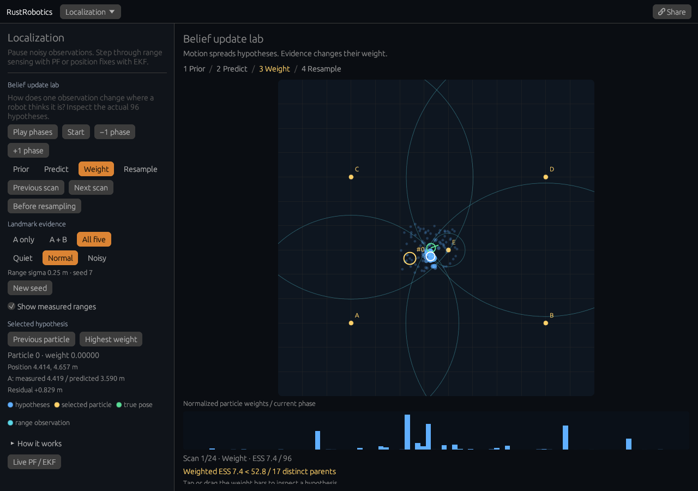</a><br/><b>Localization</b></td>
    <td align="center"><a href="https://rsasaki0109.github.io/rust_robotics/playground/?tab=slam&amp;algorithm=loop">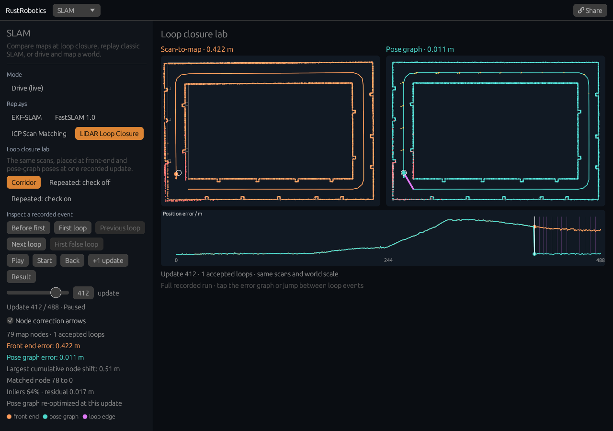</a><br/><b>SLAM</b></td>
  </tr>
  <tr>
    <td align="center"><a href="https://rsasaki0109.github.io/rust_robotics/playground/?tab=arena">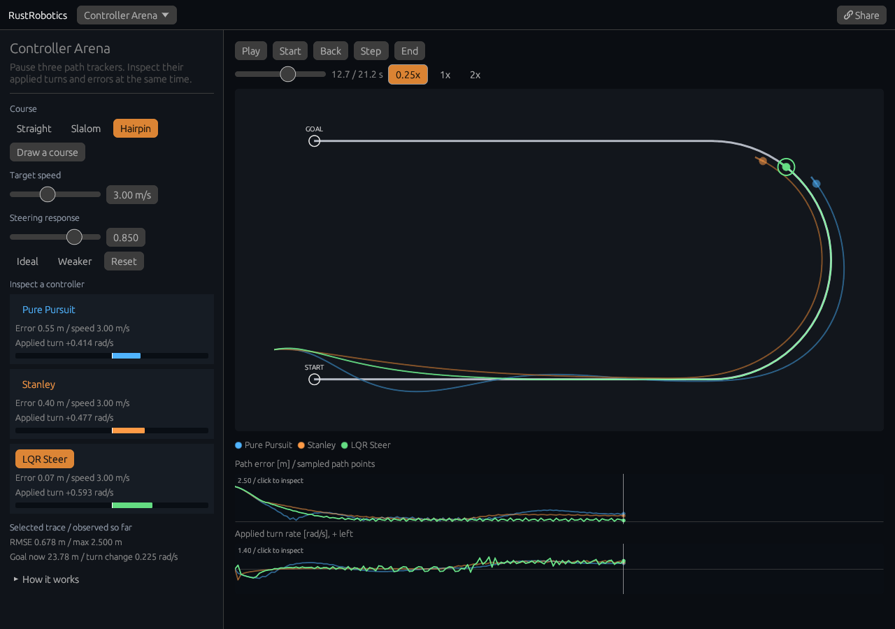</a><br/><b>Controller Arena</b></td>
    <td align="center"><a href="https://rsasaki0109.github.io/rust_robotics/playground/?tab=arm">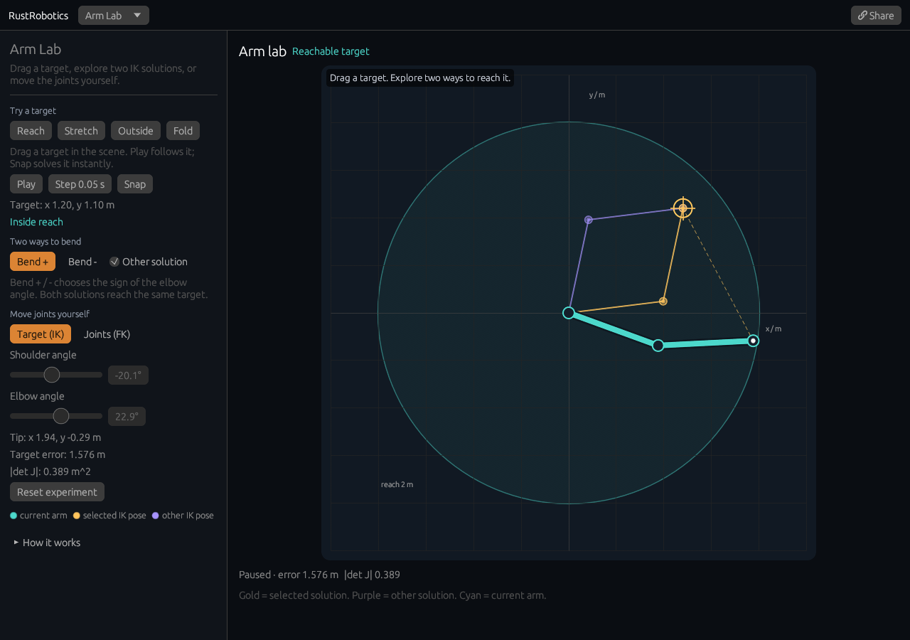</a><br/><b>Arm Lab</b></td>
    <td align="center"><a href="https://rsasaki0109.github.io/rust_robotics/playground/?tab=drone&amp;mode=manual&amp;course=climb&amp;cinema=1&amp;intro=1"></a><br/><b>Flight Lab</b></td>
  </tr>
</table>

[Explore all experiments](https://rsasaki0109.github.io/rust_robotics/)
· [Playground guide](crates/rust_robotics_playground/README.md)

### Flight Lab

[](https://rsasaki0109.github.io/rust_robotics/playground/?tab=drone&mode=manual&course=climb&cinema=1&intro=1)

[Flight recording](docs/assets/drone-manual.mp4) ·
[Course editor](docs/assets/drone-editor.mp4) ·
[Flight photograph](docs/assets/drone-photo-wide.png)

## Quick Start

Clone the repository and launch the native playground:

```bash
git clone https://github.com/rsasaki0109/rust_robotics.git
cd rust_robotics
cargo run -p rust_robotics_playground
```

### Rust navigation loop

Run planning, localization, and path tracking together without a GUI:

```bash
cargo run -p rust_robotics --example headless_navigation_loop \
  --features "planning,localization,control"
```


[Controller inspector guide](docs/controller_inspector.md)

## Use As A Library

```bash
cargo add rust_robotics --features "planning,localization,control"
```

```rust
use rust_robotics::planning::{AStarConfig, AStarPlanner};
use rust_robotics::localization::{EKFConfig, EKFLocalizer};
use rust_robotics::control::PurePursuitController;
```

See the [Rust guide](docs/rust_guide.md) for workspace crates, more examples,
build instructions, and benchmarks.

## Embedded / no_std

Core types and Kalman filters support `no_std` with `alloc`:

```bash
rustup target add thumbv7em-none-eabihf
cargo build -p rust_robotics_core -p rust_robotics_localization \
  --no-default-features --target thumbv7em-none-eabihf
```

[Run the embedded demo](docs/embedded_demo.md) with EKF, Pure Pursuit, and PID
on Cortex-M under QEMU.

## Algorithm gallery

Robotics algorithms in action. [Explanations, source, and commands](docs/algorithm_gallery.md).

<table>
  <tr>
    <td align="center"><a href="#rapidly-exploring-random-trees-rrt">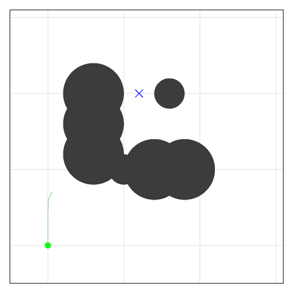</a><br/><b>RRT</b></td>
    <td align="center"><a href="#dynamic-window-approach">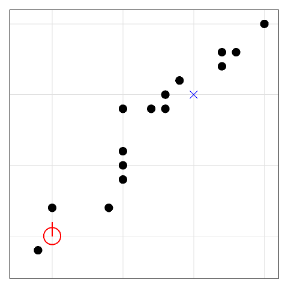</a><br/><b>Dynamic Window Approach</b></td>
    <td align="center"><a href="#dijkstra-algorithm">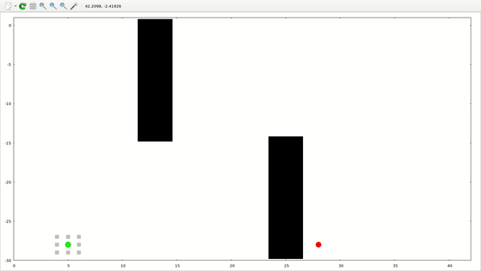</a><br/><b>Dijkstra</b></td>
  </tr>
  <tr>
    <td align="center"><a href="#extended-kalman-filter-localization">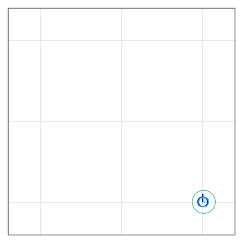</a><br/><b>EKF Localization</b></td>
    <td align="center"><a href="#particle-filter-localization">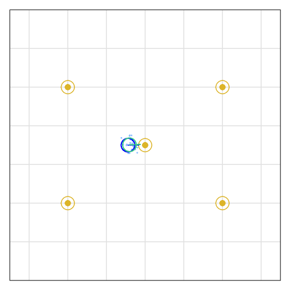</a><br/><b>Particle Filter</b></td>
    <td align="center"><a href="#pure-pursuit">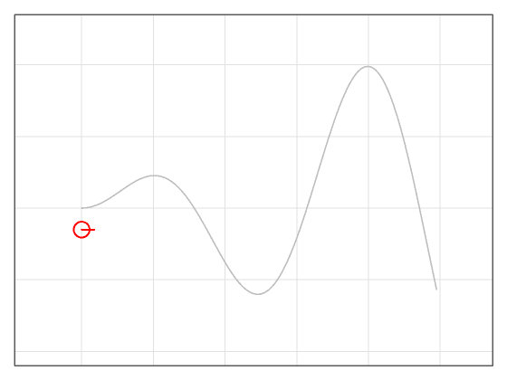</a><br/><b>Pure Pursuit</b></td>
  </tr>
  <tr>
    <td align="center"><a href="#ekf-slam">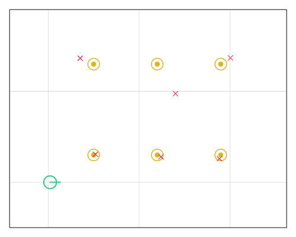</a><br/><b>EKF SLAM</b></td>
    <td align="center"><a href="#fastslam-10">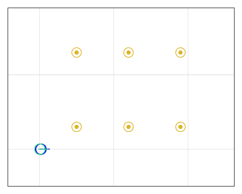</a><br/><b>FastSLAM 1.0</b></td>
    <td align="center"><a href="#iterative-closest-point-icp-matching">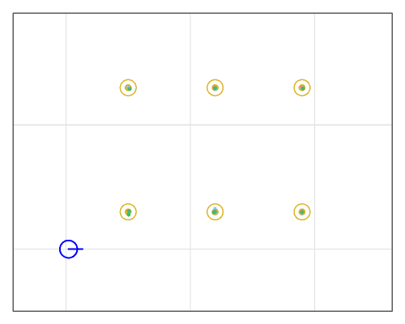</a><br/><b>ICP Matching</b></td>
  </tr>
  <tr>
    <td colspan="3" align="center"><a href="#pose-graph-optimization">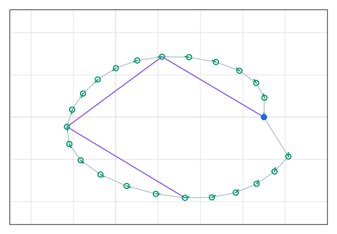</a><br/><b>Block-sparse Factor Graph Optimization</b></td>
  </tr>
  <tr>
    <td colspan="3" align="center"><a href="#loop-closure-lidar-graph-slam">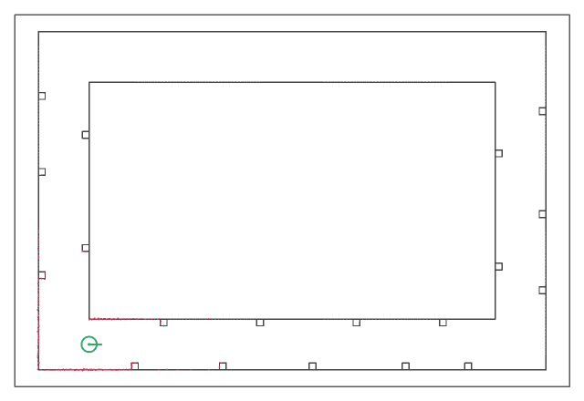</a><br/><b>LiDAR Loop Closure (scan-to-map + pose graph)</b></td>
  </tr>
</table>

[Regenerate the animations](scripts/generate_gallery_gifs.sh).

### Localization

#### Extended Kalman Filter Localization


[Source](./crates/rust_robotics_localization/src/ekf.rs) · [Details](docs/algorithm_gallery.md#extended-kalman-filter-localization)

#### Particle Filter Localization


[Source](./crates/rust_robotics_localization/src/particle_filter.rs) · [Details](docs/algorithm_gallery.md#particle-filter-localization)

#### Unscented Kalman Filter Localization

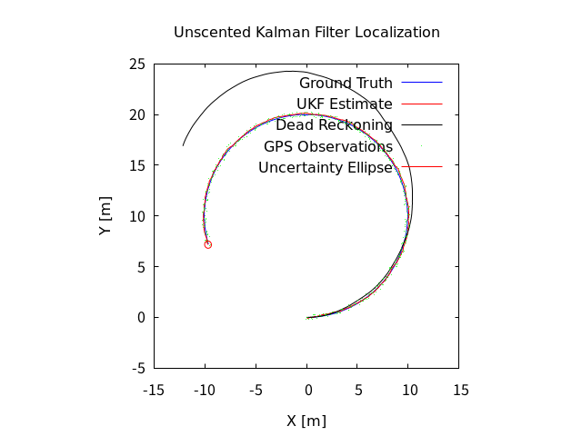

[Source](./crates/rust_robotics_localization/src/unscented_kalman_filter.rs) · [Details](docs/algorithm_gallery.md#unscented-kalman-filter-localization)

#### Histogram Filter Localization

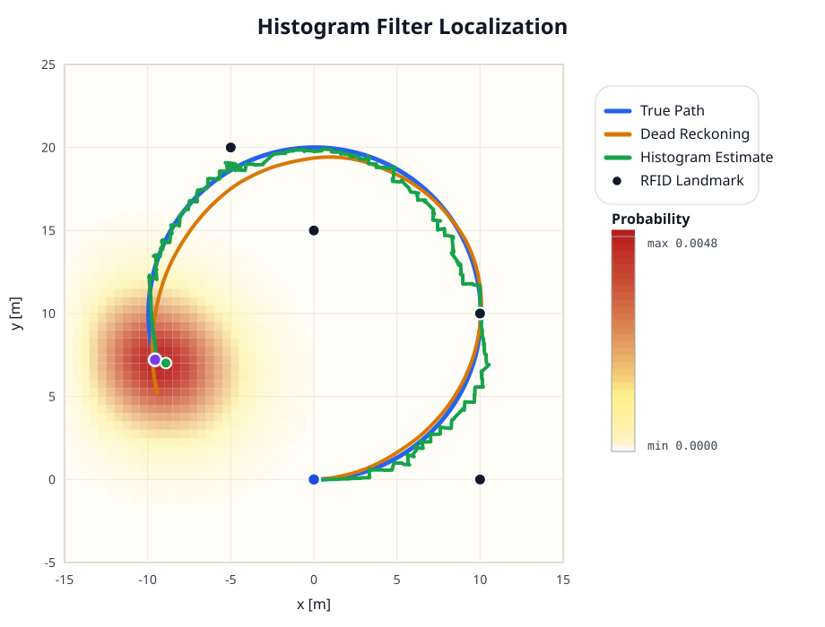

[Source](./crates/rust_robotics_localization/src/histogram_filter.rs) · [Details](docs/algorithm_gallery.md#histogram-filter-localization)

### Mapping

#### NDT Map

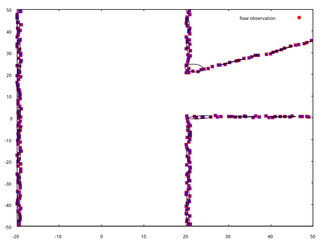

[Source](./crates/rust_robotics_mapping/src/ndt.rs) · [Details](docs/algorithm_gallery.md#ndt-map)

#### Gaussian Grid Map

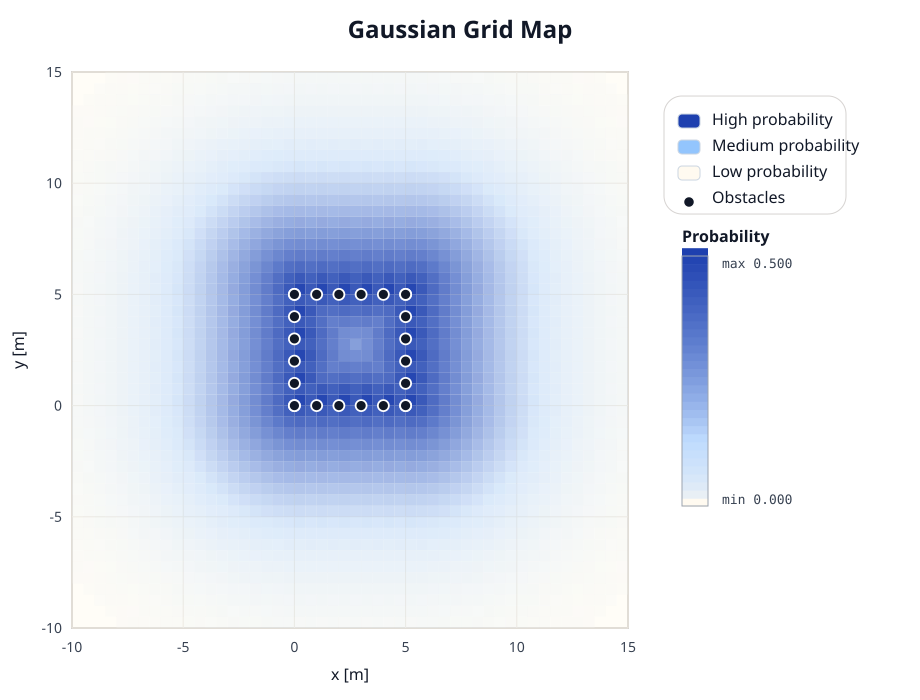

[Source](./crates/rust_robotics_mapping/src/gaussian_grid_map.rs) · [Details](docs/algorithm_gallery.md#gaussian-grid-map)

#### Ray Casting Grid Map

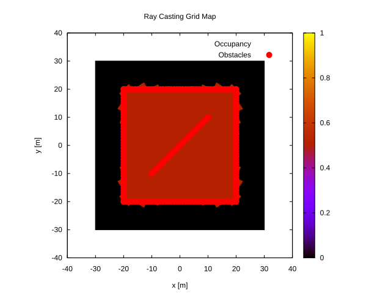

[Source](./crates/rust_robotics_mapping/src/ray_casting_grid_map.rs) · [Details](docs/algorithm_gallery.md#ray-casting-grid-map)

### SLAM

#### Iterative Closest Point (ICP) Matching


[Source](./crates/rust_robotics_slam/src/icp_matching.rs) · [Details](docs/algorithm_gallery.md#iterative-closest-point-icp-matching)

#### Scan-to-Map LiDAR Odometry

##### Loop Closure (LiDAR Graph SLAM)


[Details](docs/algorithm_gallery.md#loop-closure-lidar-graph-slam)

#### FastSLAM 1.0


[Source](./crates/rust_robotics_slam/src/fastslam1.rs) · [Details](docs/algorithm_gallery.md#fastslam-10)

#### EKF SLAM


[Source](./crates/rust_robotics_slam/src/ekf_slam.rs) · [Details](docs/algorithm_gallery.md#ekf-slam)

#### Graph-Based SLAM

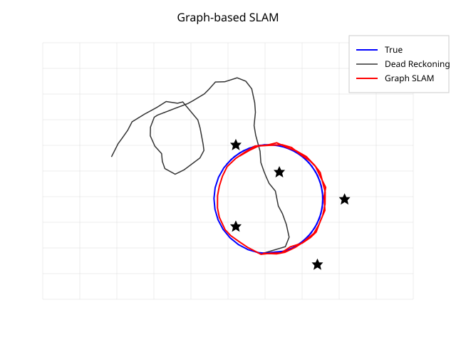

[Source](./crates/rust_robotics_slam/src/graph_based_slam.rs) · [Details](docs/algorithm_gallery.md#graph-based-slam)

#### Pose Graph Optimization

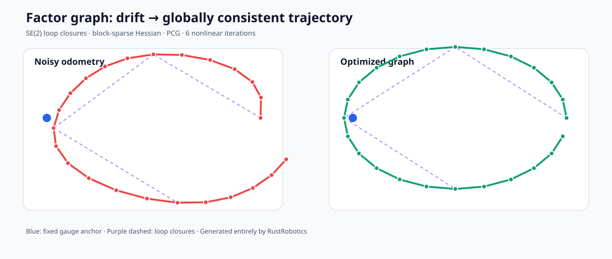

[Source](./crates/rust_robotics_slam/src/pose_graph_optimization.rs) · [Details](docs/algorithm_gallery.md#pose-graph-optimization)

#### EuRoC / KITTI Dataset Replay

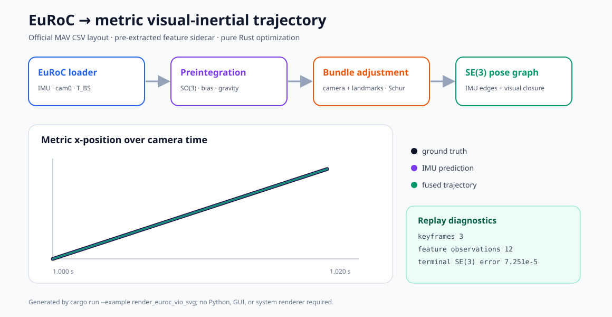

[Details](docs/algorithm_gallery.md#euroc--kitti-dataset-replay)

### Path Planning

#### A* Algorithm

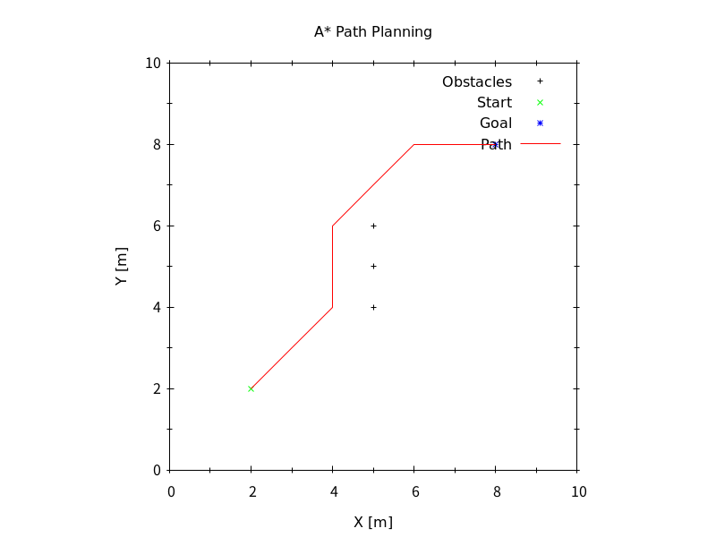

[Source](./crates/rust_robotics_planning/src/a_star.rs) · [Details](docs/algorithm_gallery.md#a-algorithm)

#### Theta* Algorithm

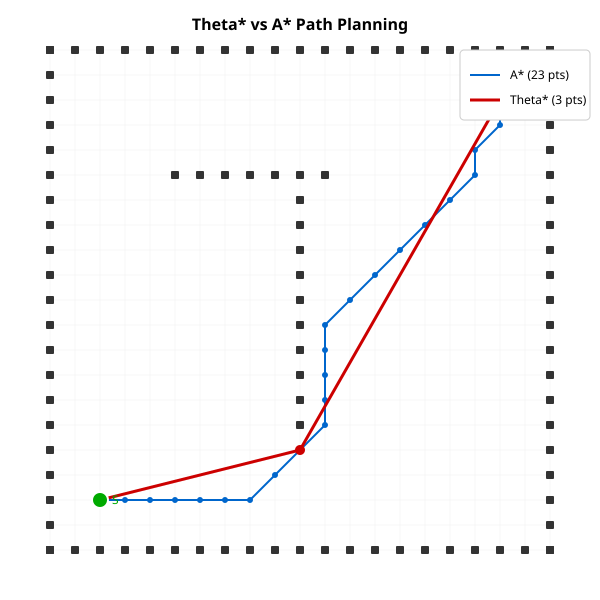

[Source](./crates/rust_robotics_planning/src/theta_star.rs) · [Details](docs/algorithm_gallery.md#theta-algorithm)

#### Jump Point Search (JPS)

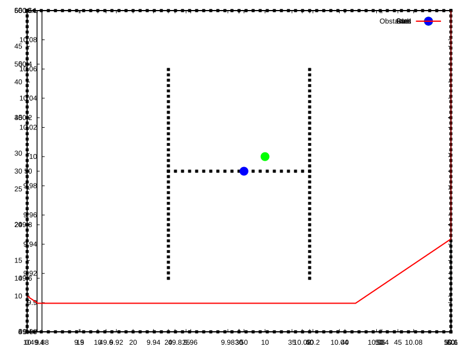

[Source](./crates/rust_robotics_planning/src/jps.rs) · [Details](docs/algorithm_gallery.md#jump-point-search-jps)

#### Bezier Path Planning

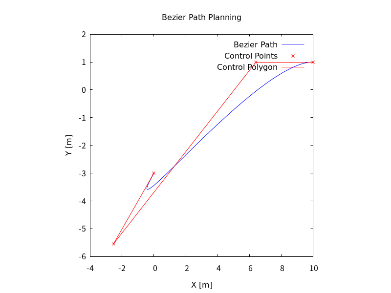

[Source](./crates/rust_robotics_planning/src/bezier_path_planning.rs) · [Details](docs/algorithm_gallery.md#bezier-path-planning)

#### Cubic Spline

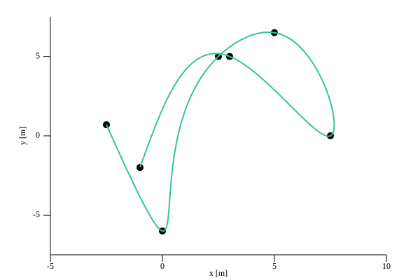

[Source](./crates/rust_robotics_planning/src/cubic_spline_planner.rs) · [Details](docs/algorithm_gallery.md#cubic-spline)

#### Dynamic Window Approach


[Source](./crates/rust_robotics_planning/src/dwa.rs) · [Details](docs/algorithm_gallery.md#dynamic-window-approach)

#### D* Lite

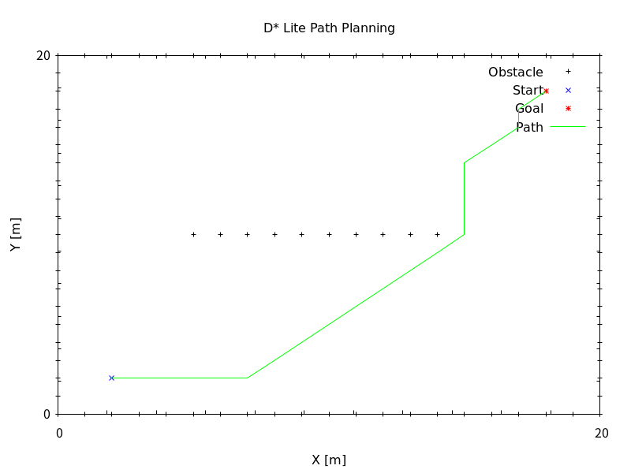

[Source](./crates/rust_robotics_planning/src/d_star_lite.rs) · [Details](docs/algorithm_gallery.md#d-lite)

#### Dijkstra Algorithm


[Source](./crates/rust_robotics_planning/src/dijkstra.rs) · [Details](docs/algorithm_gallery.md#dijkstra-algorithm)

#### Informed RRT*

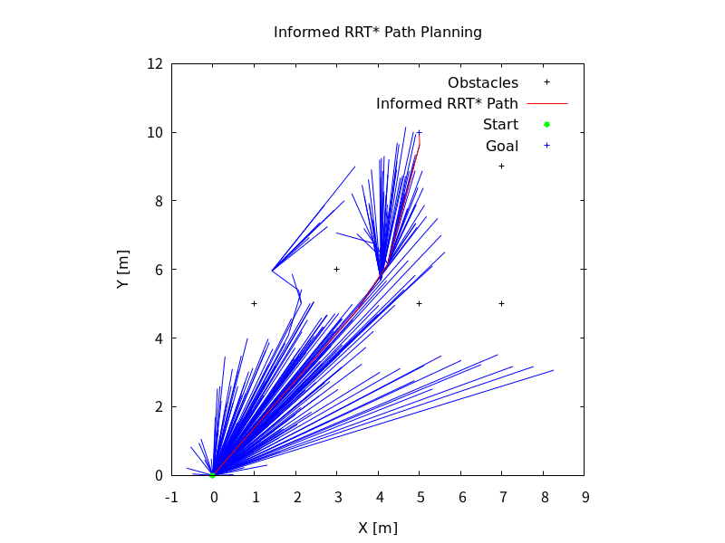

[Source](./crates/rust_robotics_planning/src/informed_rrt_star.rs) · [Details](docs/algorithm_gallery.md#informed-rrt)

#### Model Predictive Trajectory Generator

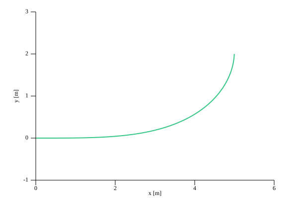

[Source](./crates/rust_robotics_control/src/model_predictive_trajectory_generator.rs) · [Details](docs/algorithm_gallery.md#model-predictive-trajectory-generator)

#### Potential Field Algorithm

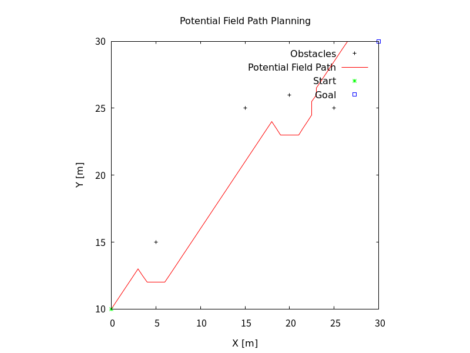

[Source](./crates/rust_robotics_planning/src/potential_field.rs) · [Details](docs/algorithm_gallery.md#potential-field-algorithm)

#### Quintic Polynomials

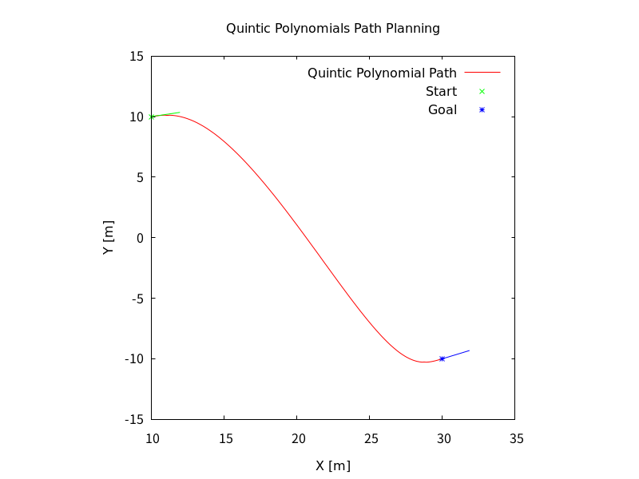

[Source](./crates/rust_robotics_planning/src/quintic_polynomials.rs) · [Details](docs/algorithm_gallery.md#quintic-polynomials)

#### Rapidly-Exploring Random Trees (RRT)


[Source](./crates/rust_robotics_planning/src/rrt.rs) · [Details](docs/algorithm_gallery.md#rapidly-exploring-random-trees-rrt)

#### RRT*

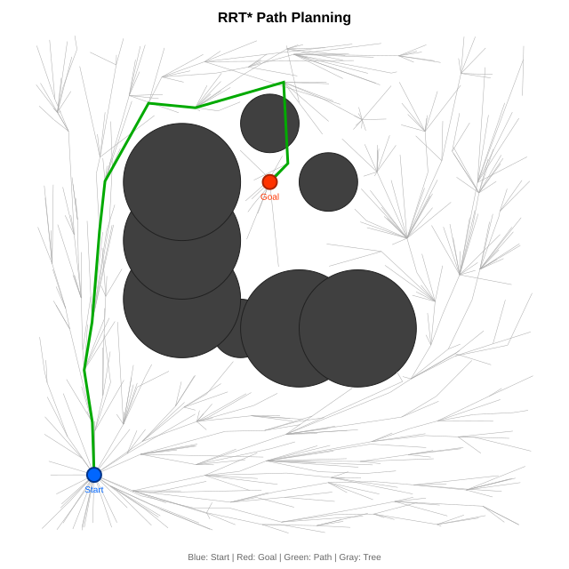

[Source](./crates/rust_robotics_planning/src/rrt_star.rs) · [Details](docs/algorithm_gallery.md#rrt)

#### Hybrid A*

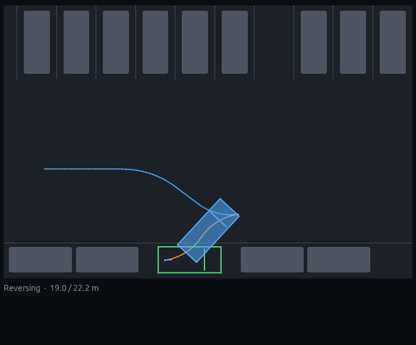

[Source](./crates/rust_robotics_planning/src/hybrid_a_star.rs) · [Details](docs/algorithm_gallery.md#hybrid-a)

#### Reeds-Shepp Path

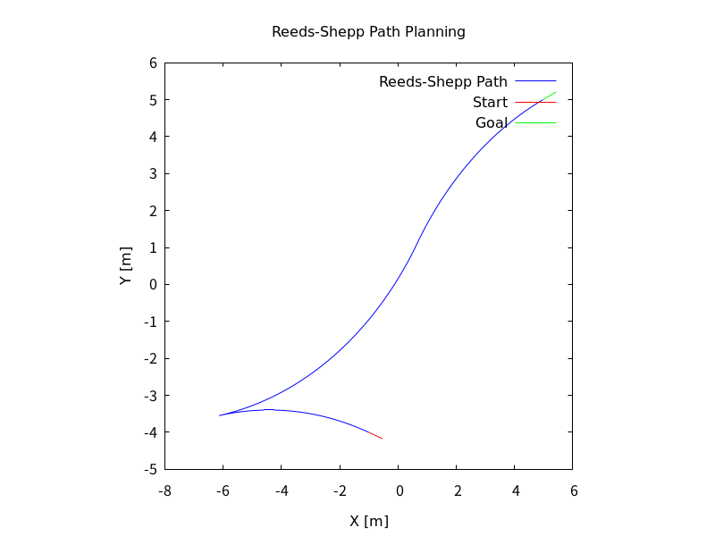

[Source](./crates/rust_robotics_planning/src/reeds_shepp_path.rs) · [Details](docs/algorithm_gallery.md#reeds-shepp-path)

#### PRM (Probabilistic Road-Map)

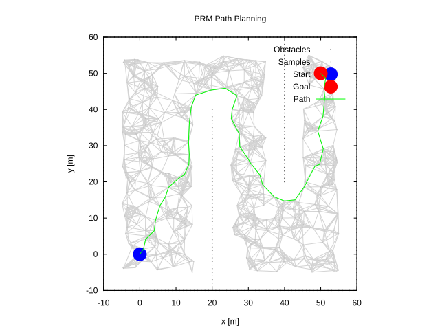

[Source](./crates/rust_robotics_planning/src/prm.rs) · [Details](docs/algorithm_gallery.md#prm-probabilistic-road-map)

#### Voronoi Road-Map

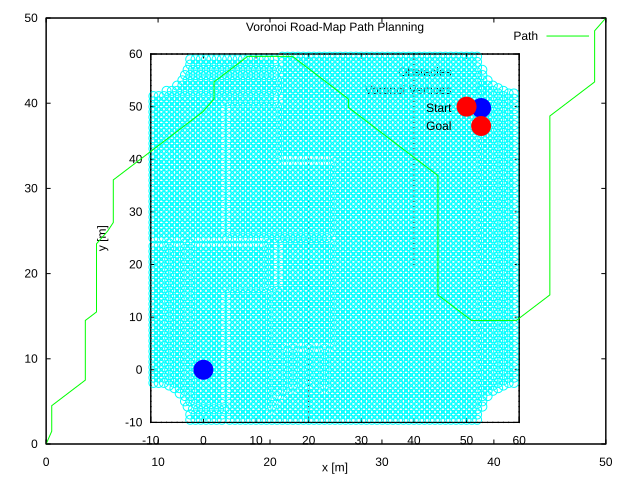

[Source](./crates/rust_robotics_planning/src/voronoi_road_map.rs) · [Details](docs/algorithm_gallery.md#voronoi-road-map)

#### Frenet Optimal Trajectory

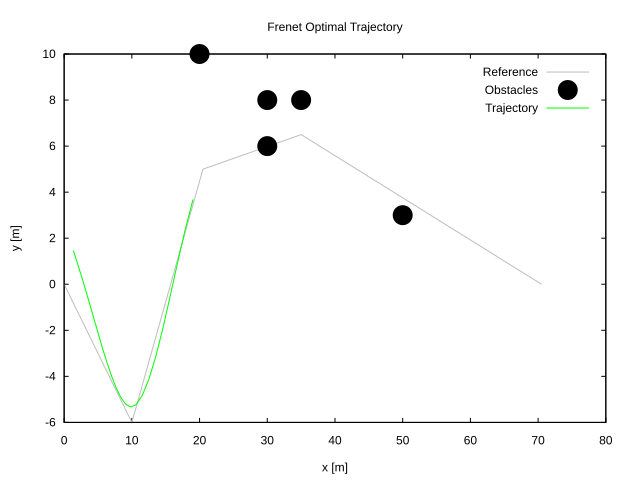

[Source](./crates/rust_robotics_planning/src/frenet_optimal_trajectory.rs) · [Details](docs/algorithm_gallery.md#frenet-optimal-trajectory)

#### State Lattice Planner

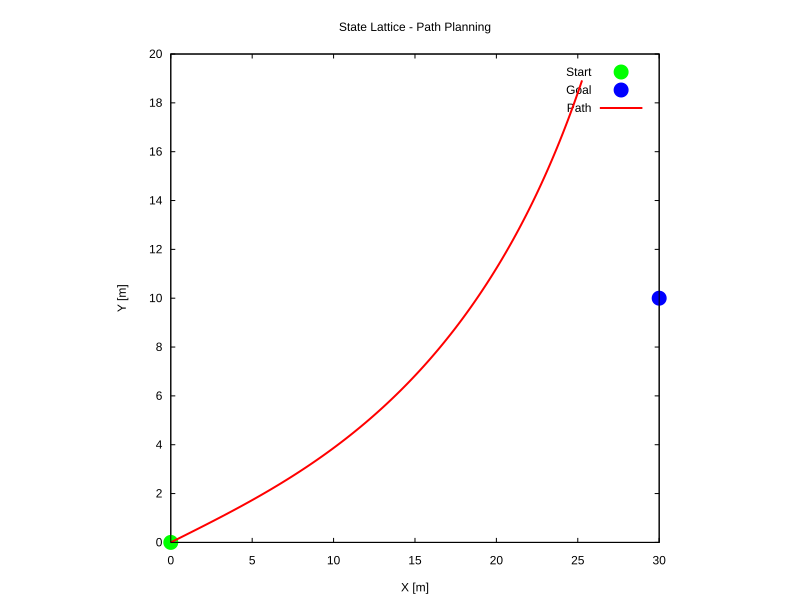

[Source](./crates/rust_robotics_planning/src/state_lattice/) · [Details](docs/algorithm_gallery.md#state-lattice-planner)

### Path Tracking

#### LQR Steer Control

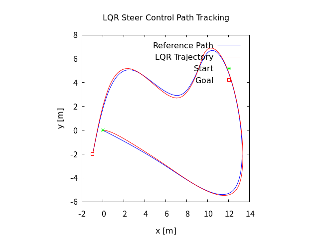

[Source](./crates/rust_robotics_control/src/lqr_steer_control.rs) · [Details](docs/algorithm_gallery.md#lqr-steer-control)

#### Move to Pose

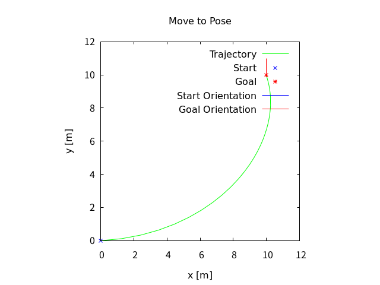

[Source](./crates/rust_robotics_control/src/move_to_pose.rs) · [Details](docs/algorithm_gallery.md#move-to-pose)

#### Pure Pursuit


[Source](./crates/rust_robotics_control/src/pure_pursuit.rs) · [Details](docs/algorithm_gallery.md#pure-pursuit)

#### Stanley Control

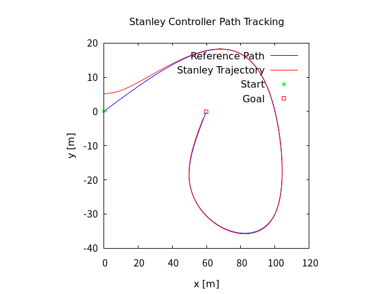

[Source](./crates/rust_robotics_control/src/stanley_controller.rs) · [Details](docs/algorithm_gallery.md#stanley-control)

#### Rear Wheel Feedback Control

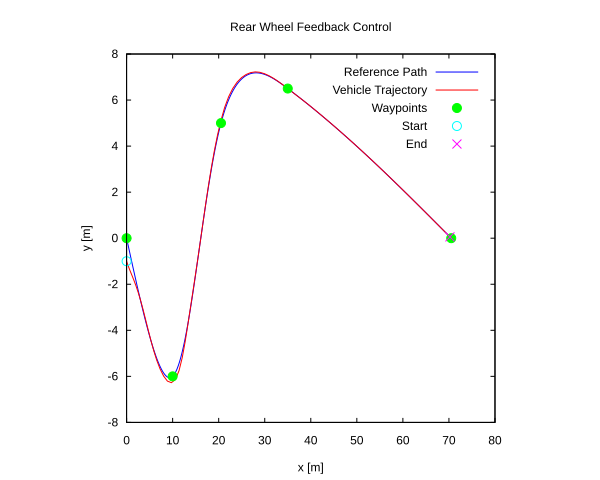

[Source](./crates/rust_robotics_control/src/rear_wheel_feedback.rs) · [Details](docs/algorithm_gallery.md#rear-wheel-feedback-control)

#### MPC (Model Predictive Control)

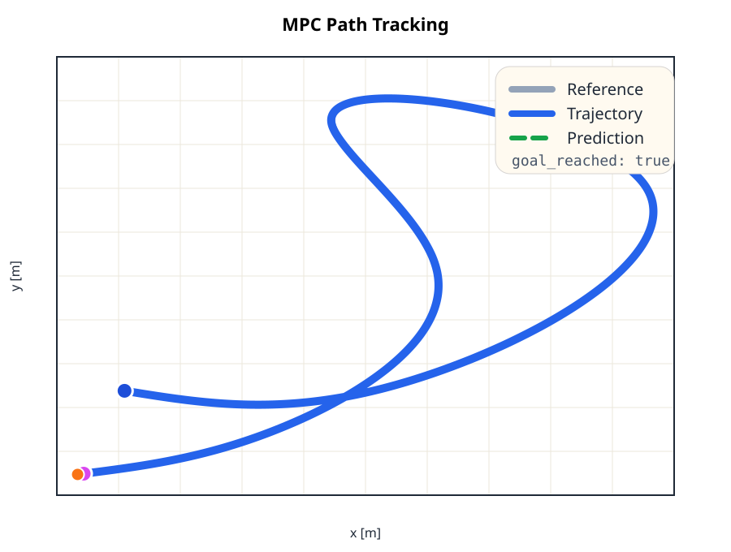

[Source](./crates/rust_robotics_control/src/mpc.rs) · [Details](docs/algorithm_gallery.md#mpc-model-predictive-control)

### Inverted Pendulum

#### LQR Control

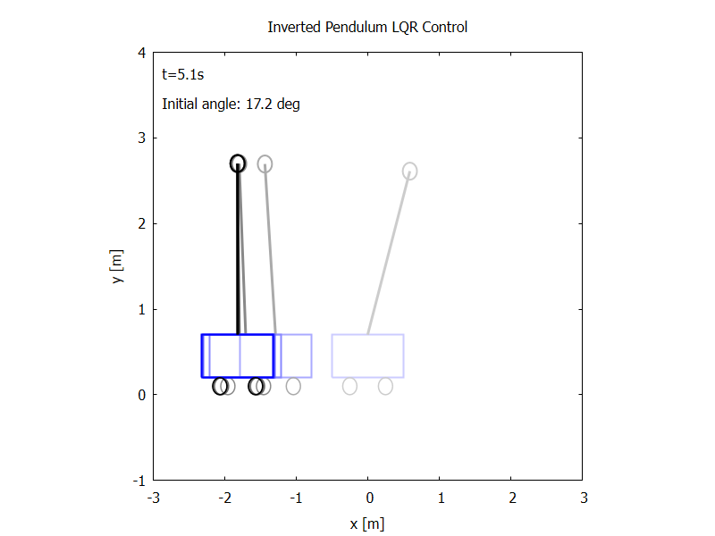

[Source](./crates/rust_robotics_control/src/lqr_control.rs) · [Details](docs/algorithm_gallery.md#lqr-control)

### Arm Navigation

#### Two Joint Arm Control

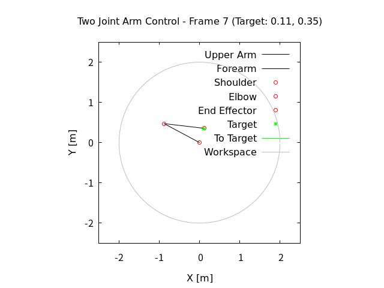

[Source](./crates/rust_robotics_control/src/two_joint_arm_control.rs) · [Details](docs/algorithm_gallery.md#two-joint-arm-control)

### Mission Planning

#### State Machine

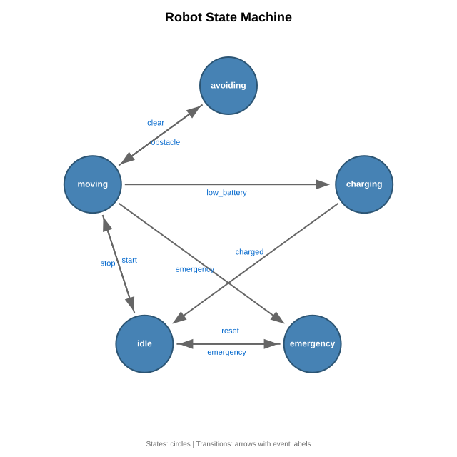

[Source](./crates/rust_robotics_control/src/state_machine.rs) · [Details](docs/algorithm_gallery.md#state-machine)

## Workspace

```
crates/
├── rust_robotics_core/          — Core types, traits, errors, Lie groups
├── rust_robotics_optimization/  — Factor graphs, robust losses, Gauss-Newton/LM
├── rust_robotics_planning/      — Path planning (A*, DWA, RRT, PRM, etc.)
├── rust_robotics_localization/  — Localization (EKF, UKF, PF, Histogram)
├── rust_robotics_control/       — Control & path tracking (Pure Pursuit, LQR, MPC, etc.)
├── rust_robotics_mapping/       — Mapping (NDT, Gaussian Grid, IMLS)
├── rust_robotics_slam/          — SLAM, pose graphs, IMU, BA, geometric ICP
├── rust_robotics_viz/           — Visualization (gnuplot wrapper)
├── rust_robotics_playground/    — Native and browser playground
└── rust_robotics/               — Umbrella crate (feature-gated re-exports)

ros2_nodes/                     — ROS2 navigation nodes (safe_drive-based)
```

## ROS2 Integration

```text
                    TurtleBot3 Gazebo
                 /scan  /odom  /cmd_vel
                    |      |       ^
                    v      |       |
               +-----------+       |
               | slam_node | ----- +
               +-----------+    /map
                      |
                      v
             +-------------------+
             | path_planner_node | ---> /planned_path
             +-------------------+             |
                ^           ^                  v
                |           |           +--------------+
         /ekf_odom     /goal_pose ---> | dwa_planner |
                ^                      +--------------+
                |
      +----------------------+
      | ekf_localizer_node   |
      +----------------------+
                ^
                |
      +-------------------------+
      | waypoint_navigator_node |
      +-------------------------+
```

[Gazebo demo](docs/gazebo_demo.mp4) · [Setup and topics](docs/ros2_integration.md)

## Documentation

- [Algorithm gallery](docs/algorithm_gallery.md) — animations, source, and commands.
- [Rust guide](docs/rust_guide.md) — library APIs, examples, and benchmarks.
- [Playground guide](crates/rust_robotics_playground/README.md) — controls and browser builds.
- [ROS2 / Gazebo](docs/ros2_integration.md) · [dora-rs](docs/dora_integration.md).
- [Datasets and VIO](docs/datasets.md) · [Interfaces](docs/interfaces.md).
- [Pose-observation loss experiment](experiments/pose_observation_loss/README.md).

## Community

[Contributions](CONTRIBUTING.md) and [algorithm requests](.github/ISSUE_TEMPLATE/algorithm_request.yml)
are welcome. See the [security policy](SECURITY.md) and [MIT license](LICENSE).

Inspired by [PythonRobotics](https://github.com/AtsushiSakai/PythonRobotics) and
[MathematicalRobotics](https://github.com/scomup/MathematicalRobotics).
Attributions are in [THIRD_PARTY_NOTICES.md](THIRD_PARTY_NOTICES.md).
