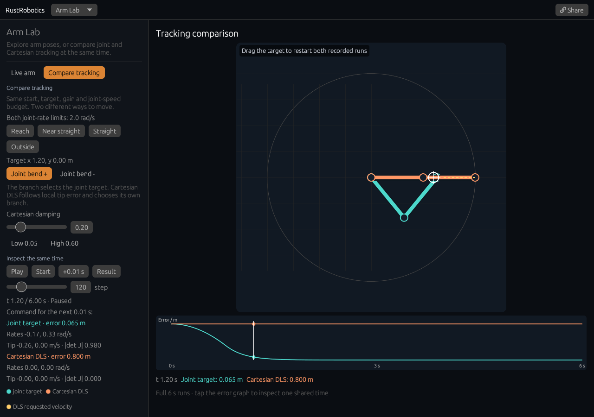

# Compare arm tracking

[Open the comparison](https://rsasaki0109.github.io/rust_robotics/playground/?tab=arm&arm_view=compare&arm_cmp_case=straight&arm_cmp_frame=120).



**Joint target** (cyan) tracks an analytic inverse-kinematics pose. **Cartesian
DLS** (orange) turns tip-position error into joint velocities using a damped
Jacobian inverse. Both start at the same joint angles and use the same goal,
gain, time step, duration, and joint-rate budget.

## Experiments

- **Reach**: play both runs, pause, then tap the error graph. Both arms and
  commands use the selected time. **+0.01 s** shows the next pose produced by
  the displayed joint-rate command. **Result** selects the end of both runs.
- **Straight**: the target at (1.2, 0) is reachable, but a straight arm at
  (2, 0) has no first-order response in the radial direction. The Cartesian
  controller returns zero joint rates and stalls; joint-angle tracking folds
  the arm. Damping makes the matrix invertible but does not create a missing
  motion direction.
- **Near straight**: a small elbow bend and a target with a tangential
  component let the local controller move. Try **Low 0.05** and **High 0.60**.
  Damping changes only the Cartesian run; the cyan run remains identical.
- **Joint bend + / -** selects the analytic goal pose for joint tracking.
  The local Cartesian controller chooses its own branch and its run remains
  identical when this setting changes.
- **Outside**: both controllers reject the unreachable target and hold their
  initial angles. Both complete error curves remain flat.

Drag the target to restart both runs from the same original pose. To choose a
different start, select **Live arm**, set the joints or target, then select
**Compare tracking**. This captures the live pose as the common initial state.
Returning to Live arm preserves that live experiment.

Share stores the comparison's initial angles, target, damping, analytic branch,
and selected step. Opening the link reconstructs both complete runs and pauses
at the same step. The Live arm share link describes its current live pose.

## Equations and limits

Each link is 1 m, with unrestricted revolute joints. With joint angles `q`,
Jacobian `J`, and tip error `e`, the raw commands are:

```text
Joint target:  qdot = 4 * wrap(q_goal - q)
Cartesian DLS: qdot = J^T * inverse(J J^T + damping^2 I) * (4 e)
```

Both joint-rate vectors are scaled to a Euclidean norm of at most **2 rad/s**.
Euler integration uses **0.01 s** steps for **6 s** (601 recorded poses).
The last pose has zero commands because the run has ended. The displayed
command at any earlier pose is the one applied to the next integration step.

Tip velocity is the instantaneous `J qdot` at the current pose. The solid
arrows display that velocity with a 0.2 s length scale; the dashed gold arrow
shows the Cartesian controller's requested velocity before damping and speed
limiting. These arrows are linearized velocities, while trails are the actual
recorded tip positions. The graph displays both complete runs and a shared
time cursor. The controller gains are 4 per second in their respective error
spaces. Outcomes depend on geometry, analytic branch, and damping.

These are deterministic kinematic experiments, without inertia, obstacles,
actuator dynamics, or joint limits. Playback follows elapsed time and discards
background gaps of at least one second.

Implementation: [library Jacobian and DLS](../crates/rust_robotics_control/src/two_joint_arm_control.rs),
[recorded comparison](../crates/rust_robotics_playground/src/arm/tracking/mod.rs),
and [real-input browser checks](../scripts/web_smoke/arm_tracking.mjs).

```sh
cargo test --locked -p rust_robotics_control two_joint_arm_control::tests:: --lib
cargo test --locked -p rust_robotics_playground arm:: --bin rust_robotics_playground
```
