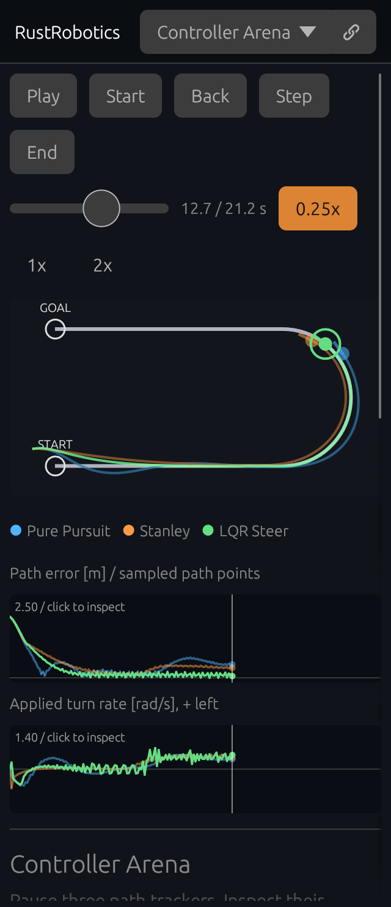

# Inspect three controllers at the same moment

[Open the paused comparison](https://rsasaki0109.github.io/rust_robotics/playground/?tab=arena&preset=hairpin&arena_frame=100&arena_playing=0&arena_focus=stanley).

Choose **Hairpin**, pause the replay, and select **Stanley**, **Pure Pursuit**, or
**LQR Steer**. The selected robot and graph lines brighten. Its connector marks
the distance to the nearest sampled path point. The three cards report each
controller's error, speed, and applied turn rate at that same simulation time.

Tap or drag either graph, or move the timeline, to inspect another moment.
**Back** and **Step** move exactly 0.1 simulated seconds. **Start** and **End**
show the first and last frames. Replay rates of 0.25×, 1×, and 2× change viewing
speed without changing simulation results. Rendering advances using elapsed
time, so a slow paint can advance multiple simulation ticks. Gaps of one second
or more are discarded when returning from the background.

Select **Weaker** to halve the shared turn response, or **Ideal** for full
response. Both rerun all three controllers from the same initial state. Draw
your own course and repeat the comparison. Drawing pauses playback; releasing
a valid stroke starts the new traces. Courses must be between 8 and 500 metres.
Share preserves the encoded course, speed, response, exact frame, pause state,
replay rate, and selected controller. A paused share opens the identical sample
and metrics in a fresh browser, without local storage.

## What the numbers mean

All controllers use the same reference path, initial pose, 0.1-second clock,
first-order speed response, turn response, and ±1.4 rad/s turn limit. The plots
show actual engine samples. Applied turn rate is the angular velocity **after**
the shared response and limit, rather than a steering-wheel angle or an
unapplied controller request. Positive turns left. The initial sample has a
zero command because no step has yet been applied.

Path error is the unsigned distance to the **nearest sampled path point**,
rather than distance to a continuous segment. Graphs and selected-trace metrics
include only samples at or before the chosen time:

- **RMSE:** root mean square of the sampled path errors, including the initial sample.
- **Max:** largest path error observed so far.
- **Goal now:** distance from this sample to the course's final point.
- **Turn change:** RMS of consecutive applied turn-rate differences, in rad/s.
  This measures command changes per simulation step, rather than angular acceleration.

A shorter trace stays at its final sample while the longer traces continue.
Its card says **Trace ended at …** and **Last turn …**. Ending can mean reaching
the goal tolerance, crossing the end line nearby, or exhausting the step limit;
the label does not claim every controller reached the goal. At **End**, the
prefix metrics match the headless engine's complete-run metrics. These paths
and model settings illustrate differences rather than a universal ranking.

## Verification

The playground's twelve arena tests cover deterministic course reconstruction,
paused-moment sharing, prefix metrics, unequal trace lengths, 2.5–100 Hz paint
rates, replay speeds, pause and background gaps, and bounded courses and query
parameters. Chromium tests use actual mouse and touch controls on desktop and
a 320-pixel, 2× display phone, with rotation and fresh visitor contexts under
the real `/rust_robotics/playground/` prefix.

The tests recompute every reported metric from the visible prefix and check
the applied command against the next pose, then exercise both graphs, stepping,
playback, response changes, course drawing, reset, and exact-moment sharing.
They wait for the actual egui input response rather than assuming a fixed
post-click delay. The [desktop receipt](assets/controller-inspector.json) and
[phone receipt](assets/controller-inspector-phone.json) record these real samples
and input acknowledgements. Run the complete 46-case suite with the
[browser verification command](drone_race_project.md).
