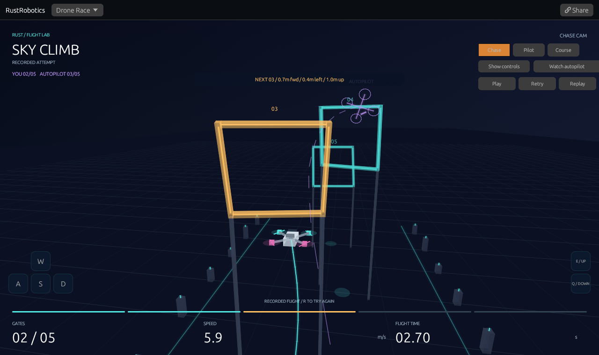

# 3D Drone Race

[Race the autopilot](https://rsasaki0109.github.io/rust_robotics/playground/?tab=drone&mode=manual&course=climb&cinema=1),
[watch 30 seconds of browser gameplay](assets/drone-manual.mp4),
or [watch autonomous flight](https://rsasaki0109.github.io/rust_robotics/playground/?tab=drone&cinema=1).
The [capture receipt](assets/drone-manual-flight.json) includes the recorded
inputs in `firstFlight.droneShare`; append that query to the playground URL
to replay the captured attempt.

Fly a quadrotor through five gates alongside a real autonomous ghost, then
replay and share the attempt. Both pilots use the existing Rust flight model
inside the WASM playground. Autopilot mode retains the original watch-and-replay
experience, three cameras, flown trail, and predicted horizon.



## Use it

- Neon Slalom alternates turns and altitude. Sky Climb adds a taller ascent.
- Choose **You vs autopilot** to fly. W/S move forward/back, A/D left/right,
  and E/Q climb/descend. Arrow keys also steer. Hold the screen buttons with
  one or more fingers on a phone. The clock waits for the first flight input
  or Play. Releasing requests zero velocity: the assist brakes and stabilizes
  the aircraft, with some stopping distance.
- Controls follow the course axes in every camera: forward is +x, right is -y,
  up is +z. There is no manual yaw. The next-gate cue gives distance in those
  directions. If you miss a gate, return with S and cross its opening forward.
- The purple wireframe is the autonomous pilot at your simulation time. The
  HUD compares gate counts; the result compares finish times only when both
  flights finish. The ghost does not collide with your drone.
- Chase follows the quadrotor; Pilot uses its position and quaternion attitude;
  Course keeps a fixed view over all five gates.
- Cinema view hides the side panel. Its camera buttons work with a mouse or
  touch; Show controls brings the panel back.
- Pause freezes a recorded physical state. In Autopilot mode, Step advances
  one 0.05-second update and the timeline can build future flight history.
  In manual mode, the timeline reviews only the available recording.
- Replay uses the same cached states and stops when the recorded inputs end.
  **New attempt** (or Retry in the scene) clears your recording and waits for
  a new start. Slow motion changes playback timing;
  it does not change the physics step, controller, or random seed.
- Share stores the course, frame, playback state, camera, line visibility,
  slow-motion setting, and cinema setting. Manual links also contain the
  recorded inputs and ghost visibility. A received manual flight is a replay;
  New attempt hands control back to you. A receiving browser reconstructs
  the required prefix incrementally rather than blocking on a whole race.
- Space starts/pauses/resumes, R starts a fresh manual attempt (or replays
  Autopilot), 1/2/3 select cameras, and Escape leaves cinema view. Losing browser
  focus pauses manual flight and clears held touch commands.

## Flight and rendering

`crates/rust_robotics_playground/src/drone_race/flight.rs` owns the deterministic
history. Autonomous flight calls the existing `QuadrotorMppiController` and `QuadrotorParams`
on a fixed 0.05-second clock with seed 7, 900 sampled command sequences, and
a 28-step horizon. No flight samples are fabricated for the animation.

`manual.rs` converts a three-axis held input into target velocity, bounded
acceleration, desired tilt, and a quaternion attitude error. It applies only
collective thrust and body rates through `QuadrotorParams::step`; it never sets
position or velocity directly. Forward/right/climb request 5/3/2.5 m/s
respectively, with the same thrust, body-rate and total-speed limits as MPPI.
The assist is a velocity controller, not a position lock or a gate-following
autopilot. The screen pad tracks touch IDs independently so forward and climb
can be held at once.

Manual links use `mode=manual&inputs=v1.<commands>`. Each lowercase base36
character stores three ternary axes for one physical update. A recording has
at most 600 commands (603 characters including its version), and unknown
versions, invalid symbols, and oversized recordings are rejected visibly.
Only recorded commands are applied during replay. An autonomous ghost is
generated incrementally alongside the manual history and rendered at the
same simulation tick, clamped at its finish. After a shorter attempt ends,
the opponent can finish computing in bounded batches to supply its result;
its visible position still uses the attempt's clock. New attempts reuse the
deterministic opponent cache without changing its flight.

Acceleration follows the quadrotor's thrust axis, with gravity, drag, thrust
and body-rate limits, and a speed cap. Quaternion integration determines the
visible tilt. Each gate is a rectangular aperture in an oriented 3D plane;
passes use the existing ordered segment/aperture crossing predicate. Gate
progress is based on the body's position, with the library's 0.04 m crossing
tolerance. Rotor/frame contact geometry, aerodynamic propeller interactions,
wind and a detailed motor powertrain are outside this model.

Every stored frame includes the physical state, gate count and terminal status.
Autonomous frames also store the controller's predicted positions. The prediction rolls the shifted
warm-start command sequence out from the state after the applied command;
reading it does not consume random samples or change future controls.
The displayed prediction does not promise that subsequent replanning follows
exactly that path.

The two built-in courses finish in native tests at 6.30 s / 126 updates and
4.05 s / 81 updates respectively. Terminal histories stop growing. Ground
contact and the 30-second simulation limit are separate outcomes. The HUD
shows simulation time; slow playback and a slower browser can take longer in
wall-clock time. Numerical results are deterministic for a given build and
target; cross-platform floating-point bit identity is not promised.

`renderer.rs` projects the actual 3D geometry into the existing egui painter:
near-plane clipping, depth-sorted surfaces, illuminated gates and pylons,
quaternion-rotated body/rotors, trajectory and predicted-horizon lines. It adds
no rendering dependency. A purple wireframe and dashed trail identify the
opponent using its actual position and attitude. Chase hides gates already passed by the drone so
they cannot sweep across its trailing camera; Course retains the whole track.
Display interpolation does not alter the stored physical states.

The frontend limits each replay-generation batch to at most two controller
calls and yields between batches. It bounds stored flight length and discards
large background-tab time gaps instead of running a long catch-up loop. A
single controller call still runs on the browser thread; low-power-device
frame rates should be measured before increasing the sampling load.

## Run and verify

```sh
cargo test --locked -p rust_robotics_playground drone_race
cargo test --locked -p rust_robotics_control --lib racing_mppi_quadrotor
cargo clippy --locked -p rust_robotics_playground --all-targets -- -D warnings
rustup target add wasm32-unknown-unknown
cd crates/rust_robotics_playground
RUSTFLAGS='--cfg getrandom_backend="wasm_js"' trunk build index.html --release --locked
```

The flight tests require both autonomous courses and a manual command sequence
to finish by actual gate crossings. They cover hover, braking, thrust/rate/speed
limits, ground contact and timeout, exact command-recording replay, simultaneous
touch/release/focus loss, independent deterministic histories, normalized
attitude interpolation, shared paused frames, bounded incremental seeking,
background-tab time gaps, and invalid links. Renderer tests cover perspective
orientation and faces crossing the near plane. The library test checks that
requesting a prediction leaves the next random plan unchanged.

The existing `scripts/web_smoke/web_smoke.mjs` also exercises the race in
Chromium: autonomous and keyboard-driven five-gate completion, a synchronized
opponent, cached replay, camera switching, pause, shared manual inputs and poses,
two-finger forward/climb and independent release, touch pause/retry, and phone
layout, alongside every previous demo. The keyboard driver in
`scripts/web_smoke/drone_manual.mjs` sends ordinary held keys using the next
gate as a test target; it does not write simulation states.
It fails on page errors and Rust panics.

## Capture the actual browser

Install the dependencies in `scripts/web_smoke/package.json` and Playwright's
Chromium, or set `CHROMIUM_PATH` to an installed Chromium. From that directory:

```sh
node capture_thumbs.mjs ../../crates/rust_robotics_playground/dist ../../docs/assets/playground drone
node capture_drone_race.mjs ../../crates/rust_robotics_playground/dist /tmp/drone-recording
cp /tmp/drone-recording/flight.mp4 ../../docs/assets/drone-race.mp4
node capture_drone_race.mjs ../../crates/rust_robotics_playground/dist /tmp/drone-manual manual
cp /tmp/drone-manual/flight.mp4 ../../docs/assets/drone-manual.mp4
cp /tmp/drone-manual/manual-flight.png ../../docs/assets/playground/drone-manual.png
cp /tmp/drone-manual/capture.json ../../docs/assets/drone-manual-flight.json
```

The recording switches cameras during real playback and checks that the first
flight passes all five gates. Manual capture uses the keyboard driver above,
records its ordinary inputs, then replays the attempt. The thumbnail reconstructs
frame 54 from that recording; the receipt includes its complete share query.
FFmpeg with libx264 is required (or set
`FFMPEG_PATH`); timestamped browser screencast frames are encoded to MP4,
repeating the preceding image across idle frames. The MP4, camera screenshots and
capture receipt remain in the selected output directory. The PNG thumbnail
waits for its requested shared frame to finish reconstructing.

Gate editing can build on the same engine. Both modes currently use two fixed
courses so the full browser experience and reproduction can be verified together.
