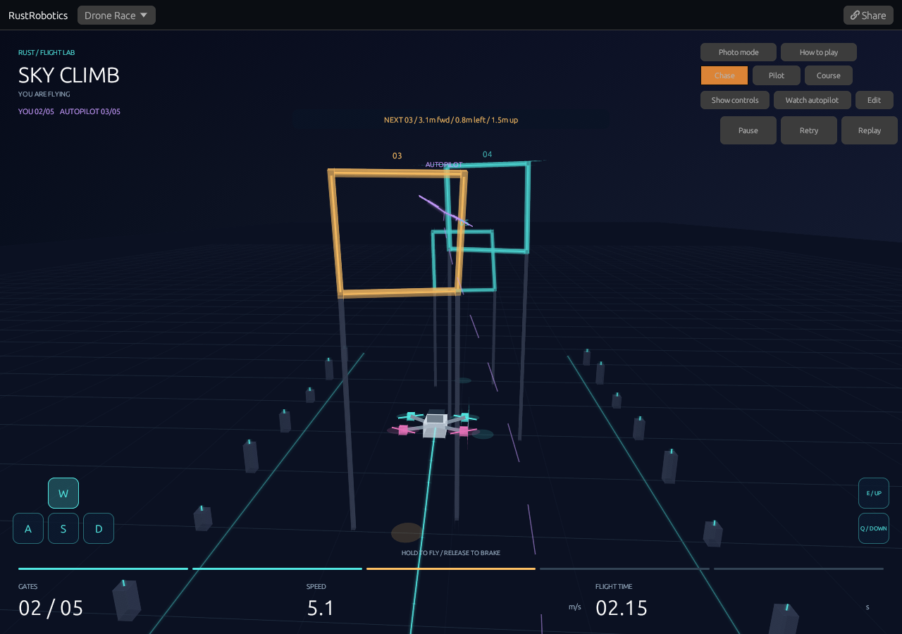
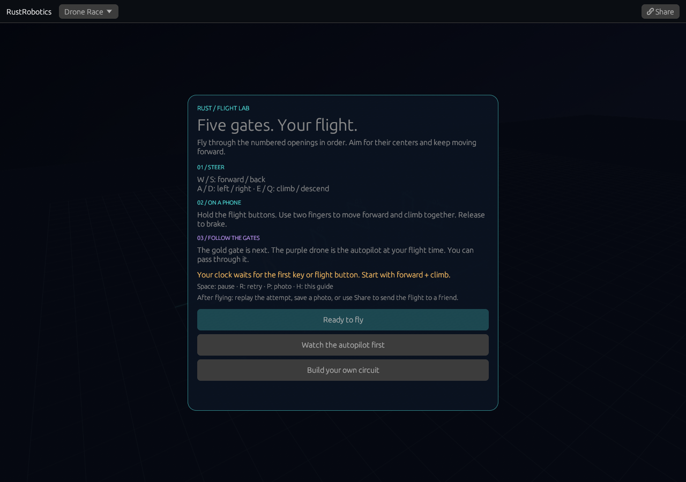
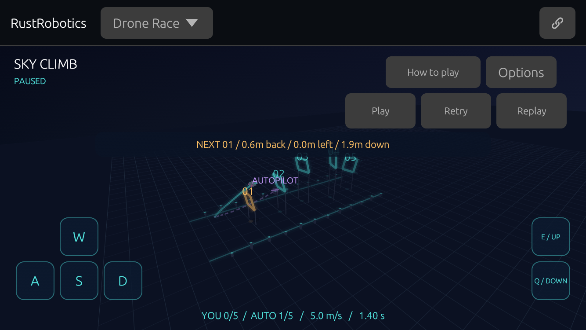
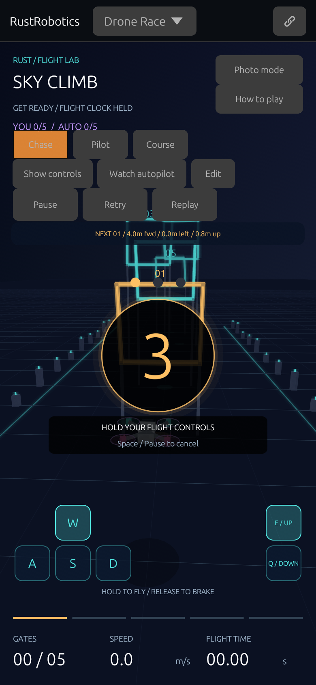
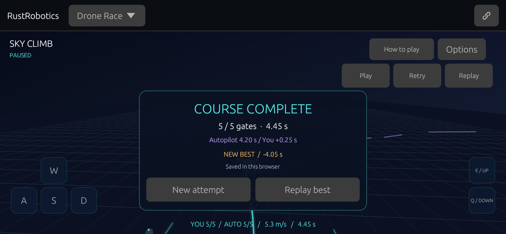
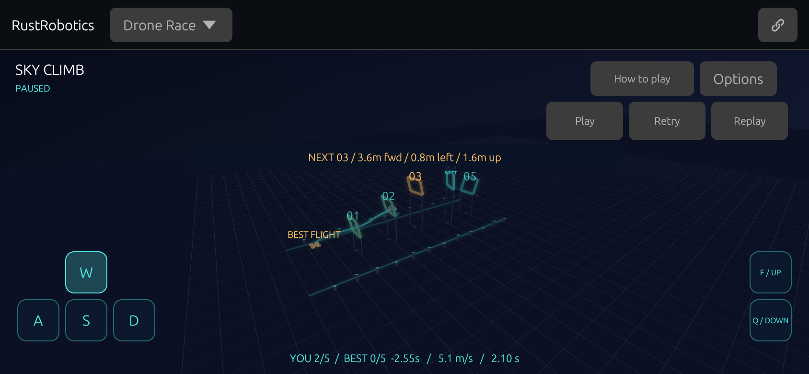
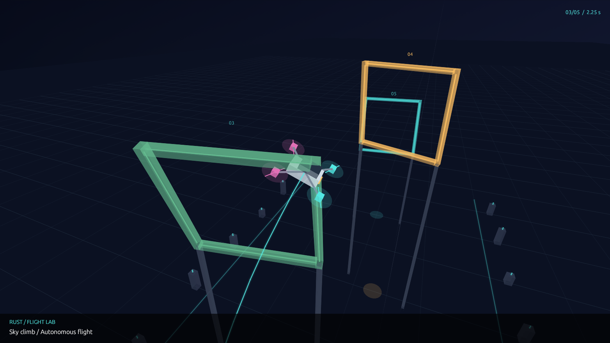
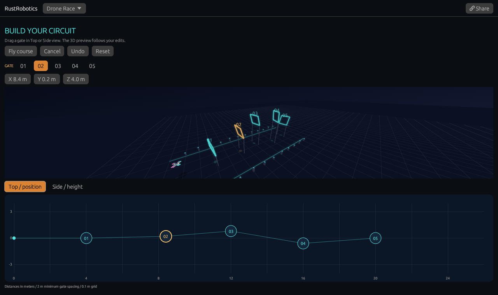

# 3D Drone Race

[Play Flight Lab v1](https://rsasaki0109.github.io/rust_robotics/playground/?tab=drone&mode=manual&course=climb&cinema=1&intro=1),
[watch 30 seconds of browser gameplay](assets/drone-manual.mp4),
or [watch autonomous flight](https://rsasaki0109.github.io/rust_robotics/playground/?tab=drone&cinema=1).
The [capture receipt](assets/drone-manual-flight.json) includes the recorded
inputs in `firstFlight.droneShare`; append that query to the playground URL
to replay the captured attempt.

Fly a quadrotor through five gates alongside a real autonomous ghost, then
replay and share the attempt. Both pilots use the existing Rust flight model
inside the WASM playground. Autopilot mode retains the original watch-and-replay
experience, three cameras, flown trail, and predicted horizon.



## Start playing on GitHub Pages

Open [RustRobotics](https://rsasaki0109.github.io/rust_robotics/) and choose
**Play drone race**. Everything runs in the browser; installation and an
account are not needed. The opening guide offers **Ready to fly**, **Watch
the autopilot first**, and **Build your own circuit**.

Choose Ready to fly, then hold **W + E** to move forward and climb, or hold
the forward and UP buttons with two fingers. A **3-2-1-GO** countdown holds
both aircraft still; keep holding your controls through GO to launch. Aim for
the gold gate's opening; numbered gates must be crossed
forward in order. The purple opponent uses the same simulation clock.



**How to play** or **H** opens the guide during a flight and pauses it. Back
to flight keeps the attempt and recording at the same position, paused; Space
or Play resumes. The guide scrolls on short screens, with its three action
buttons kept outside the scrolling text. New play links add `intro=1`; that
flag is omitted from shared flights, and does not intercept recordings,
photos, edited courses, or invalid-link recovery.

On a phone, rotate the screen whenever you like. Short viewports use a compact
HUD, separate playback and flight buttons, and an **Options** menu for cameras,
Photo mode, course editing, switching pilots, and the full controls. All six
flight buttons have 44-point targets. The header keeps Share visible in both
orientations. Release to brake and use Play/Pause while choosing your next move.



Flight Lab v1 includes the complete play flow: enter from the showcase,
read the guide, fly five gates, retry or replay, build a custom course, save
a photo, and share a reproducible attempt. The [v1 flight receipt](assets/drone-v1-flight.json)
contains a real keyboard-driven five-gate finish and the receiving browser's
reconstructed state. Use its `query` to replay that attempt.

## Ready, set, GO



Hold a flight control, or choose **Play**, to light up **3-2-1-GO**. Keep your
keys or fingers held through GO to carry the same command into the first flight
update. During the countdown, both aircraft stay at the start, the flight clock
stays at zero, and no commands are added to the recording. Slow motion changes
flight playback speed; it does not slow the countdown.

**Space / Pause**, **Retry**, opening the guide, photo mode, or the landscape
Options menu cancels the countdown. Returning from another tab leaves the race
paused, ready for a fresh countdown. Sharing during the countdown opens a paused
start for the visitor. Recorded-flight replay starts directly from its existing
history and does not add a countdown to the flight time.

The [start receipt](assets/drone-start-flight.json) observes all three lights and
GO at frame zero, a real two-finger launch, and the identical shared replay.

## Beat your personal best




A live manual finish saves your fastest time and recorded inputs for that exact
five-gate layout. The result card celebrates a new personal best and shows the
improvement when you beat it. **New attempt** keeps the record; **Replay best**
watches its actual flight. After reopening the play link, the ready screen shows
your best and its Replay button becomes **Replay best**. The full controls also
provide the saved record and replay action.

Records stay in this browser, without an account or server. At most 12 course
layouts are kept, with built-in and edited layouts distinguished by all gate
coordinates. If browser storage is unavailable or a write fails, the record
stays available for the current session and is labelled accordingly. Clearing
site data removes saved records. Another browser starts with its own records.

Only a faster, completed live manual attempt updates the best. Watching the
autopilot, opening a shared recording, seeking, replaying your best, a partial
flight, ground contact, and a timeout do not earn a personal best. Times use the
fixed simulation clock; slow playback does not change them. Saved inputs are
checked by replaying manual physics on load; malformed, incomplete, or
incompatible records are ignored. The [personal-best flight receipt](assets/drone-best-flight.json)
contains both actual finishes and the separate visitor's replay state.

### Race your best as a ghost



After your first finish, **New attempt** races a gold ghost of your best flight
for that exact layout. It replays the saved commands through the same physics.
Both aircraft use your simulation clock; pausing, replaying, and taking a photo
keep the comparison aligned. Without a saved best, the purple autopilot is your
rival. **Race autopilot** / **Race your best** starts a new attempt against the
other rival; on a landscape phone, find it in **Options**.

The signed time beside the gate counts compares your latest completed gate
with the best flight's crossing of that same gate. A negative split means you
crossed sooner. It is a checkpoint split, rather than a projected finish time.
The rival stays fixed for the whole attempt, even if you beat the record; your
next attempt picks up the new best.

**Share** includes the rival's versioned inputs as well as your attempt, so a
visitor without local records sees the same two flights, gate counts, and split.
Opening the link does not add a personal best to their browser. **Retry** returns
to their own saved best, or to the autopilot if they have none. Invalid or
incomplete ghost recordings stop before playback and can be cleared with Retry.
The [ghost-flight receipt](assets/drone-ghost-flight.json) records a real earned
best, the faster attempt, and the new visitor's matching replay state.

## Use it

- Neon Slalom alternates turns and altitude. Sky Climb adds a taller ascent.
- Choose **You fly** to fly. W/S move forward/back, A/D left/right,
  and E/Q climb/descend. Arrow keys also steer. Hold the screen buttons with
  one or more fingers on a phone. The first flight input or Play starts a
  3-2-1 countdown; the flight clock and recorded inputs begin at GO.
  Releasing requests zero velocity: the assist brakes and stabilizes
  the aircraft, with some stopping distance.
- Controls follow the course axes in every camera: forward is +x, right is -y,
  up is +z. There is no manual yaw. The next-gate cue gives distance in those
  directions. If you miss a gate, return with S and cross its opening forward.
- The purple wireframe is the autonomous pilot at your simulation time. The
  HUD compares gate counts; the result compares finish times only when both
  flights finish. The ghost does not collide with your drone.
- Chase follows the quadrotor; Pilot uses its position and quaternion attitude;
  Course keeps a fixed view over all five gates.
- Cinema view hides the side panel. Its camera buttons work with a mouse or
  touch; Show controls brings the panel back.
- Pause freezes a recorded physical state. In Autopilot mode, Step advances
  one 0.05-second update and the timeline can build future flight history.
  In manual mode, the timeline reviews only the available recording.
- Replay uses the same cached states and stops when the recorded inputs end.
  **New attempt** (or Retry in the scene) clears your recording and waits for
  a new start. Slow motion changes playback timing;
  it does not change the physics step, controller, or random seed.
- Share stores the course, frame, playback state, camera, line visibility,
  slow-motion setting, and cinema setting. Manual links also contain the
  recorded inputs and ghost visibility. A received manual flight is a replay;
  New attempt hands control back to you. A receiving browser reconstructs
  the required prefix incrementally rather than blocking on a whole race.
- Space starts/pauses/resumes, R starts a fresh manual attempt (or replays
  Autopilot), 1/2/3 select cameras, P opens Photo mode, and Escape leaves cinema view. Losing browser
  focus pauses manual flight and clears held touch commands.

## Flight and rendering

`crates/rust_robotics_playground/src/drone_race/flight.rs` owns the deterministic
history. Autonomous flight calls the existing `QuadrotorMppiController` and `QuadrotorParams`
on a fixed 0.05-second clock with seed 7, 900 sampled command sequences, and
a 28-step horizon. No flight samples are fabricated for the animation.

`manual.rs` converts a three-axis held input into target velocity, bounded
acceleration, desired tilt, and a quaternion attitude error. It applies only
collective thrust and body rates through `QuadrotorParams::step`; it never sets
position or velocity directly. Forward/right/climb request 5/3/2.5 m/s
respectively, with the same thrust, body-rate and total-speed limits as MPPI.
The assist is a velocity controller, not a position lock or a gate-following
autopilot. The screen pad tracks touch IDs independently so forward and climb
can be held at once.

Manual links use `mode=manual&inputs=v1.<commands>`. Each lowercase base36
character stores three ternary axes for one physical update. A recording has
at most 600 commands (603 characters including its version), and unknown
versions, invalid symbols, and oversized recordings are rejected visibly.
Only recorded commands are applied during replay. An autonomous ghost is
generated incrementally alongside the manual history and rendered at the
same simulation tick, clamped at its finish. After a shorter attempt ends,
the opponent can finish computing in bounded batches to supply its result;
its visible position still uses the attempt's clock. New attempts reuse the
deterministic opponent cache without changing its flight.

Acceleration follows the quadrotor's thrust axis, with gravity, drag, thrust
and body-rate limits, and a speed cap. Quaternion integration determines the
visible tilt. Each gate is a rectangular aperture in an oriented 3D plane;
passes use the existing ordered segment/aperture crossing predicate. Gate
progress is based on the body's position, with the library's 0.04 m crossing
tolerance. Rotor/frame contact geometry, aerodynamic propeller interactions,
wind and a detailed motor powertrain are outside this model.

Every stored frame includes the physical state, gate count and terminal status.
Autonomous frames also store the controller's predicted positions. The prediction rolls the shifted
warm-start command sequence out from the state after the applied command;
reading it does not consume random samples or change future controls.
The displayed prediction does not promise that subsequent replanning follows
exactly that path.

The two built-in courses finish in native tests at 6.30 s / 126 updates and
4.05 s / 81 updates respectively. Terminal histories stop growing. Ground
contact and the 30-second simulation limit are separate outcomes. The HUD
shows simulation time; slow playback and a slower browser can take longer in
wall-clock time. Numerical results are deterministic for a given build and
target; cross-platform floating-point bit identity is not promised.

`renderer.rs` projects the actual 3D geometry into the existing egui painter:
near-plane clipping, depth-sorted surfaces, illuminated gates and pylons,
quaternion-rotated body/rotors, trajectory and predicted-horizon lines. It adds
no rendering dependency. A purple wireframe and dashed trail identify the
opponent using its actual position and attitude. Chase hides gates already passed by the drone so
they cannot sweep across its trailing camera; Course retains the whole track.
Display interpolation does not alter the stored physical states.

The frontend limits each replay-generation batch to at most two controller
calls and yields between batches. It bounds stored flight length and discards
large background-tab time gaps instead of running a long catch-up loop. A
single controller call still runs on the browser thread; low-power-device
frame rates should be measured before increasing the sampling load.

## Photograph a flight

[Open Photo mode](https://rsasaki0109.github.io/rust_robotics/playground/?tab=drone&course=climb&frame=45&photo=1&distance=3.2)
at a real paused flight state. Press **P**, or choose **Photo mode** in the
controls or cinema view, during any autonomous or manual flight, including
custom courses and completed attempts.



- Drag the photograph to orbit around the quadrotor. Scroll, or use **+ / −**
  on a phone, to zoom. **Hero**, **Side**, and **Above** restore camera presets.
- Choose **16:9**, **1:1**, or **4:5**. The composition adapts to the available
  screen space. Trail, the manual opponent, and the caption can be hidden.
- **Moment** selects an actual state from the history already generated.
  It neither plans future flight nor changes the attempt's playback position.
  Resume flight first if you need more history.
- **Save PNG** downloads the photograph without the interface, playback HUD,
  touch controls, or result dialog. The image uses the displayed composition's
  physical pixels at the device's pixel ratio; it is not upscaled to a fixed
  advertised resolution. A larger browser window produces a larger photograph.
- **Share** retains the chosen moment, orbit, zoom, format, caption, course,
  and trail/ghost visibility. Manual photos retain the recorded inputs too.
  The receiver reconstructs the required physical prefix in bounded batches,
  then opens the paused photograph. Photo links do not start playing.
- **Back to flight** or Escape returns to the original playback position,
  paused. Your recording and opponent history stay intact. Space resumes.
  Flight keys do not move the aircraft while taking a photograph.

PNG download is available in the browser build; the native playground keeps
the camera and history viewer with its Save button disabled. All images come
from eframe's screenshot event after rendering, cropped to the composition
using that frame's pixel ratio. The browser encodes those RGBA pixels as PNG.
No simulation states are inserted to make the shot. If the screenshot dimensions
do not contain the requested crop, saving asks the user to try again.

The [capture receipt](assets/drone-photo-capture.json) records each photograph's
query, actual physical pose, dimensions, and byte count. It can be reproduced
with the same built WASM and the checked-in capture script:

```sh
cd scripts/web_smoke
npm install
npx playwright install chromium
node capture_drone_photo.mjs ../../crates/rust_robotics_playground/dist /tmp/drone-photos
```

The script uses ordinary camera gestures and Save PNG clicks. It writes
`wide.png`, `square.png`, `portrait.png`, a screenshot of Photo mode, and
`capture.json`. `CHROMIUM_PATH` can select an existing Chromium installation.

## Build and share a course

[Open the editor](https://rsasaki0109.github.io/rust_robotics/playground/?tab=drone&course=climb&edit=1)
or [watch editing turn into a flight](assets/drone-editor.mp4).



Choose Edit course in the panel, or Edit in cinema view. Top view drags X/Y;
Side view drags X/Z. The X/Y/Z values also accept precise edits. The selected
gate is highlighted in both the map and 3D preview. The preview fits the
actual gate corners and supports into its viewport; editing never runs MPPI.

The first editor supports exactly five ordered gates. X is 2–24 m with at
least 2 m between successive gates, Y is -3–3 m, and Z is 1.2–6 m. Coordinates
snap to 0.1 m. Dragging clamps to that envelope and preserves gate order;
gate normals are rebuilt from the preceding center, starting at [0, 0, 2].
Undo keeps up to 32 draft changes. Reset restores the layout at editor entry.
Cancel returns to the original attempt, paused at the same physical state.
Fly course applies the draft and resets the flight and autonomous opponent;
manual mode waits for the first input as usual.

Share inside the editor opens the draft with `edit=1`, without attaching inputs
from the previous attempt. During flight, Share includes the applied course
and any manual recording. The same layout is used for the player, opponent,
gate crossing tests, seeking and replay. Retry and pilot changes retain it.

`course.rs` owns the validated layout. Built-in links retain `course=neon` or
`course=climb`; custom layouts add `course=custom&gates=v1.<centers>`. Five dot-
separated centers contain integer decimeter coordinates joined by underscores,
for example `v1.40_0_28.84_2_40.120_8_52.160_-6_56.200_0_40`.
All characters survive URLSearchParams without percent decoding. Only canonical
encodings up to 128 bytes, known versions, exactly five centers, and valid
bounds/order are accepted. Invalid course links stop before seeking or replaying
and show a recovery action.

Geometric validation does not certify that MPPI will finish every layout.
Custom flights use the same real crossing predicate, ground-contact outcome
and simulation limit as the presets. A modified Sky Climb fixture finishes
all five gates in the native test; browser tests also fly an edited course to
completion and reconstruct an exact paused pose from its shared link.

## Run and verify

```sh
cargo test --locked -p rust_robotics_playground drone_race
cargo test --locked -p rust_robotics_control --lib racing_mppi_quadrotor
cargo clippy --locked -p rust_robotics_playground --all-targets -- -D warnings
rustup target add wasm32-unknown-unknown
cd crates/rust_robotics_playground
RUSTFLAGS='--cfg getrandom_backend="wasm_js"' trunk build index.html --release --locked
```

The flight tests require both autonomous courses and a manual command sequence
to finish by actual gate crossings. They cover hover, braking, thrust/rate/speed
limits, ground contact and timeout, exact command-recording replay, simultaneous
touch/release/focus loss, independent deterministic histories, normalized
attitude interpolation, shared paused frames, bounded incremental seeking,
background-tab time gaps, and invalid links. Renderer tests cover perspective
orientation and faces crossing the near plane. The library test checks that
requesting a prediction leaves the next random plan unchanged.

The existing `scripts/web_smoke/web_smoke.mjs` also exercises the race in
Chromium: autonomous and keyboard-driven five-gate completion, a synchronized
opponent, cached replay, camera switching, pause, shared manual inputs and poses,
two-finger forward/climb and independent release, touch pause/retry, and phone
layout, alongside every previous demo. The keyboard driver in
`scripts/web_smoke/drone_manual.mjs` sends ordinary held keys using the next
gate as a test target; it does not write simulation states.
It fails on page errors and Rust panics.

To verify the actual GitHub Pages project path, build and run the 34-case
browser suite from the repository root:

```sh
cd crates/rust_robotics_playground
RUSTFLAGS='--cfg getrandom_backend="wasm_js"' trunk build index.html --release --locked --public-url /rust_robotics/playground/
cd ../../scripts/web_smoke
npm install
npx playwright install --with-deps chromium
xvfb-run -a node web_smoke.mjs ../../crates/rust_robotics_playground/dist /tmp/flight-v1-checks ../../docs
```

The server exposes the showcase and its image directory under `/rust_robotics/`
and the compiled app under `/rust_robotics/playground/`. It does not alias assets
to the origin root. The three v1 cases enter through the site's real Play link
at desktop, 320-pixel portrait with 2× pixel density, and 844-pixel landscape
sizes. They cover an actual manual finish, PNG download and replay sharing,
guide pause/resume, simultaneous touch commands, orientation changes, and
autonomous completion. A missing optional web font is simulated for the site.
Two additional cases fly real manual laps to test personal bests: a deliberately
slower hovering lap, portrait/landscape result buttons, persistence after
reopening, exact saved-flight replay, a faster second finish, a shared replay
in a fresh visitor context, and blocked browser storage with session-only
fallback. Two ghost cases cover both rival selectors, a real checkpoint split,
paused ghost positions, a fresh visitor's matching two-flight replay, photo
mode, fixed rivals across record updates, and rejection of an incomplete ghost.
Two start cases hold real touch contacts through all three lights and GO,
check that countdown time is excluded from flight history, reconstruct that
flight in a fresh visitor context, and cancel starts with pause, retry, guide,
photo mode, menu opening, and a tab switch.
CI uses this same public-URL build and suite before publication.
The suite uses Playwright's full Chromium channel. The focus-loss case opens
a browser window because headless versions differ in whether a tab switch
changes focus. It disables Playwright's usual focus override, verifies that the
original page really loses focus, and checks cancellation after returning.
Linux CI runs this window under Xvfb, installed by Playwright's `--with-deps`;
the other 33 cases remain headless. With a desktop display, omit `xvfb-run -a`.

## Capture the actual browser

For the root-served capture scripts below, use the earlier build command
without `--public-url`; the Pages-path browser suite above uses its own server.

Install the dependencies in `scripts/web_smoke/package.json` and Playwright's
Chromium, or set `CHROMIUM_PATH` to an installed Chromium. From that directory:

```sh
node capture_thumbs.mjs ../../crates/rust_robotics_playground/dist ../../docs/assets/playground drone
node capture_drone_race.mjs ../../crates/rust_robotics_playground/dist /tmp/drone-recording
cp /tmp/drone-recording/flight.mp4 ../../docs/assets/drone-race.mp4
node capture_drone_race.mjs ../../crates/rust_robotics_playground/dist /tmp/drone-manual manual
cp /tmp/drone-manual/flight.mp4 ../../docs/assets/drone-manual.mp4
cp /tmp/drone-manual/manual-flight.png ../../docs/assets/playground/drone-manual.png
cp /tmp/drone-manual/capture.json ../../docs/assets/drone-manual-flight.json
node capture_drone_race.mjs ../../crates/rust_robotics_playground/dist /tmp/drone-editor editor
cp /tmp/drone-editor/flight.mp4 ../../docs/assets/drone-editor.mp4
cp /tmp/drone-editor/editor.png ../../docs/assets/playground/drone-editor.png
cp /tmp/drone-editor/capture.json ../../docs/assets/drone-editor-flight.json
```

The recording switches cameras during real playback and checks that the first
flight passes all five gates. Manual capture uses the keyboard driver above,
records its ordinary inputs, then replays the attempt. The thumbnail reconstructs
frame 54 from that recording; the receipt includes its complete share query.
FFmpeg with libx264 is required (or set
`FFMPEG_PATH`); timestamped browser screencast frames are encoded to MP4,
repeating the preceding image across idle frames. The MP4, camera screenshots and
capture receipt remain in the selected output directory. The PNG thumbnail
waits for its requested shared frame to finish reconstructing.

Editor capture uses actual mouse drags, changes height, undoes that change,
then flies the edited layout through all five gates. Its
[capture receipt](assets/drone-editor-flight.json) stores the draft in `design`
and the completed race in `firstFlight`. No physical states are injected.
