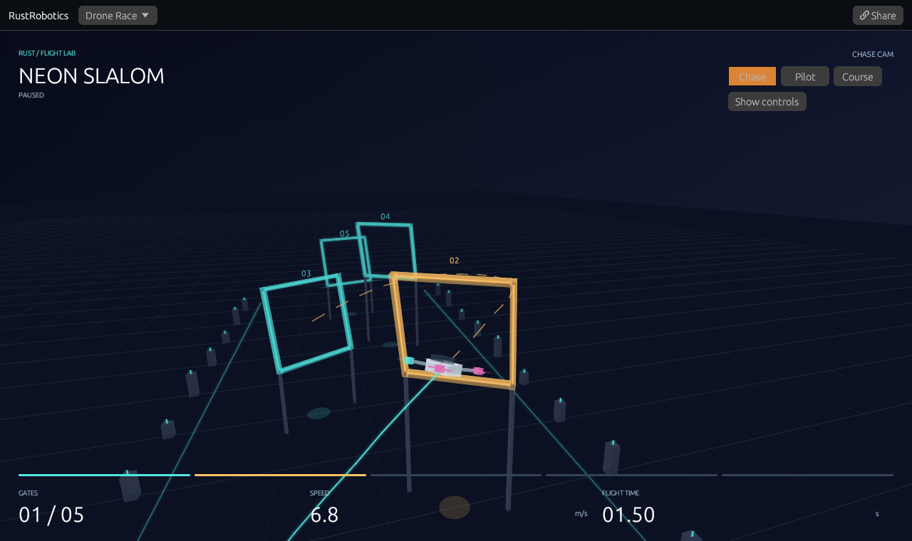

# 3D Drone Race

[Open the race](https://rsasaki0109.github.io/rust_robotics/playground/?tab=drone&cinema=1)
or [watch the 30-second browser recording](assets/drone-race.mp4).

The first version is a complete watch-and-replay experience: five gates,
visible attitude-driven flight, three cameras, a flight trail and prediction,
gate count, speed, flight time, and reproducible links. It reuses the existing
Rust flight controller and runs inside the existing WASM playground.



## Use it

- Neon Slalom alternates turns and altitude. Sky Climb adds a taller ascent.
- Chase follows the quadrotor; Pilot uses its position and quaternion attitude;
  Course keeps a fixed view over all five gates.
- Cinema view hides the side panel. Its camera buttons work with a mouse or
  touch; Show controls brings the panel back.
- Pause freezes a recorded physical state. Step advances one 0.05-second
  update. The timeline seeks through the deterministic flight history.
- Replay uses the same cached states. Slow motion changes playback timing;
  it does not change the physics step, controller, or random seed.
- Share stores the course, frame, playback state, camera, line visibility,
  slow-motion setting, and cinema setting. A receiving browser reconstructs
  the required prefix incrementally rather than blocking on a whole race.
- Space pauses/resumes, R replays, 1/2/3 select cameras, and Escape leaves
  cinema view.

## Flight and rendering

`crates/rust_robotics_playground/src/drone_race/flight.rs` owns the deterministic
history. It calls the existing `QuadrotorMppiController` and `QuadrotorParams`
on a fixed 0.05-second clock with seed 7, 900 sampled command sequences, and
a 28-step horizon. No flight samples are fabricated for the animation.

Acceleration follows the quadrotor's thrust axis, with gravity, drag, thrust
and body-rate limits, and a speed cap. Quaternion integration determines the
visible tilt. Each gate is a rectangular aperture in an oriented 3D plane;
passes use the existing ordered segment/aperture crossing predicate. Gate
progress is based on the body's position, with the library's 0.04 m crossing
tolerance. Rotor/frame contact geometry, aerodynamic propeller interactions,
wind and a detailed motor powertrain are outside this model.

Every stored frame includes the physical state, gate count, terminal status,
and the controller's predicted positions. The prediction rolls the shifted
warm-start command sequence out from the state after the applied command;
reading it does not consume random samples or change future controls.
The displayed prediction does not promise that subsequent replanning follows
exactly that path.

The two built-in courses finish in native tests at 6.30 s / 126 updates and
4.05 s / 81 updates respectively. Terminal histories stop growing. Ground
contact and the 30-second simulation limit are separate outcomes. The HUD
shows simulation time; slow playback and a slower browser can take longer in
wall-clock time. Numerical results are deterministic for a given build and
target; cross-platform floating-point bit identity is not promised.

`renderer.rs` projects the actual 3D geometry into the existing egui painter:
near-plane clipping, depth-sorted surfaces, illuminated gates and pylons,
quaternion-rotated body/rotors, trajectory and predicted-horizon lines. It adds
no rendering dependency. Chase hides gates already passed by the drone so
they cannot sweep across its trailing camera; Course retains the whole track.
Display interpolation does not alter the stored physical states.

The frontend limits each replay-generation batch to at most two controller
calls and yields between batches. It bounds stored flight length and discards
large background-tab time gaps instead of running a long catch-up loop. A
single controller call still runs on the browser thread; low-power-device
frame rates should be measured before increasing the sampling load.

## Run and verify

```sh
cargo test --locked -p rust_robotics_playground drone_race
cargo test --locked -p rust_robotics_control --lib racing_mppi_quadrotor
cargo clippy --locked -p rust_robotics_playground --all-targets -- -D warnings
rustup target add wasm32-unknown-unknown
cd crates/rust_robotics_playground
RUSTFLAGS='--cfg getrandom_backend="wasm_js"' trunk build index.html --release --locked
```

The flight tests require both complete courses to finish by actual gate
crossings. They also cover independent deterministic histories, normalized
attitude interpolation, shared paused frames, bounded incremental seeking,
background-tab time gaps, and invalid links. Renderer tests cover perspective
orientation and faces crossing the near plane. The library test checks that
requesting a prediction leaves the next random plan unchanged.

The existing `scripts/web_smoke/web_smoke.mjs` also exercises the race in
Chromium: full five-gate completion, cached replay, camera switching, pause,
shared paused frames, and phone layout, alongside every previous demo.
It fails on page errors and Rust panics.

## Capture the actual browser

Install the dependencies in `scripts/web_smoke/package.json` and Playwright's
Chromium, or set `CHROMIUM_PATH` to an installed Chromium. From that directory:

```sh
node capture_thumbs.mjs ../../crates/rust_robotics_playground/dist ../../docs/assets/playground drone
node capture_drone_race.mjs ../../crates/rust_robotics_playground/dist /tmp/drone-recording
cp /tmp/drone-recording/flight.mp4 ../../docs/assets/drone-race.mp4
```

The recording switches cameras during real playback and checks that the first
flight passes all five gates. FFmpeg with libx264 is required (or set
`FFMPEG_PATH`); timestamped browser screencast frames are encoded to MP4,
repeating the preceding image across idle frames. The MP4, camera screenshots and
capture receipt remain in the selected output directory. The PNG thumbnail
waits for its requested shared frame to finish reconstructing.

Future increments can add gate editing and manual flight on this same engine.
The first version intentionally keeps two fixed courses so the complete
browser experience and reproduction can be verified together.
