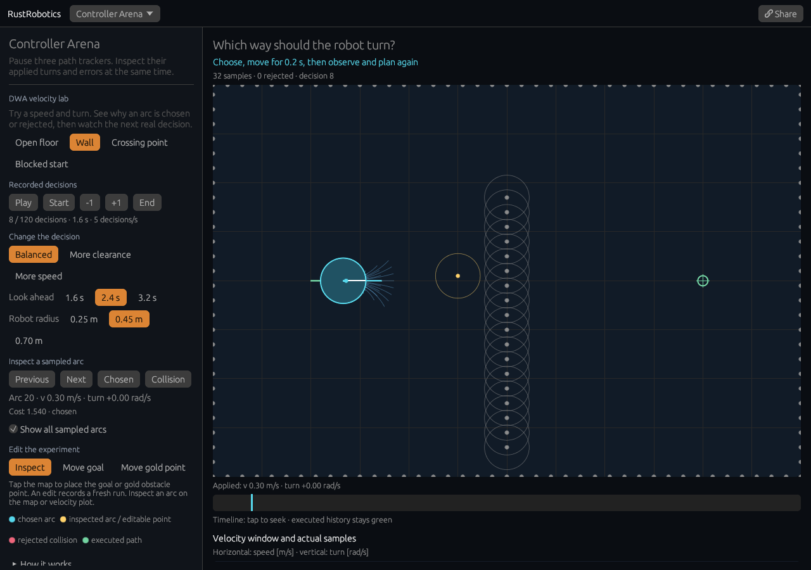

# DWA velocity lab

[Open the lab](https://rsasaki0109.github.io/rust_robotics/playground/?tab=arena&arena_view=dwa&dwa_at=8).



1. Pick **Wall** or **Crossing point**. The cyan arc is the library's chosen
   sample. Green is the motion already executed.
2. Tap the velocity plot to inspect another speed/turn pair. Red samples collide;
   **Collision** selects the first rejected arc when one exists. The cost bars
   expose weighted heading error, lost speed and inverse obstacle distance.
3. Change **More clearance**, **More speed**, look-ahead or robot radius. This
   records a fresh run from the same initial pose and velocity.
4. Step, play or tap the timeline. Each step applies the actual returned command
   for 0.2 seconds, observes obstacle positions again, and replans.
5. Choose **Move goal** or **Move gold point** and tap the map. **Share** keeps
   the geometry, settings, selected sample and exact time, and opens paused.

The scene and controls support phones; scroll down to reach the controls.
The velocity plot and cost bars also remain available below the map.

## What is actually being evaluated

The public `DWAPlanner::try_plan_step_with_trace` API runs the same decision loop
as `try_plan_step`. It retains every sampled trajectory, weighted cost terms,
collision rejection, selected sample and applied command. The normal planner
does not allocate a diagnostic sample cloud.

The acceleration window intersects speed/turn bounds with the velocities
reachable from the current velocity in one control period. Samples use the
library's rounded resolution and half-open sampling procedure. Floating-point
rounding can place a sample slightly beyond a window boundary. The prediction
loop includes time zero and continues while `time <= predict_time`, so its last
integration sample can extend beyond the nominal look-ahead.

For each clear arc, the cost is:

`heading_gain × |wrapped final heading error|`

`+ speed_gain × (max_speed − sampled_speed)`

`+ obstacle_gain / minimum center-to-point distance`.

The heading term measures the final orientation toward the goal, not goal
distance improvement. Minimum center distance includes the initial pose. A
smaller total wins; the last sample with an exactly equal total wins. Collision
rejections are excluded before weighting, even with a zero obstacle gain.

The circle collides with a point at distance `<= robot_radius`. All obstacles,
including sampled borders and the wall, are points. This is discrete trajectory
collision checking, without swept-volume or braking-distance guarantees. The
faint circles around interior points show the robot-center exclusion distance.

**Crossing point** has position `(6, 4 + 2 sin(1.1 t))`. DWA sees its current
position and treats it as static for that entire local prediction. It does not
predict the crossing point's future motion. Avoidance can be late or fail.

When all sampled arcs collide, the returned command is zero. **Blocked start**
demonstrates that this fallback is not a certificate of safety or arrival.
The library's stuck-robot rule can override a near-zero-speed sample with a
`−2 rad/s` turn, outside the usual window. The applied-command label and cyan
one-step preview expose this separately from the sampled arc. The trace API
does not rewrite the sampled trajectory to pretend it predicted the override.
After this override, the next acceleration window can have an empty
intersection with the yaw-rate limits. The plot labels that interval as empty
and draws no feasible rectangle or samples; the returned fallback is zero.

The lab distinguishes arrival within 0.4 m, a blocked decision, and the
120-decision limit. The final pose shows a decision preview only; there is no
additional applied step. No universal success or safety claim is implied.

## Reproduce and verify

```bash
cargo test -p rust_robotics_planning dwa::
cargo test -p rust_robotics_playground controller_arena::dwa
cd crates/rust_robotics_playground
RUSTFLAGS='--cfg getrandom_backend="wasm_js"' \
  trunk build --release --public-url /rust_robotics/playground/
```

The existing browser smoke command in the playground README runs four lab
cases: desktop, a 320-point phone at DPR 2, a compact desktop, and the phone
with paints throttled to 2.5 Hz. It independently regenerates the lattice,
predictions, weighted costs, tie break, fallback, every applied state and the
crossing point's observations. It also checks paint geometry, real input
acknowledgements, exact paused sharing, editing, replay and the homepage link.
The original browser cases remain enabled. Reusable diagnostic reports are
in `docs/assets/dwa-lab*.json`.
