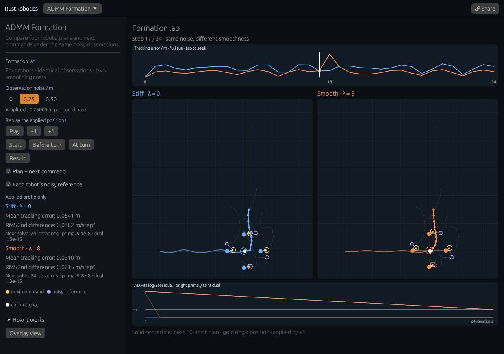

# Formation lab

[Open the lab](https://rsasaki0109.github.io/rust_robotics/playground/?tab=admm&formation_view=inspect&noise=0.25&frame=17&playing=0).



Four robots observe different noisy copies of a moving goal. ADMM finds a
shared center trajectory while preserving their formation offsets. The two
panels use **identical observations and solver settings**. Blue has no
smoothness penalty (λ = 0); orange penalizes the center trajectory's second
differences (λ = 8).

## Try it

- Select **Before turn**, then **+1**. The outlined gold circles become the
  robots' actual positions. The solver applies point 1 of its displayed
  10-point plan, then builds a new plan anchored at the new center.
- Enable **Each robot's noisy reference**. Purple circles show each robot's
  desired position at point 1; their faint paths show its full reference.
  They need not agree with one another or with the team's chosen command.
- Try noise **0**, **0.25**, and **0.50**. Both teams receive the same
  deterministic observations at each noise setting. Changing noise rebuilds
  both runs and keeps the selected step paused.
- Tap or drag the tracking-error graph. Both maps, plans, applied trails and
  statistics follow that shared step. **−1** restores the previous plan.
  Scroll down to inspect both maps and convergence on a narrow or short
  screen. On desktop, the scene and left controls scroll independently.
- Choose **Result**. Compare mean tracking error and RMS second difference
  over all applied positions. A smoother path can trade tracking accuracy
  for smaller changes in its spatial steps.

## Two different clocks

The top graph shows the full recorded tracking-error histories. Applied
trails and statistics stop at the selected step; they include no later
positions. The reference and planned horizon intentionally look ahead.

The bottom graph shows **inner ADMM iterations of the next solve** at that
step. Bright lines are primal residuals: disagreement between each robot's
planned trajectory and the shared center plus its formation offset. Faint
lines are dual residuals. The horizontal line marks the solver's 10⁻⁷
tolerance. These curves come directly from the solver report; moving along
them is not the same as moving the robots. At the last applied step there
is no next solve or horizon.

The RMS second difference uses consecutive center positions and is expressed
in m/step². It is not physical acceleration or jerk: this kinematic example
applies planned positions directly, without dynamics, obstacles or collision
avoidance. Playback advances at five recorded steps per second, independently
of paint rate; background gaps of at least one second are discarded.

**Share** restores the same noise, step and layers paused. **Overlay view**
opens the original combined view; **Open formation lab** returns to step 17.
Existing `tab=admm` links retain the original overlay behavior.

## Reproduce

```sh
cargo test --locked -p rust_robotics_playground --bin rust_robotics_playground admm_formation::
cargo test --locked -p rust_robotics_control --lib admm_consensus::
```

The lab records the existing [horizon-consensus solver](../crates/rust_robotics_control/src/admm_consensus.rs)
without changing its algorithm. The [browser checks](../scripts/web_smoke/formation_lab.mjs)
use actual mouse and touch input at desktop, compact 900 × 700 desktop,
320 px phone and 2.5 Hz paint rates. They independently check noisy
observations, consensus means, primal
residuals, command application, prefix statistics, actual painted coordinates,
layer toggles, graph seeking and exact paused sharing.
