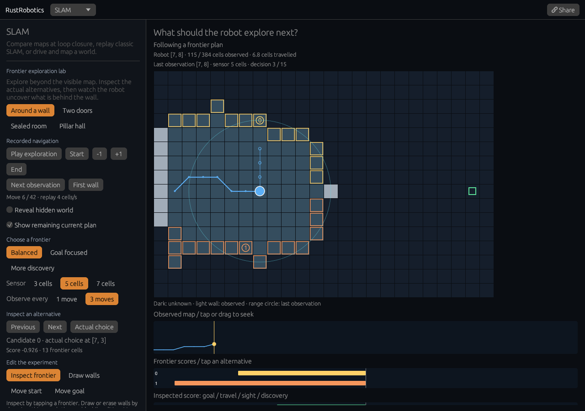

# Frontier exploration lab

[Open the experiment](https://rsasaki0109.github.io/rust_robotics/playground/?tab=slam&slam_view=explore&explore_event=wall).
This optional view lives inside SLAM. **SLAM demos** returns to the existing
experiments; reopening the lab preserves its paused state.



## Try it

1. The entry opens **Around a wall** when an interior wall first becomes
   observed. Dark cells remain unknown. The robot must discover a way around.
2. **Next observation** jumps to the next actual sensing boundary. Between
   observations the robot follows its recorded local plan and its knowledge
   stays unchanged. The cyan circle stays at the last observation position.
3. Tap a frontier to inspect its score. Green indicates the actual choice;
   gold indicates the inspected candidate, which may be an alternative.
   The four component bars show goal gain, travel cost, sight and discovery.
4. Change **Goal focused** or **More discovery**, sensor range, and the move
   budget between observations. Each change records a fresh run.
5. **Two doors** offers alternative openings. **Pillar hall** exposes shadows
   around obstacles. **Sealed room** stops after investigating its reachable
   side; it does not fabricate a route or arrival beyond the wall.
6. **Reveal hidden world** shows ground truth without giving it to the robot.
   **Draw walls** also reveals the world while editing. Tap or drag to add or
   erase walls; release restarts from unknown knowledge. Border walls, start
   and goal are protected. **Move start/goal** accepts free interior cells.
7. Scrub the coverage graph to seek and pause. **Share** restores the exact
   world, parameters, selected candidate and cursor, paused.

## Actual library decisions

The view calls
`rust_robotics_planning::frontier_navigator::simulate_frontier_navigation_with_trace`.
It shares the integration path with the existing navigator. Each trace step
records the actual known map, robot position, path boundary, candidate clusters,
scores, chosen candidate and phase. The final step records the stopping reason.

The world is a 24 × 16 cell grid. Coordinates increase rightward and downward.
Sensing reveals cells within the configured Euclidean range along sampled
lines of sight: three samples per maximum coordinate difference, rounded to
grid cells. A return wall can itself be observed; an earlier occupied cell
hides cells behind it. This is deterministic visibility, rather than noisy
LiDAR occupancy inference.

A frontier is a known-free cell with at least one unknown four-neighbor.
Frontiers form eight-connected clusters. A cluster's representative is the
member closest to its centroid, breaking ties by coordinate.
Its openness is the sum of unknown-neighbor counts across its members; a shared
unknown neighbor can contribute more than once. It is a heuristic for discovery,
rather than a prediction of newly observed area.

`score = goal_weight * goal_gain - cost_weight * travel_cost
       + sight_weight * sight_bonus + discovery_weight * normalized_openness`

Goal gain is the reduction in straight-line distance to the commanded goal.
Travel cost comes from Dijkstra over the current known-free map. Sight bonus
is one if no known wall blocks the representative; unknown cells do not block
this particular bonus. Openness is normalized by the largest current cluster
openness, including unreachable clusters. An unreachable candidate has no
travel cost or score. Equal scores break by representative coordinate.

| Strategy | Goal weight | Travel weight | Sight weight | Discovery weight |
| --- | ---: | ---: | ---: | ---: |
| Balanced | 1 | 0.35 | 1.5 | 0.15 |
| Goal focused | 2 | 0.35 | 1.5 | 0 |
| More discovery | 0.3 | 0.35 | 1.5 | 5 |

The local navigator follows the neighbor with the lowest decreasing remaining
distance field, breaking ties by coordinate. It moves at most one or three cells
before sensing again. Its executed gradient path is not claimed to minimize
total path length. When a known-free route to the goal exists, the library
follows it without additional sensing.

This is an eight-neighbor point-grid model: diagonal corner crossing is allowed.
Every moved-to cell is known free at the corresponding planning boundary.
The remaining-plan overlay contains only the current recorded segment.
Coverage shows the actual applied prefix, with no future map discoveries.
Replay advances four recorded cells per second independently of paint rate;
it does not interpolate unobserved sensor updates.
Runs stop at arrival, no frontier, no reachable frontier, no progress, or the
explicit limit of 64 planning iterations.

## Reproduce and inspect

```bash
cargo test -p rust_robotics_planning frontier_navigator
cargo test -p rust_robotics_playground slam::exploration::tests
cd crates/rust_robotics_playground
trunk build --release --public-url /rust_robotics/playground/
```

Native tests reconstruct visibility, clusters, centroid representatives,
unknown-neighbor counts, known-free distances, scores, chosen ties, gradient
steps and sensing boundaries over 72 combinations of world, strategy, range
and move budget. The independent distance oracle uses a label-correcting queue
rather than the library's heap. Tests also cover exact shares, protected edits,
hidden-world independence and playback at 100, 25 and 2.5 paints per second.

Four browser cases cover desktop, a 320-pixel touch phone, a compact 900 × 700
viewport, and a phone capped at 2.5 paints per second. Each performs 32
acknowledged inputs, including graph dragging, goal movement, frontier
inspection, wall painting, playback, reentry and exact sharing, then launches
the experiment through the real landing page. Independent JavaScript checks
the full rollout and actual painted cells, paths, sensor circle, frontiers,
coverage, candidate bars and score components.
Reports are `docs/assets/exploration-lab{,-phone,-compact,-phone-slow}.json`.

Share parameters are `slam_view=explore`, `explore_case`, `explore_strategy`,
`explore_range`, `explore_budget`, `explore_start`, `explore_goal`,
`explore_map` (384 row-major binary cells), `explore_at`,
`explore_candidate`, `explore_truth`, `explore_route`, and `explore_edit`.
Invalid inputs fall back to bounded defaults. Map decoding protects borders
and clears commanded endpoints. `explore_event=wall` seeks the first observed
interior wall in a frontier decision unless `explore_at` is explicit.
