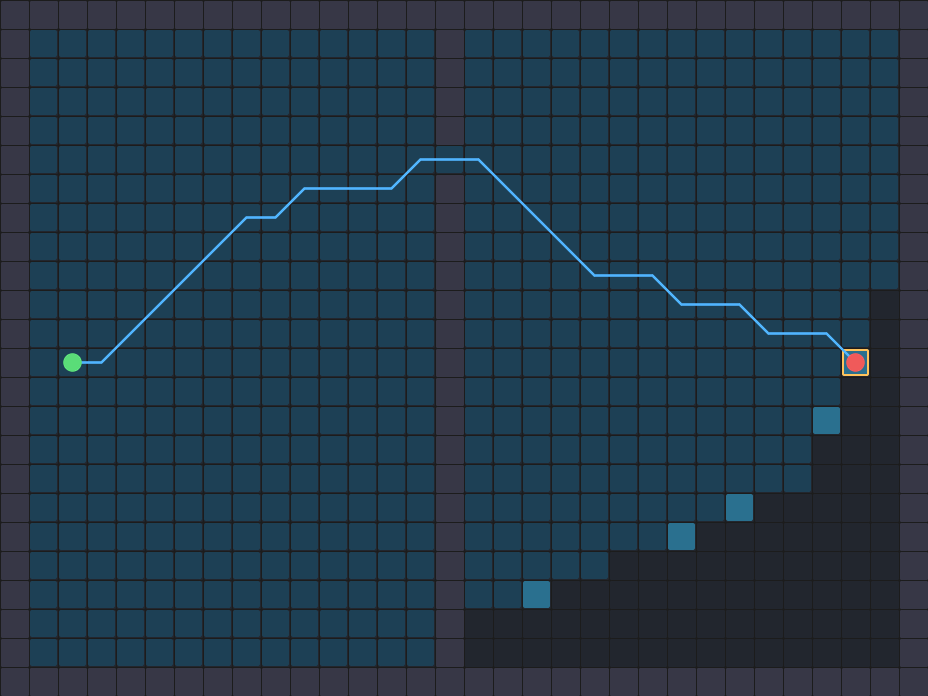
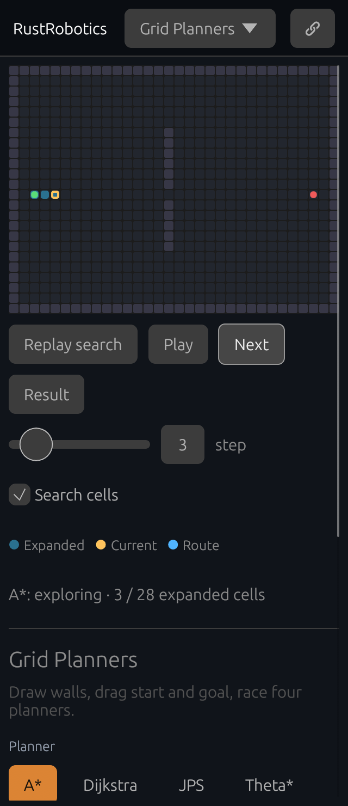

# Watch a grid search

[Open the experiment](https://rsasaki0109.github.io/rust_robotics/playground/?tab=grid&search_step=0&search_playing=1&search_rate=10).

Choose **A\*** or **Dijkstra**, then **Replay search**. Blue cells are actual
expanded cells, the amber outline marks the current cell, and the route appears
when the recorded search reaches its end. Pause, Next, Result, and the step
slider let you inspect the same search at any point. Search cells hides the
overlay and returns to the final result.

The viewing rate is in cells per second. It controls replay, not computation
time. The comparison table separately reports each query's length, waypoints,
and elapsed time; its cells column counts A*/Dijkstra expansions. JPS and
Theta* retain their path comparison without an expansion replay.

**Detour** places a wall with a gap away from the direct route. **No route**
separates start and goal completely: replay still shows how the planner searches
the reachable side. Click or drag to edit walls, including opening a single
cell in the separating wall. Editing or changing planners computes a new search,
stops playback at its result, and clears the previous comparison.

Share preserves the map, endpoints, planner, search visibility, viewing rate,
step, and playing state. A paused link reconstructs the same expanded prefix;
future cells and the final route stay hidden until selected. Phone rotation
keeps that selected state.

The [search receipt](assets/grid-search-replay.json) records the real paused
prefix and its identical shared copy, both planners on the same gap, a blocked
search, a mouse-opened route, and the detour preset.

## Search and comparison contract

`AStarPlanner::plan_with_observer` calls the observer once per expanded cell,
in world coordinates, including the start and reached goal. Unsuccessful
searches still emit their expansions; invalid endpoints emit none. Ordinary
planning methods retain neither a trace nor an extra trace allocation.
`DijkstraPlanner` uses the same search with a zero heuristic.

The playground now uses that world-coordinate Dijkstra API, matching the other
planners' grid, 0.35 m radius, and diagonal collision rules. Its previous matrix
API checked neighboring obstacles too, incorrectly blocking a one-cell gap in
this comparison. The legacy matrix API itself remains available unchanged.
Each displayed path, expansion list, and metric comes from one planner query.

## Validation

Planning tests compare observed and ordinary paths, search statistics, real
unique free cells, deterministic order, a narrow gap in an offset world,
exhausted searches, invalid queries, and coincident endpoints. Playground tests
cover fixed playback budgets, pause and seek, background gaps, comparison
invalidation, and exact shared state.

The browser suite includes desktop and 320-pixel touch cases that use the real
canvas controls, share into a new browser context, rotate the phone, and open a
blocked wall by mouse or touch. Run the complete browser suite with the public
URL build and Xvfb command in [the verification instructions](drone_race_project.md).
It writes `grid-search-map.png` and `grid-search-replay.json` into its screenshot
directory as evidence of the real run.
