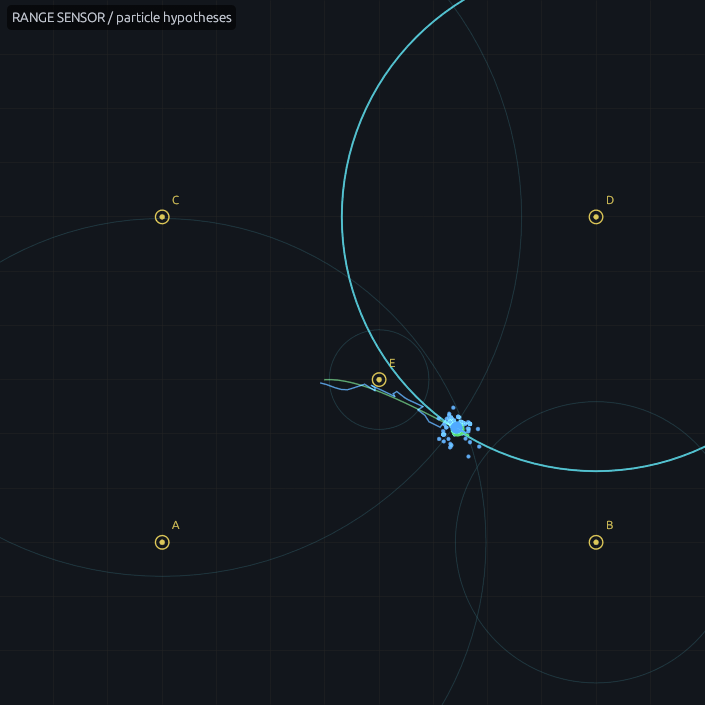
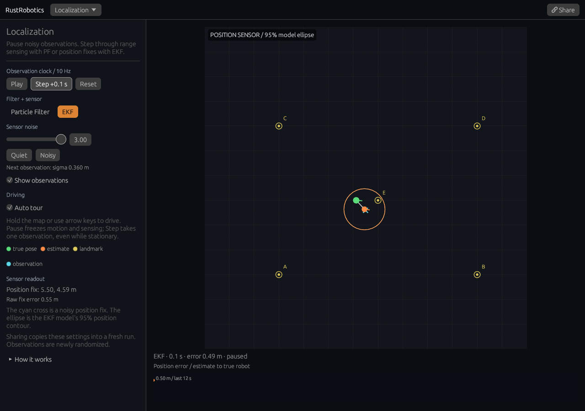
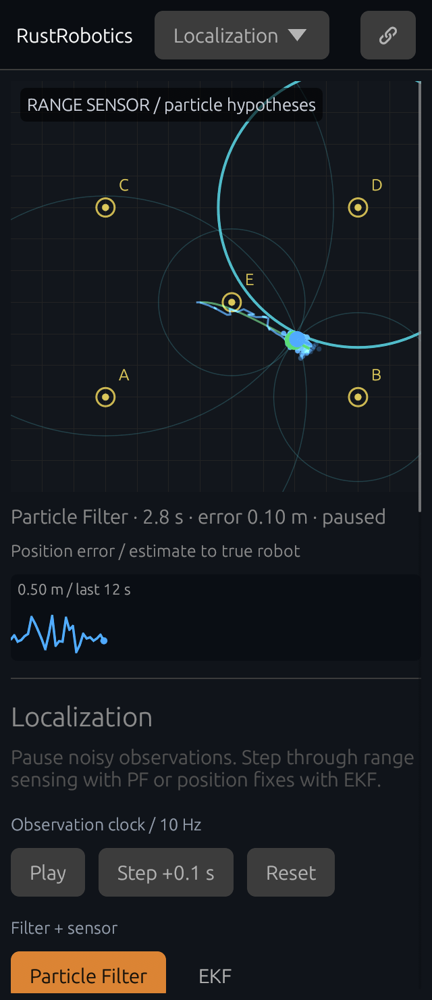

# Look inside a position estimate

[Open the experiment](https://rsasaki0109.github.io/rust_robotics/playground/?tab=localization&noise=3).

Choose **Noisy**, let the robot move, then **Pause**. The cyan circles are the
five range measurements passed to the particle filter, centered on landmarks
A–E. Select a landmark to highlight its circle and read its measured distance,
true distance, and signed residual. A circle marks possible positions at that
measured range; the particles explain all five observations together.

**Step +0.1 s** takes exactly one observation. Turn **Auto tour** off to observe
a stationary robot. Hold the map or use arrow keys to drive while playing.
Pause freezes both motion and sensing. Changing noise or hiding observations
while paused preserves the captured sample; the new noise applies to the next
observation. The position error graph shows the distance between the estimate
and the true robot over the last 120 samples (12 simulated seconds).

Switch to **EKF** to start a fresh trial with a position sensor. The cyan cross
is the actual position fix given to the EKF, and the orange ellipse is its
model's 95% position contour, using the 2D Gaussian chi-square scale of 5.991.
This is model uncertainty rather than an empirical coverage guarantee. PF uses
landmark ranges and EKF uses position fixes: their different sensor models do
not form an accuracy ranking. Compare noise levels within either filter.

The sensor's Gaussian standard deviation is `0.12 × noise` metres (per axis for
position fixes); the same variance configures the selected filter's measurement
model. Range measurements are clipped at zero. Simulation advances at 10 Hz,
independent of paint rate. Background gaps of one second or more are discarded
instead of generating a burst of observations on return.

**Reset** clears the robot, observations, trails, and graph while keeping the
chosen filter, noise, playback, tour, and display settings. Share preserves those
settings and the selected landmark in a fresh run. Each run draws new random
observations; a share link does not reproduce a previous trajectory.

## Verification

Rust tests cover clock rates from 2.5 to 100 paints per second, pause and
background gaps, stationary observations with both filters, bounded error
history, filter resets, and shared configuration. The Chromium suite uses real
desktop mouse and 320-pixel touch controls to inspect a stationary sample,
freeze input, change noise and visibility, advance a moving tour, reset and
switch filters, rotate a paused phone, and open shared settings in a fresh
browser context under `/rust_robotics/playground/`.

The [observation receipt](assets/localization-observations.json) records real
inputs and estimates from those browser interactions. Its graph values are
checked against the true and estimated positions. A further touch case limits
painting to 2.5 Hz and checks every input was handled exactly once. Controls are
acknowledged by the actual egui response, and scrolls wait for a new layout;
neither depends on a fixed post-input delay. Its
[input receipt](assets/localization-input-sync.json) records the twelve real
button responses, their playback states, and measured paint intervals.
Run the complete 44-case
suite using [the verification command](drone_race_project.md).
