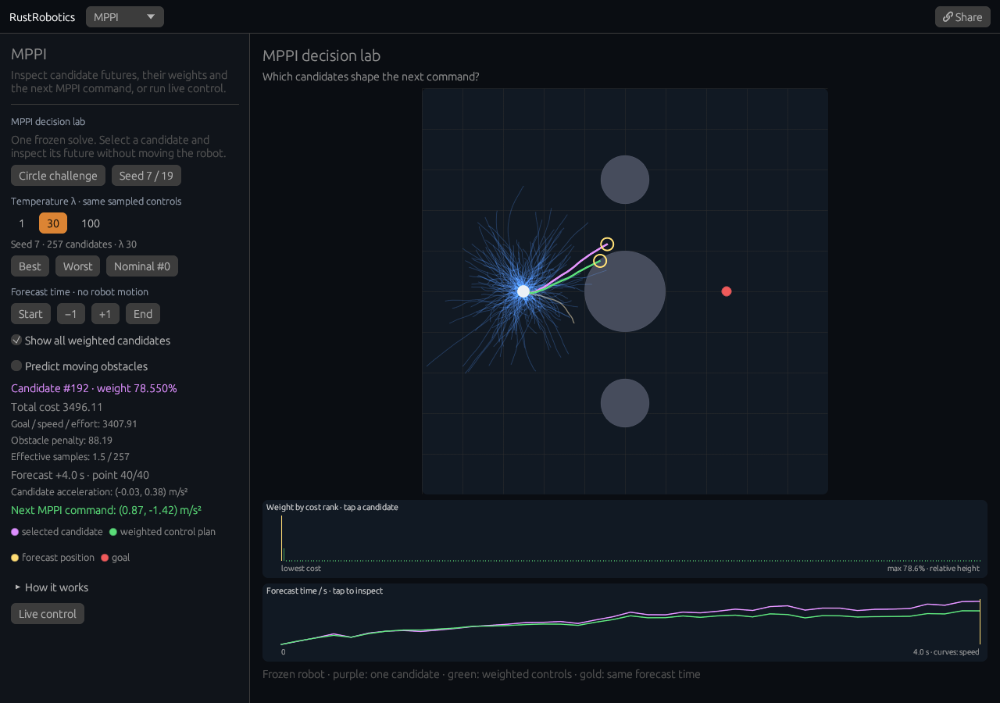

# MPPI decision lab

[Open the lab](https://rsasaki0109.github.io/rust_robotics/playground/?tab=mppi&mppi_inspect=1&mppi_case=circle&mppi_at=40).



Inspect one **frozen, seeded MPPI optimization**. Purple is one sampled
candidate. Green is the trajectory obtained by simulating MPPI's weighted
control sequence. Gold rings compare their positions at the selected future
time. The white robot stays at the planning origin.

## Try it

- Choose temperature **100**, then **1**. The same candidate controls, states
  and costs receive different normalized weights. Lower temperature tends
  to concentrate influence on fewer candidates; higher temperature spreads it.
- Tap the weight chart to inspect a candidate by its cost rank. **Best**,
  **Worst**, and **Nominal #0** jump to specific alternatives. Candidate 0 is
  the fresh controller's zero-control sequence.
- Drag the forecast-time chart or choose **Start**, **+1**, **−1**, and
  **End**. This changes the inspected future instant without moving the robot.
  The chart curves show predicted speed. At point 1, the first acceleration
  has acted for 0.1 s; point 0 is the initial state.
- Toggle the sample cloud to isolate the selected and weighted paths. Enable
  **Predict moving obstacles** to include their linear predictions in the
  cost. The movers remain frozen while their outlines show predicted positions.
- Change **Seed 7 / 19** to generate another candidate set. Returning to the
  original seed restores the same solve. **Circle challenge** resets the field
  and forecast horizon to the demonstrated four-second problem.

Both charts and controls remain reachable by scrolling on phones and compact
or short desktop windows. On desktop, the scene and left controls scroll
independently.

## What the green path means

Each bounded random acceleration sequence is simulated using the library's
2-D double-integrator model. The solver computes a cost from goal tracking,
speed, effort and obstacle penalties, then normalizes
`exp(-(cost - minimum_cost) / temperature)` over all candidates.

MPPI averages **control sequences**, then simulates the resulting sequence.
It does not simply choose the cheapest candidate or average their state paths.
The displayed next command is the weighted sequence's first acceleration.
Effective sample size is `1 / sum(weight²)`; it describes weight concentration,
not how many candidates were simulated. The weight chart sorts by cost and
scales bar heights to the largest weight, which it reports explicitly.

The displayed obstacle penalty is already part of the total cost. The other
cost line includes goal tracking, speed and effort. A low-cost candidate or
an averaged plan does not guarantee collision avoidance: obstacles use soft
penalties, and their future motion is a linear prediction.

**Inspect from start** opens the configured start at zero velocity with a
fresh seeded controller. The view inspects one optimization. **Live control** returns to a
fresh paused simulation; Play runs the existing controller. Each live solve
now draws its whole nominal plan from its actual planning origin, including
the first control. Paused previews also include moving-obstacle predictions.

**Share** restores the exact field, noise, temperature, seed, candidate,
forecast point and cloud setting as a frozen decision. Existing `tab=mppi`
links continue to open live control.

## Reproduce

```sh
cargo test --locked -p rust_robotics_playground --bin rust_robotics_playground mppi::
cargo test --locked -p rust_robotics_control --lib mppi::tests::
```

The lab uses the existing [MPPI solver and sample reports](../crates/rust_robotics_control/src/mppi.rs).
The [browser tests](../scripts/web_smoke/mppi_inspector.mjs) use real mouse and
touch input on desktop, 900 × 700 compact desktop, 320 px phone and 2.5 Hz
paint schedules. They independently check normalized weights, effective
sample size, entropy, cost decomposition, integrator equations, weighted first
controls, actual painted states and transforms, chart input, freeze behavior,
seed restoration and exact shared decisions.
