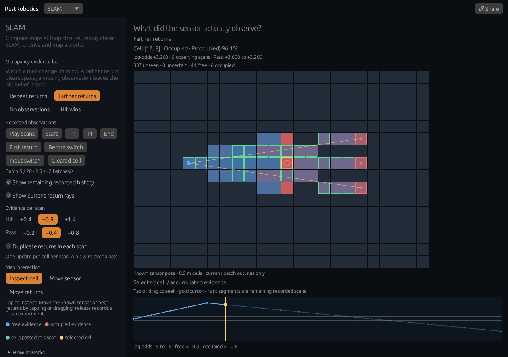

# Occupancy evidence lab

[Open the experiment](https://rsasaki0109.github.io/rust_robotics/playground/?tab=slam&slam_view=mapping&mapping_event=change).
The optional view lives inside SLAM; **SLAM demos** returns to the existing
replays. Reopening the lab preserves the paused experiment.



## Try it

1. The entry opens **Farther returns** at batch 5. Four near scans have
   established a wall. The next scan returns from 3 m farther right: its rays
   cross the old wall, decreasing those cells' occupancy belief.
2. **Before switch**, **Input switch**, and **Cleared cell** show the transition.
   The default selected cell first becomes free at batch 14.
3. Choose **No observations**. The first four scans are identical, but the
   following scans contain no observations. The map retains its evidence.
4. **Repeat returns** keeps reinforcing the near returns until values saturate.
   **Hit wins** combines a near endpoint and a longer grazing beam: the hit
   takes priority within each scan.
5. Duplicate the returns. A cell still receives only one update per scan.
   Change the hit or pass increment to see how much repeated evidence is needed.
6. Select a cell on the map to inspect its history, probability and actual
   current update. **Move sensor** or **Move returns** changes the geometry
   on release and records a fresh experiment from an unknown map.
7. Tap or drag the graph to seek and pause. Hide remaining recorded history
   to inspect only the applied prefix. **Share** restores exact inputs and the
   selected batch, paused.

## Actual evidence, known poses

The view calls the library's
`OccupancyGrid::insert_scan_with_trace`. This shares the same integration
path as `insert_scan` and records each cell application after resolving all
beams. There are 20 batches, separated by 0.5 s, in a 24 × 16 grid of 0.5 m
cells. The sensor pose is known and fixed for each experiment.

For each return, integer Bresenham traversal marks cells before the endpoint
as passes and its endpoint as a hit. A scan updates each cell at most once;
hits override passes. The update is float32 arithmetic:

`new_log_odds = clamp(old_log_odds + increment, -5, +5)`

Default hit and pass increments are +0.9 and −0.4.
Probability is `1 / (1 + exp(-log_odds))`. This is the model's belief,
not a measured accuracy score.

| Cell label | Meaning |
| --- | --- |
| Unseen | No scan has updated the cell |
| Uncertain | Observed, but log-odds is between −0.3 and +0.6, inclusive |
| Free | Log-odds < −0.3 |
| Occupied | Log-odds > +0.6 |

Unseen and uncertain both belong to the library's `Unknown` threshold class.
The lab tracks observing scans separately to distinguish them. Green or red
outlines show the actual passes or hits applied in the current batch.
No update means no evidence was applied, even when old belief remains.

Default near returns are at (6.25, 3.25), (6.25, 4.25), (6.25, 5.25) m,
observed from (2.25, 4.25) m. Farther returns shift each endpoint by +3 m in x
after batch four. Editing the geometry can change which old cells the new
rays cross; cells outside those rays do not automatically clear.
The map uses only scans through the replay cursor. Faint graph segments
show remaining recorded values, rather than predictions.

This experiment uses sparse return points, rather than a full range sensor
with max-range no-return beams. An empty packet supplies no rays and no
clearing evidence. It has no artificial time decay, pose estimation,
moving-object tracking or learned sensor uncertainty.

## Reproduce and inspect

```bash
cargo test -p rust_robotics_slam lidar_occupancy
cargo test -p rust_robotics_playground slam::mapping::tests
cd crates/rust_robotics_playground
trunk build --release --public-url /rust_robotics/playground/
```

Native tests compare every cell and actual trace against independent integer
ray traversal, mark aggregation and float32 accumulation over 144 combinations
of case, hit increment, pass increment, duplicate setting and sensor position.
They also check strict thresholds, scan counts, empty observations, clamping,
exact sharing, editing and playback at 100, 25 and 2.5 paints/s.

Four browser cases cover desktop, a 320-pixel touch phone, a compact 900 × 700
viewport, and a phone capped at 2.5 paints/s. Each performs 32 acknowledged
canvas inputs, including graph scrubbing, return dragging, sensor movement,
playback, reentry and exact sharing, then enters through the actual landing
page link. Independent JavaScript checks reconstruct all scan updates with
float32 arithmetic and verify cell colors, ray geometry, update outlines,
selected-cell history, thresholds and cursor coordinates.
Reports are `docs/assets/mapping-lab{,-phone,-compact,-phone-slow}.json`.

Share parameters are `slam_view=mapping`, `mapping_case`, `mapping_sensor`,
`mapping_return`, `mapping_hit`, `mapping_miss`, `mapping_at`,
`mapping_cell`, `mapping_future`, `mapping_rays`, `mapping_duplicates`,
and `mapping_edit`. Positions are finite and bounded; gains use the displayed
presets. Invalid values fall back to defaults. `mapping_event=change` seeks
batch 5 for switching cases unless `mapping_at` is explicit.
