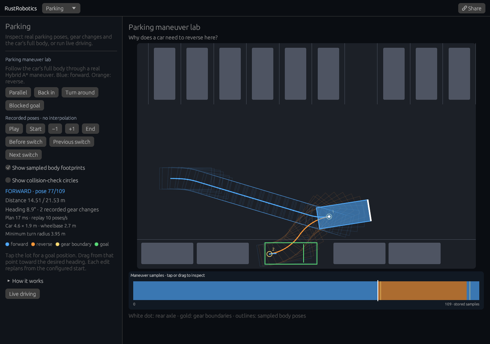

# Parking maneuver lab

[Open the lab](https://rsasaki0109.github.io/rust_robotics/playground/?tab=parking&parking_view=inspect&parking_event=before).



Inspect a real Hybrid A* parking maneuver, one recorded pose at a time.
Blue is forward, orange is reverse, and gold marks boundaries in the
planner's recorded directions. The white dot is the rear axle, the point
whose path the planner computes. The highlighted white edge is the car's front.

## Try it

- Choose **Before switch**, then **+1**. Follow the recorded gear change.
  Consecutive samples can share a position at a direction boundary.
- Use **Previous switch** and **Next switch** to move between boundaries.
  **Start**, **−1**, **+1** and **End** inspect individual path samples.
- Tap or drag the colored maneuver strip to choose a sample. Seeking pauses
  playback and does not solve another path.
- Toggle **Show sampled body footprints**. A clear rear-axle path alone
  does not show whether the whole 4.6 × 1.9 m car fits.
- Enable **Show collision-check circles** to see the three circles that
  cover the rectangular body in the actual planner. They rotate and move
  with the car, whose wheelbase is 2.7 m.
- Try **Parallel**, **Back in**, and **Turn around**. **Blocked goal** puts
  the requested car on a parked vehicle and shows the actual planning error.
- Tap the lot for a goal position, or press at that position and drag toward
  its desired heading. Every edit plans from the configured starting pose;
  inspecting another sample does not change that start.

Both the scene and all controls remain reachable by scrolling on a 320 px
phone or a compact desktop. Desktop scene and control panels scroll independently.

## What is replayed

The library's Hybrid A* combines short forward and reverse bicycle-model
arcs with Reeds-Shepp connections. It checks a covering-circle representation
of the car against a discretized obstacle field, instead of checking only the
rear-axle path. The steering limit gives a minimum turning radius of about 3.95 m.

The inspector displays the solver's exact stored `(x, y, heading)` samples
and directions. It does not interpolate a new car pose between them.
Displayed distance sums the chords between successive samples. Playback
advances **10 recorded poses per second**, so its animation is not a
constant-speed physical drive. Gold markers reflect stored direction changes.

Faint rectangles are a subset of sampled body poses. They illustrate space
occupied by the maneuver, not a continuously certified swept volume. Collision
checking still has the planner's sampling and obstacle-grid resolution limits.

**Share** restores the exact start, goal, selected sample and both overlays
as a paused experiment. The inspector's precise pose parameters use radians.
Existing `tab=parking` links retain the live animation and their degree-based
pose parameters. **Live driving** returns to that animation from the path start;
**Inspect this maneuver** returns to its recorded poses without replanning.

## Reproduce

```sh
cargo test --locked -p rust_robotics_playground --bin rust_robotics_playground parking::
cargo test --locked -p rust_robotics_planning --lib hybrid_a_star::tests::
```

The [browser checks](../scripts/web_smoke/parking_inspector.mjs) use real
mouse and touch input on desktop, compact desktop, a 320 px phone and a
2.5 Hz paint schedule. They independently recompute traveled distances,
direction boundaries, rectangular car corners, covering-circle centers,
world-to-pixel transforms and separating-axis collision checks for every
stored car pose. They also check actual painted geometry, pause and replay,
goal edits, blocked-goal failures and exact shared state.
