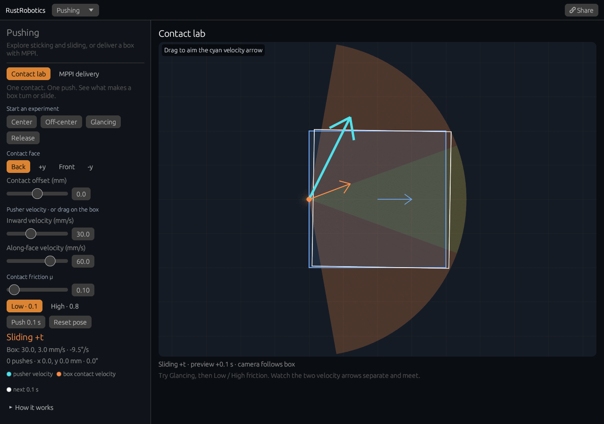

# Contact lab: make a box turn or slide

[Open the contact lab](https://rsasaki0109.github.io/rust_robotics/playground/?tab=pushing&push_mode=contact&lab_preset=glance&lab_mu=0.1).

Choose **Glancing**, then **Low** and **High** friction. With low friction the
cyan pusher velocity and orange box-contact velocity separate: the pusher slides
along the face. With high friction the contact sticks and both velocities agree.

Try **Center** and **Push 0.1 s** for straight translation. Choose **Off-center**
to see translation coupled to rotation. **Release** sets the inward speed to
zero: even with sideways speed, the box stays still. Change the face, offset,
inward speed, or speed along the face, or drag on the scene to aim the cyan arrow.
**Reset pose** brings the box back while keeping the command and friction.

The camera follows the box. Blue is its current pose; the white outline is the
next 0.1 s Euler step, and the trail records executed pushes. Every push executes
that same preview. The colored fan samples directions at the chosen contact:
yellow means sticking, orange means sliding, and gray means separated. The two
arrows share a velocity scale. The readout gives the box's body-frame center
velocity and angular velocity; the contact velocity also includes rotation.

This is the single-contact quasi-static ellipsoidal limit-surface model used by
the existing pusher-slider controller in
[`pusher_slider.rs`](../crates/rust_robotics_control/src/pusher_slider.rs).
The fan classifies **velocities** through the contact solve. The pusher recontacts
the selected face on every step. There is no inertia, pusher travel, or obstacle
collision handling in the manual lab. Use **MPPI delivery** for the existing goal
and obstacle experiment. Returning to **Contact lab** preserves your manual pose.

**Share** restores the exact current pose, command, and friction, starting a new
trail and push counter. It does not replay the earlier manual session. Links
from the older MPPI delivery experiment continue to open that mode.

Validation uses native tests for rigid contact velocity, all four faces,
friction-dependent regimes, preview/step agreement, rotated pointer coordinates,
and exact query round trips. Browser checks use real mouse and touch input at
the GitHub Pages project prefix, including a 320 px phone with 2× pixel density
and a 2.5 Hz paint cap. They also verify pose sharing and switching back to the
original delivery mode.
