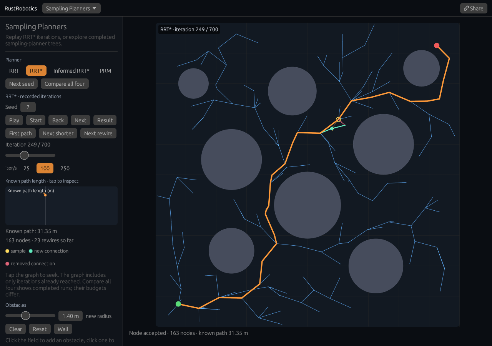

# RRT* search replay

[Open the replay](https://rsasaki0109.github.io/rust_robotics/playground/?tab=sampling&planner=rrtstar&seed=7&rrt_frame=249&rrt_playing=0).

Choose **First path**, **Next shorter**, then **Next rewire**. The orange line
is the current route. Mint highlights a newly added or reparented edge; dashed
pink shows the old connection removed during that iteration. The yellow cross
is the actual random sample, its thin line points to the nearest node, and the
candidate dot is mint when accepted or pink when rejected.

**Start**, **Back**, **Next**, **Result**, the iteration slider, and the
path-length graph all seek the same recorded run. The graph contains only costs
up to the selected iteration. Before the first solution it has no path-length
value; a rejected sample still consumes an iteration. Rewiring propagates cost
changes to descendants, so an improvement can affect an existing goal connection.
Not every rewire shortens the current goal route.

Use **Play** at 25, 100, or 250 iterations per second. Playback uses elapsed
time; pausing freezes the prefix, and background gaps of one second or longer
are discarded. **Next seed** makes a different repeatable RRT* run. Drag the
start or goal, click circles to remove them, or click free space to add one.
Editing a paused search restarts it at iteration zero while staying paused.
Dragging a start or goal clears the old trace; releasing the pointer generates
the new search, so a route for an old goal is never presented as the current one.
**Wall** demonstrates a run with no discovered route; **Clear** removes the
obstacles. The robot radius is 0.3 m and obstacles are inflated for collision checks.

**Share** preserves the full-precision map, seed, iteration, playback state,
and rate. It regenerates the search using the current solver. RRT, Informed
RRT*, and PRM retain completed-tree or roadmap views, labelled accordingly;
their share links preserve the map rather than a random run. **Compare all four**
shows completed runs with differing sample budgets and stop rules, not a timing
or universal algorithm ranking.

The recording is produced inside the existing
[`RRTStar` search](../crates/rust_robotics_planning/src/rrt_star.rs).
The new `planning_with_trace(seed)` uses the original parent selection, collision
checks, rewiring, cost propagation, and stop condition. Each step records changed
lightweight nodes with their previous values and the then-current feasible route.
The final tree is never used to invent earlier connections.

Native checks compare recorded and unobserved seeded runs, validate parent
chains, costs, collision clearance, rejections, early stopping, and prefix
solutions. Playground checks cover exact sharing, pause/elapsed-time behavior,
background gaps, and blocked maps. Browser checks use real mouse/touch operations,
including a 320 px phone at 2× pixel density and a 2.5 Hz paint cap, at the actual
GitHub Pages project prefix.
