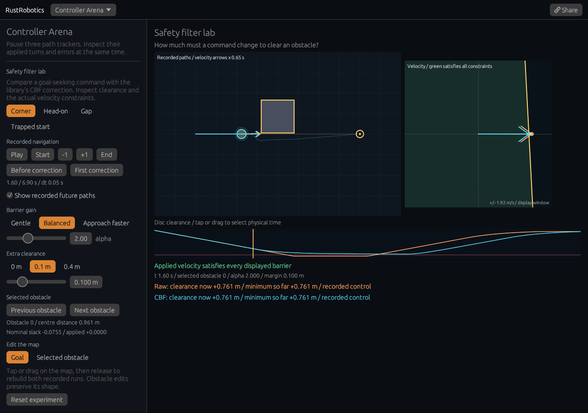

# Safety filter lab

[Open the experiment](https://rsasaki0109.github.io/rust_robotics/playground/?tab=arena&arena_view=safety&safety_event=first).



The lab records two navigation runs from the library: a goal-seeking controller
on its own, and the same controller law with a control-barrier-function (CBF)
filter. Both use the same initial position, goal, obstacle polygons, radius
`0.2 m`, nominal speed cap `1.4 m/s`, and Euler time step `0.05 s`. Commands differ
once the trajectories separate: the orange nominal arrow in the velocity diagram
is evaluated at the **filtered robot's current position**.

The orange path is unfiltered; cyan includes the CBF correction. Bright paths
show motion through the selected time. Faint paths are complete recorded futures,
which can be hidden. The goal is gold. The cyan disc is the physical robot;
its outer ring includes the extra clearance margin. Map velocity arrows are
scaled by `0.65 s` for visibility, rather than by the integration time step.

Try **First correction**, then **+1**. At the first correction both robots are
still at the same position. The velocity diagram shows the command about to be
applied; the next frame shows its actual integrated displacement. **Before
correction**, **Start**, **End**, and the clearance chart read the stored runs.
Tap or drag the chart to seek and pause. **Play** advances at physical time,
20 simulation steps per second, regardless of drawing rate. A run that reaches
its goal or time limit holds its last position and has no fabricated next command.

Each obstacle gives a velocity half-plane:

```text
gradient dot velocity >= -alpha * (signed centre distance - radius - margin)
```

Green in the velocity diagram satisfies **all** displayed half-planes. The
square is a viewing window, not an extra velocity bound. The orange arrow is
the nominal command, cyan is the applied command, and gold connects them.
Tap a boundary, or use the obstacle buttons, to inspect its signed distance and
both slacks. A negative slack means the command violates that obstacle's
inequality. The lab evaluates every inequality on the actual returned control;
it does not infer feasibility from whether the library changed the command.

| Case | What to try | What the recorded run shows |
| --- | --- | --- |
| Corner | First correction, then End | Raw motion collides; the filtered trajectory deflects past the corner and reaches the goal |
| Head-on | End | The reactive filter can keep clearance while stopping before a face, without finding a route |
| Gap | Compare `0.1 m` and `0.4 m` extra clearance | A larger margin can close the traversable gap and stop progress; the unfiltered path stays identical |
| Trapped start | Inspect the initial velocity diagram | The disc starts overlapping both sides of a narrow gap; opposing barrier inequalities are infeasible, and the library fallback violates a barrier |

**Gentle**, **Balanced**, and **Approach faster** change `alpha` to `0.8`, `2`,
and `5`. A larger gain allows faster approach when clearance is positive; it
does not increase the requested separation. Change the extra margin separately.
These edits recompute both runs, paused from time zero. Case changes keep the
current gain and margin while resetting the case geometry and goal.

Select **Goal** or **Selected obstacle**, then tap or drag the map. Release to
rebuild the runs. Obstacle edits preserve its size and leave the robot's initial
position and goal unchanged. Moving an obstacle can invalidate the starting
clearance. **Reset experiment** restores the current case with gain `2`, margin
`0.1 m`, future paths visible, and goal editing selected.

The clearance chart measures signed polygon distance minus **physical radius**;
the extra margin is part of the constraint, not subtracted again from that plot.
Readouts labelled “so far” use only the selected time prefix. The simulation
uses a single-integrator velocity model with static convex obstacles, without
braking dynamics. Head-on deadlock and infeasible initial conditions are visible
limitations, rather than hidden by a route planner or a different fallback.

**Share** restores the exact case, goal, obstacle bounds, gain, margin, time,
selected obstacle, edit mode and future overlay, paused. **Path-tracking
comparison** returns to the existing three-controller arena. Its original
links and replay behavior remain available.

## Reproduce and validate

```bash
cargo test -p rust_robotics_control cbf_safety_filter
cargo test -p rust_robotics_playground controller_arena::safety
cargo test -p rust_robotics_playground
cargo clippy -p rust_robotics_playground -p rust_robotics_control --all-targets -- -D warnings
cd crates/rust_robotics_playground
RUSTFLAGS='--cfg getrandom_backend="wasm_js"' trunk build --release --public-url /rust_robotics/playground/
cd ../..
npm --prefix scripts/web_smoke install
npx --prefix scripts/web_smoke playwright install chromium
xvfb-run -a node scripts/web_smoke/web_smoke.mjs crates/rust_robotics_playground/dist /tmp/safety-lab-shots docs
```

The browser suite uses real mouse and touch on desktop, 320 px phone,
900 × 700 desktop, and a phone capped at 2.5 paints/s. Each new scenario performs
36 acknowledged canvas inputs, plus actual navigation from the public home page.
Checks independently recompute rectangle distances, nominal commands, Euler
transitions, all velocity inequalities, the minimum-correction solution, sampled
membership of the clipped feasible region, and painted map/velocity/chart
geometry. They also verify deadlock, infeasible fallback, pause, edits, future
visibility and exact shares. Diagnostics are read-only and come from the real
rollout and drawing loops; fixtures never write application state.

Reports: [desktop](assets/safety-lab.json), [phone](assets/safety-lab-phone.json),
[compact desktop](assets/safety-lab-compact.json),
[slow phone](assets/safety-lab-phone-slow.json).

Implementation: [library rollout and trace API](../crates/rust_robotics_control/src/cbf_safety_filter.rs),
[recorded lab](../crates/rust_robotics_playground/src/controller_arena/safety.rs),
[view](../crates/rust_robotics_playground/src/controller_arena/safety/view.rs), and
[browser fixture](../scripts/web_smoke/safety_lab.mjs).
The trace API shares the original controller, CBF solver, integration and metrics.
