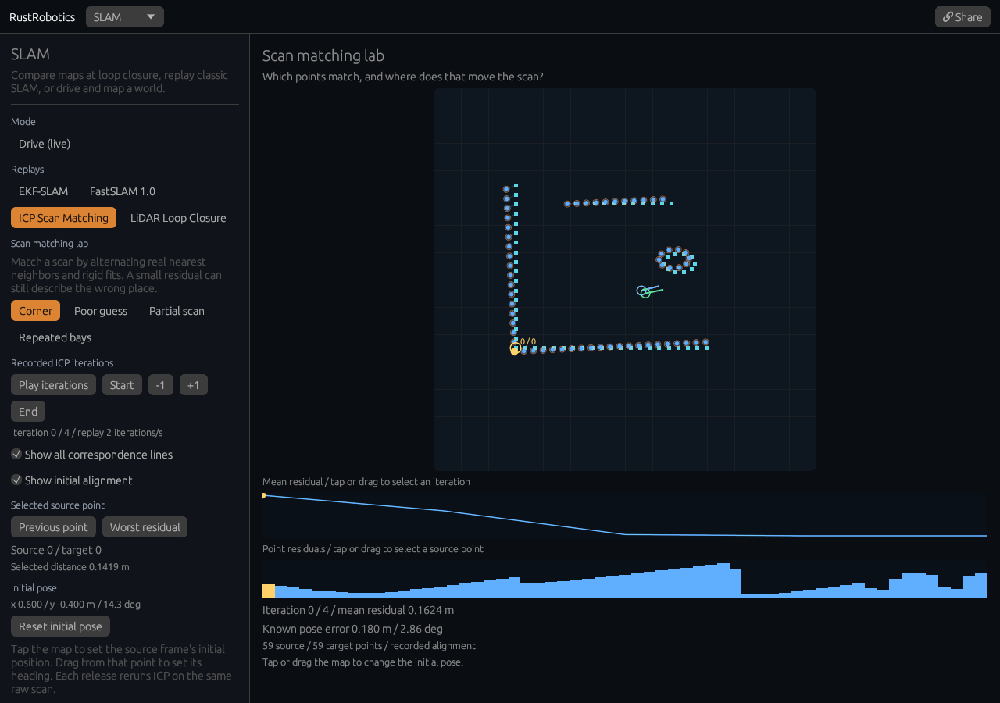

# Scan matching lab

[Open the experiment](https://rsasaki0109.github.io/rust_robotics/playground/?tab=slam&algorithm=icp&icp_view=inspect).



The lab runs the library's two-dimensional, point-to-point ICP on fixed synthetic
scans. Each recorded state contains the actual transformed source points, their
nearest target indices, the accumulated rigid transform, and mean match distance.
There is no interpolated scan motion between iterations.

Cyan squares mark the target, blue dots the aligned source, and orange rings the
initial alignment. The gold line joins the selected source point to its actual
nearest target. Several source points can share the same target. Green shows
the known true pose of this synthetic example; ICP never receives that pose.

Try **+1**, **Worst residual**, and **End**. Tap or drag the upper chart to select
an accepted iteration. The lower chart selects a source point by its distance
to the matched target. Hiding **all correspondence lines** keeps the selected
pair visible. Hiding **initial alignment** removes its points and pose axes.

The four cases expose different limits of a local scan matcher:

| Case | What changes | What to observe |
| --- | --- | --- |
| Corner | Nearby initial pose `(0.6, -0.4, 0.25 rad)` | Accepted fits recover the known pose `(0.75, -0.5, 0.2 rad)` |
| Poor guess | Same scans, initial pose `(0, 0, 0)` | Residual decreases but the solver stops at an incorrect alignment |
| Partial scan | One wall segment is absent from the source | Different source and target sizes; associations still use the full target |
| Repeated bays | One source bay and three identical target bays | The neighboring bay matches almost perfectly, with a 3 m position error |

Tap the map to change the initial translation. Drag from that point to set the
heading. Releasing starts a fresh solve on the same raw scans, paused at its
first state. **Reset initial pose** restores the current case's starting guess.
Replay navigation and point selection read the recorded solve; they do not
change the raw scans or run ICP again.

**Play iterations** advances two recorded iterations per second. That speed is
for inspection and does not represent sensor time. Seeking pauses playback.
**Share** restores the exact initial pose, case, iteration, selected point and
both overlays, paused. **Legacy scan replay** returns to the original SLAM
replay; its existing links still open that replay.

The library's SVD step minimizes squared distances for its fixed associations.
Its existing stopping and rejection rules use the sum of nearest-neighbor
distances. The plotted value divides that sum by source count. Rejected
increasing steps are not replayed. “Solver converged” describes its stopping
condition, and does not establish that the estimated location is correct.

## Reproduce and validate

```bash
cargo test -p rust_robotics_nearest_neighbor
cargo test -p rust_robotics_slam icp_matching
cargo test -p rust_robotics_playground slam::scan_matching
cargo test -p rust_robotics_playground
cargo clippy -p rust_robotics_playground -p rust_robotics_slam -p rust_robotics_nearest_neighbor --all-targets -- -D warnings
cd crates/rust_robotics_playground
RUSTFLAGS='--cfg getrandom_backend="wasm_js"' trunk build --release --public-url /rust_robotics/playground/
cd ../..
npm --prefix scripts/web_smoke install
npx --prefix scripts/web_smoke playwright install chromium
xvfb-run -a node scripts/web_smoke/web_smoke.mjs crates/rust_robotics_playground/dist /tmp/scan-matching-shots docs
```

Real mouse and touch fixtures cover desktop, 320 px phone, 900 × 700 desktop,
and a phone capped at 2.5 paints/s. Each performs 32 acknowledged inputs,
including both chart drags and an initial-pose drag. Independent checks compare
associations with brute-force search, apply the recorded rigid transform to
raw points, recompute residuals, and verify painted points, pairs, pose axes,
charts, pause and exact shares. Read-only diagnostics come from the actual
solver and drawing loops; fixtures never write application state.

Recorded reports: [desktop](assets/scan-matching.json),
[phone](assets/scan-matching-phone.json),
[compact desktop](assets/scan-matching-compact.json),
[slow phone](assets/scan-matching-phone-slow.json).

Implementation: [library ICP and trace API](../crates/rust_robotics_slam/src/icp_matching.rs),
[recorded lab](../crates/rust_robotics_playground/src/slam/scan_matching.rs),
[view](../crates/rust_robotics_playground/src/slam/scan_matching/view.rs), and
[browser fixture](../scripts/web_smoke/scan_matching.mjs).

The axis-aligned walls also exercise a KD-tree boundary case. A tied midpoint
at the minimum coordinate used to leave one child with the entire cloud,
allowing unbounded node-index growth. The split now makes progress through a
rank split in that case. Its regression tests compare two- and three-dimensional
wall clouds with brute-force nearest neighbors, including queries on the shared
split plane.
