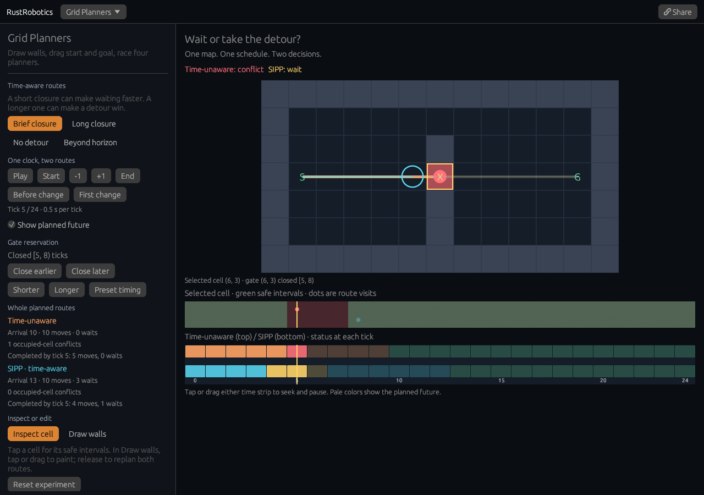

# Time-aware route lab

[Open the experiment](https://rsasaki0109.github.io/rust_robotics/playground/?tab=grid&grid_view=time&time_event=first).
The optional **Time-aware routes** view lives inside Grid Planners. The original
four-planner comparison and saved links remain available through **Static grid
comparison**.



## Try it

1. **Brief closure** opens at the first difference between the two routes.
   The time-unaware robot enters the reserved gate cell at tick 5; SIPP waits
   in the preceding cell and enters the gate at tick 8.
2. Choose **Long closure**. Going around the wall now arrives sooner than
   waiting, so SIPP takes the upper opening.
3. Choose **No detour**. The upper opening is a wall, and SIPP must wait.
4. **Beyond horizon** leaves no route that arrives within the experiment's
   24-tick horizon. The view shows a planning failure with no fabricated robot
   trajectory.
5. Change the gate timing with **Close earlier/later** and **Shorter/Longer**.
   Both routes replan from the same start at tick 0.
6. In **Draw walls**, tap or drag across the upper opening to close it.
   Release to rebuild both routes. In **Inspect cell**, tap the waiting cell
   or gate to see its actual safe intervals and visits.
7. Tap or drag either time strip to seek and pause. **Show planned future**
   hides or reveals future path points, visits, and status blocks together.
   **Share** restores the exact experiment, paused.

## Same graph, different timing information

Both routes call `rust_robotics_planning::sipp::SippPlanner::plan` on the
same 13 × 7 static grid, start `(1,3)`, goal `(11,3)`, and four-neighbor moves.
Each move costs one tick; playback uses 0.5 seconds per tick independently of
the screen's paint rate. The time-unaware call omits the gate reservation.
The time-aware call includes the exact known reservation at `(6,3)`.
Both calls block all cells after tick 24, making the planning horizon explicit.

| Preset | Gate reservation | Time-unaware arrival | SIPP arrival | SIPP moves | SIPP waiting ticks |
| --- | --- | ---: | ---: | ---: | ---: |
| Brief closure | `[5,8)` | 10 | 13 | 10 | 3 |
| Long closure | `[5,13)` | 10 | 14 | 14 | 0 |
| No detour | `[5,8)` | 10 | 13 | 10 | 3 |
| Beyond horizon | `[5,25)` | 10 | No route | — | — |

Time-unaware has an occupied-cell conflict at tick 5 in all four presets.
It continues its planned route so visitors can compare both decisions at the
same time. A conflict is not presented as successful avoidance.

The half-open interval `[a,b)` includes `a` and excludes `b`. Green safe
intervals come directly from `get_safe_intervals`, clipped to `[0,25)` for the
visible integer ticks 0 through 24. Static walls have no safe intervals.
The two visit rows in the selected-cell strip correspond to time-unaware and
SIPP. A red visit occupies a reserved cell. The lower two status rows show
moving, waiting, conflicts, arrival, or no plan at every tick.

## Reconstructing actual waits

SIPP returns compressed timed waypoints rather than a waypoint for every wait.
For consecutive waypoints `(a,t_a)` and `(b,t_b)`, the robot occupies `a` at
ticks `t_a` through `t_b-1`, then occupies adjacent cell `b` at `t_b`.
There are `t_b-t_a-1` waiting transitions followed by one moving transition.
The brief case reaches the waiting cell at tick 4, waits during transitions
4→5, 5→6 and 6→7, and moves into the gate during 7→8.

Full-plan arrival, movement, waiting and conflict counts are labelled separately
from transitions completed by the replay cursor. At tick 5 in the brief case,
SIPP has completed four moves and one wait. Finished routes hold the goal,
which cannot be the gate. A failed plan has no positions or robot marker.

This is an integer-time cell-reservation model with known occupancy, rather
than continuous swept-body collision checking, reciprocal moving agents,
uncertain obstacle predictions or braking dynamics. Playback does not interpolate
through untested continuous positions. The experiment is a planning explanation,
not a physical robot safety certificate.

## Reproduce and inspect

```bash
cargo test -p rust_robotics_playground grid_planners::time::tests
cargo test -p rust_robotics_planning sipp::
cd crates/rust_robotics_playground
trunk build --release --public-url /rust_robotics/playground/
```

Native tests compare both SIPP calls against an independent breadth-first
space-time search over 100 combinations of preset, closure start and duration.
They verify every implicit wait, adjacency, occupied-cell check, safe-interval
boundary, map edit, exact share and playback at 100, 25 and 2.5 paints/second.

The browser suite adds four cases: desktop, 320-pixel phone with touch, a compact
900 × 700 viewport, and a phone capped at 2.5 paints/second. Each performs 32
acknowledged canvas actions, including timeline dragging, cell selection, wall
painting, playback, legacy-view navigation, exact sharing, and a real click from
the public landing page. Its independent JavaScript space-time search checks
arrival optimality; paint witnesses verify square cells, actual paths, robot
positions, interval rectangles, visits, status blocks and time cursors.
Reports live at `docs/assets/time-lab{,-phone,-compact,-phone-slow}.json`.

Share parameters are `grid_view=time`, `time_case`, `time_close`,
`time_duration`, `time_map` (91 row-major binary cells), `time_at`, `time_cell`,
`time_future`, and `time_edit`. Invalid input falls back to bounded defaults;
map decoding protects borders, endpoints and the gate. `time_event=first` seeks
the first differing position only when an explicit `time_at` is absent.
