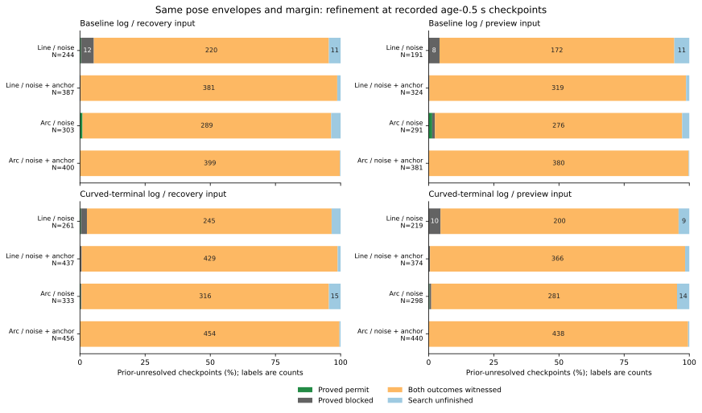

# 同じ姿勢範囲の未確定判定を調べる

前回の未確定判定は、距離の上下限が粗いことだけでは説明できませんでした。観測後0.5秒の予定操舵経路で、補正ずれ込みの範囲では、復帰入力の未確定856地点中853地点、予測入力の821地点中818地点に、許可と遮断の両方の姿勢が存在しました。残る各3地点は探索上限に達し、確定へ変わった地点はありません。

全ての時点・入力・経路・規則を含む前回未確定13,522評価では、13,170評価（97.4%）で両姿勢例が見つかりました。範囲全体の分割証明で新たに確定したのは許可16・遮断103評価、探索上限で残ったのは233評価です。両姿勢例がある評価は、同じ範囲と必要な余裕を保ったまま境界だけを締めても確定できません。

## 同じ範囲を保って調べる

[固定手順](protocol.md)を記録してから、[前回の比較](../model-admission-envelopes/report.md)の全648ケースの会計、時間切れ368ケース、2,120地点を引き継ぎました。復帰入力と予測入力、直線と予定操舵の曲線、central・noise・noise+anchorの3規則の計25,440行を保存しています。

位置の半径、向きの±4度、経路長0.6m、記録した操舵、必要な余裕Mは同じです。元から確定していた判定は引き継ぎ、前回未確定だった行だけを調べます。真の位置や判定は、探索後の正誤・包含の評価にだけ使います。

元の上限は、障害物や壁までの距離に半径などを足したものでした。複数の障害物があると、一方から離れる平行移動で他方へ近づく場合があります。元の上限だけでは遮断と確定できなくても、小さな姿勢領域ごとに別の障害物で遮断を証明できる余地があります。

一方、同じ範囲内にMを満たす姿勢と満たさない姿勢が両方あれば、幾何の上下限を精密にしても範囲全体の判定は確定しません。どちらの具体例も保存することで、この場合を探索打ち切りと区別します。

## 有限の姿勢例と範囲全体の証明

まず、推定位置のまま向きを−4〜4度まで1度刻みで替えます。別に、推定向きのまま位置を45度刻みの8方向へ、半径の0.5倍と`1-1e-9`倍だけ動かします。各軸の例は最後まで評価し、位置だけ・向きだけで両方の判定が見つかったかを重複も残して記録します。境界から2e-8m以内の例は、両判定の証拠として使いません。

両方が見つからなければ、正規化した位置円板を含む`[-1,1]×[-1,1]`と向き`[-4,4]`の箱から範囲を分割します。セル中心の正確な障害物・壁までの距離を計算し、次の移動量を上下へ足し引きします。

`r*sqrt(hx^2+hy^2) + 2*.6*sin(radians(heading_half_width)/2) + 2e-8 m`

最初の項は位置セルの半対角、次の項は向きの変化で経路上の点が動く上限、最後は数値の余裕です。各距離が点の移動に対して1-Lipschitzであることから、セル全体の距離もこの範囲に入ります。障害物は厳密な不等号、壁は境界での等号を許す元の条件を保ちます。

セルの最も大きい物理的な半幅を2分し、幅優先・小さい側を先に調べます。円板と交わるセルの訪問上限は1行256回に固定しました。円板から外れたと証明できるセルは捨て、残る全セルを同じ状態で覆えたときだけ、範囲全体を許可または遮断と確定します。中心が円板外のセルでも、境界の証明はその中心からの移動量で有効です。姿勢の具体例としては円板内の点だけを使います。

| 記録する状態 | 意味 |
|---|---|
| permit / blocked | 以前の確定判定、または範囲全体の分割証明で新たに確定 |
| mixed | 同じ範囲内に、許可と遮断の両方の姿勢例がある |
| unresolved | 上限まで探索しても、両姿勢例も全体の証明もそろわない |

mixedとunresolvedはどちらも復帰判定として未確定です。有限の候補に許可例が見つからないことを、許可できる姿勢が存在しない証明には使いません。位置や向きの軸で見つかった例も十分条件で、その軸だけが不可欠な原因だとは言いません。

## 観測後0.5秒の全地点

基準記録epochは415地点・87ケース、曲線終端記録curvedは461地点・93ケースです。次の表は両記録を合わせ、各入力・経路・規則の元の分母を876地点に保っています。表の「前回未確定」の行内訳を右4列へ分けます。入力・経路・記録の重なる評価で、独立な試行数ではありません。

| 入力・経路・規則 | 前回未確定 | 新たに許可 | 新たに遮断 | 両姿勢例あり | 探索上限 |
|---|---:|---:|---:|---:|---:|
| 復帰・直線・noise | 505 | 2 | 18 | 465 | 20 |
| 復帰・直線・noise+anchor | 824 | 0 | 4 | 810 | 10 |
| 予測・直線・noise | 410 | 0 | 18 | 372 | 20 |
| 予測・直線・noise+anchor | 698 | 0 | 3 | 685 | 10 |
| 復帰・予定操舵・noise | 636 | 4 | 1 | 605 | 26 |
| 復帰・予定操舵・noise+anchor | 856 | 0 | 0 | 853 | 3 |
| 予測・予定操舵・noise | 589 | 5 | 5 | 557 | 22 |
| 予測・予定操舵・noise+anchor | 821 | 0 | 0 | 818 | 3 |

補正ずれ込みの予定操舵経路では、両入力とも前回未確定の99.6%に両姿勢例が見つかりました。確定数は前回と同じく復帰入力が許可7・遮断13、予測入力が許可7・遮断48です。未確定が多い理由の大半は、その姿勢範囲で判定が実際に分かれることでした。

同じ予定操舵・補正ずれ込みの例を、見つけた候補の軸で分けます。「分割探索で発見」は、両軸の有限候補では両方がそろわず、その後に見つかったものです。

| 入力 | 位置の候補でのみ発見 | 向きの候補でのみ発見 | 両方の候補で発見 | 分割探索で発見 | 計 |
|---|---:|---:|---:|---:|---:|
| 復帰 | 719 | 2 | 124 | 8 | 853 |
| 予測 | 640 | 2 | 160 | 16 | 818 |

この分類は証拠の見つかり方です。位置や向きの影響を独立な因果寄与へ分解したものでも、有限候補に見つからなかった姿勢の不存在を証明したものでもありません。



図は全ての前回未確定の地点を分け、両記録、両入力、両経路、両不確かさモデルを含みます。横軸の分母は棒ごとの前回未確定数です。幅4%未満の区間のラベルは省き、0を含む64区間を[図の数値](envelope-refinement.csv)に保存しました。

## 全地点と固定した誤った追加許可

全2,120地点の予定操舵経路でも、補正ずれ込みの復帰入力は前回未確定2,068評価中2,064が両姿勢例あり、残る4が探索上限でした。予測入力は2,001評価中1,983が両姿勢例あり、4が新たに遮断、14が探索上限です。全群・全時点の結果は[summary.csv](summary.csv)にあります。

前回から固定した、直線では許可せず曲線で追加許可したのに真の余裕が足りなかった復帰入力43地点・予測入力54地点も追跡しました。両入力は重なるため合算しません。

| 入力・規則 | 元の誤った追加許可 | 前回未確定 | 両姿勢例あり | 新たな確定 | 探索上限 |
|---|---:|---:|---:|---:|---:|
| 復帰・noise | 43 | 42 | 42 | 0 | 0 |
| 復帰・noise+anchor | 43 | 43 | 43 | 0 | 0 |
| 予測・noise | 54 | 54 | 54 | 0 | 0 |
| 予測・noise+anchor | 54 | 54 | 54 | 0 | 0 |

復帰のnoiseに残る1地点は、元から誤った許可で確定していたため引き継いでいます。補正ずれ込みでは、復帰43・予測54地点のすべてで位置の有限候補だけでも両判定がそろいました。真の姿勢を範囲内に包含したのはそれぞれ33・45地点で、両判定が存在することと真の姿勢を包含することは別です。

以前から示した独立ノイズ・curved・random・seed269・迷路・A*・160.5秒の復帰入力も例になります。`source_row=2265`の半径は0.288444m、Mは0.892843mです。保存した一方の姿勢は、推定位置のまま向きを−4度にしたもので障害物距離1.059745m、他方は向きを保ちy方向へ0.144222m動かしたもので0.880809mです。両方とも範囲内で、壁の余裕も満たします。この対は真の姿勢を探索に使わずに、同じ範囲の判定が分かれることを示します。

境界計算の保守性を減らせた例もあります。独立ノイズ・curved・blackout・seed270・迷路・JPS・160.5秒の予測入力、直線・noise+anchorの`source_row=906`は、全体を遮断と証明できました。半径0.166533mの範囲を、遮断と証明した69セルと円板外の27セル、計96枚の葉で覆っています。交わるセルの訪問数は164でした。

ただし、新たな確定と真の判定の正しさも分ける必要があります。次は全時点・両入力・両経路で新たに確定した119評価の内訳です。

| 規則・新たな状態 | 評価数 | 真の判定と一致 | 不一致 | 真の姿勢を包含 |
|---|---:|---:|---:|---:|
| noise・許可 | 16 | 12 | 4 | 0 |
| noise・遮断 | 90 | 80 | 10 | 27 |
| noise+anchor・許可 | 0 | 0 | 0 | 0 |
| noise+anchor・遮断 | 13 | 13 | 0 | 13 |

noiseの新たな誤った許可4・遮断10評価はすべて真の姿勢が範囲外でした。計算上の範囲全体を正確に判定できても、その範囲が真の姿勢を含まなければ、実際の正しい判定を保証しません。観測後0.5秒だけでもnoiseの新たな許可11評価のうち3、遮断42評価のうち4が真の判定と不一致でした。

## 検証と再実行

解析コードは`843ee25`、図と手順は`e4eca76`、保存表の検証コマンドは`38b3e79`です。元の確定判定・位置半径・向き範囲・操舵・余裕を照合しました。混在する行では両判定の姿勢例と正規化した座標を保存し、範囲内であること、正確な距離で各判定を満たすことを検証しています。

新たに確定した行では、外れたセルも含む分割の全ての葉を保存します。葉が元の箱を欠け・重複なく覆うことを二分木の再構成で確認し、各セルの境界、円板からの除外、中心の幾何と上下限を検証しました。保存したCSVからも再構成し、接頭辞の重複がないことと葉の二進重みの和が1になることを別に照合しました。元のCSVを保ったまま一時的なコピーから葉を1枚除く検査も行い、検証コマンドが不完全な証明として拒否することを確認しました。

混在する13,170評価の計26,340姿勢例と、新たに確定した119評価の計7,598枚の葉を保存しました。公表した姿勢例・証明に使う18,130の固有幾何を、正確な成分距離、既存の最小距離関数、独立な120弦近似と照合しました。全件で各矢高の上限+1e-9m以内で、差の最大は約5.37e-6m、矢高の上限の最大は約5.47e-6mでした。

探索全体では544,830回の幾何要求、新たに268,122の固有幾何で正確な成分距離を計算しています。公表しない探索点まで全て120弦近似で監査したとはしていません。交わるセルの訪問数は150,338、1評価の最大は固定した256回でした。探索上限で残る233評価は両姿勢の不存在とは扱っていません。真の姿勢を包含した評価での誤った確定判定は0でした。

入力表・地図・シミュレーター・補助コード・手順の指紋を確認しました。元の生軌跡と観測窓・物理検証は引き継いでおり、今回新たに生軌跡を再実行した物理検証ではありません。Python 220テストが成功しました。追加14件は、各軸と同時変更の両判定例、探索上限、両側の障害物による全遮断、全許可の証明、証明の欠け・重複、円板との接点、曲線と壁の連続境界、数値境界の除外、真値を替えても変わらない探索、包含したときの判定整合、集計の分割を確認しています。

```bash
python3 experiments/pose_observation_loss/analyze_admission_envelope_refinement.py \
  --output /tmp/admission-envelope-refinement
python3 experiments/pose_observation_loss/verify_admission_envelope_refinement.py \
  --results /tmp/admission-envelope-refinement
python3 experiments/pose_observation_loss/plot_admission_envelope_refinement.py \
  --results /tmp/admission-envelope-refinement --output /tmp/envelope-refinement-figure
python3 -m unittest discover -s experiments/pose_observation_loss -p 'test_*.py'
```

新しい出力先を使います。解析・保存表の検証は標準ライブラリー、図はMatplotlibを使い、追跡済みの表と地図だけで再実行できます。検証コマンドは保存表の公表幾何も再計算し、`--compare DIR`で別の解析結果とのバイト一致も確認できます。再実行で6つのCSVと`sources.json`がバイト単位で一致しました。図の数値・SVG・PNG・指紋も一致し、表示を確認しました。

[accounting.csv](accounting.csv)は全ケース、[decisions.csv](decisions.csv)は25,440行の判定と探索量、[witnesses.csv](witnesses.csv)は混在する行の2姿勢、[certificates.csv](certificates.csv)は新たに確定した行の全ての葉、[geometry-audit.csv](geometry-audit.csv)は公表した姿勢例と証明の幾何、[summary.csv](summary.csv)は全群・入力・経路・規則・部分集合・判定群の集計です。`source_row`は[前回の判定表](../model-admission-envelopes/decisions.csv)のヘッダーを除く1始まりの行番号です。姿勢例と証明の`geometry_audit_id`は今回の幾何表を参照します。[sources.json](sources.json)と[図の指紋](envelope-refinement-sources.json)に再実行の指紋があります。

範囲全体の確定判定が真の判定と一致するのは、真の姿勢がその範囲内という条件付きです。元のモデルはドリフト・移動補償の不確かさを除き、ガウス過程の裾も有限の円板に収まりません。包含率や将来の誤判定率の統計的保証にはしていません。制御や必要な余裕は変更せず、以前の走行での保持結果140→140も更新していません。
