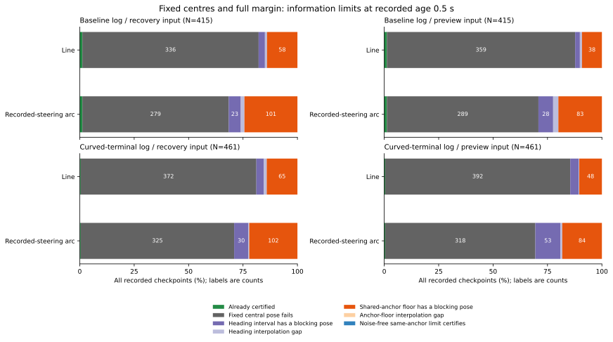

# 固定した推定位置での情報量と補正ずれの下限

観測後0.5秒の予定操舵経路では、同じ補正ずれを残して観測ノイズをゼロまで減らしても、範囲全体の許可は復帰入力・予測入力とも876地点中7地点のままでした。残る869地点には、ノイズが消えた範囲内にも余裕不足の姿勢が少なくとも1つあります。

全時点・両入力・両経路の8,480評価でも、この理想的なノイズ除去で計算上の許可は103から109評価への変化でした。追加6評価は2つの記録地点を入力・経路ごとに数えたものです。共有する補正ずれの分散を観測数だけで小さくできないことが、固定位置での許可条件に強く効いています。

## 固定した対象と情報量の仮定

[固定手順](protocol.md)を先に記録し、[前回の境界分割](../admission-envelope-refinement/report.md)と同じ648ケースの会計、時間切れ368ケース、2,120地点を使いました。元の[位置モデル](../epoch-position-components/report.md)と[姿勢範囲の比較](../model-admission-envelopes/report.md)から、復帰・予測入力、直線・予定操舵の曲線の全8,480行を引き継いでいます。誤差・移動・融合利用可否・判定で対象を選び直していません。

推定位置・向き、±4度の向き範囲、0.6mの経路、操舵、元の余裕`M=.6+2sqrt(2)*sigma+.02*age`を固定します。新しい観測で推定位置が動く効果は含めず、同じ中心で必要な情報精度を比べます。元のMの不確かさ項も削っていません。

既存のモデルから、1軸の観測ノイズ分散Vnと、共有する補正ずれの分散Vaを使います。C=2sqrt(2)として、次の2つの理想条件を比べました。

| 情報の追加方法 | K組での位置半径 | K→∞での半径 |
|---|---|---|
| same_anchors：補正ずれを共有して観測ノイズだけを独立に追加 | C*sqrt(Va+Vn/K) | C*sqrt(Va) |
| independent_anchors：ノイズと補正ずれを含む入力全体を独立に追加 | C*sqrt((Va+Vn)/K) | 0 |

K=1,3,10,25と数学的な極限を固定して比較しました。Kは現在の推定方式の観測群を丸ごと複製する理想的な組数です。観測数、受信した補正数、待機時間への換算はしていません。3期間融合の独立な1組は、その3期間の補正ずれも独立なものを必要とします。

各組の内部の時刻・重み・時間相関は既存のVnに入っています。一方、組同士のノイズまで独立とする仮定は楽観的です。相関する隣接観測や重なる融合窓を、そのまま独立な組として増やすことはできません。実際に新しい観測を使うときには、中心位置と実現した誤差も更新されます。

## 許可できる半径の必要条件と十分条件

元の監査済みの向き−4〜4度の9点から、障害物・壁までの距離の最小値do・dwを別に取ります。連続する向きとの補間量は`E=2*.6*sin(radians(.5)/2)=0.00523597m`です。真の向き全体での各距離の最小値は、それぞれ`[do-E,do]`と`[dw-E,dw]`に入ります。

半径rの円板全体について、次の3通りに分けます。

| 状態 | 条件と意味 |
|---|---|
| certified_clear | do-E-r > M、かつdw-E-r >= M。全姿勢で余裕がある十分条件 |
| some_pose_blocks | do-r <= M、またはdw-r < M。範囲内に余裕不足の姿勢が少なくとも1つある |
| angle_gap | 上のどちらにも確定せず、向き補間の隙間が残る |

ある向きで障害物までの最小距離がdなら、経路全体をその障害物へ動かすことで`max(0,d-r)`を達成できます。壁に向かって動かすと壁までの最小距離はrだけ減ります。これが2行目の必要条件を支えます。障害物の等号は許可せず、壁の等号は許す元の条件を保ちました。

`some_pose_blocks`には許可できる姿勢とできない姿勢が混在する場合もあります。この状態を全姿勢の遮断や実際の停止指令へ置き換えていません。`angle_gap`も独立に残しています。

## 観測後0.5秒に残る下限

基準記録epochは415地点・87ケース、曲線終端記録curvedは461地点・93ケースです。両記録を合わせた876地点を、各入力・経路で同じ分母に使います。時点・入力・経路・記録の重なる評価で、独立な試行数ではありません。

次は半径の単位をmで示したものです。復帰は25観測の平均、予測の3期間融合は75観測です。融合を使わない予測フィルター代替は独立ノイズ98・相関ノイズ80地点で、同じノイズ種の復帰と同じ半径です。

| ノイズ・入力方式 | 地点 | 現在の半径 | 同じ補正ずれでノイズゼロの半径 | 理想独立25組の半径 |
|---|---:|---:|---:|---:|
| 独立・復帰平均 | 474 | 0.288444 | 0.282843 | 0.057689 |
| 相関1秒・復帰平均 | 402 | 0.384966 | 0.282843 | 0.076993 |
| 独立・予測3期間融合 | 376 | 0.166533 | 0.163299 | 0.033307 |
| 相関1秒・予測3期間融合 | 322 | 0.222812 | 0.163299 | 0.044562 |

全876地点を、真値を使わずに次の優先順で分類しました。「現在中心が不許可」は推定位置・向きそのものの判定です。位置の半径をゼロにしても、その中心が範囲内に残ります。

| 条件の分類 | 復帰・直線 | 復帰・予定操舵 | 予測・直線 | 予測・予定操舵 |
|---|---:|---:|---:|---:|
| 現在すでに範囲全体を許可 | 7 | 7 | 7 | 7 |
| 現在の中心姿勢が不許可 | 708 | 604 | 751 | 607 |
| 位置半径0でも向き範囲に余裕不足の姿勢 | 28 | 53 | 27 | 81 |
| 位置半径0で向き補間の隙間が残る | 10 | 9 | 5 | 14 |
| 位置半径0なら許可できるが補正ずれの下限に余裕不足の姿勢 | 123 | 203 | 86 | 167 |
| 補正ずれの下限で向き補間の隙間が残る | 0 | 0 | 0 | 0 |
| 観測ノイズゼロの同じ補正ずれの極限で許可 | 0 | 0 | 0 | 0 |

最後の行は現在の許可を除く追加分です。この部分集合では、ノイズゼロまで平均しても追加の許可がありません。全体のうち復帰604・予測607地点は推定中心の判定自体が余裕不足で、半径だけを縮める比較では許可へ変わりません。実際の補正による推定中心の移動は、別に評価が必要です。



図は7分類をすべて含みます。ラベルは地点数、横軸は各記録の全地点数に対する割合です。幅4%未満のラベルは省き、0を含む56区間を[図の数値](information-bottlenecks.csv)に保存しました。

## 独立情報を増やす理想条件と固定誤差

次は同じ876地点の予定操舵経路です。K=1は両方法で一致します。同じ補正ずれを残す方法はK=3,10,25と極限のすべてで、両入力とも許可7・余裕不足の姿勢あり869・補間の隙間0でした。

独立な組を増やす仮定では、次のように変わりました。「一致／不一致」は、中心を動かさずに半径だけを縮めた結果の許可を、記録の真の経路判定と比べた件数です。新たに観測した結果や将来の誤判定率は測っていません。

| 入力・独立な組数 | 全姿勢を許可 | 記録の真判定と一致 | 不一致 | 余裕不足の姿勢あり | 補間の隙間 | 記録の姿勢を包含 |
|---|---:|---:|---:|---:|---:|---:|
| 復帰・1 | 7 | 7 | 0 | 869 | 0 | 814 |
| 復帰・3 | 8 | 7 | 1 | 866 | 2 | 564 |
| 復帰・10 | 54 | 24 | 30 | 818 | 4 | 305 |
| 復帰・25 | 74 | 35 | 39 | 791 | 11 | 156 |
| 復帰・極限 | 210 | 125 | 85 | 657 | 9 | 0 |
| 予測・1 | 7 | 7 | 0 | 869 | 0 | 816 |
| 予測・3 | 10 | 10 | 0 | 866 | 0 | 555 |
| 予測・10 | 43 | 29 | 14 | 824 | 9 | 140 |
| 予測・25 | 69 | 51 | 18 | 797 | 10 | 86 |
| 予測・極限 | 174 | 125 | 49 | 688 | 14 | 0 |

K=25の仮定で、復帰の追加許可67件のうち39件、予測の追加62件のうち18件は記録の真判定と不一致でした。記録の姿勢誤差は固定したままなので、狭い円板から真の姿勢が外れる地点が増えます。これは平均位置や誤差の更新も伴う実際の独立観測の効果とは別の、固定中心での整合性の確認です。

同じ補正ずれの極限でも、記録の姿勢を包含するのは復帰797/876・予測801/876です。モデルからドリフト・移動補償の不確かさを除いており、ガウス過程の裾も有限の円板に収まりません。これらを校正済みの包含率や信頼水準にはしていません。

## 全時点と固定した誤った追加許可

全8,480評価の分類は、現在すでに許可103、中心姿勢が不許可6,215、位置半径0でも向き範囲に余裕不足493、向き補間の隙間110、共有する補正ずれの下限に余裕不足1,549、その下限の補間の隙間4、ノイズゼロでの追加許可6でした。

追加6評価は、new-white・curved・none・seed274・迷路・Theta*の180秒の両入力・両経路4評価と、new-correlated・epoch・random・seed274・迷路・A*の175.18秒の両入力・予定操舵2評価です。前者は1観測への代替、後者は最初の利用可能時点の10観測でした。6評価とも記録の真判定は許可で、今回の比較ではK=10で既に許可になります。6回の独立な走行改善を示した件数ではありません。

前回から固定した、直線より曲線で追加許可したのに真の余裕が足りなかった復帰43・予測54地点では、同じ補正ずれの極限でも全姿勢の許可は0でした。独立情報の位置半径0の極限では、それぞれ21・23地点が固定中心の許可になりますが、すべて記録の真判定と食い違います。両入力は重なるため合算していません。

全時点の独立25組の仮定では、許可730評価のうち記録と一致476・不一致254、補間の隙間63、余裕不足の姿勢あり7,687でした。範囲を縮める計算だけで現実の不確かさを減らしたことにはならず、新しい情報を使った中心と誤差の更新を同時に測る必要があります。

## 検証と再実行

解析コードは`07602db`、図と手順は`0d37d08`です。全8,480行で元の半径と許可マスクをK=1で再現し、半径の差の最大は0でした。分散の分解、Kごとの半径の単調性、両方法の大小、許可と余裕不足の姿勢がある状態の単調性を検証しました。7分類の会計と各状態の分割も照合しています。

保存済みの9点の向きの幾何を使い、52,218の固有幾何の監査を引き継ぎました。今回新しい幾何・生軌跡・物理検証は追加していません。入力・モデル・補助コード・地図・シミュレーター・手順の指紋も照合しました。記録の姿勢を包含した評価での、記録の真判定に反する許可は0でした。

Python 234テストが成功しました。追加14件で共有する分散の下限、実際の相関を含む期間平均と理想独立組の差、分散0の極限、壁・障害物の等号、負の半径上限、角度補間の隙間、密な姿勢候補での十分条件、障害物・壁への移動で必要条件を満たす具体例、7分類、有限組数では達しない壁の極限、真値に依存しない条件、ある遮断姿勢と全遮断の区別、空の集計群を確認しています。

```bash
python3 experiments/pose_observation_loss/analyze_admission_information_floors.py \
  --output /tmp/admission-information-floors
python3 experiments/pose_observation_loss/plot_admission_information_floors.py \
  --results /tmp/admission-information-floors --output /tmp/information-floors-figure
python3 -m unittest discover -s experiments/pose_observation_loss -p 'test_*.py'
```

新しい出力先を使います。解析は標準ライブラリー、図はMatplotlibを使い、追跡済みの表と地図だけで再実行できます。5つのCSVと`sources.json`は別の出力先への再実行でバイト単位で一致しました。図の数値・SVG・PNG・指紋も一致し、表示を確認しました。

[accounting.csv](accounting.csv)に全648ケース、[checkpoints.csv](checkpoints.csv)に8,480行のメタデータ・分散・必要／十分な半径上限・分類、[curves.csv](curves.csv)に`base_row`で対応する84,800行の情報量比較、[bottleneck-summary.csv](bottleneck-summary.csv)に640行の分類集計、[summary.csv](summary.csv)に6,400行の条件・群・入力・経路・部分集合・判定群別の集計があります。`source_row`は[元の判定表](../model-admission-envelopes/decisions.csv)のヘッダーを除く1始まりの行番号、向きの幾何IDは[元の幾何表](../model-admission-envelopes/geometry-audit.csv)を参照します。[sources.json](sources.json)と[図の指紋](information-bottlenecks-sources.json)に指紋があります。

数学的な極限で許可条件を満たしても、有限の組数で必ず達するとは限りません。特に壁の等号で、半径0の極限だけが許可される場合があります。今回の結果は固定中心での情報精度の比較で、制御・余裕・タイマーや実走行の保持結果140→140は更新していません。
