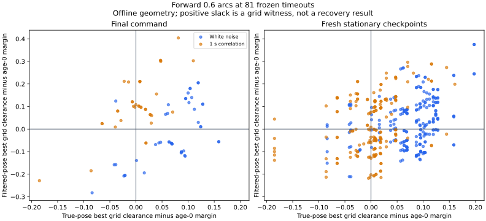

# 停止81例の前進弧と操舵選択の診断

真姿勢から前進0.6の固定操舵の弧を調べると、終了判断の81例中53例で現在の復帰余裕を満たす弧が見つかりました。直線では6例でした。ただし、平滑化姿勢で余裕を満たすとして選ばれた47例の角度を真姿勢へ移すと、同じ余裕を満たしたのは26例でした。弧を使える空間があることと、観測から適切な操舵を選べることは別の課題です。

今回は[前回の未完了診断](../aligned-stalls/report.md)で、目標未到達かつ末尾30秒の移動が0.1未満だった新規81例を固定した幾何解析です。独立ノイズ44例、相関1秒37例、seed265〜267の `aligned` 群です。制御・余裕・ノイズを変更せず、新しい走行や保持成功率の比較は行っていません。

## 評価する姿勢と距離

終了判断と、末尾30秒の `150.5, 155.5, …, 175.5` 秒のうち観測年齢0.5秒・判断前の速度の絶対値0.02以下の地点を調べました。真姿勢と、制御の停止予測に使った移動補償した平滑化姿勢は、同じ判断前の時点で比較します。行の時刻180秒なら、真姿勢は179.98秒の状態です。前回の終了後180秒の静的参照とは時点を区別しています。

終了判断81組と、鮮度を固定した416地点の計497組・994姿勢になりました。フィルタの観測数は終了判断で全例1、鮮度確認地点で全地点25でした。終了判断を25観測の平均として扱わず、二つの群も平均化効果を直接比較する標本とは扱いません。

弧は前進距離0.6、ホイールベース0.4、操舵−35〜35度の1度刻み71本です。点障害物と地図境界への最小距離を、円弧の始点・終点・射影・壁方向の内部極値から求めます。最大距離がほぼ同じ角度は、小さな絶対操舵角を優先します。目標への進行や時間応答は評価していません。

距離の基準を、物理半径0.5、追加余裕を含む0.6、観測年齢ゼロの復帰余裕、記録された年齢を含む復帰余裕に分けます。全地点でsigmaは0.1だったため、年齢ゼロの余裕は `0.6 + 2√2×0.1 = 0.88284`、年齢0.5秒では0.89284です。真姿勢での評価でも、この余裕を維持します。

## 終了判断の81例

「弧あり」は格子の少なくとも1本が余裕を超える例です。「全固定操舵で不可」は格子間も含む上界が余裕以下の例です。

| 姿勢 | 余裕の観測年齢 | 直線で通過 | 弧あり | 全固定操舵で不可 | 未確定 |
|---|---|---:|---:|---:|---:|
| 真姿勢 | 0 | 6 | 59 | 22 | 0 |
| 真姿勢 | 記録値 | 6 | 53 | 28 | 0 |
| 平滑化姿勢 | 0 | 17 | 52 | 29 | 0 |
| 平滑化姿勢 | 記録値 | 11 | 47 | 34 | 0 |

真姿勢の現在の余裕では、直線が通らなかった75例中47例に通過する弧がありました。残る28例は固定操舵全体の上界でも通らず、うち12例は始点の距離だけで余裕不足でした。年齢ゼロでは59例が通過し、22例が全固定操舵で不成立でした。

物理半径0.5と追加余裕を含む0.6に対しては、両姿勢とも全81例で通過する格子の弧がありました。復帰余裕を満たすかという判定とは分けています。

図は格子の最大距離から年齢ゼロの復帰余裕を引いた値です。正なら通過する格子の弧があります。負の点でも、格子間を含めた不成立を証明できるかは上界で別に判定します。

## 観測が新しい416地点

同じ416地点で両姿勢を比較しました。複数地点が同じ走行に属するため、独立走行の成功率ではありません。

| 姿勢 | 余裕の観測年齢 | 直線で通過 | 弧あり | 全固定操舵で不可 | 未確定 |
|---|---|---:|---:|---:|---:|
| 真姿勢 | 0 | 33 | 325 | 91 | 0 |
| 真姿勢 | 0.5秒 | 33 | 275 | 118 | 23 |
| 平滑化姿勢 | 0 | 63 | 215 | 187 | 14 |
| 平滑化姿勢 | 0.5秒 | 55 | 210 | 204 | 2 |

この群でも物理半径0.5と距離0.6に対しては、全416地点・両姿勢で通過する格子の弧がありました。現在の復帰余裕で通れる格子の弧がない地点の一部は、連続操舵の上界からも不成立と断定できず、未確定に残しています。

## 同じ操舵角を真姿勢へ移すとどうなるか

それぞれの姿勢に何らかの弧があることを確認した後、平滑化姿勢の最良角を真姿勢へ移す診断を追加しました。角度を真姿勢に合わせて選び直さず、同じ角度を独立した折れ線計算でも照合しています。

| 対象 | 余裕の年齢 | 平滑化姿勢で選択角が通過 | 同じ選択角が真姿勢でも通過 |
|---|---|---:|---:|
| 終了判断81組 | 0 | 52 | 29 |
| 終了判断81組 | 記録値 | 47 | 26 |
| 鮮度確認416組 | 0 | 215 | 160 |
| 鮮度確認416組 | 0.5秒 | 210 | 142 |

終了判断で現在の余裕を満たすとして選ばれた47例のうち、15例は真姿勢の全固定操舵で不成立、6例は真姿勢に別の通過する弧があっても選択角では不成立でした。鮮度確認地点では、選択角を移して不成立となった68地点の内訳は、真姿勢の全固定操舵で不成立42、別の格子の弧は通過15、未確定11でした。表の選択角は、真姿勢でも全例で物理半径0.5を超えており、この不成立は復帰余裕に対するものです。

例えば独立・none・seed266・dense・A*の150.5秒では、平滑化姿勢から選ばれた−17度の距離は0.96561でした。同じ角度を真姿勢へ移すと0.89084となり、その地点の余裕0.89284を下回ります。真姿勢からの最良角−25度なら距離0.94637です。この地点のフィルタは25観測でしたが、位置差0.10014、向きの差0.03185radが残っていました。これは実際にその操舵を実行した結果ではありません。

## 格子間の操舵を含む上界と検証

曲率 `k = tan(delta)/0.4`、距離 `s` の円弧の位置は、曲率に対する変化率が `s²/2` 以下です。操舵範囲内の `dk/ddelta` と最寄り格子までの0.5度を使うと、位置と最小距離の差は次で抑えられます。

`0.6²/2 × sec²(35°)/0.4 × radians(0.5) = 0.00585236`

距離は始点の距離も超えないので、`min(始点距離, 格子最大距離 + 0.00585236) + 1e-9` を上界にします。格子の通過は余裕を1e-9より大きく超えた場合、全固定操舵の不成立は上界が余裕以下の場合に限り、その間は未確定です。この証明は前進0.6の固定操舵の範囲だけを対象とし、途中の操舵変更、短い動作、後退、再計画を除外しません。

81軌跡・729,000物理区間、姿勢フィルタ、ガードと両解除タイマーを照合しました。入力と全生軌跡のハッシュは前回の診断に保存した値と一致しています。994姿勢で70,574本の格子の弧を計算し、終了判断の全格子、鮮度確認地点の直進・最良角・記録操舵、選択角の転用497件を含む14,575件を、独立した120分割の折れ線距離で照合しました。最大差は約5.47×10⁻⁶で、弧と弦の差による誤差上限と1e-9の許容内でした。

追加6件と既存の幾何テストを含むPythonの64テスト、整形・構文チェックが通過しました。集計を再実行し、5つのCSVと実行情報のバイト単位の一致を確認しています。新たな制御・保持成績の検証は行っていません。

[READMEの手順](../../README.md#audit-forward-arcs-at-the-aligned-release-stalls)で再実行できます。[checkpoints.csv](checkpoints.csv)、[steering-grid.csv](steering-grid.csv)、[geometry-audit.csv](geometry-audit.csv)、[paired-poses.csv](paired-poses.csv)、[summary.csv](summary.csv)と[sources.json](sources.json)を保存しました。図にはMatplotlibを使います。

シミュレータは前回と同じSHA-256 `62dd0d42292b070fb9289bc0ed48474bc14c4530e3fe08f64aaf339ff3babba3` です。空間的な円弧の評価では、実際の離散積分・加減速・操舵の変更や、0.5秒・1秒の解除タイマーを再実行していません。今回の結果は弧を使う候補を検討する材料ですが、真姿勢を使えない制御で適切な角度を選べることや、到達・保持が改善することまでは示していません。
