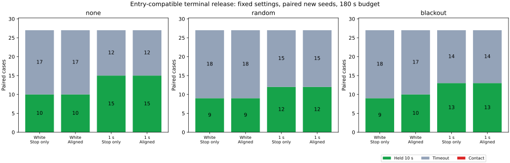

# 解除時にも開始条件を満たす終端直線の比較

解除時の終端直線に開始時と同じ余裕を要求すると、新規162組の短い再発動は8,151→434回に減りました。解除時点で開始条件が不成立の例も候補では0件になりました。一方、10秒保持は68→69/162、平均待機は105.31→107.41秒でした。接触は両群0件ですが、進行や保持の改善は小さく、静止した時間切れも増えています。候補は比較用として残し、既定には採用しません。

## 条件と比較の範囲

[前回の停止軌道だけでの解除](../terminal-entry-only/report.md)は、解除時点ですでに開始条件が不成立になる場合がありました。今回は、[実行前の固定条件](protocol.md)に従い、両者を同じ判定時点で整合させます。開始条件は変えません。

`m = 0.5 + 2√2×sigma + 0.02×観測年齢`、停止軌道の距離を `Dstop`、予測停止点から前方0.6の直線の距離を `Dterminal` とします。

| 項目 | 基準 `entryline` | 候補 `aligned` |
|---|---|---|
| 開始条件を通過 | `Dstop > m` かつ `Dterminal > m + 0.1` | 同じ |
| 解除の距離条件を通過 | `Dstop > m + 0.05` | `Dstop > m + 0.05` かつ `Dterminal > m + 0.1` |
| 単独解除・同時復帰の連続確認 | 0.5秒・1秒 | 同じ |

候補の解除用の判断値は `min(Dstop, Dterminal − 0.05)` です。これを `m + 0.05` と比較します。停止軌道の解除余裕を維持し、終端直線には開始時と同じ余裕を要求します。初期の `recoverable` の解除条件 `Dterminal > m + 0.15` まで厳しくはしていません。今回の直接比較は `entryline` と `aligned` の2群です。

単独解除と同時復帰の両方を変えており、各経路の効果までは分けていません。同時復帰に必要な実測の復帰直線、地図境界、観測数、観測年齢、静止条件、正の予定指令は従来どおりです。平滑化、速度上限、操舵・制動、ノイズの余裕、車体半径0.5、180秒制限、10秒保持も共通です。追加の待機時間や開始抑制は加えていません。真姿勢は制御判定に使いません。

`ALIGNED_TERMINAL_RELEASE` は既定で無効で、`TERMINAL_ENTRY_ONLY=true` を要します。軌跡の追加列は `aligned_terminal_release` です。解除値は既存の `release_preview_clearance_lower_bound` に記録し、開始用の列はそのままです。初期行の追加フラグはfalseです。

## 保持と接触

各行81組です。既知262〜264と新規265〜267を、独立・相関1秒のノイズ、欠落3条件、3地図、3計画器で比較しました。既知群は前回に使用済みです。途中で閾値やシードは変更していません。

| 対象・ノイズ | 基準の保持 | 候補の保持 | 獲得 | 喪失 | 接触（基準→候補） |
|---|---:|---:|---:|---:|---:|
| 既知・独立 | 30 | 27 | 1 | 4 | 0→0 |
| 既知・相関 | 37 | 39 | 2 | 0 | 0→0 |
| 新規・独立 | 28 | 29 | 1 | 0 | 0→0 |
| 新規・相関 | 40 | 40 | 0 | 0 | 0→0 |

新規162組は獲得1件・喪失0件、既知162組は獲得3件・喪失4件でした。全648走行で地図外への退出はなく、保持以外はすべて180秒の時間切れでした。

保持が変わった8組はすべてmazeでした。新規の獲得は独立・blackout・seed265・Theta*で、候補の最初の真の目標進入は165.12秒でした。既知・独立で失った4組はすべて目標に未到達で、終点の目標距離は11.32〜36.77でした。地図ごとの挙動差を含む少数シードの結果であり、改善を一般化できません。

## 待機と再発動

待機は欠落待機またはガードの指令区間の和集合で、重なりは1回だけ数えます。目標停止だけの区間は加えません。静止中の待機は判断前の速度の絶対値0.02以下に限定します。

| 対象・ノイズ | 平均待機（基準→候補） | 静止中の平均待機（基準→候補） | 短い再発動（基準→候補） |
|---|---:|---:|---:|
| 既知・独立 | 110.72→115.77秒 | 104.93→110.82秒 | 4,859→206 |
| 既知・相関 | 98.17→98.93秒 | 93.61→94.32秒 | 3,738→229 |
| 新規・独立 | 115.68→118.04秒 | 110.59→113.34秒 | 4,192→247 |
| 新規・相関 | 94.95→96.77秒 | 89.72→92.26秒 | 3,959→187 |

新規全体の平均待機は105.31→107.41秒、静止中の平均待機は100.16→102.80秒でした。末尾30秒の移動0.1未満の時間切れは68→81件に増えました。ガード開始は10,628→896回に減りましたが、候補の891回は終端直線だけによる開始でした。

短い再発動は、解除時の実指令速度が正、途中に欠落待機がなく、次の開始まで1秒以内かつ移動0.1未満という従来の定義です。新規8,151→434回、既知8,597→435回に減りました。再発動回数の減少は、待機短縮や目標への進行の改善を意味しません。走行は保持完了時などで終了するため、回数と待機時間は同一時間窓の率でもありません。

## 同じ判定時点と次の行の違い

候補の全ガード解除を独立な幾何確認とイベント記録で確認しました。

| 対象 | 候補のガード解除 | 解除時点で開始条件が不成立 | 次の0.02秒で再発動 |
|---|---:|---:|---:|
| 既知162例 | 808 | 0 | 29 |
| 新規162例 | 806 | 0 | 28 |

この集計は速度ゼロの解除を含め、欠落による中断も除外しないため、短い再発動とは分母・条件が異なります。候補の予定速度ゼロでの解除は既知54回、新規51回でした。

同じ入力での開始と解除の食い違いは解消しましたが、次の行では観測姿勢・予定指令・物理状態が変わります。解除直後の再発動は残っており、今回の条件は将来の開始判定や復帰の成功を保証するものではありません。長い待機や未到達の時間切れも残っています。

## 検証と再実行

- 全648走行と元の既定条件seed201・54走行を検証しました。5走行のシミュレータハッシュは一致しています。既知シードの基準群162件は前回の結果と全項目が一致し、既定54件も保存結果と一致しました。既定baseline・blackoutに元からある接触1件も同じでした。
- 全ステップの開始・解除値、両解除タイマー、ガード遷移、姿勢フィルタ、物理応答、対にした乱数、目標保持を照合しました。両群は最初に解除動作が異なるまで、モード・解除値の列と両証拠時間を除いて一致しました。
- 候補の全開始・解除・欠落復帰と固定地点を含む5,468地点で、停止軌道、終端直線、速度用の弧、実際の復帰直線を独立に再計算しました。欠落からの全復帰430回と、解除時の開始条件の成立も確認しました。イベント集計の解除数は全軌跡の解除数と一致しました。
- Pythonの52テスト、Rust exampleの9テスト、Pure Pursuitのライブラリ3テストが通過しました。Headless Releaseビルド、`std`を有効にした全ターゲットのClippy（警告をエラー扱い）、Rust/Python整形・構文チェックも通過しました。
- 集計を再実行し、6つのCSVと実行情報のバイト単位の一致を確認しました。

[READMEの手順](../../README.md#compare-entry-compatible-terminal-release)で再実行できます。[all-results.csv](all-results.csv)、[summary.csv](summary.csv)、[paired-holds.csv](paired-holds.csv)、[control-events.csv](control-events.csv)、[preview-audit.csv](preview-audit.csv)、[release-entry-gaps.csv](release-entry-gaps.csv)と[sources.json](sources.json)を保存しました。図にはMatplotlibを使います。生軌跡は再実行で生成します。

シミュレータSHA-256は `62dd0d42292b070fb9289bc0ed48474bc14c4530e3fe08f64aaf339ff3babba3` です。正確な測定速度・操舵・車体モデルに依存する姿勢補償や、相関ノイズ・共通バイアスへの制約は前回と同じです。今回の整合化は再発動を大幅に減らしましたが、目標へ進めず待つ問題の解決には至っていません。
