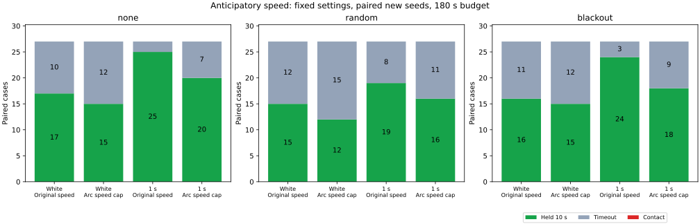

# 停止ガードより手前で速度を制限する比較

推定した前方経路から速度上限を決める新案 `paced` は、既知例の接触記録を3件から0件に減らしました。ただし新規シード244〜246では両案とも接触0件で、10秒保持は116/162件から96/162件に減りました。今回の新しい試行では安全面の改善は確認できず、到達率の代償がありました。実験オプションとして保存し、既定の制御には採用しません。

## 固定した条件と減速案

前回の[余裕を広げた経路](../planning-clearance/fixtures/fine-padding)を両群に使います。3地図×3計画器、刻み幅0.125・計画半径0.99の全9経路が同一です。`clearance` は従来の停止ガード、`paced` はその制御に速度上限と上限超過時の追加ブレーキを加えます。補正前後の整合性確認は使いません。

各判断で、推定姿勢から現在の名目操舵を保つ長さ2の円弧を調べます。円弧長0.05ごとの点を線分で結び、既知の点障害物・地図境界との距離を確認します。余裕は `0.5 + 0.1 + 2√2σ + 0.02×観測経過時間`。初めて余裕を満たさない線分を見つけたら、その始点までの円弧長をDとし、最初の姿勢から不適ならD=0、全区間が適合ならD=2です。

速度上限は `clamp(sqrt(0.0225 + D) - 0.15, 0, 1)`。設計上の制動減速度0.5と0.3秒分の移動余裕を置いた式 `0.3v + v²/(2×0.5) ≤ D` から求め、既存の目標・復帰速度に適用します。計測速度が上限を1e-9より大きく超えれば、既存の `clamp(-4v, -1, 0)` で制動します。0.3秒は設計上の余裕であり、物理モデルに作動遅延を加えたものではありません。操舵の計算、停止ガード、欠落時の待機・復帰は従来どおりです。

速度上限と追加制動を合わせた比較で、両者の効果は分離していません。真の位置・障害物距離や未来の観測は制御に使いません。車体半径0.5、最大減速度1、操舵上限、観測ノイズ・ドリフト・欠落、180秒上限は同じです。成功は目標停止指令中の真の目標距離0.25未満・速度0.02以下の10秒連続保持、接触は真の移動線分と点障害物との距離0.5以下で即終了です。

## 新しいシード244〜246

固定した設定で独立ノイズと相関時間1秒を比較しました。各行は同じ27件、値は `clearance → paced` です。

| 局所ノイズ | 外部観測欠落 | 10秒保持 | 接触 | 時間切れ |
|---|---|---:|---:|---:|
| 独立 | なし | 17 → 15 | 0 → 0 | 10 → 12 |
| 独立 | ランダム | 15 → 12 | 0 → 0 | 12 → 15 |
| 独立 | 45〜75秒 | 16 → 15 | 0 → 0 | 11 → 12 |
| 相関1秒 | なし | 25 → 20 | 0 → 0 | 2 → 7 |
| 相関1秒 | ランダム | 19 → 16 | 0 → 0 | 8 → 11 |
| 相関1秒 | 45〜75秒 | 24 → 18 | 0 → 0 | 3 → 9 |

新規324件の対比較では、保持を獲得したケースは0件、喪失は20件でした。独立ノイズの保持は48/81→42/81、相関1秒は68/81→54/81です。全件で地図外への逸脱はありません。

相関1秒・欠落なしでは、平均ガード待機時間が22.12→42.56秒に増えました。新案の速度制限時間は平均8.69秒、追加ブレーキ時間は5.27秒で、低速走行の時間だけでなく停止ガードの待機も増えています。待機時間は終了までの累計で未達も含み、速度制限・追加ブレーキ時間は目標停止・欠落待機・停止ガードと重ならない区間だけを数えます。

新しい乱数シードは3個で、地図は従来と同じです。同じ乱数を複数経路・欠落条件で使うため、各ケースは独立した統計標本ではありません。今回の接触0件から将来の接触確率や安全性を保証することはできません。

## 既知の接触例234・243

相関1秒の別枠108件では、接触記録が3→0件、保持が34/54→27/54件でした。保持は欠落なし15/18→11/18、ランダム5/18→5/18、45〜75秒欠落14/18→11/18です。接触3件のうち、シード243の欠落なし・45〜75秒欠落は欠落開始前の同じ軌跡であり、独立した2事象ではありません。

| 欠落なしの既知例 | 従来 | 新案 | 最小距離（従来→新案） | 新案の終了時目標距離 |
|---|---|---|---:|---:|
| seed234・dense・Theta* | 92.30秒で接触 | 180秒で時間切れ | 0.49937 → 0.73287 | 26.89677 |
| seed243・maze・JPS | 7.90秒で接触 | 180秒で時間切れ | 0.49765 → 0.58376 | 43.58081 |

これらの接触回避は到達成功にはつながっていません。両案の最初の速度制限ブレーキ、最初のガード発動、従来の接触時刻、終了時の記録は [reference-checkpoints.csv](reference-checkpoints.csv) に保存しました。接触の独立な幾何再計算は [contacts.csv](contacts.csv) にあります。

## 検証と再実行

- 全432ケースで時間・物理応答・ノイズの対比較・停止と解除・保持/接触・集計値を検証しました。速度上限の式、目標速度、追加ブレーキと上限付き減速度も全判断で照合しています。
- 新案216ケースの計1,498地点で停止予測と速度制限用の円弧を独立に再計算しました。速度プローブの検証はシミュレータの近傍障害物への絞り込みを使わず全障害物を走査し、最初の不適合線分までの距離を照合しています。全3件の接触記録も真の移動線分から再計算しました。
- 既知例の比較対象54件は、同じ経路入力の保存済み結果と全サマリー項目が一致しました。既定モード・シード201も54件を実行し、該当する保存済み結果との回帰検証を通過しました。旧経路比較の集計CSV 3種類も完全に再現しました。
- 制御crateの全ターゲットClippy（警告をエラー扱い）、関連4テスト、ヘッドレスrelease exampleビルド、Rust整形とPython構文・整形チェックを通過しました。

全ケースは [all-results.csv](all-results.csv)、集計は [summary.csv](summary.csv)、保持の対比較は [paired-holds.csv](paired-holds.csv)、停止・速度制限の時間は [control-events.csv](control-events.csv)、幾何監査は [preview-audit.csv](preview-audit.csv) に記録しています。[sources.json](sources.json) に各群の同一な入力ハッシュと実行時情報を保存しました。実行時基点は `b829c7c` で、開発中の差分を含むため `dirty: true` です。最終ソースと一致する全比較のシミュレータSHA-256は `4eab2a2cbea0623afe307592b86cb08baf636fa4f888059c9544152f5228a606` です。

[実験README](../../README.md#anticipatory-speed-comparison-on-padded-paths) の3走行・集計コマンドで再実行できます。図の再生成だけMatplotlibが必要です。固定操舵の円弧と経験的な位置余裕は、将来の操舵変更や姿勢誤差の上限を保証しません。到達率を維持しながら接触を防ぐ条件は、この案では確認できませんでした。
