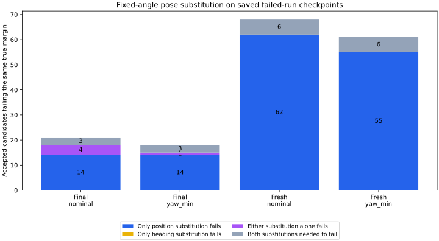

# 選択角を固定した位置・向きの差の診断

従来方式の食い違い89地点のうち76地点は、位置だけ真値に置き換えると復帰余裕を満たさなくなり、向きだけの置き換えでは満たしました。向きだけで余裕不足になる地点は0、どちらの置き換えでも単独で不足する地点は4、両方を置き換えた場合だけ不足する地点は9でした。この固定した標本では、向きだけを慎重に選ぶ方式で食い違いが多く残る理由として、位置の差が大きく関わっています。

これは[前回の選択方式の比較](../robust-arc-selection/report.md)の原因を切り分ける幾何診断です。保存済みの失敗走行81例に属する497組の姿勢を使い、新規走行は行っていません。終了判断81組と観測年齢0.5秒・判断前速度の絶対値0.02以下の416組を分けます。同一走行の複数地点を含むため、独立な試行の成功率ではありません。

## 角度と判定を変えずに比較する

[診断条件](protocol.md)を先に固定しました。nominalとyaw_minの選択角・通過判定は前回の記録を使い、その角度で次の4通りの最小距離を計算します。pose_boundはyaw_minと同じ角度なので、重ねて集計しません。

| 記号 | 位置 | 向き |
|---|---|---|
| FF | 平滑化した観測位置 | 平滑化した観測の向き |
| TF | 真の位置 | 平滑化した観測の向き |
| FT | 平滑化した観測位置 | 真の向き |
| TT | 真の位置 | 真の向き |

弧の長さ0.6、ホイールベース0.4、地図、選択角を維持し、真姿勢でも従来の余裕 `M = 0.6 + 2√2 × sigma + 0.02 × age` を要求します。通過は距離がMを1e-9より大きく超える場合です。真値への置き換えは原因を調べるための参照で、実装可能な推定器や制御への変更ではありません。

## 食い違いの内訳

前回の方式が通過と判定したものの、TTでは余裕を満たさない地点だけを分類します。この全地点でFFは余裕を満たしています。

| 地点群 | 選択方式 | 食い違い | 位置だけで不足・向きだけなら通過 | 向きだけで不足・位置だけなら通過 | どちら単独でも不足 | 両方を変えた場合だけ不足 |
|---|---|---:|---:|---:|---:|---:|
| 終了判断81組 | nominal | 21 | 14 | 0 | 4 | 3 |
| 終了判断81組 | yaw_min | 18 | 14 | 0 | 1 | 3 |
| 鮮度確認416組 | nominal | 68 | 62 | 0 | 0 | 6 |
| 鮮度確認416組 | yaw_min | 61 | 55 | 0 | 0 | 6 |

nominalの89地点とyaw_minの79地点には同じ地点が多く含まれるため、合算しません。通過判定数と真姿勢でも通過する数は前回と一致し、終了判断では47中26と40中22、鮮度確認では210中142と190中129でした。

例として、独立ノイズ・none・seed266・dense・A*の150.5秒で、nominalの選択角−17度を固定します。Mは0.89284です。

| 姿勢 | 最小距離 | Mを超えるか |
|---|---:|---|
| FF | 0.96561 | 通過 |
| TF：位置だけ真値 | 0.90409 | 通過 |
| FT：向きだけ真値 | 0.95584 | 通過 |
| TT：両方真値 | 0.89084 | 不足 |

この例は位置・向きの両方が重なったときだけ閾値を下回ります。位置だけの診断で大多数を説明できても、向きの差を無視できるという結論にはなりません。

## 距離差を二つの順序で分解する

距離低下 `FF - TT` を、位置→向き、向き→位置の両順序で分解して平均します。

`位置の寄与 = ((FF - TF) + (FT - TT)) / 2`

`向きの寄与 = ((FF - FT) + (TF - TT)) / 2`

二つの寄与の和は元の距離低下と一致します。これは順序に対して対称な記述上の配分で、推定器の誤差原因や、補正して得られる性能を証明するものではありません。負の寄与は距離低下を和らげる向きに作用したことを表し、ゼロに切り詰めません。

次の平均と中央値は、各群の食い違いの地点だけを対象とします。

| 地点群・方式 | 平均の距離低下 | 平均の位置寄与 | 平均の向き寄与 | 位置寄与の中央値 | 向き寄与の中央値 |
|---|---:|---:|---:|---:|---:|
| 終了判断 nominal | 0.19640 | 0.17571 | 0.02069 | 0.09733 | 0.01555 |
| 終了判断 yaw_min | 0.20822 | 0.19067 | 0.01755 | 0.18917 | 0.01515 |
| 鮮度確認 nominal | 0.15966 | 0.15510 | 0.00456 | 0.15461 | 0.00049 |
| 鮮度確認 yaw_min | 0.16849 | 0.16302 | 0.00547 | 0.16101 | 0.00000 |

この分解では全食い違い地点で位置寄与が向き寄与を上回りました。位置寄与が負の地点はありませんでした。向き寄与が負の地点は、終了判断のnominal・yaw_minでそれぞれ3、鮮度確認で29・25でした。誤差の作用が相殺する場合もあるため、寄与を確率や独立な原因の割合として扱いません。

## 始点ですでに余裕不足の地点

真の始点から障害物・壁までの距離がM以下の地点を別に数えました。弧は始点を含むため、どの固定操舵に変えても、始点から弧全体で同じMを超えることはできません。

| 地点群 | nominalの食い違いのうち始点で不足 | yaw_minの食い違いのうち始点で不足 |
|---|---:|---:|
| 終了判断 | 3 / 21 | 3 / 18 |
| 鮮度確認 | 20 / 68 | 17 / 61 |

nominalでは計23地点、yaw_minでは計20地点です。上の置き換え分類と重なる別の性質であり、件数を足し合わせません。これは観測誤差分も含む復帰余裕についての不成立で、物理半径0.5での接触を意味しません。

## 検証と再実行

497地点×2方式の994行を出力しました。重複する選択角を共有すると580組の地点・角度があり、それぞれ4姿勢の計2,320件で全障害物を走査しました。全件を独立した120分割の折れ線計算と照合し、最大差は約5.47×10⁻⁶で弧と弦の誤差上限内でした。FF・TTの距離、元の通過判定、各群の件数は保存済みの比較結果と一致しています。距離低下と二つの寄与の和も全行で確認しました。

追加6件を含むPythonの76テスト、整形・構文チェックが通過しました。座標の置き換え、成分が変わらない場合、順序の交換、負の寄与、4分類と閾値、壁への距離の既知解、食い違い以外を除外した集計を検査しました。再実行で3つのCSVと実行情報がバイト単位で一致しました。

[READMEの手順](../../README.md#separate-position-and-heading-effects-at-fixed-selected-angles)は追跡済みの入力だけで再実行できます。[components.csv](components.csv)、[geometry-audit.csv](geometry-audit.csv)、[summary.csv](summary.csv)、[sources.json](sources.json)に詳細と入力・スクリプト・固定条件のハッシュを保存しています。

今回示したのは固定角度での距離差です。制御、姿勢推定、余裕、解除タイマーは変更しておらず、走行や保持成績も測定していません。次の実装を検討する際には、向きだけの選択改善に加え、位置の不確かさと、始点ですでに余裕不足の場合の復帰条件を扱う必要があります。
