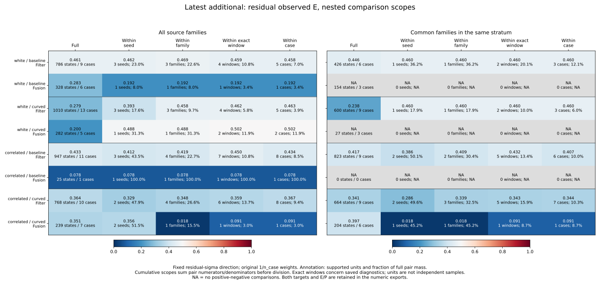
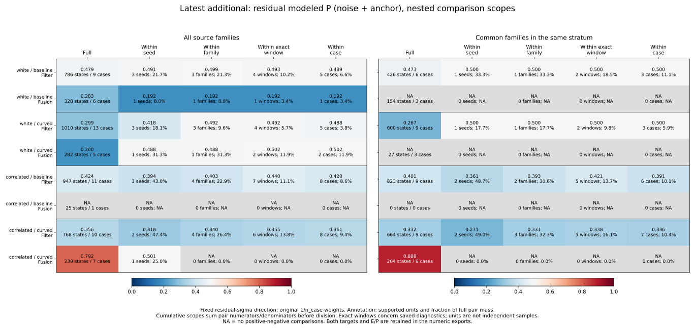
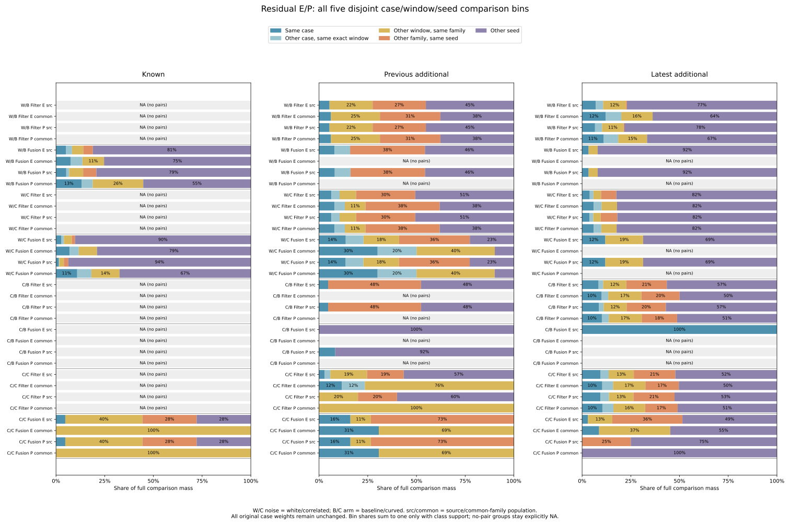
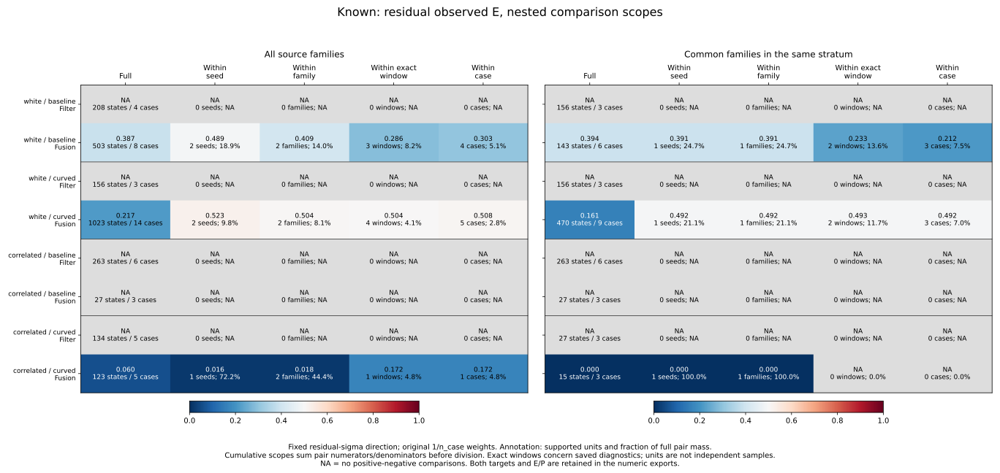
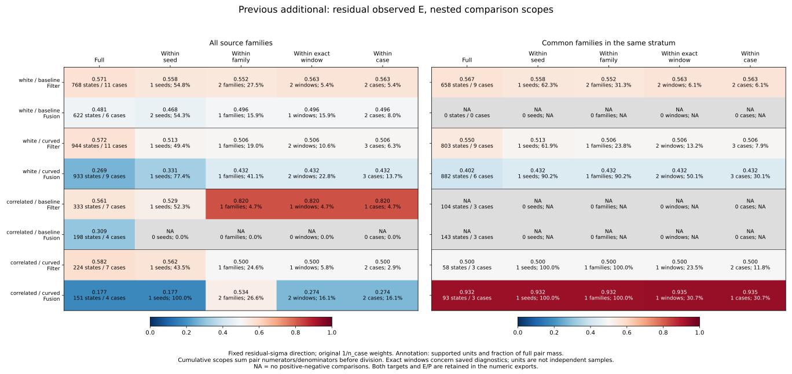

# Case, window and seed ranking comparisons

The latest cohort's Filter residual observed-error AUC remains below .5 when
only comparisons within each individual case are combined: .458125, .462568,
.433526 and .367442 across the four noise/arm conditions. That result persists
on common-family support. However, those within-case comparisons cover only
3.91–9.37% of the original full comparison mass and require both classes within
a case. This is a supported-case diagnostic, not a claim about every case.

Latest correlated/curved Fusion modeled P has full AUC .791564 but no
within-case, within-window or within-family class comparisons. Its within-seed
AUC .501320 comes entirely from different families. The high value on matched
common families (.888312) is entirely between seeds.

## Fixed comparison populations

Protocol [52c29a3](protocol.md) was committed before computing these results,
from main e90294f. Reuse 32,985 reconstructed pair references, 10,995 saved
Recovery/Preview states, 157 represented cases, 275 source opportunities,
972 planned cases and 324 planner families. Keep known 269/270/271, previous
additional 274/275/276 and latest additional 277/278/279 separate.

All noises/arms, five strata, both targets, three scores and E/P/U labels remain
in the tables. Only mixed planners are extended here; individual-planner
results remain in the preceding bundle. Original 1/n_case weights precede
stratum/population selection. Common-family eligibility still requires all
three planners in that same stratum and family, based on availability alone.
No weight normalization, new fitting, score reversal or cutoff change.

Each ordered positive/negative case comparison belongs to exactly one bin:

| Bin | Relationship |
|---|---|
| same_case | Identical full case key |
| other_case_same_window | Different cases, identical family-scoped complete saved window |
| other_window_same_family | Different complete windows in the same family |
| other_family_same_seed | Different families, same seed |
| other_seed | Different seeds |

A family retains cohort, arm, loss mode, seed and scenario. Exact window
equality uses the preceding complete typed diagnostic signature; partial
overlaps do not match. The first one/two/three/four bins give within-case/
window/family/seed metrics. All five give full AUC. Sum pair numerators and
denominators before division; a case with no positive-negative comparisons
does not receive an imputed AUC or equal weight. High score predicts outside,
ties receive half credit, and outside remains norm > .10 m with a closed inside
disk. Pair/unit counts are descriptive, not independent sample sizes.

## Latest Filter: the ordering persists within cases

Residual_sigma ranks residual observed E below. AUCs combine only existing
positive-negative pairs. Supported cases have both classes within Filter.

| Noise / arm | Source full | Within case | Supported cases | Pair share | Common within case | Supported cases | Pair share |
|---|---:|---:|---:|---:|---:|---:|---:|
| white / baseline | .461424 | .458125 | 5/9 | 6.98% | .460452 | 3/6 | 12.07% |
| white / curved | .279402 | .462568 | 5/13 | 3.91% | .460452 | 3/9 | 5.98% |
| correlated / baseline | .432830 | .433526 | 8/11 | 8.46% | .407047 | 6/9 | 10.05% |
| correlated / curved | .363656 | .367442 | 8/10 | 9.37% | .344113 | 7/9 | 10.35% |

Common-family matching retains different cases and changes comparison mass;
within-case AUCs are .460452, .460452, .407047 and .344113 in the same order.
Individual case AUCs remain available in full and need not all be below .5.
The aggregate does not estimate uncertainty or repair the score.

## Latest Fusion: family membership adds information beyond seed

Correlated/curved residual P has 239 source states, seven cases and three
families. Every individual case is P-one-class; every family is also P-one-class.
Consequently, same-case/window/family denominators are zero. The full .791564
AUC is .501320 on different-family/same-seed comparisons (25% of mass), and
.888312 between seeds (75%). There is no missing within-case statistic to fill.

Common-family matching removes the unmatched 35-state A* case at seed 279,
retaining 204 states, six cases and two families. The remaining P-outside
states all belong to seed 278 and P-inside states to 279. All P comparison mass
is between seeds, yielding .888312. The higher matched full AUC supplies no
within-case/family/seed evidence of stronger state-level ranking.

For observed E in that same source cell, full AUC is .351269 and within-seed
AUC .355612. Within-family AUC is .017544 on 15.51% of mass; within-case AUC is
.090909 on 2.99%, contributed by one of seven represented cases. Same-window
AUC also equals .090909 because the additional identical-window comparisons
have no E class support. The other-window/same-family bin has AUC zero.

The complete five-bin decomposition for this cell is below. Zero share with
NA AUC means no supported comparisons; a zero AUC with positive share is defined.

| Population / bin | E pair share | E AUC | P pair share | P AUC |
|---|---:|---:|---:|---:|
| Source / same_case | 2.99% | .090909 | 0.00% | NA |
| Source / other_case_same_window | 0.00% | NA | 0.00% | NA |
| Source / other_window_same_family | 12.52% | .000000 | 0.00% | NA |
| Source / other_family_same_seed | 35.99% | .501320 | 25.00% | .501320 |
| Source / other_seed | 48.50% | .346658 | 75.00% | .888312 |
| Common / same_case | 8.73% | .090909 | 0.00% | NA |
| Common / other_case_same_window | 0.00% | NA | 0.00% | NA |
| Common / other_window_same_family | 36.51% | .000000 | 0.00% | NA |
| Common / other_family_same_seed | 0.00% | NA | 0.00% | NA |
| Common / other_seed | 54.76% | .710216 | 100.00% | .888312 |

Matching retains the same within-case E numerator/denominator while shrinking
the full denominator, increasing its share from 2.99% to 8.73%. Common-family
E full AUC is .396864, within-family .017544 and within-case .090909. Neither
matching nor conditioning adds new states or independent noise realizations.

White/baseline source Fusion E has within-case AUC .192308 on 3.35% of mass,
from one of six cases. White/curved has .502171 on 11.91%, from two of five.
The latter is near .5 and represents limited support. Their matched common
subsets contain only inside E/P states and therefore have no AUC. Correlated/
baseline Fusion has 25 states from one JPS case: E AUC .077922 is entirely
within-case; P is one-class, and no three-planner common family is available.

## Other cohorts: conditional AUCs are not a universal repair

Known Filter stays one-class in both populations, so every comparison scope
is undefined. Previous-additional Filter has within-case AUCs .562928,
.506471, .820000 and .500000 on source support. The .820000 value comes from
one case and only 4.67% of full comparison mass, and becomes undefined on
common-family support. The cohort differences remain visible.

Fusion source observed E across all cohorts is retained below. Supported-case
counts and within-case shares show how much information each number uses.

| Cohort | Noise / arm | Source full | Within case | Supported cases | Pair share | Common within case | Supported cases | Pair share |
|---|---|---:|---:|---:|---:|---:|---:|---:|
| Known | white / baseline | .387488 | .303439 | 4/8 | 5.06% | .211933 | 3/6 | 7.46% |
| Known | white / curved | .217215 | .508244 | 5/14 | 2.80% | .492411 | 3/9 | 7.02% |
| Known | correlated / baseline | NA | NA | 0/3 | NA | NA | 0/3 | NA |
| Known | correlated / curved | .059663 | .171703 | 1/5 | 4.77% | NA | 0/3 | 0.00% |
| Previous additional | white / baseline | .481113 | .495969 | 2/6 | 7.97% | NA | 0/0 | NA |
| Previous additional | white / curved | .268723 | .431625 | 3/9 | 13.70% | .431625 | 3/6 | 30.07% |
| Previous additional | correlated / baseline | .308547 | NA | 0/4 | 0.00% | NA | 0/3 | NA |
| Previous additional | correlated / curved | .177094 | .274348 | 2/4 | 16.10% | .935484 | 1/3 | 30.69% |
| Latest additional | white / baseline | .283060 | .192308 | 1/6 | 3.35% | NA | 0/3 | NA |
| Latest additional | white / curved | .200314 | .502171 | 2/5 | 11.91% | NA | 0/3 | NA |
| Latest additional | correlated / baseline | .077922 | .077922 | 1/1 | 100.00% | NA | 0/0 | NA |
| Latest additional | correlated / curved | .351269 | .090909 | 1/7 | 2.99% | .090909 | 1/6 | 8.73% |

Known white/curved full AUC .217215 becomes within-case .508244 on only 2.80%
of comparison mass; common-family within-case is .492411 (see unrounded CSV).
Known correlated/curved common Fusion has AUC zero entirely from different
windows within one family; all individual cases are one-class.

Previous-additional correlated/curved source Fusion has within-case .274348
from two cases on 16.10% of pair mass. Matching removes one of those cases;
the remaining supported Theta* case has AUC .935484. This conditional result
uses one case, not new validation. All unmodeled U AUCs stay blank where there
are no outside states. Full tables retain every score, label, target and empty
stratum, without selecting favorable subsets.

## Reproduction and verification

See the [README commands](../../README.md#ranking-comparisons-within-cases-and-exact-windows).
The collector needs Python's standard library and tracked sources. Plotting
needs Matplotlib/NumPy; the independent verifier needs NumPy and imports no
analysis helpers. Use new result/figure directories and a new evidence filename,
without Python -O. No raw histories, new simulations or Rust build are needed.

Save 4,860 planned case/stratum audits, 14,130 individual case rankings (including
empty strata of represented parent cases), 2,160 aggregate rankings and 10,800
bin rows. All 136,980 checks of preceding mixed-ranking fields, family/stratum
eligibility and latest-only within/between-case masses pass. Original
accounting, support, events, cutoffs, historical 550/509 and latest 101/94 loss
references, complete case/family audit and stratum eligibility bytes are
unchanged. All 32,985 reconstruction audits pass: maximum vector closure is
2.434e-14 m and maximum residual component difference is zero.

Two aggregation runs match byte for byte across 15 artifacts; two plot runs
match across 13 artifacts (five SVGs, five PNGs, two numeric CSVs, provenance).
All five figures were visually inspected. SVGs, complete numeric inputs and
provenance are tracked; PNGs are reproducible scratch outputs.

The independent verifier reconstructs signed vectors, class labels, exact
windows and parent weights, then checks individual cases and direct state-pair
masks for all five categories. Every output and plotted numeric field agrees:
1,577,127 comparisons, 639 defined full AUCs, 543 defined within-case aggregate
AUCs, 2,415 defined bin AUCs and 1,152 plotted numeric rows. The saved
`independent-verification.json` pins script/source hashes. All 573 Python tests
pass, including eleven new exact-mass, support, grouping and baseline tests.

The cohorts remain retrospective. Missing within-case class support cannot
establish calibration, and repeated states/windows/planners do not supply
independent streams, confidence intervals or causal effects. Live outcomes
remain historical 140->140 and latest 62->60.
