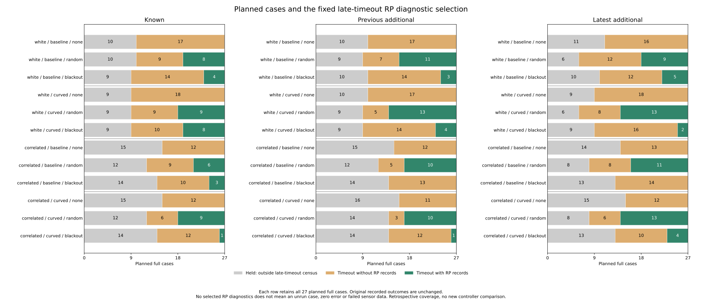
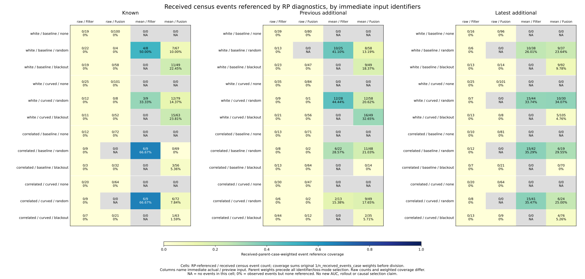
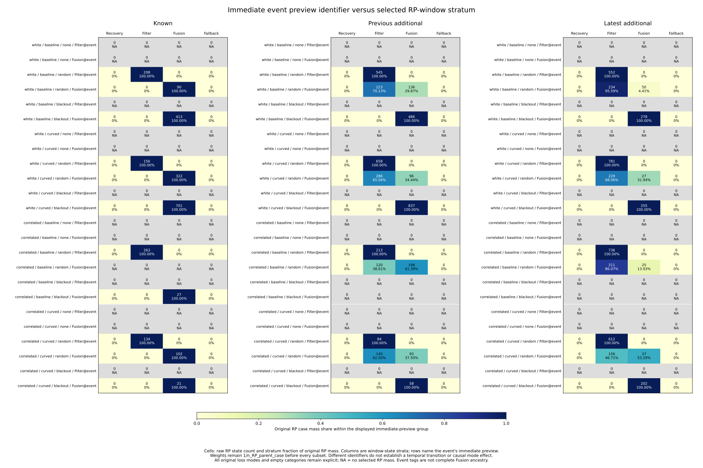

# Coverage from the late-timeout census to RP records

No-loss mode none has **175 timeout cases and 1,226 original late census
events**, including 961 immediate Fusion previews, but no selected RP records.
An absent RP diagnostic population therefore does not mean that no-loss cases
were never run or that Fusion was unavailable in the original census.

Immediate event identifiers also differ from window-state strata: **1,599 RP
states** refer to events whose immediate preview was Fusion while the RP
record is Filter. Treating an immediate Fusion census as the same population
as RP Fusion error tables would merge different selections and timestamps.
This study measures their coverage without new error estimates or AUCs.

The [protocol](protocol.md) was committed as **6e8759e** from main
**8247c0db2c7328ba16636214d8fe6a3e42f9b656**, before computing coverage outcomes.
It extends the [support attrition census](../event-support-attrition/report.md).
Original outcomes, case identities, selection rules and parent weights remain
fixed. No rollout, controller change, fitting, cutoff or score reversal was made.

## Planned cases, census events and RP references

All 972 planned full cases and 324 families remain in accounting. Loss mode,
seed, scenario and planner remain part of case identity. The census covers
every correction/precision opportunity at logged 150--180 s in timeout histories,
once immediately after update. Held cases are outside that late-timeout census
by design. They still retain their recorded held/collision/out-of-bounds outcomes.

The RP audit previously selected both endpoints of an adjacent decision when
at least one was on the joint route with active_ready, over offsets -1..+75
intervals clipped at 180 s. This study joins its saved artifacts. It does not
replay that decision rule or attribute a missing RP case to an individual gate.
Saved RP event offsets remain within [-20, 1500] ms, with the original
microsecond rounding and final-time clipping. A tag is a diagnostic reference,
not complete Fusion ancestry or an independent physical stream.

| Cohort | Planned cases | Held | Timeout, no RP | Timeout with RP | Census events | RP-referenced events |
| --- | ---: | ---: | ---: | ---: | ---: | ---: |
| Known | 324 | 138 | 138 | 48 | 1,307 | 74 |
| Previous additional | 324 | 142 | 130 | 52 | 1,276 | 97 |
| Latest additional | 324 | 122 | 145 | 57 | 1,414 | 104 |
| Total | 972 | 402 | 413 | 157 | 3,997 | 275 |

The 815 cases without RP records comprise 402 held cases and 413 timeouts,
rather than 815 unaccounted experiments. The RP selection still contains all
10,995 original states in 157 cases and 32,985 source-view references. These
repeated states, events and reused seeds are not independent trials.

All **275** referenced events are received. The original census also retains
427 missed and seven precision-only events, none referenced by these RP states.
The received census has 3,563 events across all 570 timeout cases. Its raw
RP-reference fraction is **275/3,563 = 7.718215%**. Case-normalized received
event coverage is **9.535505%**, using original received-parent weights, rather
than giving longer event histories more case weight. This is diagnostic
coverage, not a prediction, error rate or controller success probability.

## None is present in the census and absent from RP

Each cohort below has 108 planned none cases across the four noise/arm groups:

| Cohort | Held | Timeout, no RP | Census events | Received events | RP references |
| --- | ---: | ---: | ---: | ---: | ---: |
| Known | 49 | 59 | 413 | 413 | 0 |
| Previous additional | 51 | 57 | 400 | 399 | 0 |
| Latest additional | 49 | 59 | 413 | 413 | 0 |
| Total | 149 | 175 | 1,226 | 1,225 | 0 |

All 1,226 none events have immediate actual input raw_fallback. Their immediate
previews include **265 Filter and 961 Fusion** events. Thus the raw-input census
cells have observed denominators and defined 0% RP coverage; the immediate
recovery_mean cells are empty and have NA coverage. Neither can be assigned
zero pose error or chance AUC. This does not establish why a particular later
decision failed the joint/active_ready selection.

More generally, all 275 RP-referenced events have immediate actual input
recovery_mean in these saved records. The 1,944 received raw_fallback events
have zero RP references. Immediate actual/preview coverage remains separated
in every noise/arm/loss/cohort cell, including empty combinations.

## Three parent measures stay separate

| Measure | Contribution before filtering | Unfiltered total |
| --- | --- | ---: |
| All census events | 1 / original census-event count in that timeout case | 570 |
| Received census events | 1 / original received-event count in that case; zero contribution from nonreceived events | 570 |
| RP states | 1 / original full-RP-parent state count in that case | 157 |

Each parent normalization precedes event-kind, actual/preview and RP-stratum
selection. Their totals and units describe different populations; they must
not be equated or subtracted. Received RP-reference mass is exactly 5707/105,
so dividing by the full received-parent mass 570 gives 9.535505% coverage.
The collector sums exact Fraction masses before dividing and never averages
case rates or reweights a filtered case back to one.

For example, latest random received-event coverage with immediate actual
recovery_mean is:

| Noise / arm | Immediate preview | Referenced / census events | Raw coverage | Received-parent-weighted coverage |
| --- | --- | ---: | ---: | ---: |
| White / baseline | Filter | 10 / 38 | 26.315789% | 26.008969% |
| White / baseline | Fusion | 9 / 37 | 24.324324% | 23.636364% |
| White / curved | Filter | 15 / 44 | 34.090909% | 33.738192% |
| White / curved | Fusion | 10 / 30 | 33.333333% | 34.074074% |
| Correlated / baseline | Filter | 15 / 42 | 35.714286% | 35.285714% |
| Correlated / baseline | Fusion | 6 / 19 | 31.578947% | 29.545455% |
| Correlated / curved | Filter | 15 / 41 | 36.585366% | 35.465116% |
| Correlated / curved | Fusion | 6 / 24 | 25.000000% | 25.000000% |

The weights still include each parent's other received events before selecting
these identifiers. Raw and weighted rates answer different availability
questions. The figure preserves the same four combinations in every cohort,
noise/arm and loss mode; it does not choose a favorable identifier subset.

## Immediate preview and RP-window preview differ

There are **9,396** same-identifier RP states, **1,599** different-identifier
states and no other-stratum states. The four planned RP strata remain explicit.
All differences are from immediate Fusion to RP Filter, in random mode:

| Cohort | Referenced events with different identifiers | Full cases | RP states |
| --- | ---: | ---: | ---: |
| Known | 0 | 0 | 0 |
| Previous additional | 21 | 20 | 769 |
| Latest additional | 23 | 20 | 830 |

These counts concern saved diagnostic identifiers, not 1,599 independent mode
switches, physical errors or additional trials. They do not locate a transition
or establish a causal Fusion effect. Source events and window states have
different times and estimator histories.

For random subsets including both actual inputs, whose event preview is Fusion:

| Cohort | Noise / arm | RP Filter states | RP Fusion states | Filter share of original RP mass in this subset |
| --- | --- | ---: | ---: | ---: |
| Previous additional | White / baseline | 223 | 136 | 70.133021% |
| Previous additional | White / curved | 286 | 96 | 65.555060% |
| Previous additional | Correlated / baseline | 120 | 198 | 38.613861% |
| Previous additional | Correlated / curved | 140 | 93 | 62.500000% |
| Latest additional | White / baseline | 234 | 50 | 95.590829% |
| Latest additional | White / curved | 229 | 27 | 68.062079% |
| Latest additional | Correlated / baseline | 211 | 25 | 86.070784% |
| Latest additional | Correlated / curved | 156 | 37 | 46.708149% |

For latest white/baseline, the raw Filter fraction 234/284 is 82.39%, while
the original RP-mass fraction is 95.59%. This uses the RP parent measure,
not the received-event coverage measure in the preceding section.

One concrete example is **C0073**, fresh correlated/curved random, seed 279,
dense/A*. Census event **3727** (original source fresh_1144) at 160 s has
immediate preview three_epoch. All 52 RP records tagged to it are filter_single,
at offsets +160 through +1180 ms. The join preserves both identifiers and the
time offsets, rather than changing the event or relabeling those states.

## Artifacts and reproduction

[case-selection.csv](case-selection.csv) retains **972** planned cases and their
original outcome fields. [event-selection.csv](event-selection.csv) retains all
**3,997** census events, original source IDs/partition aliases, immediate
metadata, parent measures, RP records/masses and source-time bounds.
[selection-summary.csv](selection-summary.csv) keeps **3,024** cells across
cohorts/noises/arms, three modes plus all_modes, seven event groups and all/two
actual and preview selectors. Every empty planned combination remains present.
The [numeric plot export](plot-values.csv) retains the **252** complete rows
used by the three frozen figures. SVGs are tracked; PNGs are scratch outputs.

See the [README commands](../../README.md#coverage-from-the-late-timeout-census-to-rp-records)
for sequential reproduction with new directories and an unused evidence file,
without Python -O. Collection and independent SQL verification use the standard
library. Figures require Matplotlib/NumPy. No simulation or Rust build is needed.

- **783 Python tests passed**, including 24 new tests for selection stages,
  preserved statuses, unequal census/RP weights, original received weights before
  filtering, sums before shares, mode/kind/identifier closure, zero versus NA,
  partition aliases, all event flag combinations, unknown/duplicate/wrong-case
  joins, unchanged inputs, differing window/event identifiers, history versus
  selected group counts, microsecond bounds and clipping at 180 s.
- **28,842 preceding case/event coverage comparisons** and **64,080 exact
  additive closure comparisons** pass in collection and independent verification.
- **Four collector artifacts** (three CSVs and sources.json) repeat byte for
  byte. **Eight plot artifacts** (three SVGs, three PNGs, CSV and provenance)
  repeat byte for byte. All three final figures were inspected.
- **586,363 independent comparisons passed**. The standalone verifier imports
  no analyzers. It joins original broad-census IDs and original historical
  membership/latest RP score metadata instead of trusting source-event-map.
  SQL selection/count queries and exact Fraction original parent weights check
  every new field, original coverage, all 252 plotted rows and input/helper/
  script/protocol/output/plot hashes. Unrelated raw-vector labels and AUCs are
  not recomputed.

[sources.json](sources.json), [plot-sources.json](plot-sources.json) and
[independent-verification.json](independent-verification.json) retain exact
hashes and counts. All preceding artifacts remain unchanged and pinned in place.
These are retrospective selection and identifier audits, not evidence of causal
mode benefits, calibration, confidence intervals, independent physical trials
or held-out prediction. Historical held goals remain 140->140 and latest
62->60; no new live outcomes were measured or controller selected.
