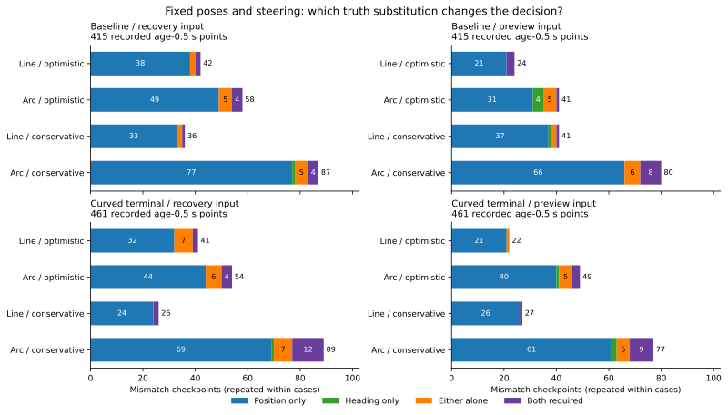

# 予定操舵の復帰曲線に残る位置・向きの判定差

前回、曲線で追加許可したのに真の余裕が足りなかった復帰入力の43地点は、位置だけを真値へ替えると38地点が遮断されました。内訳は位置だけが有効28、位置・向きのどちら単独でも有効10、両方を替えて初めて遮断5です。向きだけが有効な地点は0でした。位置の差が大きく関わる一方、位置だけで全件の判定差を説明できる結果ではありません。

真では通れるのに遮断した曲線176地点でも、位置だけの置換で158地点が通過しました。位置差は過大な許可と余分な遮断の両方に作用しています。これは座標を真値に置き換えた保存記録上の診断で、実装可能な補正や新しい走行の改善を測った結果ではありません。

## 同じ記録と操舵を使う4通りの姿勢

[固定手順](protocol.md)に従い、[前回の曲線比較](../commanded-recovery-arc/report.md)の全648ケース、時間切れ368ケース、2,120地点、復帰入力・停止予測入力、直線・予定操舵の曲線をすべて残しました。結果による地点の選び直しはしていません。

それぞれの入力で、次の4姿勢の最小距離と通過判定を調べました。

| 記号 | 位置 | 向き |
|---|---|---|
| FF | その入力の推定位置 | その入力の推定の向き |
| TF | 真位置 | その入力の推定の向き |
| FT | その入力の推定位置 | 真の向き |
| TT | 真位置 | 真の向き |

直線と曲線はともに前進0.6mです。曲線の操舵は記録された予定値を保ち、真の姿勢から操舵を再計算したり探索したりしていません。位置sigma、観測からの時間、予定速度、余裕`M=.6+2sqrt(2)*sigma+.02*age`も同じです。障害物距離は厳密に`>M`、地図境界からの距離は`>=M`を要求します。距離からMを引いた値が0でも、壁の等号なら通過し得るため、単に正の余裕だけで分類していません。

以下の中心となる部分集合は観測後0.5秒の地点です。基準側epochは415地点・87ケース、曲線終端側curvedは461地点・93ケースです。同じ走行の複数の補正期間を含み、独立な876試行ではありません。元の終点・最初の利用可能地点・観測後0.5秒の部分集合は重複し、別々に保存しています。

## 追加許可の過大評価43地点

FFで許可・TTで遮断を「過大許可」、FFで遮断・TTで許可を「余分な遮断」と呼びます。各判定差について、位置だけ・向きだけの置換がTTの判定に一致するかを調べ、次の4分類へ分けました。「どちら単独も有効」は、位置だけでも向きだけでもTTの判定になる意味です。

次の表は、前回から固定した「推定では直線遮断→曲線許可、真では曲線遮断」の地点です。復帰入力の43地点と予測入力の54地点は重なり得るため合算しません。

| 保存記録・入力 | 過大な追加許可 | 位置のみ有効 | 向きのみ有効 | どちら単独も有効 | 両方必要 |
|---|---:|---:|---:|---:|---:|
| 基準側・復帰入力 | 24 | 16 | 0 | 5 | 3 |
| 曲線終端側・復帰入力 | 19 | 12 | 0 | 5 | 2 |
| 基準側・予測入力 | 27 | 18 | 4 | 5 | 0 |
| 曲線終端側・予測入力 | 27 | 21 | 1 | 4 | 1 |

復帰入力では位置だけの置換で38/43、向きだけでは10/43が遮断され、両者は10地点で重なります。予測入力では位置だけで48/54、向きだけで14/54です。これらは真値を知る診断上の置換であり、観測から同じ修正が可能という意味ではありません。

復帰入力の43地点中9地点は、真の開始中心距離が現在のMより小さく、うち8地点は観測年齢0の下限M0よりも小さい地点でした。同じ位置・sigmaで同じ余裕を要求する限り、その8地点は観測を更新しても開始点で条件を満たせません。この性質は上の分類と重なるため、件数を足しません。

## 全曲線の過大許可と余分な遮断

追加許可だけに限らず、同じ観測後0.5秒の全地点で曲線の判定差を分類しました。

| 保存記録・入力 | 判定差 | 地点 | 位置のみ有効 | 向きのみ有効 | どちら単独も有効 | 両方必要 |
|---|---|---:|---:|---:|---:|---:|
| 基準側・復帰入力 | 過大許可 | 58 | 49 | 0 | 5 | 4 |
| 曲線終端側・復帰入力 | 過大許可 | 54 | 44 | 0 | 6 | 4 |
| 基準側・予測入力 | 過大許可 | 41 | 31 | 4 | 5 | 1 |
| 曲線終端側・予測入力 | 過大許可 | 49 | 40 | 1 | 5 | 3 |
| 基準側・復帰入力 | 余分な遮断 | 87 | 77 | 1 | 5 | 4 |
| 曲線終端側・復帰入力 | 余分な遮断 | 89 | 69 | 1 | 7 | 12 |
| 基準側・予測入力 | 余分な遮断 | 80 | 66 | 0 | 6 | 8 |
| 曲線終端側・予測入力 | 余分な遮断 | 77 | 61 | 2 | 5 | 9 |

復帰入力の過大許可112地点のうち、位置だけの置換で104地点が遮断されます。余分な遮断176地点では158地点が通過し、2地点は向きだけ、16地点は両方を替える必要があります。位置差は一方向にだけ働くものではありません。



図は直線・曲線、両入力、両保存記録をすべて表示しています。棒の外側は判定差の総数で、色は4分類です。直線と曲線、入力の違う棒を、独立な試行として合算しません。

## 符号を保った距離差の分解

最小距離の過大評価`FF-TT`を、位置→向き、向き→位置の両方の置換順序で分けて平均します。

`位置寄与 = ((FF-TF)+(FT-TT))/2`

`向き寄与 = ((FF-FT)+(TF-TT))/2`

二つの和は元の距離差に一致します。負の寄与は距離の過大評価を和らげる方向の作用として残します。次は過大な追加許可に条件づけた平均で、単位はmです。

| 保存記録・入力 | 地点 | 平均の距離過大評価 | 平均の位置寄与 | 平均の向き寄与 |
|---|---:|---:|---:|---:|
| 基準側・復帰入力 | 24 | 0.093767 | 0.083437 | 0.010330 |
| 曲線終端側・復帰入力 | 19 | 0.120752 | 0.108104 | 0.012647 |
| 基準側・予測入力 | 27 | 0.070423 | 0.060395 | 0.010028 |
| 曲線終端側・予測入力 | 27 | 0.089101 | 0.074032 | 0.015069 |

復帰入力の43地点では35地点で位置寄与が向き寄与より大きく、12地点の向き寄与は負でした。この分解は記述上の配分で、独立な誤差源の割合や推定器を修正した際の因果効果ではありません。

## 経路を曲げたことで増えた距離差か

同じ地点・同じ入力で、推定と真それぞれの「曲線距離−直線距離」を比較しました。その差は、曲線と直線の`FF-TT`の差、さらに位置寄与・向き寄与の変化の和とも一致します。これは操舵0と記録された操舵による経路形状の比較で、操舵の推定誤差を分離したものではありません。

過大な追加許可の同じ地点での平均です。

| 保存記録・入力 | 推定の曲線による距離増（m） | 真の距離増（m） | 距離過大評価の変化（m） |
|---|---:|---:|---:|
| 基準側・復帰入力 | 0.081959 | 0.056258 | +0.025701 |
| 曲線終端側・復帰入力 | 0.072928 | 0.069371 | +0.003557 |
| 基準側・予測入力 | 0.089703 | 0.064005 | +0.025698 |
| 曲線終端側・予測入力 | 0.086688 | 0.090233 | -0.003546 |

復帰入力の43地点では、直線の時点でも全地点で距離を過大に見積もっていました。曲線でその差が増えたのは33地点、減ったのは10地点です。曲線で新しく誤った許可が生じたことは、曲線自体の距離改善を余分に大きく評価したことだけでは説明できません。もともとの位置・向きの差を残したまま、推定と真が別々に閾値へ近づく場合があります。

## 以前から注目した地点の相互作用

前回報告した「曲線で真の直線通過を失った1地点」と、動けなかった既知相関ケースで真の曲線が通った2地点を示します。すべて曲線終端側・maze、復帰入力で、M=0.892843mです。

| 既知群・欠測・seed・計画器・時刻 | FF距離 | TF距離 | FT距離 | TT距離 | 判定差の分類 |
|---|---:|---:|---:|---:|---|
| 独立・random・269・A*・160.5秒 | 1.023689 | 0.898666 | 1.011483 | 0.887077 | 過大許可・両方必要 |
| 相関・blackout・270・Theta*・160.5秒 | 0.675396 | 0.915993 | 0.687041 | 0.928063 | 余分な遮断・位置のみ有効 |
| 相関・blackout・270・Theta*・175.5秒 | 0.779500 | 0.885736 | 0.801421 | 0.908673 | 余分な遮断・両方必要 |

最初の地点は位置寄与0.124715m、向き寄与0.011897mで、位置寄与が大きくても、位置だけ真値に替えたTFはまだMを満たしています。最後の地点はTFもFTも遮断され、両方を替えたTTだけが通ります。寄与の大きさと、閾値を越えるために必要な置換は区別します。

## 検証と再実行

解析コードは`4ea469a`、図は`7e0ad21`です。前回の5入力ファイル、地図、シミュレーター、補助関数のハッシュを照合しました。元の368軌跡・3,312,000移動区間の検証は以前の指紋の連鎖を引き継ぎ、今回の生軌跡の再読込や物理挙動の再検証はしていません。

8,480比較で4姿勢、計33,920の幾何要求を評価しました。キャッシュで共有した16,777件の異なる入力すべてを独立した120線分と照合し、最大差5.36e-6mは各入力の弓高上限＋1e-9内でした。全8,480のFF/TT判定・距離と、実入力のTFの全4,240距離が前回に一致しました。全行で距離差と寄与の和、4,240の経路対で距離差変化の等式を検査し、分類境界から2e-8m以内の曖昧な行は0でした。

Python 183テストが成功しました。追加9テストは両方向の4分類、一致した判定の除外、壁と障害物の等号の違い、既知の壁距離と4姿勢、余裕ごとのキャッシュ判定、元の判定を変えた入力の拒否、符号付きの経路差、操舵0の一致、空の群と固定した追加許可群の分母を確認します。

```bash
python3 experiments/pose_observation_loss/analyze_commanded_arc_components.py \
  --output /tmp/commanded-arc-components
python3 experiments/pose_observation_loss/plot_commanded_arc_components.py \
  --results /tmp/commanded-arc-components --output /tmp/commanded-components-figure
python3 -m unittest discover -s experiments/pose_observation_loss -p 'test_*.py'
```

新しい出力先を使います。追跡済みの表と地図だけで再実行でき、解析は標準ライブラリー、図はMatplotlibを使います。5つのCSVと`sources.json`を再集計してバイト単位で一致しました。図の数値・SVG・PNG・指紋も再生成で一致し、表示を確認しました。

[components.csv](components.csv)に全比較、[geometry-audit.csv](geometry-audit.csv)にIDで参照する独立幾何検証、[path-effects.csv](path-effects.csv)に経路対の差、[summary.csv](summary.csv)に群・方式・入力・経路・重複する地点集合・判定群別の集計を保存しました。[accounting.csv](accounting.csv)に全ケース、[sources.json](sources.json)と[図の指紋](coordinate-effects-sources.json)に入力とコードを残しています。空の判定群は件数0、平均・中央値は空欄です。

制御、sigma、余裕、操舵選択、解除タイマーは変更していません。真値への置換から実際の復帰や目標保持は予測せず、前回の走行結果140→140も更新していません。
