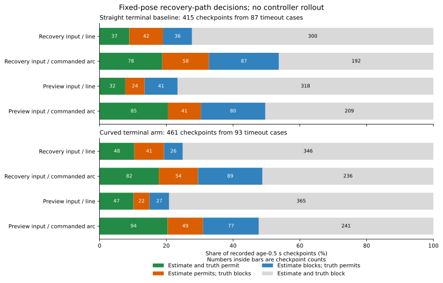

# 記録された予定操舵で復帰直線を曲線に替える比較

観測後0.5秒の同じ876地点では、真姿勢で復帰余裕を満たす地点が、直線147から予定操舵の曲線336へ増えました。ただし、実際の復帰入力で新たに許可した104地点のうち43地点は真の余裕に不足しました。通れる空間は増えますが、単純な曲線への置換だけでは、観測から適切に許可できることまでは確認できません。

終盤に動けなかった注目の3ケースでは、曲線が真の余裕を満たすのは18地点中2地点でした。その2地点は実際の復帰入力・停止予測入力のどちらでも遮断され、推定と真の両方で通過する地点は0でした。今回も保存記録上の幾何比較で、新しい走行や目標保持の改善を測定した結果ではありません。

## 固定した条件と対象

[固定手順](protocol.md)を記録し、[前回の復帰診断](../joint-admission-geometry/report.md)と同じ全648ケースの会計、時間切れ368ケース、2,120地点、各地点の6姿勢を使いました。指令差や幾何結果による再選別はしていません。各ケースの最後30秒の終点、補正期間ごとの最初の利用可能地点、観測後0.5秒の地点を重複除去したものです。終点はサンプル数や復帰待機の有無にかかわらず含みます。

元の前方0.6mの直線と、同じ始点から記録された予定操舵を保つ前進0.6mの円弧を比較しました。ホイールベースは0.4m、曲率は`tan(steering)/.4`です。操舵探索や、真姿勢を使う操舵の選び直しはしていません。

余裕は従来どおり`M=.6+2sqrt(2)*sigma+.02*age`、観測直後の下限は`M0=.6+2sqrt(2)*sigma`です。障害物距離は厳密に`>M`、地図境界からの距離は`>=M`とし、両者を分けて計算しました。真姿勢でも同じsigmaと余裕を使います。

ここでいう「基準側」はepoch方式、「曲線終端側」はcurved方式の保存記録です。両者の元の欠測復帰経路は直線です。今回比較する復帰経路の曲線と、前回走行で使った終端予測の曲線を区別します。

## 真姿勢ではどれだけ通れるか

中心となる観測後0.5秒の部分集合は、基準側415地点・87ケース、曲線終端側461地点・93ケースです。すべて元の欠測復帰の静止・鮮度・10以上のサンプル条件を満たします。同じ走行の複数期間を含み、独立な876試行ではありません。

| 保存記録の方式 | 地点 | 真で直線通過 | 真で曲線通過 | 直線遮断→曲線通過 | 直線通過→曲線遮断 |
|---|---:|---:|---:|---:|---:|
| 基準側 | 415 | 73 | 165 | 92 | 0 |
| 曲線終端側 | 461 | 74 | 171 | 98 | 1 |
| 合計 | 876 | 147 | 336 | 190 | 1 |

観測直後の下限M0での曲線通過は基準側174、曲線終端側189地点でした。現在のMに対しては合わせて540/876地点が曲線でも遮断されます。短い速度探索線分が通過することと、復帰の0.6m全部が通過することは別です。

1地点では曲線が真の直線通過を失いました。既知独立・random・seed269・maze/A*・曲線終端側の160.5秒で、真の直線距離0.897392mはM=0.892843mを満たしますが、予定操舵0.029272radの曲線は0.887077mでした。復帰入力では直線1.034796m、曲線1.023689mと両方通過に見えます。推定で通過を失っていなくても、真では新しく余裕に不足する場合があります。

4群すべてで、真の曲線通過地点は直線より増えました。表は基準側／曲線終端側の順です。

| 群 | 地点 | 真の直線通過 | 真の曲線通過 |
|---|---|---|---|
| 既知seed・独立ノイズ | 108 / 132 | 19 / 27 | 59 / 61 |
| 既知seed・相関時間1秒 | 117 / 126 | 2 / 5 | 29 / 20 |
| 新seed・独立ノイズ | 116 / 118 | 38 / 37 | 49 / 46 |
| 新seed・相関時間1秒 | 74 / 85 | 14 / 5 | 28 / 44 |

## 推定入力で許可した曲線の評価

「復帰入力」は同じ補正期間の静止サンプルによる実入力、「予測入力」は停止予測に使った姿勢です。サンプル0なら復帰入力は瞬時の観測姿勢へ戻し、予測入力は融合位置がなければ運動フィルターを使います。「過大許可」は推定で通過・真で遮断、「余分な遮断」は推定で遮断・真で通過です。

次の表も観測後0.5秒の同じ地点だけを比較します。

| 保存記録・入力 | 経路 | 地点 | 推定で通過 | 真でも通過した許可 | 過大許可 | 余分な遮断 |
|---|---|---:|---:|---:|---:|---:|
| 基準側・復帰入力 | 直線 | 415 | 79 | 37 | 42 | 36 |
| 基準側・復帰入力 | 曲線 | 415 | 136 | 78 | 58 | 87 |
| 曲線終端側・復帰入力 | 直線 | 461 | 89 | 48 | 41 | 26 |
| 曲線終端側・復帰入力 | 曲線 | 461 | 136 | 82 | 54 | 89 |
| 基準側・予測入力 | 直線 | 415 | 56 | 32 | 24 | 41 |
| 基準側・予測入力 | 曲線 | 415 | 126 | 85 | 41 | 80 |
| 曲線終端側・予測入力 | 直線 | 461 | 69 | 47 | 22 | 27 |
| 曲線終端側・予測入力 | 曲線 | 461 | 143 | 94 | 49 | 77 |

曲線では真でも通過する許可が増える一方、両入力・両記録で過大許可も増えました。予測入力は曲線の過大許可を復帰入力より減らしますが、直線の予測入力に対する過大許可の増加は残ります。真で通れる候補自体が増えたため、余分な遮断の件数も併せて示しています。



図の各棒は同じ部分集合の全地点を含み、緑は両方通過、橙は過大許可、青は余分な遮断、灰は両方遮断です。横軸は割合、棒内は地点数です。

## 新しい許可の内訳

同じ地点で直線遮断から曲線通過へ変わる推定上の許可を追いました。単に真で曲線が通れる数を、推定器が発見した改善数と取り違えないためです。

| 保存記録・入力 | 新しい許可 | その曲線が真で通過 | その曲線が真で遮断 | 真でも直線遮断→曲線通過 | 推定の通過喪失 |
|---|---:|---:|---:|---:|---:|
| 基準側・復帰入力 | 57 | 33 | 24 | 19 | 0 |
| 曲線終端側・復帰入力 | 47 | 28 | 19 | 21 | 0 |
| 基準側・予測入力 | 72 | 45 | 27 | 31 | 2 |
| 曲線終端側・予測入力 | 74 | 47 | 27 | 45 | 0 |

復帰入力の新しい許可104地点のうち、真でも通過する61地点には、真では元から直線も通れた21地点が含まれます。真の幾何的な改善190地点のうち、復帰入力が新しい許可として捉えたのは40地点です。予測入力の通過喪失2地点は、どちらも真では両経路とも遮断されていました。

真位置に復帰入力の向きを組み合わせると、完全な真姿勢から分類が変わる地点は曲線で基準側18・曲線終端側27、直線で6・7でした。予定操舵を固定していても、始点の向きは曲線の分類に影響します。予測入力の向きだけを分離する比較はしていません。

## 終盤に移動しなかった3ケース

前回から固定した、曲線終端側のmaze/Theta*の3ケースです。各6地点、静止サンプル25個、融合位置が利用可能です。M0=0.882843m、現在のM=0.892843mでした。

| 群・欠測・seed | 真の直線距離（m） | 真の曲線距離の範囲（m） | 真で曲線通過 | 復帰入力で曲線通過 | 予測入力で曲線通過 | 推定と真で曲線通過 |
|---|---:|---|---:|---:|---:|---:|
| 既知独立・random・270 | 0.749212 | 0.775443–0.807893 | 0/6 | 1/6 | 0/6 | 0/6 |
| 既知相関・blackout・270 | 0.734236 | 0.810094–0.928063 | 2/6 | 1/6 | 1/6 | 0/6 |
| 新規独立・blackout・274 | 0.772879 | 0.791810–0.841057 | 0/6 | 1/6 | 0/6 | 0/6 |

最初と最後のケースは、記録された6操舵すべてで曲線がM0にも不足します。既知相関のケースは160.5秒に0.928063m、175.5秒に0.908673mで真の曲線がMを満たしますが、両地点とも復帰入力・予測入力では遮断されました。また160.5秒の元の速度探索距離は0mで、正の予定速度もありません。この2地点の局所的な空間だけから、1秒連続の復帰や保持を推測できません。

## 検証と再実行

解析コードは`c58c1ca`、図は`3e775a9`です。前回の5入力ファイル、地図、シミュレーター、補助関数のハッシュを検査しました。前回までの指紋の連鎖には368軌跡・3,312,000移動区間の検証が含まれます。今回は追跡済みの姿勢表を使い、生軌跡の再読込や物理挙動の再検証はしていません。

12,720姿勢の両経路を評価し、同じ入力を再利用するキャッシュを含め17,101件の異なる幾何入力を独立した120線分と照合しました。最大差4.68e-6mは、各入力の弓高上限＋1e-9内でした。元の直線距離・判定は全姿勢で、推定と真の直線比較は全4,240行で前回と一致しました。曲線の現在年齢・年齢0の分類、および推定・真姿勢比較で、境界から2e-8m以内の曖昧な判定は0でした。

全8,480比較行で、推定が許可した経路の真の距離が物理半径0.5m以下となるものは0でした。これは余裕Mへの不足とは別の基準であり、実走行での接触の検証を追加した結果ではありません。

Python 174テストが成功しました。追加10テストは壁の内部極値と等号、左右旋回の対応、操舵0の一致、曲線による獲得と喪失、余裕だけが違う場合のキャッシュ、現在年齢と年齢0の区別、真では通れない推定上の改善、推定で遮断される真の改善、重複する地点群の分母を確認します。図は表示を確認しました。

```bash
python3 experiments/pose_observation_loss/analyze_commanded_recovery_arc.py \
  --output /tmp/commanded-recovery-arc
python3 experiments/pose_observation_loss/plot_commanded_recovery_arc.py \
  --results /tmp/commanded-recovery-arc --output /tmp/commanded-recovery-figure
python3 -m unittest discover -s experiments/pose_observation_loss -p 'test_*.py'
```

新しい出力先を使います。解析は標準ライブラリー、図はMatplotlibを使います。保存済みの表と地図だけで再実行でき、6つのCSVと`sources.json`は再集計でバイト単位で一致しました。図の数値・SVG・PNG・指紋も再生成で一致しました。

[accounting.csv](accounting.csv)に全ケース、[geometry.csv](geometry.csv)に両経路と距離検証、[decisions.csv](decisions.csv)に8,480比較、[transitions.csv](transitions.csv)に4,240の獲得・喪失比較、[summary.csv](summary.csv)と[transition-summary.csv](transition-summary.csv)に群・方式・重複する地点部分集合別の集計、[sources.json](sources.json)と[図の指紋](recovery-decisions-sources.json)に入力とコードを保存しました。

制御コード、余裕、推定器、解除タイマーは変更していません。加減速や実際の操舵変更を含む走行も追加しておらず、前回の保持140→140という結果を今回の局所通過数で更新していません。
