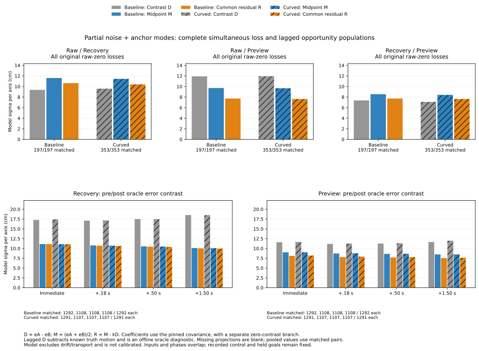

# Contrasts and remaining common error

All 3,000 simultaneous recovery/preview pairs with zero modeled difference
variance retain positive common residual variance. Their errors cancel in
the contrast, without becoming known absolutely. In the fixed loss population,
this includes the earlier 168 identical pairs, 102 with both positions outside
the .10 m truth disk.

The model-based projection also does not guarantee smaller observed error:
baseline Raw/Recovery loss records have midpoint error RMS 13.576 cm and
residual error RMS 14.377 cm, while their partial model sigma decreases.
These are separate diagnostics of selected recorded inputs.



The [protocol](protocol.md) was frozen as bf33718 and analyzer/tests as
874626a before new outcomes. Inputs are the pinned
[simultaneous covariance pairs](../speed-probe-shared-information/report.md),
[correction pre/post pairs](../correction-information-renewal/report.md),
and their recorded error components. All 648 case records, 368 timeouts,
2,583 opportunities, 6,610 simultaneous states, 550 loss links and 509-subset
flags remain. No new controller, geometry query or physical rollout was added.

## What the projection measures

For errors eA/eB, define contrast `D=eA-eB` and midpoint `M=(eA+eB)/2`.
The pinned partial covariance matrix supplies VA, VB and C. For each axis:

```
VD  = VA + VB - 2*C
VM  = (VA + VB + 2*C)/4
CMD = (VA - VB)/2
k   = CMD/VD
R   = M - k*D = (.5-k)*eA + (.5+k)*eB
VR  = VM - CMD^2/VD
```

R is the linear projection residual of the midpoint onto the contrast under
that covariance model. The model residual is uncorrelated with D. These
second-moment identities require no Gaussian assumption, and do not establish
statistical independence or a calibrated conditional posterior. Coefficients
come only from the model, not from the observed truth/error vectors.

Adding a common translation error to both inputs leaves D unchanged and
shifts M/R by that error. Swapping A/B reverses D/k and preserves M/R.
Apply the same weights to every noise/anchor/drift/transport component; their
vectors close to the observed residual. Component norms do not add. The model
itself covers only noise and anchor offsets, excluding drift/nonlinear
transport and the effects of selecting timeout/event populations.

For VD<=1e-12 m^2 require abs(CMD)<=1e-12 m^2 and keep k=0, R=M, VR=VM.
All 3,000 flagged pairs here have exactly zero VD, and all belong to the
recovery/preview pairing. No other simultaneous positive VD is below
1.2591e-5 m^2; lagged VD is at least 3.5642e-5 m^2. Thus the numerical branch
does not combine small positive contrasts with exact zero in these results.
Every available pair in both families has positive VR.

## Simultaneous observable contrasts

All 19,830 pairs are retained, 6,610 for each pairing. Both inputs refer to
the same preceding physical truth, so D equals their observable pose
difference. Source agreement labels remain the five closed .05 m bins and
the original .10 m accuracy disks; neither M nor R relabels a point.

All-state event-kind summaries use source event unions and can overlap.
Loss summaries use the original link event ID. Both retain repeated source
references rather than treating them as independent observations.

For the full fixed 550-loss population, the pooled partial-model sigmas below
are **per axis, in cm**. Pool variances over source references, then take a
square root; do not average sigmas or add pairings as independent trials.

| Arm / loss rows | A / B | Contrast D | Midpoint M | Residual R |
|---|---|---:|---:|---:|
| Baseline / 197 | Raw / Recovery | 9.369 | 11.607 | 10.640 |
| Baseline / 197 | Raw / Preview | 11.924 | 9.715 | 7.732 |
| Baseline / 197 | Recovery / Preview | 7.371 | 8.544 | 7.736 |
| Curved / 353 | Raw / Recovery | 9.599 | 11.450 | 10.404 |
| Curved / 353 | Raw / Preview | 11.941 | 9.674 | 7.646 |
| Curved / 353 | Recovery / Preview | 7.090 | 8.415 | 7.646 |

The same references have the following observed **two-dimensional error
RMS, in cm**, kept separate from the model sigmas:

| Arm | A / B | Midpoint error RMS | Residual error RMS |
|---|---|---:|---:|
| Baseline | Raw / Recovery | 13.576 | 14.377 |
| Baseline | Raw / Preview | 11.807 | 11.778 |
| Baseline | Recovery / Preview | 12.362 | 11.815 |
| Curved | Raw / Recovery | 13.623 | 12.590 |
| Curved | Raw / Preview | 12.889 | 11.024 |
| Curved | Recovery / Preview | 11.318 | 11.034 |

VR cannot exceed VM under the model, but this variance identity does not
order observed error RMS in selected histories with additional components.
This analysis proposes no new estimator, release condition or empirical
accuracy improvement.

The 168 zero-contrast loss references split into baseline 55 (39 both outside)
and curved 113 (63 both outside). Revisit pair 10554, source transition 106204,
event 1626, new-white curved random seed 275, maze JPS, t=160.56 s. Poses
14070/14071 have D=0, k=0 and VR=.0104 m^2, or sigma 10.1980 cm per axis.
Their common observed error and R are (-.02970896548, -.17261522748) m,
with norm 17.5153 cm. The difference has no modeled information about this
common error. Source first-chord decisions and recorded control remain fixed.

## Lagged contrasts are offline oracle diagnostics

All 20,664 requested pre/post references remain: 18,456 matched and 2,208
unavailable. Each input/phase has 1,292 baseline and 1,291 curved requests.
Immediate pairs are complete; each later phase has 1,108 baseline and 1,107
curved matches, plus 184 unavailable per arm. The four phases, two inputs and
event kinds overlap in the original histories and must not be added as trials.

Here D is pre error minus post error. It subtracts the known displacement of
physical truth from the pose change; it is not an online observation of error
change. All source accuracy transitions and censoring labels remain unchanged.
Missing projections have blank model/vector fields, not zero residuals.

The following pooled partial-model sigmas are **per axis, in cm**, over all
matched event kinds. Each entry is **midpoint M / residual R**.

| Arm | Phase | Recovery | Preview |
|---|---|---:|---:|
| Baseline | Immediate | 11.128 / 11.122 | 9.022 / 8.119 |
| Baseline | +.18 s | 10.772 / 10.703 | 8.734 / 7.826 |
| Baseline | +.50 s | 10.550 / 10.468 | 8.628 / 7.715 |
| Baseline | +1.50 s | 10.121 / 10.037 | 8.494 / 7.565 |
| Curved | Immediate | 11.092 / 11.087 | 9.046 / 8.214 |
| Curved | +.18 s | 10.718 / 10.643 | 8.771 / 7.925 |
| Curved | +.50 s | 10.499 / 10.406 | 8.652 / 7.794 |
| Curved | +1.50 s | 10.081 / 9.989 | 8.493 / 7.646 |

For the preceding study's first event, event 1, known-white curved blackout
seed 269, dense A*, t=150 s, preview snapshots 2/4 form lagged source pair 2.
The covariance yields k=.35483871 and weights .14516129/.85483871.
Model midpoint sigma 7.3485 cm becomes residual sigma 6.6024 cm, while the
observed midpoint/residual norms are 15.4976/15.6814 cm. Its old shared anchor
and other components remain in R; lower partial variance does not remove them.

## Coefficients and numerical limits

No weights are clipped. Raw negative-sign counts are 7,886 simultaneous
references and 15 matched lagged references; in all cases it is A's weight.
The minima are -.0217984 and -.0716508. These counts include weights just
below zero by rounding, as small in magnitude as 1.11e-16, so they are not
counts of materially distinct extrapolations. The stored coefficients permit
inspection without changing the recorded sign flags.

Independent matrix multiplication changes some such near-zero signs because
of operation order; all coefficients agree within the fixed numeric guard.
No variance/accuracy threshold was tuned to results, no Gaussian probability
or confidence interval was assigned, and no corrected pose was used online.

## Reproduction and saved artifacts

Run the [README commands](../../README.md#contrasts-and-remaining-common-error)
with new output directories and tracked inputs. All **seven CSVs and
provenance** repeat byte for byte. Figure CSV/SVG/PNG/provenance also repeat;
the figure was visually inspected and PNG remains in scratch. The Python
suite passes **397 tests**, including 15 new tests for equal/unequal independent
inputs, persistent offsets, identical biased inputs, common translations,
swapping inputs, negative weights, singular models, numerical guards,
component cancellation, truth-independent coefficients and full denominators.

A separate 2x2 matrix-coordinate calculation checks every available
projection, its variance identities, input IDs, labels and four component
vectors. It also checks all 2,208 blank projections, every field of the 540
simultaneous and 480 lagged summary rows, all original 550/509 loss links,
all 396 numerical figure rows and source/script/protocol/helper fingerprints.

[Simultaneous projections](simultaneous.csv) and [lagged projections](lagged.csv)
retain every source pair/input ID, covariance, coefficient and observed
component. [Simultaneous summaries](simultaneous-summary.csv) retain all three
populations; [lagged summaries](lagged-summary.csv) retain every phase/input.
Empty cohorts/event kinds and source category/estimator counts remain explicit.
[Accounting](accounting.csv), [events](events.csv) and [loss links](loss-links.csv)
are unchanged pinned copies. [Analysis provenance](sources.json),
[figure data](contrast-common-comparisons.csv) and
[figure provenance](contrast-common-comparisons-sources.json) are tracked.
Source observation/physics validation is inherited. Recorded control and
held goals remain **140 -> 140**.
