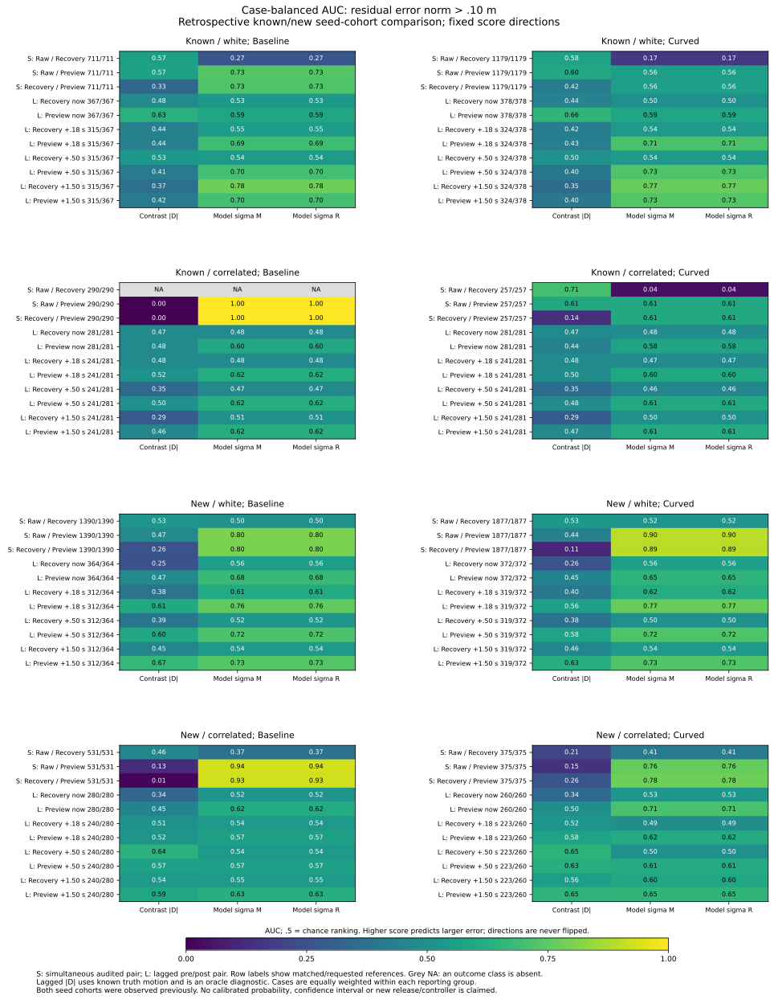

# Retrospective transfer of contrast/common-error risk diagnostics

Small disagreement does not reliably identify small common error in these
recorded histories. For new correlated-noise baseline Recovery/Preview pairs,
the known-cohort median contrast cutoff retains 63.14% of case weight with
99.07% residual-error-outside fraction, versus 69.41% using all available
references. A low-contrast subset can concentrate the shared errors that
cancel in the contrast.

The model residual sigma ranks this error better in some views, but its known
median cutoff retains about 27--29% of new white-noise case weight and about
92% of new correlated-noise case weight. A fitting quantile is neither achieved
evaluation coverage nor a calibrated error bound.

This is **retrospective transfer**: both cohorts have appeared in earlier
studies. Known seeds 269/270/271 alone determine cutoffs; existing new seeds
274/275/276 are used for evaluation of those fixed cutoffs. This is not an
untouched holdout experiment. The [protocol](protocol.md) was frozen as
032230c and analyzer/tests as e3a4664 before these results. Score directions
and quantile rules were fixed before this aggregation; numerical cutoffs use
only known-cohort references.

## Source population and weighting

Keep the [preceding contrast/common decomposition](../contrast-common-errors/report.md)
unchanged: all 648 accounting records, 368 timeout histories, 2,583
opportunities, 19,830 simultaneous pairs and 20,664 requested lagged pairs.
The original 550/509 loss links remain, but do not select fitting rows.

| Cohort partition | Source family | Requested | Available | Unavailable | Recorded cases |
|---|---|---:|---:|---:|---:|
| Known | Simultaneous | 7,311 | 7,311 | 0 | 48 |
| New | Simultaneous | 12,519 | 12,519 | 0 | 52 |
| Known | Lagged | 10,456 | 9,340 | 1,116 | 186 |
| New | Lagged | 10,208 | 9,116 | 1,092 | 182 |

All 40,494 requested source references remain, with 38,286 available and
2,208 blank-score lagged references. Families, inputs, phases and event-kind
unions overlap. Cases include cohort/arm/mode/seed/map/planner; variants can
share underlying random draws. These are not independent trial counts.

There are eleven fixed views: three simultaneous pairings and four post phases
for each lagged input. Keep both arms, both noise types and every event kind,
including empty combined-event groups. Within each view/noise fitting group,
each available reference has weight 1/n_case, giving each represented case
total weight one. Both known arms contribute to the same cutoff. No new-cohort
score or label enters fitting, and no trajectory is split by time or phase.

Reporting recomputes these case weights within each cohort/noise/arm/event-kind/
view group. After retention, keep the original weights. Coverage is retained
mass divided by available case mass; error fraction is outside-error mass
divided by retained mass. Do not renormalize each retained case to weight one.
Raw reference counts, case counts and row-weighted measures remain alongside
case-balanced measures. Case balancing does not establish independence.

## Fixed diagnostics and fitting rules

Three high-risk score directions are frozen: contrast norm |D|, model midpoint
sigma sqrt(VM), and model common-residual sigma sqrt(VR). In lagged pairs D
subtracts known truth displacement, so |D| is an **offline oracle score**.
The model sigmas are partial per-axis noise-plus-anchor quantities; drift and
nonlinear transport remain outside the model. Neither is a calibrated risk.

The two outcomes are midpoint norm>.10 m and residual norm>.10 m. The closed
.10 m disk is inside. They label the observed abstract error modes M/R, not
new point-accuracy labels, geometric decisions or control actions. Missing
projections have blank scores and labels. Both outcomes use the same cutoffs.

Map scores to nearest 1e-8 m integer ticks before ranking. Preserve raw scores;
keep equal ticks together. Fitting uses exact case-weighted lower quantiles
at .25/.50/.75 and evaluation retains ticks<=cutoff. Include an all_available
reference. Exact rational weights avoid rounding jumps at quantile boundaries.
There are 264 threshold rows and no unavailable fit groups in these data.

AUC compares outside with inside references, with high scores predicting
outside and half credit for tied ticks. Case-weighted and raw-row AUC are both
retained. Do not reverse a direction when AUC is below .5. When either class
is absent, AUC is blank: known correlated baseline Raw/Recovery has 290/290
residual errors outside, across 9 cases, rather than a defined ranking score.

## New-cohort simultaneous rankings

All event kinds are included below. Values are **case-weighted AUC for residual
error>.10 m**. Reference and case counts are per pairing; they overlap across
views. Scores keep the same frozen high-risk direction everywhere.

| Noise / arm | Pairing | Available references / cases | Contrast | Midpoint sigma | Residual sigma |
|---|---|---:|---:|---:|---:|
| White / baseline | Raw / Recovery | 1,390 / 14 | .526 | .504 | .504 |
| White / baseline | Raw / Preview | 1,390 / 14 | .472 | .802 | .802 |
| White / baseline | Recovery / Preview | 1,390 / 14 | .256 | .798 | .798 |
| White / curved | Raw / Recovery | 1,877 / 17 | .532 | .516 | .516 |
| White / curved | Raw / Preview | 1,877 / 17 | .439 | .896 | .896 |
| White / curved | Recovery / Preview | 1,877 / 17 | .113 | .892 | .892 |
| Correlated / baseline | Raw / Recovery | 531 / 10 | .462 | .375 | .375 |
| Correlated / baseline | Raw / Preview | 531 / 10 | .127 | .935 | .935 |
| Correlated / baseline | Recovery / Preview | 531 / 10 | .012 | .927 | .927 |
| Correlated / curved | Raw / Recovery | 375 / 11 | .208 | .415 | .415 |
| Correlated / curved | Raw / Preview | 375 / 11 | .146 | .763 | .763 |
| Correlated / curved | Recovery / Preview | 375 / 11 | .259 | .779 | .779 |

There is no uniform ranking advantage across inputs/noise conditions. Model
sigma performs near chance or below for Raw/Recovery in these groups, while
some Preview comparisons separate the selected outcomes more strongly.
In the defined event-kind groups, midpoint/residual sigma AUCs differ by at
most 6.65e-5 for the midpoint target and 3.09e-5 for the residual target. Their
variance values differ, but that does not produce much additional ranking
information here. All three scores remain in every saved table.

## Cutoff transfer, ties and retained error

For simultaneous Recovery/Preview, the known-cohort fitting populations are
1,890 references/29 cases for white noise and 547 references/19 cases for
correlated noise. Model residual-sigma cutoffs are per axis, in **cm**:

| Noise | .25 quantile | .50 quantile | .75 quantile |
|---|---:|---:|---:|
| White | 5.887841 | 5.916838 | 5.951667 |
| Correlated | 7.877406 | 13.610597 | 13.610597 |

The correlated contrast cutoffs are 0, 0 and .03965 m. A median contrast cutoff
of tick zero retains the entire tied near-zero-contrast group. The following
new-cohort Recovery/Preview results use the fixed **.50 quantile** rule. Every
cell with a slash is **case-weighted coverage % / retained residual-outside %**;
the final column is the all_available residual-outside fraction.

| Noise / arm | Contrast cutoff | Midpoint-sigma cutoff | Residual-sigma cutoff | All-available outside % |
|---|---:|---:|---:|---:|
| White / baseline | 68.27 / 94.52 | 28.59 / 55.23 | 28.59 / 55.23 | 82.02 |
| White / curved | 76.92 / 75.53 | 27.35 / 14.62 | 27.35 / 14.62 | 62.42 |
| Correlated / baseline | 63.14 / 99.07 | 91.96 / 66.74 | 91.96 / 66.74 | 69.41 |
| Correlated / curved | 63.11 / 75.62 | 91.61 / 49.95 | 91.61 / 49.95 | 54.15 |

For example, the correlated baseline contrast rule retains 330/531 raw
references from 7/10 cases. The weighted outside fraction is 99.07%; the raw
row fraction is 98.48%. The model residual-sigma rule retains 467/531 references
from all 10 cases, with weighted outside fraction 66.74%. These are descriptive
fractions of selected diagnostics, not release decisions or error guarantees.

All .25/.50/.75 and all_available rows remain in [risk-summary.csv](risk-summary.csv).
For the model residual-sigma rule, new white-noise coverage ranges from
18.31--21.98% at .25 to 31.73--36.74% at .75; correlated coverage ranges from
8.75--12.37% at .25 to 91.61--91.96% at .75. Large jumps and unequal transfer
follow the empirical score distribution and ties; they are not calibrated
coverage statements.

The midpoint target is evaluated separately. At the same model-residual-sigma
.50 rule, its all_available versus retained outside fractions are:

| Noise / arm | All midpoint-outside % | Retained midpoint-outside % | Retained residual-outside % |
|---|---:|---:|---:|
| White / baseline | 86.37 | 69.34 | 55.23 |
| White / curved | 66.73 | 29.25 | 14.62 |
| Correlated / baseline | 69.41 | 66.74 | 66.74 |
| Correlated / curved | 54.15 | 49.95 | 49.95 |

## Lagged views and the second outcome

All four lagged phases and both inputs remain. For the new cohort, model
residual-sigma case-weighted AUC for residual-outside is shown as
**recovery / preview** in each cell:

| Noise / arm | Immediate | +.18 s | +.50 s | +1.50 s |
|---|---|---|---|---|
| White / baseline | .560 / .676 | .611 / .756 | .522 / .720 | .540 / .732 |
| White / curved | .564 / .654 | .621 / .769 | .503 / .724 | .536 / .728 |
| Correlated / baseline | .519 / .616 | .538 / .569 | .538 / .569 | .547 / .627 |
| Correlated / curved | .529 / .713 | .493 / .616 | .500 / .615 | .596 / .654 |

The [midpoint-outside figure](contrast-risk-midpoint.svg) keeps the same complete
cohorts/arms/noises/views/scores for the other outcome. Its rankings differ from
the residual outcome; neither outcome is selected as a fitted target. Both
figures show matched/requested denominators and retain undefined-class cells.
All event-kind numeric series, including empty groups, are available.

## Validation and reproduction

Run the [README commands](../../README.md#retrospective-transfer-of-risk-diagnostics)
using new output directories and tracked inputs. All **seven CSVs and provenance**
repeat byte for byte. Both SVG/PNG figures, their shared CSV and provenance
repeat exactly; final layouts were visually checked and PNG remains in scratch.
The Python suite passes **412 tests**, including 15 new tests for exact seed
membership, no evaluation-data influence on fitting, pooled-arm/shared cutoffs,
separate noise/view groups, case weights, exact quantile boundaries, ties,
pairwise AUC, missing outcome classes, empty fits, retained weights and censoring.

A separate saved-data calculation checks all 40,494 source identities/scores/
ticks/outcome labels and unchanged 550/509 links. It verifies all 264 threshold
rows using independent exact integer case weights and cumulative quantiles,
all 1,584 ranking rows using explicit positive-versus-negative comparison
matrices, every field of all 6,336 retention rows and all 3,168 numeric figure
rows. Source, script, protocol, helper and plot fingerprints match.

[Scores](scores.csv) preserve every source-family/ID, source category, raw score,
integer tick, missing flag and both outcomes. [Thresholds](thresholds.csv)
retain fitting counts, seeds and reference fingerprints. [Ranking](ranking.csv)
keeps case-weighted and row AUC; [retention](risk-summary.csv) keeps both raw
counts and case mass. [Accounting](accounting.csv), [events](events.csv) and
[loss links](loss-links.csv) are unchanged copies. [Analysis provenance](sources.json),
[figure data](contrast-risk-ranking.csv) and [figure provenance](contrast-risk-ranking-sources.json)
are tracked. The original observation/physics validation is inherited.
Recorded control and held goals remain **140 -> 140**.
