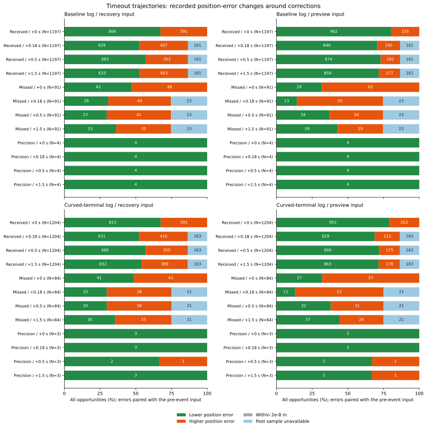

# 補正受信前後の推定位置・誤差・実際の復帰動作

受信後0.5秒まで観察できた2,077機会では、復帰入力の位置誤差RMSは0.241801mから0.186437mへ下がりました。ただし、誤差が減ったのは1,369機会、増えたのは708機会です。予測入力では0.219077mから0.130827mとなり、改善1,740・悪化337でした。推定位置の移動と実際の誤差変化を対にして測った結果です。

受信後1.5秒以内に記録された合同復帰は、基準側17機会・旋回側16機会でした。誤差の改善だけで復帰条件が成立したとは数えていません。対象は最終的に時間切れとなった反復記録であり、補正受信の因果効果や保持成功率の増加を示す比較ではありません。

## 対象と時刻の対応

[固定手順](protocol.md)を先に記録しました。[前回](../admission-information-floors/report.md)は推定中心を固定して情報精度を比べました。今回は既存648ケースの会計と、時間切れ全368ケース・両制御記録を引き継ぎ、記録時刻150〜180秒の補正予定または精密補正開始をすべて対象にしました。移動、誤差、受信、復帰経路、融合利用可否で選んでいません。

通常の予定補正は各ケース150、155、160、165、170、175、180秒の7回です。独立ノイズと相関時間1秒のノイズ、既知seed269〜271と追加seed274〜276、欠測なし・ランダム欠測・45〜75秒の連続欠測、全地図・プランナーを保持しています。この末尾区間での欠測はランダム欠測に属します。

| 記録 | 時間切れケース | 通常受信 | 予定補正の欠測 | 精密補正のみ | 全機会 | 完全な後続1.5秒窓 | 観測打切り窓 |
|---|---:|---:|---:|---:|---:|---:|---:|
| epoch：基準 | 184 | 1,197 | 91 | 4 | 1,292 | 1,108 | 184 |
| curved：旋回終端 | 184 | 1,204 | 84 | 3 | 1,291 | 1,107 | 184 |
| 合計 | 368 | 2,401 | 175 | 7 | 2,583 | 2,215 | 368 |

予定補正と精密補正の同時発生は0でした。空の2分類も集計表に残しています。打切り368機会はすべて180秒の予定補正で、受信324・欠測44です。直前と直後の推定入力は残し、+0.18・+0.5・+1.5秒は未観測としました。

刻みは0.02秒です。各機会eの直前e−0.02、直後e、e+0.18、e+0.5、e+1.5秒で、復帰入力actualと予測入力previewを再構成しました。CSVの行tの推定・判定は積分前の真位置を使うため、比較する真値は前行t−0.02です。例えば150秒直後は149.98秒の真位置、直前149.98秒の推定は149.96秒の真位置と対応します。直前から+0.5秒までの推定同士の間隔は0.52秒です。

推定位置の変位から対応する真位置の変位を引き、誤差ベクトルの変化と一致することを確認しました。補正直後もロボットが動き得るため、推定位置が跳んだ大きさをそのまま誤差改善にはしていません。

## 通常受信後の改善と悪化

RMSの単位はmです。直前・事後の両方を観察できた同じ機会だけを両側の分母に使います。各入力・時点は重なり、独立な試行数ではありません。改善・悪化の境界は誤差ノルムの差±2e−8mで、今回の利用可能対に境界内の変化はありませんでした。

| 記録・入力 | 事後時点 | 利用可能対 | 直前RMS | 事後RMS | 改善 | 悪化 | 事後未観測 |
|---|---|---:|---:|---:|---:|---:|---:|
| 基準・復帰 | 直後 | 1,197 | 0.238303 | 0.202916 | 806 | 391 | 0 |
| 基準・復帰 | +0.18秒 | 1,036 | 0.242492 | 0.197427 | 629 | 407 | 161 |
| 基準・復帰 | +0.5秒 | 1,036 | 0.242492 | 0.187579 | 683 | 353 | 161 |
| 基準・復帰 | +1.5秒 | 1,036 | 0.242492 | 0.193995 | 633 | 403 | 161 |
| 基準・予測 | 直後 | 1,197 | 0.214184 | 0.131590 | 962 | 235 | 0 |
| 基準・予測 | +0.18秒 | 1,036 | 0.219559 | 0.131770 | 846 | 190 | 161 |
| 基準・予測 | +0.5秒 | 1,036 | 0.219559 | 0.129144 | 874 | 162 | 161 |
| 基準・予測 | +1.5秒 | 1,036 | 0.219559 | 0.125279 | 859 | 177 | 161 |
| 旋回・復帰 | 直後 | 1,204 | 0.237367 | 0.202399 | 813 | 391 | 0 |
| 旋回・復帰 | +0.18秒 | 1,041 | 0.241111 | 0.194611 | 631 | 410 | 163 |
| 旋回・復帰 | +0.5秒 | 1,041 | 0.241111 | 0.185294 | 686 | 355 | 163 |
| 旋回・復帰 | +1.5秒 | 1,041 | 0.241111 | 0.192449 | 652 | 389 | 163 |
| 旋回・予測 | 直後 | 1,204 | 0.212951 | 0.134486 | 952 | 252 | 0 |
| 旋回・予測 | +0.18秒 | 1,041 | 0.218595 | 0.134916 | 829 | 212 | 163 |
| 旋回・予測 | +0.5秒 | 1,041 | 0.218595 | 0.132480 | 866 | 175 | 163 |
| 旋回・予測 | +1.5秒 | 1,041 | 0.218595 | 0.125657 | 863 | 178 | 163 |

全記録を合わせた通常受信の直後では、復帰入力の推定位置は平均0.233063m動き、対応する真位置の変位は平均0.000413mでした。+0.5秒では復帰入力0.252247m・真位置0.010881m、予測入力0.193415mでした。+1.5秒では復帰入力0.289686m・真位置0.039590m、予測入力0.218195mです。これらは変位ノルムの平均であり、その差を誤差ノルムの改善量としてはいません。



図の分母は各種類の全機会で、青は事後が未観測の部分です。棒のラベルは件数で、4%未満の区間は省略しています。0を含む192区間を[図の数値](correction-error-changes.csv)に保存しました。

## 推定方式と誤差成分

通常受信の直前は、復帰入力が現在の観測値による代替、予測入力が移動補償フィルターでした。+0.5秒の利用可能対では、次の方式へ変わっています。

| 記録・事後入力方式 | 対 | 直前RMS | 事後RMS | 改善 | 悪化 |
|---|---:|---:|---:|---:|---:|
| 基準・復帰の観測値代替 | 621 | 0.242120 | 0.197795 | 383 | 238 |
| 基準・復帰平均 | 415 | 0.243048 | 0.171157 | 300 | 115 |
| 旋回・復帰の観測値代替 | 580 | 0.243834 | 0.198739 | 348 | 232 |
| 旋回・復帰平均 | 461 | 0.237642 | 0.166846 | 338 | 123 |
| 基準・予測フィルター代替 | 271 | 0.242594 | 0.188656 | 189 | 82 |
| 基準・予測3期間融合 | 765 | 0.210797 | 0.099892 | 685 | 80 |
| 旋回・予測フィルター代替 | 300 | 0.245180 | 0.194843 | 198 | 102 |
| 旋回・予測3期間融合 | 741 | 0.206863 | 0.096367 | 668 | 73 |

群の所属は記録された制御状態と融合利用可否に依存します。方式ごとに別の集団となるため、表の差を方式だけの効果とはしていません。事後未観測の遷移も`->unavailable`として保存しました。

位置誤差は、観測ノイズ、同じ補正を共有するずれ、ドリフト、移動補償の4つのベクトルに分けました。次は通常受信の同じ+0.5秒対での各成分の2次元RMS、単位はmです。成分間の交差項があるため、成分RMSは足し合わせません。

| 記録・入力 | ノイズ：前→後 | 共有補正ずれ：前→後 | ドリフト：前→後 | 移動補償：前→後 |
|---|---|---|---|---|
| 基準・復帰 | 0.152785→0.128268 | 0.154528→0.148816 | 0.113763→0.008413 | 0→1.39e−11 |
| 旋回・復帰 | 0.151716→0.125085 | 0.154094→0.148496 | 0.112684→0.008218 | 0→1.61e−11 |
| 基準・予測 | 0.086936→0.063758 | 0.154528→0.114573 | 0.109210→0.005200 | 0.001376→0.001244 |
| 旋回・予測 | 0.084678→0.070782 | 0.154094→0.115399 | 0.108115→0.005198 | 0.001777→0.001126 |

この広い対象では、補正前にたまったドリフトの更新が大きく見られます。前回までの補正直後・静止条件に絞った2,120地点とは対象時刻が異なります。通常補正は共有ずれを新しい乱数で引き直すため、個々の誤差が必ず小さくなるわけではありません。ノイズと共有ずれのモデル分散、観測数・重み、向き誤差も各スナップショットに残しました。

## 欠測と精密補正

予定補正の欠測175機会でも、推定フィルターの窓は更新されます。アンカーを更新しないことと、推定位置が変わらないことは同じではありません。後続を観察できた131機会の+0.5秒では、復帰RMSは0.280547→0.291960m、改善52・悪化79、予測RMSは0.244122→0.255873m、改善66・悪化65でした。+1.5秒ではそれぞれ0.265189mと0.219859mとなりました。欠測44機会の後続は未観測です。

精密補正のみの7機会はすべて非解除中の移動中で、直後は両入力とも7機会すべて改善しました。+0.5秒の復帰RMSは0.173612→0.089007m、予測は0.163283→0.074500mで、ともに改善6・悪化1でした。対応する真位置の変位は平均0.483448mであり、静止中の通常補正とは状態が異なります。

受信と欠測の集団は欠測モード・直前状態が異なり、反復・時間相関もあります。精密補正も状態に応じた開始です。これらを受信の有無だけを変えた対照実験や、独立試行の改善率として扱っていません。

## 実際の解除・復帰と1.5秒の観察窓

実際の解除経路と要件は固定した既存ヘルパーで照合しました。機会時点で合同判定中だった通常受信は基準474・旋回527、独立ガード判定中は680・646、非解除中は43・31でした。欠測175機会はすべて合同判定中でした。後続窓は`e < t <= e+1.5`の75判定区間で、機会直後の動作は別に数えます。

| 記録・機会 | 完全窓 | 合同復帰あり | ガード解除あり | 正の目標速度あり | 物理移動あり |
|---|---:|---:|---:|---:|---:|
| 基準・通常受信 | 1,036 | 17 | 59 | 93 | 141 |
| 旋回・通常受信 | 1,041 | 16 | 79 | 102 | 160 |
| 基準・欠測 | 68 | 0 | 0 | 0 | 11 |
| 旋回・欠測 | 63 | 0 | 0 | 0 | 9 |
| 基準・精密補正 | 4 | 0 | 0 | 4 | 4 |
| 旋回・精密補正 | 3 | 0 | 0 | 3 | 3 |

物理移動ありは区間移動距離の合計が2e−8m超の場合です。正の指令がなくても残る速度で移動し得ます。ガード解除と合同復帰は別の記録フラグで、同じ機会に両方が含まれ得るため合算していません。両入力のスナップショットも同じ実動作を参照します。上の表は[機会表](events.csv)から1機会1回で数えたもので、入力別に二重計上していません。

機会直後の合同復帰は0で、ガード解除は旋回側の通常受信1機会でした。通常受信直後に正の目標速度があったのは基準33・旋回26機会、精密補正は4・3機会です。これらは後続窓の数に足していません。

完全窓の通常受信のうち、機会時点で合同判定中だったのは基準415・旋回461機会でした。+0.18秒と+0.5秒では、それぞれ全415・461機会が静止・鮮度・観測数の基礎条件を満たしました。それでも後続1.5秒で合同要件が一度でも全部そろったのは75・96機会、連続1秒以上そろい合同復帰したのは17・16機会です。復帰の最初の遅延は基準1.16〜1.42秒、旋回1.16秒で、各側15ケースに属します。基礎条件の成立、全要件の同時成立、タイマーを経た実際の復帰を分けています。

打切り368窓は後続0区間で、完全な「復帰なし」の窓には含めていません。通常受信4窓には別の精密補正が入り、精密補正1窓には次の予定補正が入りました。この5窓を除外せず、介在件数を保存しています。窓の重なりと既に動いていた機会も含む記述であり、距離や動作を独立な走行改善として足し上げていません。

## 検証と再実行

解析コードは`a0b6d1a`、図と手順は`201789c`です。全368軌跡の3,312,000区間で観測窓数・融合利用可否を再現しました。従来の2,120地点・両入力4,240参照の誤差ノルムとの差の最大は0でした。新しい標本時刻と既存参照で、復帰・予測・移動フィルターの位置と向きをログと照合し、差の最大は1.240004e−9（位置m／向きrad）で、固定した1e−8の許容値内でした。

全スナップショットの4成分の和と実際の位置誤差、および各対の`Δ推定−Δ真値=Δ誤差=ΣΔ成分`を確認しました。保存したCSVでもID対応、利用可否、時刻、ベクトルの閉合、全件会計、集計の分母、図の分割を照合しました。元データ72ファイル、地図・入力・補助コード・シミュレーター・固定手順の指紋を確認しています。物理・接触・タイマーの検証は従来の走行検証を引き継いでいます。

Python 250テストが成功しました。追加16件で5種の補正分類、積分前の真位置との対応、位置・向きの再構成、観察窓の両端・遅延・介在補正、経路変更での連続条件のリセット、途中打切り、ロボットと推定位置が同じだけ動く例、中心移動と誤差改善の違い、成分の破損、対応する分母、空の集計、欠測・180秒を含む9,000区間の時計を確認しています。BlackとPython構文検査も成功しました。

```bash
python3 experiments/pose_observation_loss/analyze_correction_centre_transitions.py \
  --output /tmp/correction-centre-transitions
python3 experiments/pose_observation_loss/plot_correction_centre_transitions.py \
  --results /tmp/correction-centre-transitions --output /tmp/correction-centre-figure
python3 -m unittest discover -s experiments/pose_observation_loss -p 'test_*.py'
```

出力先は新しいディレクトリを使います。解析は標準ライブラリー、図はMatplotlibを使います。元の生軌跡は必要で、既存の指紋に対応する保存先を使うか、`--raw-root DIR`で同一内容の4群のディレクトリを指定します。7つのCSVと`sources.json`は別ディレクトリへの2回の解析でバイト単位に一致しました。図の数値・SVG・PNG・指紋も一致し、表示を確認しました。

[accounting.csv](accounting.csv)は全648ケース、[reconstruction.csv](reconstruction.csv)は再構成368軌跡、[events.csv](events.csv)は2,583機会と実動作の窓、[snapshots.csv](snapshots.csv)は5時点・両入力の25,830行（利用可能23,622）、[pairs.csv](pairs.csv)は直前と4事後時点・両入力の20,664行です。[pair-summary.csv](pair-summary.csv)は群・記録・補正種類・時点・入力・機会時の経路・推定方式遷移別2,954行、[event-summary.csv](event-summary.csv)は機会・動作137集計を保存します。`event_id`と`snapshot_id`で対応し、未観測の値と空の群のRMSは空欄です。[sources.json](sources.json)と[図の指紋](correction-error-changes-sources.json)に再実行用の指紋があります。

この解析は既存記録の補正前後を観察したもので、新しい情報を与えた走行や、受信しなかった場合の反実仮想は生成していません。制御・余裕・タイマー・最終保持結果140→140は更新していません。
