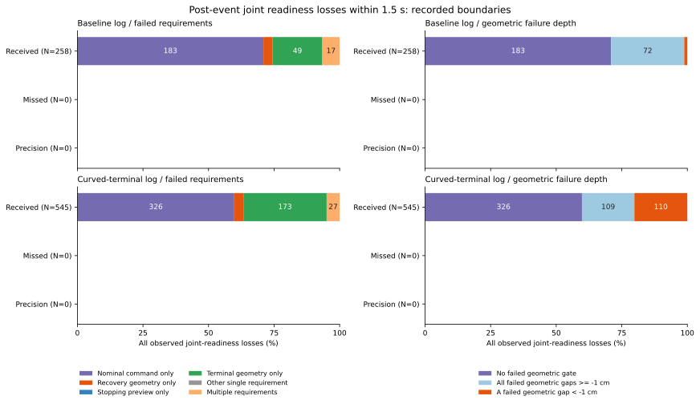

# 復帰条件が途切れる前後の推定入力と速度指令

全条件が成立した次の判定で成立が途切れた803対のうち、509対では正の速度指令の条件だけが不成立でした。速度指令の条件を含む不成立550対は、すべて生の観測位置・向きと予定操舵を使う速度プローブが上限を0にした記録です。停止ラッチが上流の速度指令を0にした例はありませんでした。

この803対では、対応する真位置の変位はすべて0でした。一方、生の観測位置は1区間で平均0.182407m（基準）・0.189527m（旋回）動き、復帰入力の移動は平均0.007855・0.007679mでした。異なる推定入力を使う判定が同時に成立し続けるかを、実際の記録と地図上の幾何で確認した結果です。入力や指令を置き換えた走行は試していません。

## 対象と隣り合う判定の会計

[固定手順](protocol.md)を先に記録しました。[前回の条件・タイマー解析](../correction-gate-sequences/report.md)の全648ケースの会計、時間切れ全368ケース、150〜180秒の全2,583機会を使っています。通常受信2,401・欠測175・精密補正のみ7機会、両記録・全ノイズ群・欠測モード・地図・プランナーを残しました。同時補正の空分類も保持しています。

各機会の直前から直後への1対と、後続1.5秒の隣接判定をすべて比較しました。直後の対は2,583、後続の対は166,125、合計168,708対です。180秒で終わる368機会の直前・直後は観察できますが、後続は未観測です。完全な「成立維持」や「不成立」へ置き換えていません。

| 後続1.5秒の隣接判定 | 基準epoch | 旋回終端curved | 合計 |
|---|---:|---:|---:|
| 合同条件が成立したまま | 2,196 | 2,280 | 4,476 |
| 合同条件が成立から不成立へ | 258 | 545 | 803 |
| 合同条件が不成立から成立へ | 294 | 581 | 875 |
| 両時点とも合同判定だが不成立 | 33,201 | 35,622 | 68,823 |
| 合同判定から別の経路へ | 17 | 16 | 33 |
| 別の経路から合同判定へ | 0 | 0 | 0 |
| その他の経路 | 47,134 | 43,981 | 91,115 |
| 全対 | 83,100 | 83,025 | 166,125 |

復帰後に合同判定を抜ける33対は、条件が崩れた803対とは別です。803対は通常受信に属し、基準54機会・29ケース、旋回80機会・43ケースで反復しています。基準の258対中1対は、いったん途切れてから復帰したevent_id=2023にも属します。残る257対と旋回545対は前回の短い成立区間の機会でした。復帰しなかった例だけを選んでいません。

直後の2,583対では、合同条件の成立・維持・喪失はいずれも0でした。合同判定へ入った対は基準22・旋回14、両時点とも合同判定だが不成立は543・597、その他727・680です。欠測と精密補正にも後続の条件喪失は0でした。これらを観察対象から削っていません。

## 速度指令のどの段階が0になったか

このシミュレーターでは、速度制限は生の観測位置・向きと予定操舵を使います。復帰直線は復帰平均または現在値、停止・終端予測は3期間融合または移動フィルターを使います。3つの位置を同一視せず、元のコードの対応を保ちました。

速度計算は、地図上の自由距離dに対して`speed_cap=clamp(sqrt(.0225+d)-.15,0,1)`、復帰後用の目標速度は`nominal_target_speed=min(uncapped_target_speed,speed_cap)`です。その後、安全待機やガードで実際の`target_speed`が0になります。実指令が0であることだけでは、正の復帰後指令の条件が不成立とは言えません。

条件喪失時の復帰後指令は次の内訳でした。

| その判定の速度指令 | 基準の対 | 旋回の対 | 合計 |
|---|---:|---:|---:|
| 正のまま | 61 | 192 | 253 |
| 速度上限が0、上流指令は正 | 197 | 353 | 550 |
| 上流指令だけが0 | 0 | 0 | 0 |
| 上流指令と速度上限が両方0 | 0 | 0 | 0 |
| 丸めによるその他の記録上の0 | 0 | 0 | 0 |

速度上限0の550対では、自由距離も0でした。プローブの開始点が余裕不足か、最初の0.05m区間が余裕不足の場合に返る値であり、物理的な障害物接触を表す値ではありません。位置・向き・操舵の変化を個別に固定した実験はしていません。

## 同時に崩れた条件と幾何の境界

803対の不成立マスクは次の排他的な分割です。基礎条件の静止・鮮度・観測数、および停止予測の条件が新たに崩れた対は0でした。

| 不成立となった条件 | 基準の対 | 旋回の対 | 合計 |
|---|---:|---:|---:|
| positive_commandのみ | 183 | 326 | 509 |
| recovery_geometryのみ | 9 | 19 | 28 |
| terminalのみ | 49 | 173 | 222 |
| recovery_geometry + positive_command | 3 | 3 | 6 |
| positive_command + terminal | 9 | 17 | 26 |
| recovery_geometry + terminal | 3 | 0 | 3 |
| recovery_geometry + positive_command + terminal | 2 | 7 | 9 |
| 合計 | 258 | 545 | 803 |

509対は全体の63.4%です。幾何条件も不成立だった294対については、復帰直線の障害物・壁、停止、終端のすべての不成立距離を調べました。境界からの不足がすべて1cm以内なのは181対、それを超える不足があるのは113対でした。この1cmは記述用に事前固定した区切りで、新しい制御余裕ではありません。

| 幾何条件の状態 | 基準の対 | 旋回の対 | 合計 |
|---|---:|---:|---:|
| 不成立の幾何条件なし | 183 | 326 | 509 |
| 不成立の幾何余裕がすべて−1cm以上 | 72 | 109 | 181 |
| −1cm未満の幾何余裕あり | 3 | 110 | 113 |

障害物・停止・終端の余裕は厳密に正が必要で、復帰直線の壁の余裕は0を許します。速度の単位m/sを距離の不足mに混ぜていません。複数条件の不成立を単独原因へ割り当てることもしていません。



図は後続の条件喪失の全対を分母にしています。欠測・精密補正の0対も表示し、0を含む54区間を[図の数値](gate-boundary-losses.csv)に保存しました。4%未満の区間のラベルは省略しています。

## 生観測・復帰入力・予測入力の変化

次は同じ隣接対での位置変位ノルムの平均、単位はmです。成立し続けた区間と、成立し始めた区間も同じ手順で含めています。これらは異なる条件で選ばれた反復区間であり、無作為な対照群ではありません。

| 記録・条件の変化 | 対 | 真位置 | 生観測位置 | 復帰位置 | 予測位置 |
|---|---:|---:|---:|---:|---:|
| 基準・成立を維持 | 2,196 | <5e−13 | 0.119830 | 0.006091 | 0.003973 |
| 基準・成立が途切れる | 258 | 0 | 0.182407 | 0.007855 | 0.002696 |
| 基準・成立し始める | 294 | 0 | 0.179687 | 0.007850 | 0.003672 |
| 旋回・成立を維持 | 2,280 | <5e−13 | 0.129040 | 0.006107 | 0.003262 |
| 旋回・成立が途切れる | 545 | 0 | 0.189527 | 0.007679 | 0.002571 |
| 旋回・成立し始める | 581 | 0 | 0.193791 | 0.007553 | 0.002820 |

条件喪失の対では、ノイズ成分の変化のノルム平均は基準0.182306・旋回0.189348m、補正ずれ成分の変化は両側とも約0.000400mでした。生観測の誤差変化が、記録されたノイズと補正ずれの変化の和になることをベクトルで確認しました。向きの変化の絶対値平均は約2.07・2.18度で、位置だけが変わる比較ではありません。

また、復帰入力の位置誤差が減った対も基準170/258・旋回275/545ありました。予測入力は基準72改善・58悪化・128ほぼ不変、旋回125改善・131悪化・289ほぼ不変です。ほぼ不変は±2e−8m以内です。推定中心が動いた量、位置誤差が改善した量、判定条件が成立したかを別々に保存しています。

## 前回のタイマー中断例との対応

event_id=400（known-white・epoch・blackout・seed269・迷路・A*・150秒）の+0.54→+0.56秒では、生観測位置が0.210575m、復帰位置が0.005253m動き、予測位置と真位置は変わりませんでした。上流指令0.4m/sは変わらず、速度プローブの自由距離が2.0→0m、速度上限が1.0→0m/s、復帰後指令が0.4→0m/sとなり、合同タイマーが0.38→0秒に戻っています。

同じ+0.56秒の復帰直線の障害物余裕は+0.067512m、停止は+0.127353m、終端は+0.031775mで、ログ上はすべて成立していました。復帰直線の壁の余裕も正でした。これらの距離はその時点の指令を使った結果です。正の指令に変えると停止・終端予測も変わるため、距離を固定したまま指令条件だけを通せば復帰できるとは結論していません。

event_id=1638（new-white・curved・random・seed276・密集地図・A*・150秒）でも、+0.26・+1.04秒の中断は速度上限0による正の指令条件のみの不成立でした。生観測位置の変化は0.343370・0.132856m、復帰・予測位置の変化は0.018403・0.013302m、真位置は変わりません。上流指令はどちらも0.4m/sのままです。前回示したタイマー0.08→0秒、0.76→0秒の中断と対応します。これらは前回から固定した説明例で、今回の結果から都合のよい例を探し直していません。

## 集団差と観察範囲

既知・追加seed、独立・相関ノイズを区別した条件喪失の対数は、基準で76・3・149・30、旋回で226・12・280・27でした。同じ順の成立維持は基準503・266・992・435、旋回599・213・1,176・292です。群の状態・成立時間・反復数が異なるので、比率を独立試行の失敗確率やノイズ種の因果効果にはしていません。

先に観察した705機会の「全条件が一度も同時成立しない」状態は、今回の条件喪失とは別です。すべての対の会計には含めていますが、今回の詳細な変位・幾何監査は少なくとも片側が合同条件成立の対に事前固定しました。成立喪失だけでなく、成立獲得・成立維持・復帰後の経路退出を含む6,187対、両端の固有6,610地点を監査しています。

## 検証と再実行

解析コードは`1c9aa66`、図と手順は`ef6d087`です。72個の生軌跡の指紋を確認して3,312,000選択区間を読み、従来の全171,291参照の経路・条件・記録フィールドを再現しました。固有171,082状態に入力位置と余裕を保存しています。生観測は前行の真位置にノイズと補正ずれを加えて再構成し、復帰・予測は従来監査済みの記録値です。観測推定器の全期間再構成や新しい走行は今回追加していません。

全状態で速度上限と指令の最小値を再計算し、記録との差の最大は4.789223e−10m/sでした。6,610地点の速度プローブ自由距離は全地図走査と差0、復帰直線の障害物距離は差の最大1.340510e−9m、終端距離は1.382134e−9mでした。停止の記録下限は許容値2e−8mの範囲で再計算値以下でした。解除余裕から2e−8m以内の停止境界例は0で、停止判定の分類は全地点で一致しています。

全詳細対で`Δ推定−Δ真値=Δ誤差`、生観測では`Δ誤差=Δノイズ+Δ補正ずれ`を照合しました。時刻は行tの積分前の真値、すなわち前行t−0.02秒に対応させています。保存したCSVでもID・時刻・式・全対の分類・集計・誤差RMSの対応分母・空の群・指紋・リンクを確認しました。

Python全282テストが成功しました。追加15件で7つの隣接判定分類、復帰後の経路退出、指令0の分類と丸め、破損した速度式、生観測の真値時刻、測定速度の等号、停止・終端の厳密な等号、幾何の不足1cmと壁の等号、移動と誤差の区別、ノイズ・補正ずれのベクトル閉合、向きの±π越え、生観測だけが速度プローブを遮る地図例、誤った距離下限、打切りを残す分母と空の集計を確認しました。BlackとPython構文検査も成功しました。

```bash
python3 experiments/pose_observation_loss/analyze_correction_gate_boundaries.py \
  --output /tmp/correction-gate-boundaries
python3 experiments/pose_observation_loss/plot_correction_gate_boundaries.py \
  --results /tmp/correction-gate-boundaries --output /tmp/correction-boundaries-figure
python3 -m unittest discover -s experiments/pose_observation_loss -p 'test_*.py'
```

出力先は新しいディレクトリを使います。解析は標準ライブラリー、図はMatplotlibを使います。生軌跡は既存の保存先、または`--raw-root DIR`で指定する同一内容の4群が必要です。9つのCSVと`sources.json`は2回の解析でバイト単位に一致しました。図の数値・SVG・PNG・指紋も一致し、表示を確認しました。

[accounting.csv](accounting.csv)は648ケース、[events.csv](events.csv)は2,583機会と各分類の対数、[states.csv](states.csv)は171,082状態、[transitions.csv](transitions.csv)は168,708隣接対、[changes.csv](changes.csv)は詳細6,187対、[geometry.csv](geometry.csv)は6,610地点の幾何監査です。[summary.csv](summary.csv)は全対480集計、[change-summary.csv](change-summary.csv)は変位と対応誤差の600集計、[loss-patterns.csv](loss-patterns.csv)は条件喪失の224集計です。

`event_id`は[従来の機会](../correction-gate-sequences/events.csv)と共通、`source_interval_id`と対の前後区間IDは[従来の判定表](../correction-gate-sequences/intervals.csv)を参照します。`state_id`・`transition_id`で新しい状態・変化・幾何を照合できます。[sources.json](sources.json)と[図の指紋](gate-boundary-losses-sources.json)に入力・補助コード・地図・シミュレーター・手順・図の指紋があります。

既存の時間切れ記録に条件付けられた反復観察です。物理・接触・全期間の観測復元は前回までの検証を引き継ぎ、指令や入力を変更する反実仮想、改善した保持数、将来の安全性は評価していません。元の制御・余裕・タイマーと保持結果140→140は更新していません。
