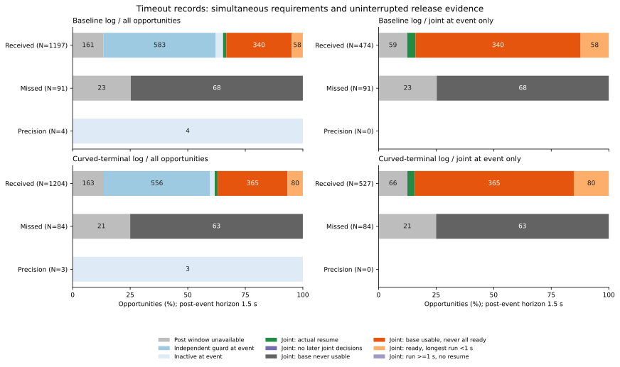

# 補正後の同時成立条件と復帰タイマーの経過

通常受信後に合同判定を観察できた876機会のうち、705機会では全要件が一度も同時に成立せず、138機会では成立しても連続1秒に届きませんでした。残る33機会が実際に復帰した記録です。138機会中133機会では、成立後に要件が崩れた区間がありました。

誤差が小さくなること、必要な条件を個別に満たすこと、すべてを同時に満たすこと、その状態を1秒続けることは、それぞれ別の段階です。今回は既存の時間切れ記録で各段階を追いました。条件・余裕・タイマーを変更した場合の走行結果は測っていません。

## 固定した対象と観察区間

[固定手順](protocol.md)を先に記録し、[前回の補正前後解析](../correction-centre-transitions/report.md)の全648ケースの会計、時間切れ全368ケース、150〜180秒の全2,583機会を使いました。両制御記録、既知・追加seed、独立・相関ノイズ、欠測モード、受信・欠測・精密補正、移動中や非解除中の機会も引き継いでいます。復帰33機会だけに対象を絞っていません。

各機会eの直前e−0.02、直後e、後続e+0.02〜e+1.5秒のすべての判定を保存しました。後続窓は`e < t <= e+1.5`の75区間です。180秒の368機会は直前・直後のみ残し、後続は未観測にしました。完全窓は2,215機会です。

| 種類 | 基準epoch | 旋回終端curved | 合計 |
|---|---:|---:|---:|
| 通常受信 | 1,197 | 1,204 | 2,401 |
| 予定補正の欠測 | 91 | 84 | 175 |
| 精密補正のみ | 4 | 3 | 7 |
| 全機会 | 1,292 | 1,291 | 2,583 |
| 後続が未観測 | 184 | 184 | 368 |

予定補正と精密補正の同時発生は0で、空の2分類も集計に残しています。打切りを完全な「復帰なし」の窓に置き換えていません。独立ガード判定中・非解除中に始まった完全窓はそれぞれ1,139・69機会で、合同判定の不成立には分類していません。

## 再構成した条件とタイマー

判定前の状態フラグと、その判定に使われた測定速度を既存の固定ヘルパーへ渡しました。行tの積分後の速度から判定を逆算していません。合同判定は次の7条件の同時成立です。

| 条件名 | 内容 |
|---|---|
| stationary | 判定に使う速度の絶対値が0.02m/s以下 |
| fresh | 補正からの経過が1.5秒以下 |
| samples | 現在の補正期間の復帰用観測が10個以上 |
| recovery_geometry | 既存の復帰直線の障害物距離と地図内境界が元の余裕を満たす |
| positive_command | 復帰後用の目標速度`nominal_target_speed`が正 |
| stop | 停止予測の距離下限が元の解除余裕を超える |
| terminal | 終端経路の距離から0.05mを引いた値が同じ解除余裕を超える |

最初の3条件の積を基礎条件とします。合同タイマーは全7条件が成立した区間だけ0.02秒ずつ増え、崩れると0へ戻り、1秒で復帰します。独立ガードはstationary・stop・terminalだけを使い、0.5秒で解除します。非解除中には要件がなく、存在しない要件は空欄です。

解除した区間のログでは、すでにタイマーが0へ戻っています。そこで前行の値から判定中の加算値を再構成し、動作フラグと加算・リセット後の記録値を照合しました。観察窓の開始前から残る値も保持します。合同復帰と同時に立つガード解除フラグを、独立タイマーによる別の解除にはしていません。

## 同時成立と連続成立の内訳

次は、機会時点で合同判定中だった通常受信だけを示した表です。各機会をいずれか1つに分類しています。

| 分類 | 基準epoch | 旋回終端curved | 合計 |
|---|---:|---:|---:|
| 全機会 | 474 | 527 | 1,001 |
| 後続が未観測 | 59 | 66 | 125 |
| 完全窓 | 415 | 461 | 876 |
| 基礎条件が成立するが全7条件は一度も同時成立せず | 340 | 365 | 705 |
| 全7条件が成立するが最長の連続区間が1秒未満 | 58 | 80 | 138 |
| 実際に合同復帰 | 17 | 16 | 33 |

この876機会では、基礎条件はすべての機会で少なくとも一度成立しました。「後続に合同判定なし」「基礎条件が一度も成立せず」「連続1秒以上なのに復帰なし」は0です。これらの空分類も保存しました。復帰17・16機会は各側15ケースに属し、独立な33試行ではありません。

一度も同時成立しなかった705機会のうち39機会（基準11・旋回28）では、7条件それぞれが少なくとも一度は成立していました。ただし、成立した時刻が異なります。残る666機会では、少なくとも1つの条件が観察中に一度も成立していませんでした。

例としてevent_id=30、known-white・curved・blackout・seed269・迷路・JPS・155秒では、後続75区間中、samplesのみ不成立が1区間、samples+recovery_geometryが7区間、recovery_geometryのみが50区間、recovery_geometry+terminalが17区間でした。7条件は個々にはすべて成立していますが、観測数が足りる時点では復帰直線の条件が成立していません。全条件がそろう区間は0でした。この例は該当する旋回側機会の最小event_idを選んだ説明例です。



左列は全2,583機会、右列は機会時点で合同判定中だった部分集合です。後続未観測を灰色で残し、精密補正の合同判定0件も表示しています。ラベルは件数で、4%未満は省略しています。0を含む108区間を[図の数値](gate-sequence-partitions.csv)に保存しました。

## 基礎条件を満たした区間の複数の不成立条件

通常受信の後続で基礎条件を満たした合同判定区間は、基準27,529・旋回30,615区間でした。これはイベント窓内の区間数で、ケース数や独立な試行数ではありません。復帰すると合同判定を抜けるため、その後の区間はこの分母に入りません。

次は同時に成立しなかった条件の組合せによる排他的な内訳です。「他の組合せ」は残る6組合せです。

| 同時に不成立だった条件 | 基準の区間 | 旋回の区間 |
|---|---:|---:|
| なし：全7条件が成立 | 2,490 | 2,861 |
| recovery_geometry + terminal | 12,218 | 9,790 |
| recovery_geometry + positive_command + stop + terminal | 4,842 | 5,983 |
| recovery_geometry + positive_command + terminal | 3,967 | 3,874 |
| recovery_geometryのみ | 360 | 3,143 |
| terminalのみ | 2,006 | 1,369 |
| 他の組合せ | 1,646 | 3,595 |
| 合計 | 27,529 | 30,615 |

各条件を単独で数えた不成立区間は次のとおりです。重なる不成立があるので、この表は足し合わせません。

| 条件 | 基準の不成立区間 | 旋回の不成立区間 |
|---|---:|---:|
| recovery_geometry | 22,347 | 25,421 |
| positive_command | 9,666 | 12,205 |
| stop | 5,678 | 7,293 |
| terminal | 24,137 | 22,561 |

復帰直線と終端経路の両方が同時に余裕を満たさない区間が多く、単独の条件を主因として割り当てることはできません。条件を外せば安全に復帰できる、または保持成功が増えるという反実仮想は計算していません。

## 成立しても1秒続かなかった機会

全条件が成立したが復帰しなかった138機会のうち、要件不成立で成立区間が途切れたのは基準53/58・旋回80/80機会でした。残る基準5機会は観察窓の終点まで短い成立区間が続いており、終点を条件の不成立とは数えていません。

最長の連続成立の中央値は基準12区間（0.24秒）・旋回6区間（0.12秒）、最大は47区間（0.94秒）・38区間（0.76秒）でした。成立区間の末尾が観察窓の終点に当たるのは基準19・旋回20機会で、その中には一度途切れて再び成立した基準14・旋回20機会も含みます。この窓内での継続不足であり、以後も復帰しないという分類ではありません。

基準側の最長例event_id=400は、known-white・epoch・blackout・seed269・迷路・A*・150秒です。+0.18〜+0.54秒の19区間で全条件が成立し、+0.56秒の1区間だけpositive_commandが不成立となってタイマーが0.38秒から0へ戻りました。+0.58〜+1.5秒は47区間連続で成立し、終点のタイマーは0.94秒です。合計66区間（1.32秒）成立しても、合同復帰はありませんでした。

旋回側の最長例event_id=1638は、new-white・curved・random・seed276・密集地図・A*・150秒です。成立は+0.18〜+0.24秒の4区間、+0.28〜+1.02秒の38区間、+1.06〜+1.5秒の23区間でした。間の+0.26・+1.04秒でpositive_commandだけが不成立となり、タイマーがそれぞれ0.08・0.76秒から0へ戻っています。合計65区間（1.30秒）、最長0.76秒で、復帰していません。両例は各側の最長連続区間を持つ機会から最小event_idを選びました。

## 欠測・他の経路・反復の扱い

欠測175機会はすべて機会時点で合同判定中でした。完全窓131機会（基準68・旋回63）では基礎条件が一度も成立せず、復帰は0でした。打切り44機会は別分類です。受信・欠測の集団は欠測モードと直前状態が異なるため、この差を受信の因果効果にはしていません。

精密補正7機会は非解除中に始まっています。独立ガードと非解除中の完全窓も保持し、実際のガード解除・正の指令・移動・遅延・介在補正は前回の各機会の値と照合しました。機会直後の動作を後続窓へ足していません。後続窓内に別の補正が入った5機会も除外せず、イベントごとに観察した区間を保存しています。

既知・追加seedやノイズ種ごとの結果も集計表にあります。各群の「一度も全要件が同時成立せず／短い成立／復帰」は、基準の既知独立86/18/4・既知相関108/6/3・追加独立89/20/7・追加相関57/14/3、旋回の順に102/26/4・113/10/3・78/34/6・72/10/3でした。小さな反復群の記述であり、群間差を一般化していません。

## 検証と再実行

解析コードは`02714e5`と観察開始境界の補足`a332c2f`、図と再実行手順は`7c246ba`です。72個の生軌跡ファイルの指紋を確認し、選択された3,312,000区間の時系列を読みました。固有171,082判定で実際の経路とタイマーを監査し、記録値との差の最大は1.110223e−16秒でした。前回の利用可能な全23,622スナップショットと、両入力が共有する判定フィールドが一致しました。

各機会の後続区間数、実動作、最初の遅延、成立時間と最長区間、移動距離、介在補正も前回のActionWindow値と一致しました。今回の計算は記録された判定とタイマーの監査です。全期間の観測位置・融合の再構成、物理・接触の検証は前回までの監査を引き継ぎ、新たに走行や物理状態を生成していません。

Python全267テストが成功しました。追加17件で、独立経路に存在しない要件、同時不成立、解除直前のタイマー加算と解除後の0、窓へ持ち越す値、欠測時のリセット、破損したタイマー・フラグ、個々の成立と同時成立の違い、途切れた成立の合計、観察終点と要件不成立の区別、経路変更、短い観察でも持越し値で復帰する場合、最大区間の被覆、開始直後に崩れる条件、終点打切り、初期経路、重なる不成立と排他的な組合せを確認しました。BlackとPython構文検査も成功しています。

```bash
python3 experiments/pose_observation_loss/analyze_correction_gate_sequences.py \
  --output /tmp/correction-gate-sequences
python3 experiments/pose_observation_loss/plot_correction_gate_sequences.py \
  --results /tmp/correction-gate-sequences --output /tmp/correction-gates-figure
python3 -m unittest discover -s experiments/pose_observation_loss -p 'test_*.py'
```

出力先は新しいディレクトリを使います。解析は標準ライブラリー、図はMatplotlibを使います。既存の保存先の生軌跡、または`--raw-root DIR`で指定した同一内容の4群が必要です。7つのCSVと`sources.json`は2回の解析でバイト単位に一致しました。図の数値・SVG・PNG・指紋も一致し、表示を確認しました。保存した区間・タイマー・マスク・分類・区間被覆・分母・指紋・リンクも照合しました。

[accounting.csv](accounting.csv)は全648ケース、[events.csv](events.csv)は全2,583機会と新しい分類・各要件の成立・連続区間の終了理由、[intervals.csv](intervals.csv)は直前・直後と後続の171,291行、[spans.csv](spans.csv)は後続166,125行を被覆する19,379区間を保存します。[summary.csv](summary.csv)は240集計、[patterns.csv](patterns.csv)は同時不成立の排他的な971集計、[requirements.csv](requirements.csv)は各条件の660集計です。

`event_id`は[前回の機会表](../correction-centre-transitions/events.csv)と同じIDです。`interval_id`と区間表の先頭・末尾IDで照合でき、`failed_mask`のビット順はstationary、fresh、samples、recovery_geometry、positive_command、stop、terminalです。非解除中のmask=0は合同要件の成立を意味しません。複数の機会に属する同じ判定209行分を重ねて保存しており、独立な区間数にはしていません。[sources.json](sources.json)と[図の指紋](gate-sequence-partitions-sources.json)に入力・コード・手順と再実行の指紋があります。

対象は最終的な時間切れに条件付けられた既存記録です。誤差や要件の改善を最終的な保持へ換算しておらず、保持結果140→140は更新していません。
