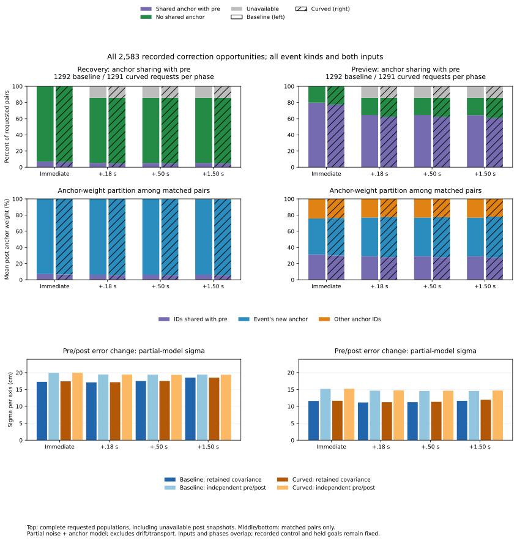

# Information retained across correction opportunities

Immediately after ordinary received corrections, preview retains an anchor
shared with its pre-correction input in **1,856 of 2,401 opportunities**.
Recovery replaces its old anchor at every one of these opportunities. Across
all **18,456 matched pre/post pairs**, the actual observation samples are
disjoint. Shared correction offsets and temporal noise correlation remain
distinct sources of covariance even when observations do not overlap.

The [protocol](protocol.md) was frozen as 9de48ec and the analyzer/tests as
b5e784a before new outcomes. This extends the
[correction-centre study](../correction-centre-transitions/report.md) and
[within-span temporal study](../speed-probe-temporal-information/report.md)
using the existing physical histories. No new controller, geometry or rollout
was introduced; the earlier 550/509 loss populations are unchanged.

## Complete requested population

Keep all 648 case records and all 368 timeout histories. The 2,583 late
opportunities comprise 2,401 ordinary received corrections, 175 scheduled
misses and 7 precision-only activations. Both combined event kinds remain
explicit empty summary groups. The phases retain the original definition:
pre is one decision before the event, immediate is the event decision, and
later phases are +9, +25 and +75 decisions at .02 s per step. Each input's
truth is the physical row preceding its decision, including the pre phase.

| Phase | Baseline requested | Baseline matched | Curved requested | Curved matched | Unavailable, both arms |
|---|---:|---:|---:|---:|---:|
| Immediate | 1,292 | 1,292 | 1,291 | 1,291 | 0 |
| +.18 s | 1,292 | 1,108 | 1,291 | 1,107 | 368 |
| +.50 s | 1,292 | 1,108 | 1,291 | 1,107 | 368 |
| +1.50 s | 1,292 | 1,108 | 1,291 | 1,107 | 368 |

This table applies separately to recovery and preview; their actions are the
same recorded actions. The export retains all 25,830 snapshot references and
20,664 requested pre/post pairs. Exactly 23,622 snapshots and 18,456 pairs are
available; the 2,208 unavailable post references/pairs keep blank model fields,
not zero error. Input/phase counts must not be added as physical attempts.

## Actual replacement versus inherited offsets

An event replaces the raw correction anchor exactly when a correction is
received or precision activates: 2,408 opportunities. A scheduled miss clears
estimator windows but preserves the existing correction anchor. At all 175
misses both inputs retain the old anchor immediately, despite zero shared
observation steps. All 131 observed post-miss windows retain it through +1.5 s;
the other 44 are censored at the end of the history.

For ordinary received corrections, preview's shared-anchor counts are:

| Phase | Baseline matched | Baseline sharing pre anchor | Curved matched | Curved sharing pre anchor |
|---|---:|---:|---:|---:|
| Immediate | 1,197 | 940 | 1,204 | 916 |
| +.18 s | 1,036 | 765 | 1,041 | 741 |
| +.50 s | 1,036 | 765 | 1,041 | 741 |
| +1.50 s | 1,036 | 763 | 1,041 | 722 |

All ordinary pre-preview inputs use the motion filter. Immediately after
reception, 1,856 use three-epoch fusion and share one old anchor with pre;
545 use the motion filter and share no anchor. Each fused input assigns 1/3
weight to that shared anchor, 1/3 to the newly received event anchor, and 1/3
to another older anchor. That third anchor is newly present in this pair's
post input, but was not newly received at the event. At +.50 s, 1,506/2,077
matched ordinary previews use the three-epoch estimator with this same shared
anchor weight; 571 use the motion filter.

The 7 precision-only events reset both inputs without retaining a pre anchor.
They are moving, state-triggered activations and remain a separate event kind.
One meets a later ordinary correction within 1.5 s. Overall, five original
opportunities contain an intervening anchor replacement by +1.5 s; they remain
in every corresponding input/phase table with explicit intervention counts.

Group weights partition post anchors into IDs shared with pre, the event's
new anchor if absent from pre, and all other IDs. The event anchor's total
weight is also recorded separately, since on a miss it is already shared with
pre. This avoids treating a window reset as an independent correction or an
older fusion anchor as a newly received one.

## Noise and cross-time covariance

The [exact group records](group-weights.csv) retain actual sample-step and
sigma lists, group weights, anchor IDs, anchor sigmas and realized anchor
vectors. Per-sample coefficients are group weight times sigma divided by
group sample count. Noise covariance applies the full `rho^abs(i-j)` kernel
between pre and post coefficients. Anchor covariance sums products of weighted
anchor sigmas over shared IDs. Anchors use their recorded sigma; initial
anchor 0 has deterministic zero variance. Shared IDs must have matching
metadata, and all covariance calculations satisfy PSD/nonnegative checks.

There are no common observation steps in any matched pair, so white-noise
cross-covariance is zero. Correlated noise remains correlated across anchor
replacement. At the 1,020 ordinary receptions in the two correlated cohorts,
immediate recovery has zero shared anchors but positive noise covariance in
every pair. A new independent anchor does not reset the AR noise process.

The error-change variance is `VA+VB-2*Cov(pre,post)`; the independent comparison
is `VA+VB`. Pool variances over matched pairs, then take a square root. The
following per-axis partial-model sigmas are in **cm**, using all event kinds.
Each entry is **retained covariance / independent pre/post**.

| Arm | Phase | Recovery | Preview |
|---|---|---:|---:|
| Baseline | Immediate | 17.277 / 19.922 | 11.610 / 15.172 |
| Baseline | +.18 s | 17.109 / 19.453 | 11.163 / 14.659 |
| Baseline | +.50 s | 17.501 / 19.384 | 11.255 / 14.568 |
| Baseline | +1.50 s | 18.526 / 19.402 | 11.653 / 14.566 |
| Curved | Immediate | 17.425 / 19.947 | 11.656 / 15.218 |
| Curved | +.18 s | 17.160 / 19.416 | 11.255 / 14.737 |
| Curved | +.50 s | 17.506 / 19.331 | 11.348 / 14.632 |
| Curved | +1.50 s | 18.514 / 19.356 | 11.975 / 14.696 |

These models include noise and anchor offsets, exclude drift and nonlinear
transport, and are not calibrated posterior bounds. A smaller change variance
describes shared modeled errors; it does not imply small input error or a
successful release. Event kinds, estimator availability and window censoring
select different populations; this is not a causal reception experiment.

## Accuracy remains a separate observed diagnostic

The closed .10 m truth-position disk uses each input's own preceding physical
truth and no heading test. For the entire requested population at +.50 s:

| Arm | Input | Both inside | Inside to outside | Outside to inside | Both outside | Unavailable |
|---|---|---:|---:|---:|---:|---:|
| Baseline | Recovery | 47 | 83 | 265 | 713 | 184 |
| Baseline | Preview | 106 | 80 | 467 | 455 | 184 |
| Curved | Recovery | 40 | 86 | 281 | 700 | 184 |
| Curved | Preview | 109 | 73 | 463 | 462 | 184 |

All other phases and all categories remain in the complete summaries.
Observed improvement/worsening retains the earlier 1e-8 m tie tolerance.
Error-vector change subtracts truth displacement from the estimated pose jump;
neither it nor lower error is substituted for an actual release or goal hold.

For a concrete example, use the first source event: event 1, known-white,
curved blackout seed 269, dense A*, t=150 s. Preview snapshots 2/4 change from
a 25-sample motion filter on anchor 7250 to fusion on anchors 7000/7250/7500
with 25/25/1 samples and equal group weights. Pre uses steps 7475--7499;
post uses 7001--7025, 7251--7275 and 7500, so none overlap. They share anchor
7250 with covariance .00333333 m^2, while white-noise covariance is zero.

The partial error-change sigma is 9.0921 cm versus 12.2202 cm independently.
Observed error norms decrease from 17.3764 to 16.1280 cm, with both still
outside the accuracy disk. The error-vector change is 12.7830 cm; truth does
not move at this event. A decrease in scalar error norm and the norm of the
error-vector change are different quantities.

## Validation and reproduction

Run the [README commands](../../README.md#information-retained-across-correction-opportunities)
with new output directories; `--raw-root` supports relocated identical cohort
directories. All **seven CSVs and provenance** repeat byte for byte. The figure
CSV/SVG/PNG/provenance also repeat exactly; the figure was visually checked
and PNG remains in scratch. The Python suite passes **382 tests**, including
15 new tests for anchor replacement/misses, independent anchors with AR noise,
three-way anchor weights, actual sample gaps, changing sigma, deterministic
initial anchors, metadata consistency, truth subtraction and censoring.

All 3,312,000 intervals reproduce estimator counts/fusion availability.
Every available source snapshot matches its recorded pose, estimator, truth,
sample count, noise/anchor marginal and four signed error components. Maximum
pose/yaw discrepancy is 1.24e-9 in their respective units; maximum component
discrepancy is 2.22e-16 m. Separate dense-kernel calculations checked all
23,622 available snapshot marginals and all 18,456 matched cross-covariances,
plus all source joins, anchor partitions, 2,880 summaries and 768 numeric
figure rows. Source, script, protocol, helper and simulator hashes match.

[Snapshot information](snapshot-information.csv) retains all original snapshot
IDs. [Transitions](transitions.csv) retain every requested pair and its source
IDs, censoring, covariance, anchor-weight partition and error-change labels.
[Summary](summary.csv) keeps empty event kinds and estimator groups.
[Reconstruction](reconstruction.csv) keeps all 368 history checks.
[Accounting](accounting.csv) and [events](events.csv) are unchanged pinned
copies, including recorded action fields. [Analysis provenance](sources.json),
[figure data](correction-information-comparisons.csv) and
[figure provenance](correction-information-comparisons-sources.json) are tracked.
Original observation/physics validation is inherited. Recorded control and
held goals remain **140 -> 140**.
