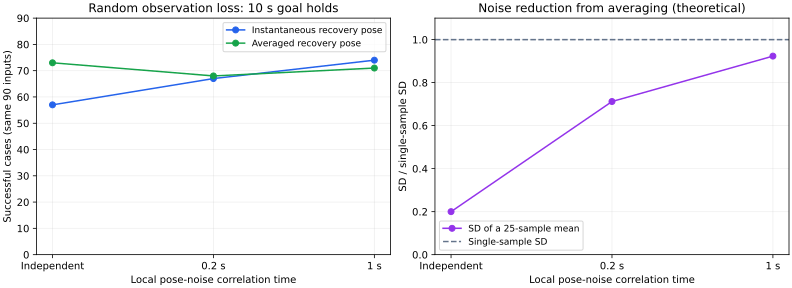

# Correlation changes the benefit of recovery-pose averaging

The benefit observed with independent measurement noise largely disappeared
at correlation time 0.2 s and reversed for random loss at 1 s. These are fixed
policies on the same maps and seeds, not tuned controllers or unseen trials.



| Correlation time | Availability | Recovery pose | Held 10 s | Contact | Timeout |
|---|---|---|---:|---:|---:|
| 0.0 s | none | aware | 90/90 | 0 | 0 |
| 0.0 s | none | averaged | 90/90 | 0 | 0 |
| 0.0 s | random | aware | 57/90 | 0 | 33 |
| 0.0 s | random | averaged | 73/90 | 0 | 17 |
| 0.0 s | blackout | aware | 85/90 | 0 | 5 |
| 0.0 s | blackout | averaged | 88/90 | 0 | 2 |
| 0.2 s | none | aware | 90/90 | 0 | 0 |
| 0.2 s | none | averaged | 90/90 | 0 | 0 |
| 0.2 s | random | aware | 67/90 | 0 | 23 |
| 0.2 s | random | averaged | 68/90 | 0 | 22 |
| 0.2 s | blackout | aware | 87/90 | 0 | 3 |
| 0.2 s | blackout | averaged | 89/90 | 0 | 1 |
| 1.0 s | none | aware | 89/90 | 1 | 0 |
| 1.0 s | none | averaged | 89/90 | 1 | 0 |
| 1.0 s | random | aware | 74/90 | 1 | 15 |
| 1.0 s | random | averaged | 71/90 | 0 | 19 |
| 1.0 s | blackout | aware | 88/90 | 1 | 1 |
| 1.0 s | blackout | averaged | 88/90 | 1 | 1 |

`aware` uses each instantaneous recovery pose; `averaged` uses the stationary
25-sample window. Each row has three maps × three planners × seeds 211–220.
The independent-noise rows reuse the previous 540-case evaluation. The two
correlated conditions add 540 cases each. No case left the map.

For random loss, averaging gained five holds and lost four at 0.2 s, for a net
gain of one. At 1 s it gained three and lost six, for a net loss of three.
At 1 s it also reduced random-loss contacts from one to zero, at the cost of
more timeouts. Neither completion nor contact alone describes the tradeoff.

## What correlation changes

The normalized local pose-noise process is stationary AR(1): the first sample
is standard normal, then `z[t] = rho*z[t-1] + sqrt(1-rho²)*epsilon[t]`, with
`rho = exp(-0.02/tau)`. Position/yaw σ remains 0.1/2°, or 0.03/0.6° after
precision activation. Normalized state persists across that σ change. The
external correction residuals and drift are unchanged. The policies, margins,
timing, speed limits, and true ten-second hold criteria were fixed throughout.

For a stationary unit-variance process, the SD of a mean of N samples is
`sqrt((N + 2*sum((N-k)*rho^k, k=1..N-1))/N²)`. At N=25 it is 0.200 for
independent samples, 0.712 at tau=0.2 s, and 0.923 at tau=1 s. This describes
only the local measurement-noise component: averaging does not remove the
shared correction residual or bias. Correlation also changes tracking and
confirmation dynamics, so these values do not by themselves predict success.

The fixed first 50 s of open-map A* trajectories provide 25,000 normalized
samples per axis per condition. Empirical variance was 0.959–1.097 across all
axes/conditions; lag-one correlations were near 0, 0.900–0.907, and 0.980–0.982,
consistent with the specified coefficients 0, 0.904837, and 0.980199. See
[noise-statistics.csv](noise-statistics.csv). These are descriptive checks,
not confidence intervals or efficacy estimates.

## Contact diagnosis

Five contact rows occurred at tau=1 s, representing two case histories:

- Dense map / Theta* / seed 213 contacted the obstacle at (24,35) at 42.60 s.
  It appears in both policies with no loss and with the 45–75 s blackout.
  These four rows share the same history because contact preceded the blackout
  and no recovery pause occurred. Recomputed swept clearance is 0.497890502
  against radius 0.5. Averaging only the recovery pose cannot address this
  ordinary tracking failure.
- Maze / JPS / seed 212 under random loss contacted (33,40) at 140.76 s with
  the instantaneous policy, while not paused and with observation age 0.76 s.
  Recomputed swept clearance is 0.499741753.

The analysis independently recalculated all contact distances from consecutive
true trajectory positions and the checked-in point-obstacle map. Full records
are in [contacts.csv](contacts.csv). The five rows are not five independent
physical failure histories. No contacts occurred at tau=0 or tau=0.2 s.

## Reproduce and validation

Run the three correlation times with the same seeds, retaining each output
directory. The independent data can also be regenerated from the preceding
study. From the repository root:

```bash
python3 experiments/pose_observation_loss/run.py --recovery-comparison \
  --noise-correlation-time 0.2 --seeds 211 212 213 214 215 216 217 218 219 220
python3 experiments/pose_observation_loss/run.py --recovery-comparison \
  --noise-correlation-time 1 --seeds 211 212 213 214 215 216 217 218 219 220
python3 experiments/pose_observation_loss/compare_correlations.py \
  WHITE_RUN TAU_02_RUN TAU_1_RUN --output NEW_ANALYSIS_DIRECTORY
```

The optional figure generator requires matplotlib; simulation and CSV analysis
use only the Python standard library:

```bash
python3 experiments/pose_observation_loss/plot_correlations.py NEW_ANALYSIS_DIRECTORY
```

All 1,080 correlated cases passed the trajectory verifier: AR recurrence and
stationary initialization, paired noise and correction residuals, observation
availability/age, recovery-window provenance and reset rules, motion/braking,
RMS, clearance summaries, and true hold conditions. The fixed-window analysis
also matched Gaussian innovations across all three correlation times.
Independent-noise regressions passed all 162 executed cases against the old
snapshots (seeds 211, then 201 and 213). An additional 54-case correlated smoke
check passed before the full study. The tau=0 behavior remains the default.

Formatting, control-crate Clippy for all targets with warnings denied, and all
three headless Pure Pursuit tests passed. The broader workspace suite was not
rerun for this example-only extension. New correlated results and source/input
hashes are preserved in the `tau-*` files. `sources.json` records the reused
white run as well. Raw trajectories are regenerated and are not committed.

The model is not fitted to sensor recordings, and maps/seeds were already used.
The results establish sensitivity of this fixed simulation policy to temporal
correlation, not hardware reliability. A correlated-noise model is now available
for further controller comparisons; this change does not alter the policy.
