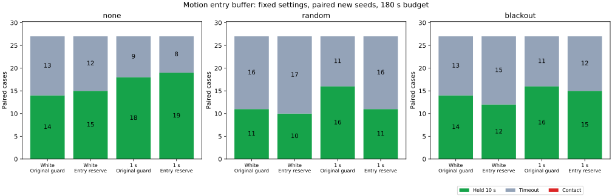

# 開始側だけに速度依存の余裕を加える比較

停止予測ガードの開始側にだけ追加余裕を設け、解除の閾値を従来のままにしても、新規シードの10秒保持成功は89/162から82/162に減りました。接触は両群とも0件でした。平均待機は81.71秒から87.70秒へ増えています。この固定条件では改善を確認できず、実装は比較用のオプションとして残し、既定にはしません。

## 比較する条件

従来の `joint` と、開始側だけを変える `entry` を比較します。両群とも広い経路、弧による速度制限、観測の平均、欠落待機とガードの同時復帰を使います。ライブラリの既定コントローラとの比較ではありません。

`base = 0.5 + 2√2×sigma + 0.02×観測年齢` とすると、閾値は次のとおりです。速度には判断前の測定値を使います。

| 項目 | 従来の `joint` | 開始側余裕の `entry` |
|---|---|---|
| ガード開始 | `base` | `base + 0.1×min(速度の絶対値/0.4, 1)` |
| ガード解除 | `base + 0.05` | `base + 0.05` |
| 欠落待機との同時解除 | 復帰条件とガード解除条件を1秒確認 | 同じ |

開始閾値を一律0.1増やすと、解除閾値が開始閾値を下回り、静止したまま解除・再発動を繰り返せます。そのため追加余裕は速度に応じて0〜0.1にしました。解除可能な速度0.02以下では、同じ観測に対する解除閾値が開始閾値より少なくとも0.045高くなります。観測が変化しても解除や走行を保証する条件ではありません。この式、既知シード250〜252、新規シード253〜255は、今回の結果を見る前に固定しました。

独立したガード解除の0.5秒確認、同時復帰の1秒確認、復帰用の前方0.6の直線、速度上限、制動則、車体半径0.5、目標の10秒保持、180秒の制限は両群で共通です。各対で補正受信・欠落・ノイズ革新を揃えています。真姿勢を制御判断には使いません。

遠い障害物を停止予測から除く枝刈りにも実際の開始閾値を渡しています。古い記録の距離下限と新しい閾値を比較しただけの解析ではありません。`MOTION_ENTRY_BUFFER` は既定で無効で、`JOINT_RECOVERY=true` を要し、従来の `RECOVERY_GUARD_BUFFER` とは同時指定できません。

## 保持と接触

3地図×3計画器×欠落3条件を、独立ノイズと相関1秒のノイズで比較しました。各行は81組、各群81走行です。

| 対象・ノイズ | シード | 従来の保持 | 開始側余裕の保持 |
|---|---|---:|---:|
| 既知・独立 | 250〜252 | 41 | 37 |
| 既知・相関1秒 | 250〜252 | 55 | 51 |
| 新規・独立 | 253〜255 | 39 | 37 |
| 新規・相関1秒 | 253〜255 | 50 | 45 |

比較の全648走行で接触・地図外への退出は0件、保持以外はすべて180秒の時間切れでした。新規162組では保持の獲得3件・喪失10件、既知162組では獲得3件・喪失11件です。接触0件は両群に共通であり、追加余裕による接触低減の証拠にはなりません。

| 新規ノイズ | 欠落 | 従来の保持 / 27 | 開始側余裕の保持 / 27 |
|---|---|---:|---:|
| 独立 | なし | 14 | 15 |
| 独立 | ランダム | 11 | 10 |
| 独立 | 45〜75秒 | 14 | 12 |
| 相関1秒 | なし | 18 | 19 |
| 相関1秒 | ランダム | 16 | 11 |
| 相関1秒 | 45〜75秒 | 16 | 15 |

## 待機とガードの再発動

待機は欠落待機または停止ガードが有効な指令区間の和集合です。重なりは1回だけ数え、目標停止だけの時間は加えません。制動中も含みます。「静止中の待機」はこの和集合を判断前の測定速度の絶対値0.02以下に限定したものです。

| 対象・ノイズ | 従来の平均待機 | 開始側余裕の平均待機 | 従来の静止中の待機 | 開始側余裕の静止中の待機 |
|---|---:|---:|---:|---:|
| 既知・独立 | 99.09秒 | 102.06秒 | 94.47秒 | 93.59秒 |
| 既知・相関1秒 | 65.90秒 | 69.08秒 | 62.06秒 | 60.19秒 |
| 新規・独立 | 98.14秒 | 100.21秒 | 94.12秒 | 91.82秒 |
| 新規・相関1秒 | 65.29秒 | 75.19秒 | 61.71秒 | 67.22秒 |

新規例全体の静止中の待機は77.91→79.52秒でした。ガードの開始回数は1走行平均4.67→9.72回に増えています。静止時の閾値逆転を避けても、ガードの繰り返しを減らせたわけではありません。どの繰り返しが保持喪失を引き起こしたかは今回の集計では切り分けていません。

一方、時間切れかつ終了前30秒の移動距離0.1未満だった新規例は40→37件に減っています。移動が増えても保持成功とは限りません。この分類は時間切れ例だけを対象にし、独立した失敗原因とは扱いません。

待機時間は各走行の終了までの値です。成功例には10秒の目標保持があり、時間切れ例とは観測期間が異なります。固定した180秒全体での待機量の因果効果や、単位時間あたりの待機率ではありません。

## 前回の追加余裕との関係

[前回の `buffered`](../guard-buffer/report.md) は開始・解除をともに0.1増やしました。同じシード250〜252の162組では、従来の保持96件に対し `buffered` は81件、今回の `entry` は88件でした。平均待機は従来82.50秒、`buffered` 97.99秒、`entry` 85.57秒です。今回の従来群162件は前回の保存結果と全項目が一致しています。

ただし `buffered` と `entry` の比較では、解除閾値と開始余裕の速度依存性が両方変わっています。88−81の差を解除条件だけの効果とは解釈できません。今回の対比較で変更したのは `joint` に対する開始ルールだけで、その条件でも保持成功は減りました。

## 検証と再実行

比較4走行の648ケースと、元の既定条件のseed201・54ケースを検証しました。5走行の実行情報と現在のシミュレータのSHA-256が一致しています。

- 毎ステップの開始・解除閾値、速度依存の追加余裕、静止時の閾値の間隔、速度上限、物理応答、対にしたノイズ・欠落、平均観測窓、目標保持、両方の解除タイマーを照合しました。ガードの全状態遷移も独立に再構成しています。
- 既知シードの従来群162件と既定条件54件の結果は、それぞれ保存済み結果と一致しました。既定条件のbaseline・blackoutに元からある接触1件も同じです。
- 開始側余裕群の全ガード開始・解除・欠落待機からの復帰と固定地点を合わせた8,518地点で、停止予測、速度用の弧、復帰直線の幾何を独立に再計算しました。欠落待機からの全復帰533回を含みます。
- ガード開始の欠落、解除後の不正な有効状態、解除タイマーの破損、同時解除の破損、解除閾値の破損を注入した5記録は、検証がすべて拒否しました。新しい閾値列を持たない過去の生軌跡9本も、従来の解除式で検証を通過しました。
- Headless Releaseビルド、全ターゲットのClippy（警告をエラー扱い）、std有効のPure Pursuit単体テスト4件、Rust/Pythonの整形・構文チェックが通過しました。集計を再実行し、全CSVと実行情報のバイト単位の一致を確認しました。

[READMEの手順](../../README.md#compare-a-motion-dependent-entry-reserve-with-unchanged-release)で4走行と集計を再実行できます。走行・検証・集計はPython標準ライブラリとCargo、図にはMatplotlibを使います。全結果は [all-results.csv](all-results.csv)、条件別集計は [summary.csv](summary.csv)、保持の獲得・喪失は [paired-holds.csv](paired-holds.csv)、待機とイベントは [control-events.csv](control-events.csv)、幾何確認は [preview-audit.csv](preview-audit.csv) にあります。

入力経路、シミュレータのハッシュ、シード、実行元コミット等は [sources.json](sources.json) に保存しました。シミュレータSHA-256は `d57b89d607d71347980b6bebe9f2f9bdbdb0a58f72711f6947ce1a1aec41275b` です。生軌跡はリポジトリへ含めず、再実行で生成します。

同じ3地図と少数シードの組合せであり、648走行を独立な統計標本とは扱えません。ノイズ余裕も経験的な値です。今回の固定条件では、開始余裕を速度に応じて加え、解除条件を維持するだけでは保持の改善につながりませんでした。
