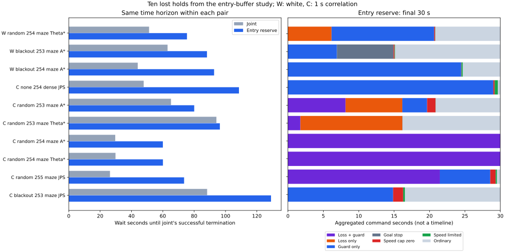

# 開始側余裕によって保持を失った10組の診断

[開始側余裕の比較](../entry-buffer/report.md)で保持を失った新規シードの10組では、従来案が成功する時刻までの待機がすべて増えていました。10組の平均は53.96→86.41秒です。ガード解除後1秒以内・移動0.1未満での再発動も27回あり、うち21回は追加余裕がある場合だけ発動する位置でした。一方、最後の30秒を静止待機したものは2例で、残りを一律に停止行き詰まりとは扱えません。

今回は既存の結果から失敗側を選んだ事後診断です。新しい性能評価や独立した検証シードではなく、全体の成功率への効果をこの10組から推定しません。制御則・閾値・シードを変更した再走行も行っていません。

## 対象と比較の時間窓

シード253〜255・独立ノイズと相関1秒のノイズについて、従来の `joint` が10秒保持に成功し、開始側余裕の `entry` が時間切れとなった全10組を対象としました。独立が3組、相関1秒が7組です。対象の選択には前回保存した結果だけを使っています。

待機は欠落待機または停止ガードの指令区間の和集合で、重なりを二重に数えません。比較終了時刻は各組の `joint` の成功時刻に揃えています。候補の180秒全体と、早く終わった従来案を直接引き算した結果ではありません。ただし、共通時刻内でも目標保持など走行の状態は異なります。

| ノイズ・欠落 | seed・地図・計画器 | 共通終了時刻 | 従来の待機 | 開始側余裕の待機 | 短い再発動 |
|---|---|---:|---:|---:|---:|
| 独立・ランダム | 254・maze・Theta* | 121.18秒 | 51.24秒 | 75.42秒 | 0 |
| 独立・45〜75秒 | 253・maze・A* | 137.50秒 | 63.04秒 | 88.18秒 | 10 |
| 独立・45〜75秒 | 254・maze・A* | 118.14秒 | 44.00秒 | 92.72秒 | 4 |
| 相関1秒・なし | 254・dense・JPS | 166.14秒 | 47.80秒 | 108.58秒 | 6 |
| 相関1秒・ランダム | 253・maze・A* | 148.90秒 | 65.22秒 | 80.04秒 | 0 |
| 相関1秒・ランダム | 253・maze・Theta* | 178.74秒 | 94.20秒 | 96.40秒 | 0 |
| 相関1秒・ランダム | 254・maze・A* | 102.32秒 | 29.66秒 | 60.04秒 | 1 |
| 相関1秒・ランダム | 254・maze・Theta* | 102.48秒 | 29.82秒 | 60.08秒 | 1 |
| 相関1秒・ランダム | 255・maze・JPS | 115.58秒 | 26.30秒 | 73.58秒 | 4 |
| 相関1秒・45〜75秒 | 253・maze・JPS | 174.34秒 | 88.28秒 | 129.04秒 | 1 |

短い再発動の列は、候補の180秒全体で数えています。左側の待機時間と同じ打ち切りではありません。

図の右側は150秒を超え180秒までの指令区間を状態別に合計したもので、時系列の並びではありません。分類の優先順は欠落＋ガード、欠落のみ、ガードのみ、目標停止、速度上限0、速度制限、通常です。

## 解除後の再発動

候補の全ガード開始129回のうち103回は、その時点の正確な停止予測距離が従来の開始閾値を上回り、速度依存の追加余裕を含む閾値以下でした。閾値との距離が2×10⁻⁸以内で分類が曖昧な例はありません。この分類は候補と同じ姿勢・速度・観測・予定指令に対して余裕を除いた局所比較です。分岐後の従来案の実際の軌跡を再現する反実仮想ではありません。

解除から次のガード開始まで完結した区間は119本でした。初回の開始や、終了まで次の開始がない解除はこの本数に含めません。「短い再発動」は、解除時の実指令速度が正、途中に欠落待機がなく、判断時刻の差が1秒以下、再発動直前までの移動が0.1未満の区間です。この定義は集計前に固定しました。

27本がこの条件に該当し、7例に分布しました。遅延は0.10〜0.82秒、移動は最大0.09677でした。21本は追加余裕がある場合だけ発動する位置、6本は従来の閾値でも発動する位置でした。119本には解除時指令が0の23本、途中に欠落待機を挟む15本も含まれ、これらを短い再発動には数えていません。両分類は重なり得ます。

移動距離は解除判断の直前の真位置から、再発動判断の直前の真位置までです。解除指令の区間は含み、再発動による制動指令の区間は含みません。真位置はこのオフライン診断にだけ使っています。

短い再発動のない3例でも保持を失っています。この現象だけでは10例すべてを説明できず、発動を抑えれば安全に保持できるという結論にもなりません。

## 終了間際の状態

独立・blackout・seed253・maze・A*は171.38秒に初めて目標範囲へ入り、終了時の連続保持は7.38秒でした。相関1秒・random・seed253・maze・Theta*は169.24秒に初めて入りましたが、終了時の連続保持は9.44秒です。最初の進入から終了までの経過時間を、連続保持時間とは扱いません。両例とも最終目標距離は0.25未満でした。

末尾30秒の移動が0.1未満だったのは、相関1秒・random・seed254・mazeのA*とTheta*の2例です。両例とも移動0、欠落待機とガードの重なりが30秒でした。欠落復帰を待っている間の条件を集計すると、次のようになります。失敗条件の時間は重なるため合計できません。

| 復帰条件・末尾30秒 | A* | Theta* |
|---|---:|---:|
| 観測年齢が1.5秒を超過 | 22.40秒 | 22.40秒 |
| 平均観測のサンプルが10未満 | 23.30秒 | 23.30秒 |
| 復帰直線または地図境界の余裕が不足 | 28.92秒 | 23.58秒 |
| 予定指令速度が正でない | 29.10秒 | 24.14秒 |
| 停止予測がガード解除余裕を満たさない | 26.04秒 | 19.30秒 |
| 全条件を満たした時間の合計 | 0.28秒 | 2.26秒 |
| 全条件を満たした最長の連続時間 | 0.12秒 | 0.52秒 |

両例とも、この窓内では同時復帰に必要な連続1秒へ達していません。Theta*では条件を満たす時間の合計が1秒を超えていても、分断されて復帰できません。終了の1時点だけでは両例ともガード解除の距離条件を満たしますが、平均観測のサンプル数が1です。最後の補正直後の値だけを、30秒間の待機原因とは解釈しません。

相関1秒・random・seed255・maze・JPSの末尾移動は0.100505で、0.1未満の分類には入りません。その他の例も含め、移動があること自体は目標への進行や保持成功を保証しません。

## 検証と再実行

選んだ両群20軌跡の158,266物理区間について、時間差、位置・速度・ヨーの積分を検証しました。ガードの全状態遷移と同時復帰タイマーを独立に再構成しています。候補のガード開始・解除・欠落復帰の全274地点と終了時10地点では停止予測の正確な幾何を再計算しました。末尾の復帰条件の時間集計は、検証済みの記録に含まれる判定値に基づきます。

入力経路のハッシュと全走行の要約を前回保存した研究に照合し、今回使った生軌跡、ヘルパー、解析スクリプトのハッシュを [sources.json](sources.json) に保存しました。生軌跡を指定して解析を繰り返し、全CSVと実行情報のバイト単位の一致を確認しています。時間窓、重複待機、区間の端点、距離閾値、欠落による中断、未完了の解除を扱う7単体テストと、再利用する幾何の既存7テストが通過しました。

[READMEの手順](../../README.md#diagnose-the-entry-buffer-studys-lost-holds)で同じ診断を再実行できます。[lost-holds.csv](lost-holds.csv) に10組の指標と終了時条件、[guard-events.csv](guard-events.csv) に全イベントの正確な距離、[release-bouts.csv](release-bouts.csv) に解除から再発動までの区間を保存しました。

今回確認できたのは、失った10組で共通時刻までの待機が増え、7例には短い再発動があり、末尾の完全な静止待機2例では復帰条件を連続して満たせなかったことです。開始側余裕を加えるだけでは改善せず、次の変更を検討する際には再発動と復帰待機の両方を確認する必要があります。
