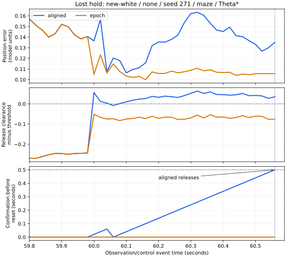

# 位置推定を改善したとき、停止と解除はどこで変わったか

最初の分岐は、119組で従来方式が先に解除し、2組で融合方式が先に停止する動作でした。保持を失った3組では、位置誤差が小さくなり、従来が過大に見積もっていた解除余裕を満たさなくなっていました。終端の直線と固定した距離余裕が解除を抑えることが、同じ履歴からの最初の違いでした。

これは[前回の648ケース](../epoch-preview/report.md)の診断です。新たな制御成績の測定は行わず、保持141→139、新seedで72→70という結果をそのまま使っています。推定器と制御の既定値も維持しています。

## 結果で選別せず、指令が変わった全組を調べる

全324組を[accounting.csv](accounting.csv)へ残し、指令が変わった121組を解析しました。残る203組は指令の差がなく、終了状態と時刻も同じでした。121組の内訳は、両方時間切れ111、両方保持6、保持喪失3、保持獲得1です。

| 群 | 解析した組 | 従来が先に単独解除 | 従来が先に欠測復帰 | 融合が先に停止 |
|---|---:|---:|---:|---:|
| 既知・独立 | 31 | 24 | 7 | 0 |
| 既知・相関1秒 | 31 | 22 | 9 | 0 |
| 新規・独立 | 34 | 27 | 5 | 2 |
| 新規・相関1秒 | 25 | 22 | 3 | 0 |
| 合計 | 121 | 95 | 24 | 2 |

同じseed・経路・欠測条件に共通する観測が含まれます。表は指令が変わった組に条件づけた内訳で、独立な121試行としての信頼区間は付けていません。

最初のガード・欠測動作が違う時点まで、物理姿勢、計測速度、ノイズ、補正イベント、元のフィルタ姿勢、予定操舵・速度と余裕が同じことを確認しました。共有履歴は402,593判断です。この範囲で変えた入力は停止予測のx,yです。その後の姿勢・進路・観測は変わるため、後半の位置差を最初の入力差だけに帰属させていません。

## 現在の位置と、解除タイマーの履歴を分ける

単独解除には0.5秒、欠測復帰には1秒の連続確認が必要です。解除が分かれた行で幾何条件が同じだったものは11組あり、うち7組では既に融合を使わず元の位置へ戻っていました。以前の融合位置でタイマーがリセットされた影響が、その後の解除まで残っています。

まず、最初の条件・カウンタ差と、対象タイマーが最後に同じ値だった時点を記録しました。初回の集計で、新規独立・random・271・maze/JPSの1組では、値が不一致のまま先行側が逆転することも確認しました。45.28秒では融合側だけが幾何条件を通り、その後は従来側が連続確認を満たして46.46秒に先に復帰していました。

そこで[固定条件](protocol.md)へ診断の補足を記録し、先に解除した側の連続確認区間内で、もう一方が最後に条件を満たさなかった行も保存しました。初回集計の対象、成績、終盤の集計と要約は変えていません。補足後の全119解除で、先行側の連続確認はそれぞれ0.5秒または1秒でした。最後の阻害点では121組すべてで融合が利用されていました。

[forks.csv](forks.csv)には各時点、[prefixes.csv](prefixes.csv)にはその時点の必要条件とタイマーを保存しました。最後にタイマーが一致した直後と、今回の解除を阻害した最後の判定を区別できます。

## 同じ状態で位置だけを差し替える

選んだ1,116判断時点を、記録姿勢・元の位置と記録の向き・真位置と記録の向き・真姿勢の4通りで評価しました。[geometry.csv](geometry.csv)は4,464行です。速度・予定操舵・予定速度・余裕は各行の値を維持しています。

今回のガード開始余裕を `m = 0.5 + 2√2σ + 0.02×観測年齢` とすると、解除には停止軌道の距離 `Dstop > m+0.05`、終端直線の距離 `Dterminal > m+0.10` が必要です。表の解除余裕は `min(Dstop, Dterminal−0.05)−(m+0.05)` で、正の場合に幾何条件を満たします。欠測復帰では、このほかに実測の復帰直線、鮮度、サンプル数などの条件も必要です。

最後の阻害判定で、融合位置の誤差が小さかったのは105組、大きかったのは16組でした。同じ予定指令を真姿勢から予測した幾何分類と一致したのは融合92組、元の位置29組です。向きも真値へ置き換えると分類が変わったものは2組でした。この121地点に判定境界から2e-8以内の曖昧なものはありませんでした。

以下の4組では最後の阻害点が最初の動作分岐と同じ行です。すべてmaze/Theta*で、元の位置からは解除可能、融合位置からは解除不可となっていました。

| 群・条件・seed | 分岐時刻 | 位置誤差 元→融合 | 解除余裕 元 | 解除余裕 融合 | 解除余裕 真姿勢 | 保持の変化 |
|---|---:|---:|---:|---:|---:|---|
| 既知独立・blackout・270 | 101.24 | 0.18138→0.03045 | +0.01164 | −0.12118 | −0.13833 | 喪失 |
| 新規独立・none・271 | 60.56 | 0.13508→0.10564 | +0.03488 | −0.07640 | −0.05250 | 喪失 |
| 新規独立・blackout・271 | 95.48 | 0.13625→0.07355 | +0.05725 | −0.03340 | −0.05086 | 喪失 |
| 既知相関・random・269 | 51.16 | 0.14180→0.09201 | +0.11124 | −0.01413 | +0.07969 | 獲得 |

喪失した3組では、真位置だけを代入して向きを残した評価でも解除不可でした。従来の推定誤差による楽観的な解除を、より真位置に近い推定が抑えています。一方、その3地点の真姿勢からの予測停止軌道・終端線分は、物理半径0.5を超える距離を持っていました。固定した追加余裕を満たさないことと、物理的に接触することは区別しています。前回の実走行では両方式とも接触0でした。

保持を得た1組では、最初の復帰は真姿勢でも余裕があり、融合位置が見送る判定でした。その後の観測・進路も変わった結果、最終的には融合側が保持しています。最初の幾何判定の正否だけから、最終保持の増減を予測できるという結果ではありません。

## 解除までの1例



新規独立・欠測なし・271の39判断を示しています。60.56秒まで更新前の物理姿勢と予定指令は同じです。融合位置の誤差は小さくなっていますが、解除余裕は負のままでした。従来方式は60.08〜60.56秒の25回で0.02秒ずつを足して0.50秒に達し、先に解除しました。図のカウンタは解除後にゼロへ戻す前の値で、元のログとの整合を検査しています。

図はこの分岐を説明する1例です。[release-example.csv](release-example.csv)に数値、[実行情報](release-example-sources.json)に39判断の共有入力確認と生データ・コードのハッシュを残しています。

## 終盤では何が進行を妨げたか

候補側で時間切れになった解析対象114組のうち、終了前30秒の移動0.1未満は83組、0.1以上は31組でした。保持を失った3組にはすべて終盤の移動があり、待機を挟みながら目標へ届いていませんでした。

| 喪失した候補 | 最後30秒の移動 | 最後30秒の待機 | 停止軌道条件の不成立秒 | 終端直線条件の不成立秒 | 最長連続確認秒 | 終端条件を外した最長秒 |
|---|---:|---:|---:|---:|---:|---:|
| 既知独立・blackout・270 | 7.209 | 21.64 | 0.00 | 16.46 | 0.50 | 9.58 |
| 新規独立・none・271 | 6.156 | 22.56 | 0.00 | 21.58 | 0.28 | 20.94 |
| 新規独立・blackout・271 | 15.805 | 10.30 | 6.12 | 8.64 | 0.50 | 1.98 |

必要条件の秒数は、更新前のガード状態で単独解除を評価する行に限定します。待機は判断後のガード・欠測待機の和集合です。条件の不成立は重なり、合計を待機時間と同じものには扱いません。特に新規none・271は最長0.28秒で0.5秒へ届かず、終端直線の条件が連続確認を遮っていました。

時間切れ114組の終盤で単独解除を評価したのは83組でした。32組には0.5秒の確認区間があり、残る51組では停止予測条件を除けば0.5秒へ届く区間がありました。欠測復帰を評価した34組では、2組が1秒へ届き、17組は停止予測条件が連続確認を遮り、15組はそれを除いても他の条件が1秒を遮っていました。単独・欠測の両方を評価する組もあり、83と34は重なります。

終端条件を外した値は、記録された状態と予定指令を保った必要条件の確認です。条件を外して走らせた到達成績や、接触しないという保証には置き換えていません。各方式自身の最後30秒と、両方が存在する短い終端時刻までの30秒を[tails.csv](tails.csv)、[requirements.csv](requirements.csv)に分けて保存しました。

## 検証と再実行

以前に全量検証した生データのハッシュを照合し、選んだ242軌跡・2,151,228移動区間を再利用しました。最初の指令差の時刻は前回の記録と全組で一致しました。過去のケース・結果・シミュレータ・必要な補助関数のハッシュも照合しています。Python 124テストが成功し、速度の厳密な境界、向きだけを残す置換、タイマー履歴、先行側の逆転、直接停止、条件を除いた連続時間などを検査しました。

初回の診断は`eb71b43`で固定し、先行側の逆転を扱う補足を`b9fd378`へ保存しました。補足後の7つのCSVと`sources.json`を再集計し、バイト単位で一致しました。初回集計の対象一覧・終盤・必要条件・要約もそのまま一致しています。図の数値・SVG・実行情報も再生成で一致し、表示も確認しました。

```bash
python3 experiments/pose_observation_loss/analyze_epoch_divergence.py \
  --output /tmp/epoch-divergence
python3 experiments/pose_observation_loss/plot_epoch_release_example.py \
  --diagnosis /tmp/epoch-divergence --output /tmp/epoch-release-example
python3 -m unittest discover -s experiments/pose_observation_loss \
  -p test_epoch_divergence.py
```

出力先は新しいディレクトリにします。解析本体はPython標準ライブラリ、図にはMatplotlibを使います。別の場所へ再生成した前回と同じ4群には、両スクリプトで`--raw-root DIR`を指定できます。起動時刻やGitコミットが違っていても、シミュレータ・条件・生軌跡のハッシュで照合します。

[summary.csv](summary.csv)と[sources.json](sources.json)に群別要約と実行情報を保存しました。今回の診断で、より真位置に近い推定が、従来の楽観的な解除を抑える場面を確認しました。余裕や操舵を変えた新たな走行成績は、今回の診断からは求めていません。
