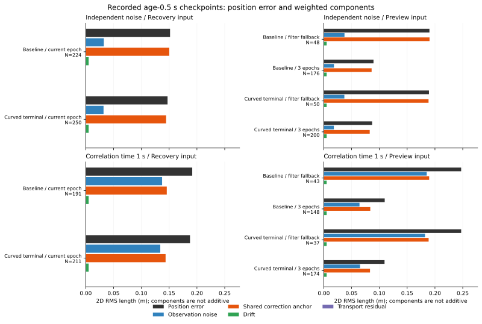

# 復帰入力と3期間融合に残る位置誤差の分解

前回、曲線で追加許可したのに真の余裕が足りなかった復帰入力の43地点では、位置誤差方向への最大の寄与は、共有する補正ずれが30地点、観測ノイズが13地点でした。全地点が25観測の平均ですが、同じ補正期間で共有するずれは25分の1にはなりません。

独立ノイズの復帰入力474地点では、全地点で共有する補正ずれの寄与が最大でした。相関時間1秒の402地点では、補正ずれ215・ノイズ187地点に分かれます。3期間融合でも残差はあり、同じ地点の復帰入力に比べて位置誤差が増えたものも698地点中246地点ありました。平均数や平均誤差の改善だけでは、個別の復帰判定が正しくなるとは言えません。

## 固定した対象と再構成

[固定手順](protocol.md)を記録してから、[前回の位置・向きの診断](../commanded-arc-components/report.md)と同じ全648ケースの会計、時間切れ368ケース、2,120地点を使いました。直線と曲線で同じ位置入力は重複して数えず、復帰入力・停止予測入力の計4,240行を作りました。判定群のラベルだけは前回の予定操舵の曲線から引き継いでいます。

同じ生軌跡を読み直し、受信・欠測・精密観測への切り替え、前時点の測定速度と実際の操舵、復帰窓、移動補償フィルター、3期間融合を再構成しました。窓のサンプル数と融合の状態は全3,312,000区間、位置・向きと前回の位置誤差は固定2,120地点で照合しています。

全地点で実際に使われた入力は次のとおりです。復帰入力の窓が空なら、その時点の観測1個を使います。融合は位置だけを替え、向きは移動補償フィルターのままです。

| 入力 | 実際の方式 | 地点 | 使用した観測数 |
|---|---|---:|---|
| 復帰 | 現在の補正期間の平均 | 1,877 | 1 / 10 / 25 |
| 復帰 | 空の窓から瞬時の観測へ戻る | 243 | 1 |
| 予測 | 3期間融合 | 1,691 | 51 / 60 / 75 |
| 予測 | 移動補償フィルターへ戻る | 429 | 1 / 10 / 25 |

補正を受信できなかったときも復帰窓と移動補償窓はリセットされますが、位置バイアスの基準を替えるのは受信または精密観測への切り替えです。受信前の初期バイアス基準は確定値0として扱い、確率的な補正誤差を割り当てていません。

## 位置誤差を4成分へ分ける

各観測の重みをwとして、入力位置から同じ判断前時点の真位置を引いたベクトルを、次の重み付き和に分解しました。

| 成分 | 計算するベクトル |
|---|---|
| 観測ノイズ | 各観測の位置ノイズ |
| 共有する補正ずれ | 各観測時点で最後に受けた補正・精密観測の位置バイアス |
| ドリフト | 各観測のバイアスから、その補正時のバイアスを引いたもの |
| 移動補償残差 | 各観測時の真位置＋伝播した移動量−現在の真位置 |

復帰入力は観測を伝播しないため、最後の成分には過去の真位置と現在位置の差が入ります。フィルターと融合では、各観測の向きと測定速度・適用した操舵による移動量を含めます。重みを決める処理に真位置は使わず、真位置やノイズの記録は分解の参照にだけ使います。

成分ベクトルの和は位置誤差ベクトルへ一致します。誤差方向への符号付き射影も保存し、負の寄与や相殺を残しました。以下の「最大寄与」はその射影が最大の成分で、最小距離の判定を変えた独立な因果要因という意味ではありません。

## 観測後0.5秒に残る成分

基準側epochは415地点・87ケース、曲線終端側curvedは461地点・93ケースです。ここでは両側をノイズ種別ごとに集計します。復帰入力は全地点25観測、融合利用時は75観測でした。各入力の同じ地点は重なり、独立な試行とは扱いません。

値は2次元ベクトルの長さのRMS、単位はmです。異なる成分のRMSを足しても全誤差にはなりません。

| ノイズ・入力方式 | 地点 | 位置誤差 | ノイズ成分 | 補正ずれ成分 | 最大寄与：補正ずれ / ノイズ |
|---|---:|---:|---:|---:|---|
| 独立・復帰平均 | 474 | 0.149284 | 0.032234 | 0.147262 | 474 / 0 |
| 独立・予測3期間融合 | 376 | 0.088153 | 0.018228 | 0.084282 | 359 / 17 |
| 独立・予測フィルター代替 | 98 | 0.189640 | 0.037172 | 0.189341 | 98 / 0 |
| 相関1秒・復帰平均 | 402 | 0.189441 | 0.135626 | 0.144629 | 215 / 187 |
| 相関1秒・予測3期間融合 | 322 | 0.109453 | 0.064819 | 0.083400 | 218 / 104 |
| 相関1秒・予測フィルター代替 | 80 | 0.247147 | 0.183770 | 0.189155 | 44 / 36 |

この部分集合のドリフト成分のRMSは全群で0.0052m、移動補償残差のRMSは最大5.16e-11mでした。今回のほぼ静止した地点では、移動補償残差を主な説明にはできません。



図は両保存記録と実際に使われた推定方式を分け、地点数も表示します。融合利用群と代替群は異なる地点なので、棒の差をそのまま融合の効果とは扱いません。

同じ融合利用地点で復帰入力と予測入力を対応させた結果も示します。固定した軌跡上の位置入力の比較です。

| ノイズ | 同じ地点 | 復帰入力RMS（m） | 融合入力RMS（m） | 融合で位置誤差減少 | 融合で位置誤差増加 |
|---|---:|---:|---:|---:|---:|
| 独立 | 376 | 0.136824 | 0.088153 | 255 | 121 |
| 相関1秒 | 322 | 0.172130 | 0.109453 | 197 | 125 |

平均では小さくなっていても個別に増える地点があり、走行や保持の増減をこの位置誤差だけから予測していません。

## 観測数と補正期間数を分けるモデル

観測ノイズの単位過程は、相関時間tauに対し`rho=exp(-.02/tau)`のAR(1)です。独立ノイズはrho=0です。実際のサンプル間隔k、正規化した重みwと各時点のsigmaから、1軸の分散を計算しました。

`Vnoise = sum(i,j) wi*wj*sigma_i*sigma_j*rho^abs(ki-kj)`

受信ごとに独立に替わる補正ずれは、同じ補正IDの観測で共有されます。

`Vanchor = sum(anchor IDs) (sum(i in anchor) wi*anchor_sigma_i)^2`

次は観測後0.5秒での値です。全地点のsigmaは0.1でした。実効観測数は重み付き単位ノイズ共分散の逆数で、位置推定全体の独立な標本数ではありません。

| ノイズ・入力 | 観測数 | ノイズの実効観測数 | ノイズの1軸標準偏差 | 補正ずれの1軸標準偏差 | 両者を含む1軸標準偏差 |
|---|---:|---:|---:|---:|---:|
| 独立・復帰平均 | 25 | 25.000 | 0.020000 | 0.100000 | 0.101980 |
| 独立・3期間融合 | 75 | 75.000 | 0.011547 | 0.057735 | 0.058878 |
| 相関1秒・復帰平均 | 25 | 1.173 | 0.092330 | 0.100000 | 0.136106 |
| 相関1秒・3期間融合 | 75 | 3.482 | 0.053594 | 0.057735 | 0.078776 |

3期間融合は各期間の平均を1/3ずつ合わせます。最新期間のサンプル数が少なくてもその重みは1/3であり、すべての観測を等しく平均するものではありません。

| 融合利用地点の種類 | 地点 | 期間ごとの観測数 | 合計 | 独立な単位ノイズでの重みの実効観測数 |
|---|---:|---|---:|---:|
| 最初の利用可能地点 | 698 | 25 + 25 + 10 | 60 | 50.000 |
| 観測後0.5秒 | 698 | 25 + 25 + 25 | 75 | 75.000 |
| 終点 | 295 | 25 + 25 + 1 | 51 | 8.333 |

終点を75観測の平均として扱わず、最新1観測の重みも再現しています。モデル値は、記録された時刻と重みを固定した無条件ノイズ過程の参考量です。欠測復帰や時間切れに条件づけた誤差分布、校正済みの信頼区間ではなく、ドリフト・移動補償の不確かさも含めていません。上の2次元RMSと1軸標準偏差も同一視しません。

## 誤った追加許可の位置誤差

前回から固定した過大な追加許可の地点です。復帰入力43地点と予測入力54地点は重なるため合算しません。

| 保存記録・入力 | 地点 | 最大寄与が補正ずれ | 最大寄与がノイズ |
|---|---:|---:|---:|
| 基準側・復帰入力 | 24 | 16 | 8 |
| 曲線終端側・復帰入力 | 19 | 14 | 5 |
| 基準側・予測入力 | 27 | 22 | 5 |
| 曲線終端側・予測入力 | 27 | 20 | 7 |

復帰入力の独立ノイズ9地点ではすべて補正ずれが最大でした。相関ノイズ34地点では補正ずれ21・ノイズ13です。予測入力の過大な追加許可54地点のうち41地点は、3期間融合が利用できていました。融合が利用できることと、その位置から正しい幾何判定が得られることは別です。

## 検証と再実行

解析コードは`7c94572`、図は`09d4ecb`です。前回の入力・コードと生軌跡のハッシュ、実行条件を照合しました。全368軌跡の観測窓・融合状態を3,312,000区間で照合し、固定地点の位置各軸・向きの最大成分差は約1.24e-9で、それぞれ1e-8m・1e-8radの許容内でした。前回の位置誤差の長さとも一致しました。元の物理・接触・解除タイマーの検証は既存の指紋を引き継ぎ、今回は新たな物理検証を追加していません。

4,240入力行でベクトルと符号付き射影の和を検査し、7,622の期間別の平均成分・重みを保存しました。観測ごとの履歴は固定した生軌跡で追跡できます。Python 197テストが成功しました。追加14件は、直接の観測伝播との照合、融合位置でも向きはフィルターを使うこと、重みと実間隔の共分散、共通・独立アンカー、最新1観測の等期間重み、期間間の相関、4成分と相殺、空の復帰窓、受信失敗・精密観測・移動のリセット、前時点の測定による伝播、空の群と誤差0の区別を確認します。

```bash
python3 experiments/pose_observation_loss/analyze_epoch_position_components.py \
  --output /tmp/epoch-position-components
python3 experiments/pose_observation_loss/plot_epoch_position_components.py \
  --results /tmp/epoch-position-components --output /tmp/epoch-position-figure
python3 -m unittest discover -s experiments/pose_observation_loss -p 'test_*.py'
```

新しい出力先を使います。解析は標準ライブラリー、図はMatplotlibを使い、`--raw-root DIR`で同じ4群の生軌跡の場所を替えられます。5つのCSVと`sources.json`は再集計でバイト単位で一致しました。図の数値・SVG・PNG・指紋も再生成で一致し、表示を確認しました。

[accounting.csv](accounting.csv)に全ケース、[reconstruction.csv](reconstruction.csv)に軌跡ごとの照合件数、[positions.csv](positions.csv)に入力ごとの分解と分散モデル、[epoch-groups.csv](epoch-groups.csv)に各期間の重みと平均成分、[summary.csv](summary.csv)に群・方式・入力・推定方式・重複する地点部分集合・判定群別の集計を保存しました。[sources.json](sources.json)と[図の指紋](position-components-sources.json)に入力・コード・生軌跡の指紋があります。

制御、sigma、余裕、平均窓、融合の重みは変更していません。新しい走行や保持の改善を測ったものではなく、前回の走行結果140→140も更新していません。
