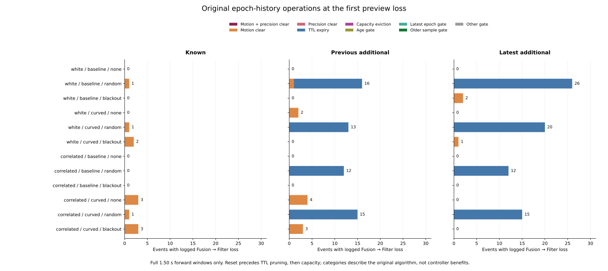

# Epoch retention mechanisms behind the logged Fusion losses

The 152 previously logged Fusion-to-Filter losses separate into **128 inclusive
15 s retention expiries at +20 ms** and **24 motion clears at +520..+1,220 ms**.
All 1,599 earlier immediate-Fusion / RP-Filter disagreements belong to the TTL
expiry group. These transitions follow the existing algorithm's retention and
reset rules. The controller and its horizon were not changed.

The [protocol](protocol.md) was committed as `da08f25` from main
`a795bd457a02409859a370aac14cf8165b71fa98`, before reading new raw-history epoch
identities. Implementation and [rerun instructions](../../README.md#epoch-retention-mechanisms-behind-the-logged-losses)
are in `4d7af73`.

## Mechanisms and coverage

The study retains 972 planned full cases, 324 families, all 570 timeout
histories and all 3,997 census events. All 108 original raw files are pinned
(6,043,185,194 bytes). Both implementations check 5,130,000 decisions after the
570 initial rows against logged availability and retained group count.
Loss mode remains part of case identity; epoch timestamps are meaningful
within that full case, not shared physical observations across cases.

| Cohort | TTL-expiry losses | Motion-clear losses | No observed preview loss |
|---|---:|---:|---:|
| Known | 0 | 11 | 1,296 |
| Previous additional | 55 | 10 | 1,211 |
| Latest additional | 73 | 3 | 1,338 |
| Total | 128 | 24 | 3,845 |

All losses occur in the existing full 1.50 s forward windows. There are no
precision-clear, combined motion/precision, capacity-eviction, age-gate,
latest-epoch-gate, older-sample-gate or other-gate first losses in these fixed
windows. Those planned categories remain explicit and empty. The operation
category follows the original order: clear, expire, append/enforce capacity,
then availability checks. Separate flags preserve overlapping predicates;
the category is not a causal decomposition of controller outcomes.

The 128 TTL losses span 86 full cases. Every one is a received event in random
mode, and every one first loses Fusion at +20 ms. At the immediate event, the
three retained epochs have sample counts [25,25,1], and the oldest is exactly
15,000 ms old. Their consecutive epoch gaps are [5,000,10,000] ms for 58 events
and [10,000,5,000] ms for 70 events. At the next checkpoint exactly one old
group expires, leaving two groups with sample counts [25,2]. Neither motion
nor precision clears history at that boundary. Fusion requires three groups.

For example, latest correlated/curved/random seed-279 dense A* case `C0073`,
event 3727, has this history:

| Logged time | Retained epoch times | Samples per epoch | Fusion available |
|---|---|---|---|
| 160.00 s | 145.00, 155.00, 160.00 s | 25, 25, 1 | yes |
| 160.02 s | 155.00, 160.00 s | 25, 2 | no |

The removed 145 s group is 15.02 s old on the second row. Latest correlated/
baseline/random seed-278 maze JPS case `C0149`, event 3708, similarly retains
155, 165 and 170 s at 170.00 s, then removes the 155 s group at 170.02 s.
The original Rust test `expires_after_the_inclusive_fifteen_second_horizon`
already specifies this inclusive boundary. The audit connects that rule to
the actual selected histories; it does not discover a different horizon.

The 24 motion losses span 24 cases: nine none, four random and eleven blackout
events, all received. Before the loss they have [25,25,25] samples. At the
loss, measured speed is 0.0200359776..0.0396, strictly above the 0.02 stationary
limit, all three groups are cleared and no fresh stationary sample is added.
Precision, TTL expiry and capacity eviction are absent at those boundaries.
Their first offsets are +520..+1,220 ms. The original motion-boundary test
separately keeps speed 0.02 and clears above it.

## The next-step denominator

Available Fusion can sit at the inclusive retention limit at an event without
having any further logged observation. The table conditions on immediate
Fusion and explicitly requires an observed next 20 ms step for the loss columns.

| Cohort | Fusion with a next step | TTL limit with a next step | TTL-limit +20 ms losses | Other Fusion with a next step | Other +20 ms losses | TTL limit without a next step |
|---|---:|---:|---:|---:|---:|---:|
| Known | 878 | 0 | 0 | 878 | 0 | 0 |
| Previous additional | 683 | 55 | 55 | 628 | 0 | 18 |
| Latest additional | 715 | 73 | 73 | 642 | 0 | 0 |
| Total | 2,276 | 128 | 128 | 2,148 | 0 | 18 |

Thus all 128 observed TTL-limit opportunities lose availability at the next
checkpoint; the other 2,148 observed immediate-Fusion events do not lose it
at +20 ms. The 24 later motion losses belong to this second group, so absence
of a next-step loss is not stability throughout the whole window. The 18
TTL-limit events without a next step all occur at 180 s in the previous cohort.
They are neither observed losses nor observed stable events. There are 427
immediate-Fusion no-forward events overall, including these 18.

Raw and original census-case-mass next-step fractions are respectively 100%
within the observed TTL-limit group and 0% within the observed other-Fusion
group. A cohort/cell without that denominator has a blank fraction, including
the known cohort's TTL-limit group. This is a retrospective cross-tabulation
of source-defined boundaries, not a fitted or held-out prediction result.

All 10,995 original RP records and their weights remain fixed. The TTL group
contains the 44 events/40 cases with all 1,599 preview disagreements; 84 other
TTL-loss events have no RP reference. Five motion-loss events have RP records,
all before the loss, and the other 19 have none. These reference counts do not
identify which RP gate excluded an absent record. Original all-census and
received-census masses each close to 570 case units, while RP mass closes
separately to 157 units. None is renormalized after selection or equated with
another measure.

## Independent verification and reproducibility

The saved bundle includes 3,997 event-mechanism rows, 4,301 event/role snapshots,
10,570 retained-group rows and 1,344 summary cells. Every immediate event is
represented; every prior preview loss adds its predecessor and changed row.
Reused physical checkpoints remain separate role references. Empty histories
have zero group rows. Summaries retain all modes, event kinds and full/clipped/
no-forward horizons, with 53,568 exact additive count/mass checks.

The standalone verifier imports no analyzers. It extracts unchanged pinned
Rust source for StationaryEpochFusion/observe, mean_pose, VehicleState struct/
new, constants and all six original epoch-fusion tests into a stdlib harness.
It independently reads all raw CSVs in Rust and runs the original observe
at every timeout decision, checking the logged group count and availability.
Its event requests come from original broad-census IDs and the pinned prior
trace. Native group identities/sample counts and operation evidence reconstruct
every new field, original parent measure and all 144 numeric plot rows.

Geometry inputs are zero dummy pose and steering because they do not enter
epoch membership, capped sample counts or availability. Fused positions are
ignored. This is an exact check of original metadata behavior, not pose-error,
trajectory or controller replay. The pinned source and method establish this
scope; matching availability is not validation of uncomputed coordinates.

The [independent evidence](independent-verification.json) records **739,220
successful field comparisons**, all **5,130,000 decisions** matched to original
logs, **six original Rust tests passed**, source-slice and generated harness
hashes, and Rust 1.99.0 with `--edition=2021 -O`. Assertions remain active.
The [native request checks](native-request-checks.json) also record rejection
of duplicate, unknown-trajectory and outside-grid requests, with the specific
expected diagnostic, fixture hashes and harness/input hashes.

All **826 Python tests** pass, including 20 new tests for TTL/speed/age/sample
boundaries, reset ordering, capacity, missed observations, loss-role requests,
empty histories, no-forward denominators, original parent weights and exact
closure. All five collector artifacts repeat byte for byte. All four figure/
export/provenance artifacts, including the scratch PNG, also repeat byte for
byte; the final figure was inspected. The source manifest SHA-256 is
`b849e7b25de666fa74f1a8dfde5052627684398fa77e4c92dbea4d2a92d187d1`.

No retention tuning, new rollout, label, AUC, safety benefit, calibration or
causal performance estimate is added. Historical held goals remain 140->140
and latest 62->60. Evaluating a different horizon would require its own
predefined intervention and live outcome accounting; this audit retains the
current behavior.
