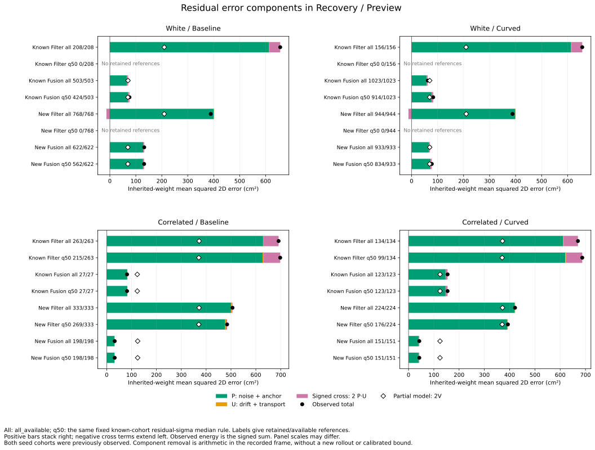
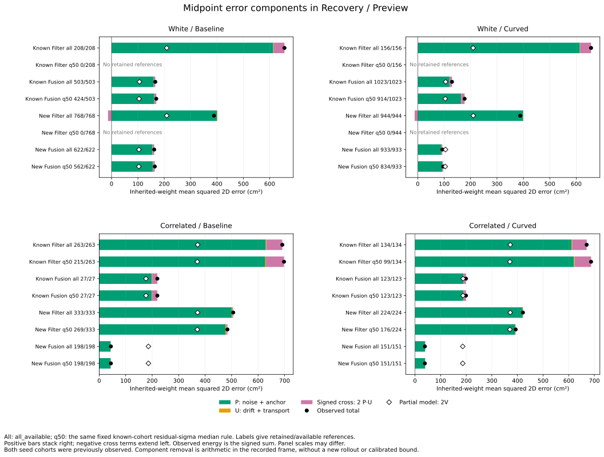

# Observed error components within source estimator modes

Omitted drift/transport does not explain away the weak within-Fusion ranking
seen in the preceding study. In new-cohort Recovery/Preview residuals, its
RMS is about **0.49--0.51 cm**, while total error RMS is **5.66--11.51 cm**.
Removing those components arithmetically leaves the fixed model-sigma AUC
for noise-plus-anchor outside errors **below .5 in all four groups**.

The partial variance reference can lie above or below the observed error
energy in these selected windows. For Fusion residuals, observed energy is
**1.906 / 1.011 times** the partial-model reference in white baseline/curved,
but **.258 / .342 times** it in correlated baseline/curved. A missing positive
variance term alone cannot account for both directions.

This is **retrospective**: both known seeds 269/270/271 and existing new seeds
274/275/276 have been studied before. The [protocol](protocol.md) was frozen
as 5844580, analyzer/tests as 940173b, and plotting/reproduction instructions
as 13ce468 before reporting these results. No weights or cutoffs are fitted.

## Population and arithmetic

Use all 19,830 simultaneous pairs at 6,610 audited states, in 100 recorded
cases linked to 171 received-correction opportunities. The source population,
three pairings, Recovery/Filter/Fusion strata and parent case weights are
unchanged from [estimator-mode transfer](../estimator-mode-transfer/report.md).
Both midpoint M and common residual R are retained, including existing
negative R weights and degenerate-contrast handling.

The unchanged accounting contains 648 cases, 368 timeout histories and 2,583
opportunities, with all 550/509 source loss links. The 20,664 requested lagged
pairs, including 2,208 missing projections, remain inherited outside this
simultaneous study. Pairings, times, event unions, modes and arms overlap.

Apply each target's existing weights to the four recorded input vectors:
noise, anchor, drift and transport. In the saved coordinate frame let
**P=noise+anchor**, **U=drift+transport**, so E=P+U. Keep the exact signed identity

`|E|² = |P|² + |U|² + 2 P·U`.

The tables also retain all four component squared norms and all six signed
twice-dot cross products. The reference **2V** is the model's two-axis partial
noise-plus-anchor energy. P is the observed realization of those components;
2V is the model quantity. They are different measurements.

Within every original cohort/noise/arm/event-kind/view group, available rows
have weight 1/n_case. Carry these weights into strata and through selection;
normalize energy means by retained mass. Do not give each retained case fresh
unit weight. The full tables keep pooled and every structural stratum, all
three scores, all four existing budgets, all views and empty event kinds.

## New-cohort Fusion residuals

The following Recovery/Preview results use all_available, all event kinds and
the inherited parent weights. **All RMS columns are two-dimensional cm**;
the reference is sqrt(mean(2V)), rather than the per-axis sigma used for the
cutoff. Cases can also contribute to Filter, so stratum case counts overlap.

| Noise / arm | References / cases | Observed E RMS | P RMS | U RMS | Partial-model RMS | E energy / 2V |
|---|---:|---:|---:|---:|---:|---:|
| White / baseline | 622 / 6 | 11.508 | 11.328 | .510 | 8.336 | 1.906 |
| White / curved | 933 / 9 | 8.391 | 8.135 | .488 | 8.347 | 1.011 |
| Correlated / baseline | 198 / 4 | 5.661 | 5.562 | .505 | 11.153 | .258 |
| Correlated / curved | 151 / 4 | 6.523 | 6.296 | .502 | 11.156 | .342 |

For comparison, new Filter observed residual RMS is 19.714/19.699 cm in white
baseline/curved and 22.498/20.528 cm in correlated baseline/curved. Its U RMS
is 1.240/1.008 and 1.642/1.170 cm respectively. The large Filter/Fusion
difference remains in the observed noise-plus-anchor components.

Anchor and noise contributions do not add as independent squared norms in
these saved samples. Two examples, with **energies in cm²**, are:

| New Fusion baseline | Noise energy | Anchor energy | Noise/anchor cross | P energy | U energy | P/U cross | Observed energy | Model 2V |
|---|---:|---:|---:|---:|---:|---:|---:|---:|
| White | 2.476 | 151.259 | -25.412 | 128.324 | .260 | +3.856 | 132.440 | 69.491 |
| Correlated | 15.673 | 39.425 | -24.166 | 30.932 | .255 | +.861 | 32.048 | 124.395 |

The cross terms preserve cancellation. They are finite selected-window cross
products, not estimates of unconditional noise/anchor covariance. Repeated
references share underlying samples and anchors; case balancing does not make
them independent. The small near-unit white-curved energy ratio likewise
does not establish model calibration.

## Ranking and the .10 m boundary

Keep the original high-risk score direction and 1e-8 m score ticks, with
half credit for ties. The following **residual-sigma AUCs** compare outside
with inside references in new Recovery/Preview Fusion, all_available:

| Noise / arm | Residual E outside | Residual P outside | Midpoint E outside | Midpoint P outside |
|---|---:|---:|---:|---:|
| White / baseline | .481 | .485 | .438 | .438 |
| White / curved | .269 | .279 | .233 | .233 |
| Correlated / baseline | .309 | .419 | .309 | .329 |
| Correlated / curved | .177 | .177 | .177 | .177 |

Removing U therefore does not restore the frozen score direction in these
groups. This does not establish a causal source of reversed ranking: the
partial model is being compared within selected recorded modes/cases.

P-only and U-only labels use the same closed .10 m disk as E. U alone is never
outside that disk in these audited simultaneous records for either target, so
its diagnostic AUC is blank everywhere. It can still change an E/P boundary
label: new correlated baseline Fusion residual-outside mass is 17.742% for E
versus 10.323% for P, a **7.419 percentage-point** inside-to-outside change.
The corresponding midpoint change is 1.935 points.

The reverse also occurs. In new white baseline/curved Fusion residuals,
.202%/.173% of inherited mass has P outside but E inside. Removing U increases
the norm for those records. All four E/P label combinations are retained as
raw counts, inherited mass and fractions; component removal is not assumed
to reduce error monotonically.

## Fixed median selection and the midpoint target

The existing residual-sigma q50 rule retains no white-noise Filter references.
For new Fusion it gives these residual outside fractions; both white groups
retain a subset and both correlated groups retain every Fusion reference:

| Noise / arm | Retained / available | Observed E outside % | P-only outside % |
|---|---:|---:|---:|
| White / baseline | 562 / 622 | 55.227 | 55.227 |
| White / curved | 834 / 933 | 14.623 | 14.623 |
| Correlated / baseline | 198 / 198 | 17.742 | 10.323 |
| Correlated / curved | 151 / 151 | 16.219 | 16.219 |

The figure retains known/new and both Filter/Fusion populations before and
after that same cutoff. Empty retained populations remain visibly empty.
Other scores, budgets, strata and pairings remain in the complete tables.

For new Fusion midpoint errors, observed RMS is 12.728/9.645 cm in white
baseline/curved and 6.651/6.211 cm in correlated baseline/curved. P RMS is
12.451/9.455 and 6.539/6.292 cm; U RMS is .841/.681 and .665/.626 cm.
Both targets preserve the original labels and prior ranking results.

These are component-removal calculations in a recorded frame. They do not
change input selection, estimator feedback, geometry or subsequent motion,
and do not evaluate a counterfactual controller or new release rule.

## Validation and reproduction

Use the [README commands](../../README.md#observed-error-components-within-estimator-modes)
with new output directories. All **eight CSVs and provenance** reproduce byte
for byte. Both SVG/PNG figures, their shared 64-row numeric series and plot
provenance also repeat exactly. Both layouts were visually inspected; PNGs
remain in scratch. All three new scripts parse as Python 3.9 syntax.

The Python suite passes **447 tests**, including 18 new tests covering full
signed energy closure, rotations, negative R weights, source joins/labels,
component-removal reversals, exact disk boundaries, original case weights
across strata and retention, ties, empty classes/selections and zero model
energy. All 13,824 original observed retention-target comparisons and 3,456
observed AUC comparisons match the pinned preceding tables.

A separate calculation imports no analyzer functions. It reconstructs every
source using NumPy weighted component/Gram matrices, integer LCM case weights
and explicit positive-versus-negative AUC matrices. It checks all 19,830
reconstruction audits, all fields of 13,824 component summaries and 3,456
diagnostic rankings, and all 64 numeric figure rows: **1,119,408 field checks**.
Input, script, protocol, helper and figure hashes match. Accounting, events,
loss links, all 264 thresholds and source membership are unchanged copies.

Maximum component/vector closure is 1.876e-14 m; every recomputed residual
component matches the preceding saved residual component exactly. Maximum
aggregated signed-energy closure error is 1.002e-15 m².

[Reconstruction](reconstruction.csv) preserves source input references and
closure checks. [Component summaries](component-summary.csv) keep all energies,
cross terms, RMS, counts/mass and E/P/U labels. [Diagnostic rankings](diagnostic-ranking.csv)
retain all three score directions and absent-class blanks. [Provenance](sources.json),
[figure data](estimator-mode-components.csv) and
[figure provenance](estimator-mode-components-sources.json) are tracked.
Original observation/physics validation is inherited; recorded held goals
remain **140 -> 140**.
