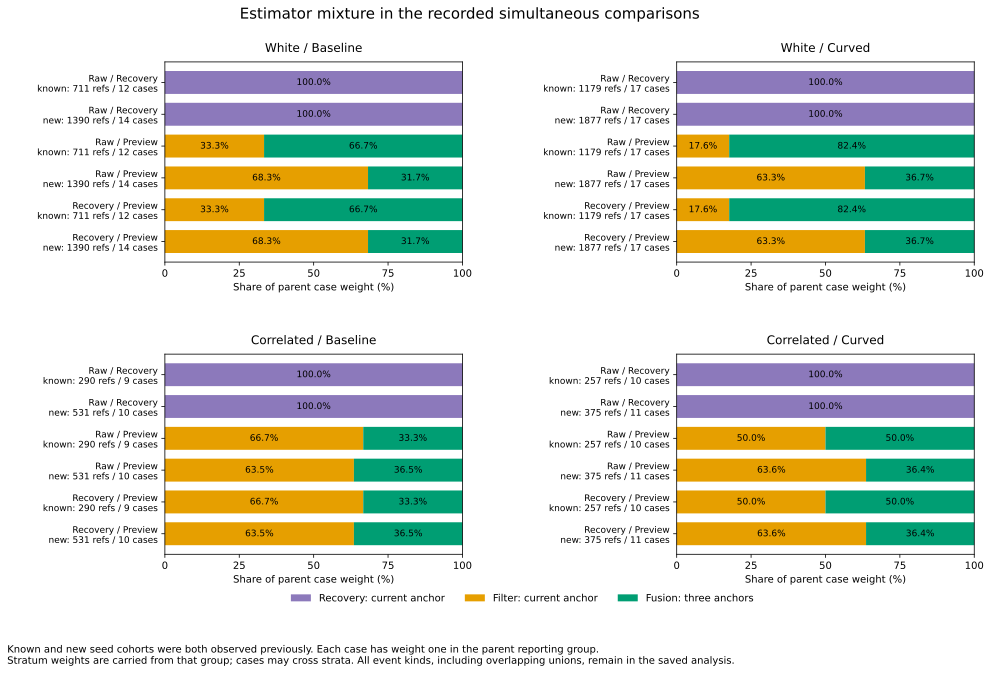
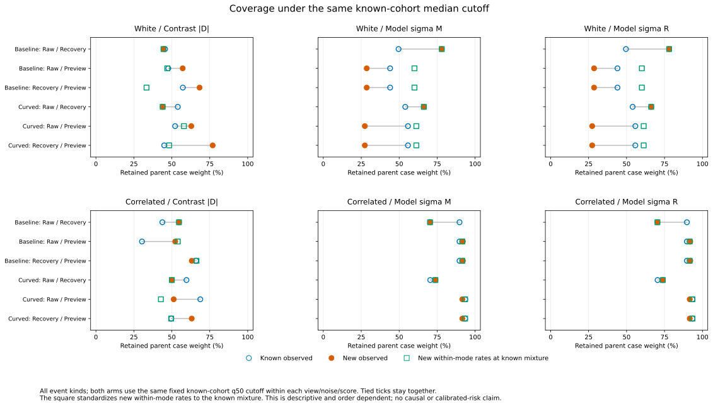

# Estimator composition and fixed-cutoff transfer

Changing estimator mixtures accounts for much of the white-noise reduction in
retained case weight under the preceding known-cohort median model-sigma rule.
For Recovery/Preview, baseline coverage changes from **44.01% to 28.59%**:
the frozen composition-first decomposition gives **-23.06 percentage points**
from mixture change and **+7.65 points** from within-mode changes. Curved
coverage changes from **55.77% to 27.35%**, with **-30.89 / +2.47 points**.
These terms describe the saved histories and depend on the decomposition order.

The strong pooled sigma ranking also does not persist within the three-anchor
fusion stratum: new-cohort residual-error AUC there ranges from .177 to .481,
while the preceding pooled AUC ranges from .779 to .927 for these views.
Estimator labels distinguish populations with different error frequencies;
pooled discrimination does not establish within-mode error ranking.

This is **retrospective**: known seeds 269/270/271 and existing new seeds
274/275/276 were observed in earlier studies. No cutoff is fitted here. The
[protocol](protocol.md) was committed as 85150b0 and analyzer/tests as 4038206
before these stratified results; plotting/reproduction instructions are df56b3f.

## Source population and estimator strata

All 19,830 simultaneous references are joined to their preceding score and
projection records by family/ID, full case identity, input IDs, view and source
event union. They represent 6,610 audited states in **100 recorded cases**,
linked to **171 received-correction opportunities**. Counts per pairing are:

| Noise / arm | Known references / cases | New references / cases |
|---|---:|---:|
| White / baseline | 711 / 12 | 1,390 / 14 |
| White / curved | 1,179 / 17 | 1,877 / 17 |
| Correlated / baseline | 290 / 9 | 531 / 10 |
| Correlated / curved | 257 / 10 | 375 / 11 |

Each pairing refers to the same audited states, so these counts overlap.
The unchanged accounting still covers 648 cases, 368 timeout histories and
2,583 opportunities, with all 550/509 original loss links. The 20,664 requested
lagged references, including 2,208 missing projections, remain inherited outside
this simultaneous stratification. Their data and labels are unchanged in the
[preceding transfer study](../contrast-risk-transfer/report.md).

Three structural strata are fixed from the second input's source estimator
and anchor mode:

| Stratum | Source estimator / anchor mode | Pairings | Full reference count |
|---|---|---|---:|
| Recovery | recovery_mean / shared_single | Raw/Recovery | 6,610 |
| Filter | motion_filter / shared_single | Both Preview pairings | 6,060 |
| Fusion | three_epoch / preview_three | Both Preview pairings | 7,160 |

The first input uses the current anchor. The filter shares that single anchor;
fusion combines it with two older anchors. These describe recorded estimator
states rather than randomized groups. Seven cases cross Filter/Fusion during
their audited Recovery/Preview histories. Keep their original parent weights
1/n_case inside each stratum and after retention. Mass is additive; stratum
case counts can overlap and are not added as distinct cases.

Both Preview pairings have the following **Filter shares of parent case weight**;
Fusion supplies the remainder. Raw/Recovery is entirely Recovery.

| Noise / arm | Known Filter % | New Filter % |
|---|---:|---:|
| White / baseline | 33.33 | 68.27 |
| White / curved | 17.65 | 63.26 |
| Correlated / baseline | 66.67 | 63.53 |
| Correlated / curved | 50.00 | 63.64 |

## Fixed-cutoff coverage decomposition

Keep all three preceding high-risk scores, 1e-8 m integer ticks, all tied
q25/q50/q75/all_available rules, and both midpoint/residual norm>.10 m outcomes.
Both arms use the same previously fitted cutoff for each view/noise/score.
All event-kind rows, including structurally empty strata/groups, remain saved.

For stratum shares p and retained fractions c, overall coverage is sum(p*c).
Change mixture first while holding known within-mode rates, then change rates
at the new mixture. The sum is exactly the observed coverage shift. Also
standardize new rates to the known mixture without dropping missing support.

The following Recovery/Preview table uses **model residual-sigma q50**, all
event kinds. Coverage columns are percentages; decomposition columns are
percentage points. Midpoint-sigma produces the same retention in these rows.

| Noise / arm | Known coverage | New coverage | Mixture term | Within-mode term | New rates at known mixture |
|---|---:|---:|---:|---:|---:|
| White / baseline | 44.01 | 28.59 | -23.06 | +7.65 | 60.07 |
| White / curved | 55.77 | 27.35 | -30.89 | +2.47 | 61.30 |
| Correlated / baseline | 89.74 | 91.96 | +0.48 | +1.74 | 91.57 |
| Correlated / curved | 93.47 | 91.61 | -1.78 | -0.08 | 93.41 |

In white noise the fixed residual-sigma cutoff retains no Filter references.
Within Fusion it retains 66.01% -> 90.11% of baseline mass and 67.73% -> 74.44%
of curved mass, from known to new. More Filter mass reduces overall coverage
even as within-Fusion coverage rises. In correlated noise every Fusion
reference is retained; Filter coverage is about 85--87% in these groups.

The white/correlated cutoffs differ: .05916838 m versus .13610597 m for model
residual sigma. The decomposition compares known/new **within each noise
condition**. It does not attribute the entire cross-noise coverage difference
to estimator composition.

The figure retains Raw/Recovery, Raw/Preview and Recovery/Preview for all three
scores, both arms and noise types. Raw/Recovery has only one estimator stratum,
so its mixture term is zero wherever populated. All_available coverage is one
with zero coverage shift wherever both groups exist. All 288 populated
score/budget comparisons have support for both standardizations. Another 576
rows preserve empty event-kind comparisons; no missing mode rate is imputed.

## Error fractions and within-mode ranking

Retained risk is joint retained-and-outside mass divided by retained mass.
Standardize both numerator and denominator; averaging stratum risks would
give a different quantity. The same fixed Recovery/Preview residual-sigma q50
rule gives these **retained outside percentages**. Each triple is
**known / new / new within-mode rates at the known mixture**:

| Noise / arm | Residual norm>.10 m | Midpoint norm>.10 m |
|---|---|---|
| White / baseline | 45.60 / 55.23 / 55.23 | 62.61 / 69.34 / 69.34 |
| White / curved | 37.35 / 14.62 / 14.62 | 70.83 / 29.25 / 29.25 |
| Correlated / baseline | 62.86 / 66.74 / 69.38 | 100.00 / 66.74 / 69.38 |
| Correlated / curved | 85.00 / 49.95 / 42.21 | 86.23 / 49.95 / 42.21 |

Composition affects coverage and error fractions differently. White-noise
retention contains only Fusion, so replacing the mixture changes the retained
mass but leaves its new conditional risk unchanged. Both decomposition terms
for joint outside mass are saved separately for each target; risk is their
ratio to the corresponding coverage, not an additive risk decomposition.

For the new cohort's Recovery/Preview comparisons, **model residual-sigma AUC**
for residual-outside is shown below. Parent weights are preserved within
strata. All_available ranking uses every available reference, before selection.

| Noise / arm | Preceding pooled AUC | Filter AUC | Fusion AUC | Fusion midpoint-outside AUC |
|---|---:|---:|---:|---:|
| White / baseline | .798 | .571 | .481 | .438 |
| White / curved | .892 | .572 | .269 | .233 |
| Correlated / baseline | .927 | .561 | .309 | .309 |
| Correlated / curved | .779 | .582 | .177 | .177 |

The Filter/Fusion residual-outside baseline fractions are respectively
94.52%/55.11%, 91.85%/11.75%, 99.07%/17.74% and 75.82%/16.22% in these groups.
Within-Fusion ranking is below .5 in the frozen high-risk direction in all four
groups. Keep that direction and the absent-class blanks in every table;
do not reverse scores after observing outcomes. Midpoint-sigma AUC equals
residual-sigma AUC in these particular rows; both scores and both targets
remain in the complete outputs.

These mixtures arise in selected recorded correction windows, with dependence
between times, pairings, cases and arms. Neither estimator mixture nor anchor
sharing was randomized here. The algebra describes shifts; it does not prove
that switching estimators would cause the observed errors, calibrate either
partial noise-plus-anchor sigma, or evaluate a new controller action.

## Validation and reproduction

Use the [README commands](../../README.md#estimator-composition-and-cutoff-transfer)
with new output directories. All **seven CSVs and provenance** repeat byte for
byte. Both SVG/PNG figures, two numeric series and figure provenance also repeat
exactly; both final layouts were visually checked. PNGs remain in scratch.
The Python suite passes **429 tests**, including 17 new tests covering structural
joins, unequal case lengths, stratum-crossing cases, inherited weights, tied
retention/AUC, empty retention/classes/groups, missing support, exact
composition/within closure, standardization ratios, event unions and prior
aggregate checks. The new scripts also parse as Python 3.9 syntax.

All 1,728 parent retention rows match the preceding study. A separate saved-data
calculation, importing no analysis functions, uses integer LCM case weights,
explicit positive-versus-negative AUC matrices and direct decomposition sums.
It checks all 19,830 memberships, every field of 5,184 stratum rows and 864
transfer rows, the 1,728 prior aggregates, and all 108 numeric figure rows
(635,106 field comparisons). Source, script, protocol, helper and plot hashes
match; accounting/events/loss links/all 264 thresholds are byte-identical copies.

[Membership](membership.csv) gives source references and structural labels;
[stratum summaries](stratum-summary.csv) keep counts, inherited mass, AUC,
retention and both targets. [Transfer summaries](transfer-summary.csv) retain
both mixture/rate standardizations, support flags and ratio
standardizations. Raw prior scores remain pinned in the preceding study.
[Provenance](sources.json), [composition data](estimator-mode-composition.csv),
[coverage data](estimator-mode-coverage.csv) and
[figure provenance](estimator-mode-figure-sources.json) are tracked.
Original observation/physics validation is inherited; recorded held goals
remain **140 -> 140**.
