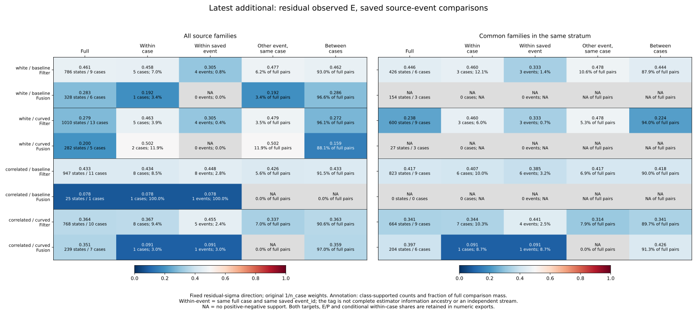
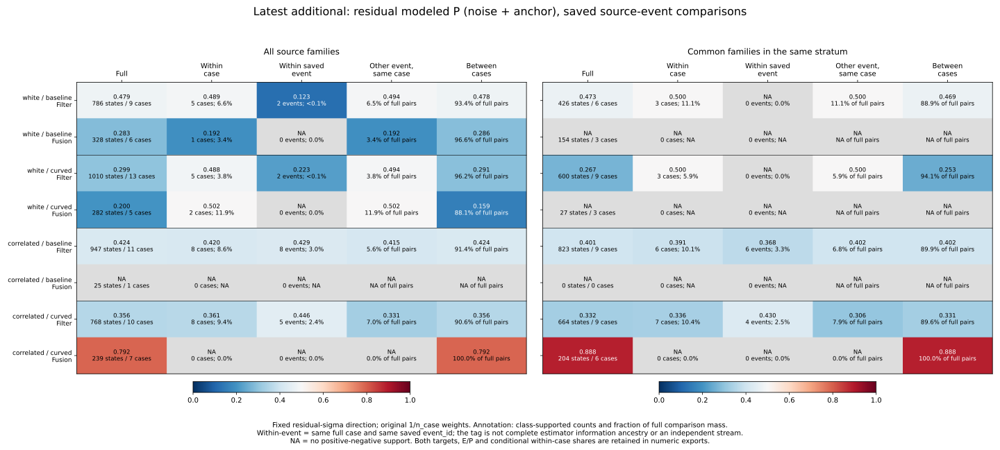
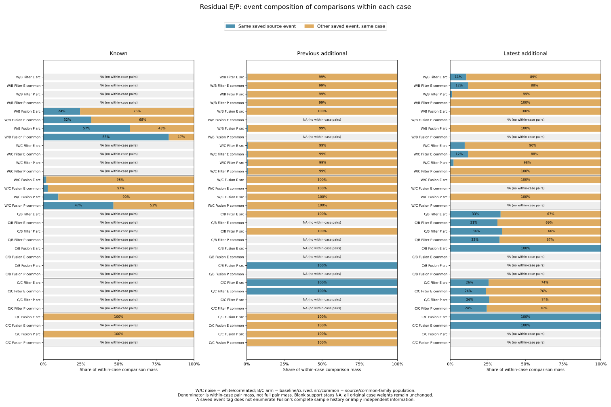
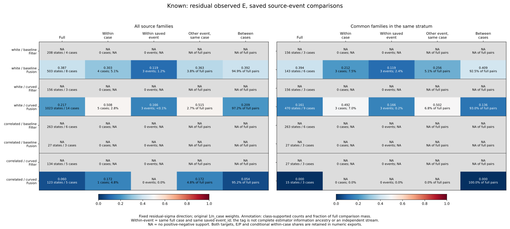
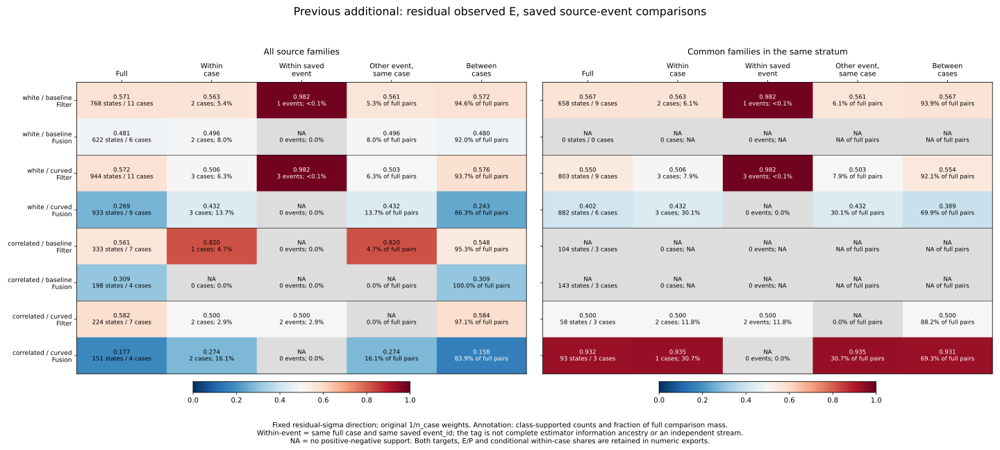

# Rankings within saved source events

The latest cohort's Filter residual observed-error AUC remains below .5 within
the same saved source event: .305263, .305263, .448297 and .455090 across the
four noise/arm conditions. These comparisons cover only .376–2.827% of full
pair mass. Event conditioning does not establish a repair to the fixed score,
and unsupported events cannot be assigned an AUC.

White-noise Fusion supplies an additional limitation: its defined within-case
AUCs come entirely from different event tags in that case. Neither white arm
has a defined within-event E/P AUC. A case-conditioned statistic can therefore
still depend entirely on comparing distinct saved observation references.

## Frozen scope and event meaning

The [protocol](protocol.md) was committed as d15e454 before event-ranking
outcomes, starting from main 429ef9d. A label-blind source audit established that
each of 10,995 RP states has exactly one source_event_ids entry, referencing
275 received events and 550 nonempty event/stratum groups including all.

Keep known seeds 269/270/271, previous additional 274/275/276 and latest
additional 277/278/279 separate. Preserve both noises/arms, all five strata,
both targets, three integer-tick scores and E/P/U labels. Mixed planners and
source/common_family populations are unchanged. The 1/n_case weights precede
all stratum/population selection; neither events nor their AUCs get equal
weights. No new rollout, fitting, threshold or score-direction change.

Grouping uses the full case key plus saved census event_id. Empty, unknown,
multiple and wrong-case tags fail. Equal timestamps, underlying source_event_id
values or event semantics do not merge events/cases. The census alias
existing_new is normalized to new for reporting while both original partition
and source IDs remain in the audit.

This event_id is a diagnostic reference tag, not the complete history of
samples used by Fusion, a new independent observation stream, or proof of a
causal event effect. Comparisons within a tag still involve different states
and estimator history. All conclusions concern the existing selected windows.

## Coverage is retained before class conditioning

All 3,997 census events remain in coverage. Of these, 275 are referenced by RP
states. The other 3,722 have no reference in this saved diagnostic selection;
that is not a missing-sensor-observation classification. Original received,
missed and precision-only flags remain unchanged, without a new event-kind
filter.

| Cohort | Census events | RP-referenced events | RP states | Represented cases |
|---|---:|---:|---:|---:|
| Known | 1,307 | 74 | 2,437 | 48 |
| Previous additional | 1,276 | 97 | 4,173 | 52 |
| Latest additional | 1,414 | 104 | 4,385 | 57 |

The full 972 planned cases and 324 families remain in the copied audits.
`source-event-map.csv` retains all 10,995 state mappings, times, ages, full
case/source IDs and parent row weights. Event support contains 275 x 5 = 1,375
rows, including 825 empty strata. The 550 nonempty groups yield 9,900 event
rankings across both targets, three scores and E/P/U; empty groups receive no
fabricated observations/rankings and remain explicit in support.

## Pair decomposition and denominators

Every ordered positive/negative state pair belongs to exactly one bin:

| Bin | Definition |
|---|---|
| same_event | Same full case and same saved census event_id |
| other_event_same_case | Same full case, different event IDs |
| other_case | Different full case keys |

The first two bins reproduce all five old within-case pair masses exactly;
all three reproduce full masses. Concordant/tied/discordant masses,
numerator/denominator, AUC, full pair shares and numerator contributions are
saved for every group. Conditional within-case shares are saved for the first
two bins; other_case has no within-case share. Sum masses before division,
never average event AUCs. High score predicts outside, ties count half, and
outside remains norm > .10 m with a closed inside disk. AUC is blank without
positive-negative support. Zero share and NA AUC are different from a defined
zero AUC.

## Latest Filter: supported within-event ordering remains below .5

Residual_sigma ranks residual observed E below. Event counts refer to events
with both classes / represented tags. The two share columns have different
denominators: full positive-negative mass and within-case mass.

| Noise / arm | Within case | Within event | Other event, same case | Supported events | Event / full pairs | Event / case pairs |
|---|---:|---:|---:|---:|---:|---:|
| white / baseline | .458125 | .305263 | .476540 | 4/18 | 0.750% | 10.75% |
| white / curved | .462568 | .305263 | .479294 | 4/22 | 0.376% | 9.61% |
| correlated / baseline | .433526 | .448297 | .426105 | 8/20 | 2.827% | 33.44% |
| correlated / curved | .367442 | .455090 | .337423 | 5/18 | 2.390% | 25.51% |

Common-family results retain the same case weights and stratum eligibility:

| Noise / arm | Within case | Within event | Other event, same case | Supported events | Event / full pairs | Event / case pairs |
|---|---:|---:|---:|---:|---:|---:|
| white / baseline | .460452 | .333333 | .477564 | 3/12 | 1.431% | 11.86% |
| white / curved | .460452 | .333333 | .477564 | 3/15 | 0.709% | 11.86% |
| correlated / baseline | .407047 | .385388 | .416943 | 6/16 | 3.151% | 31.36% |
| correlated / curved | .344113 | .441077 | .313820 | 4/16 | 2.464% | 23.80% |

White-noise event AUCs are lower than their within-case AUCs; the correlated
event AUCs are higher. Neither pattern supplies a general conditioning remedy.
Supported-event counts remain small and do not count independent streams.
Individual event rankings are fully saved, including every score/target/label.

For white modeled P on source support, within-event AUCs are .123008 and
.222672, each supported by only two events. Their full pair shares are .0888%
and .0861%. Common-family white P has no within-event class support, even
though its within-case AUC is .5 in both arms; all those comparisons are
between different event tags within a case.

## Fusion: case support does not guarantee event support

| Population / noise / arm | E within case | E within event | E supported events | E event / full pairs | P within case | P within event |
|---|---:|---:|---:|---:|---:|---:|
| Source / white / baseline | .192308 | NA | 0/10 | 0.000% | .192308 | NA |
| Source / white / curved | .502171 | NA | 0/8 | 0.000% | .502171 | NA |
| Source / correlated / baseline | .077922 | .077922 | 1/1 | 100.000% | NA | NA |
| Source / correlated / curved | .090909 | .090909 | 1/7 | 2.993% | NA | NA |
| Common / white / baseline | NA | NA | 0/6 | NA | NA | NA |
| Common / white / curved | NA | NA | 0/3 | NA | NA | NA |
| Common / correlated / baseline | NA | NA | 0/0 | NA | NA | NA |
| Common / correlated / curved | .090909 | .090909 | 1/6 | 8.730% | NA | NA |

Latest white/baseline source E has within-case AUC .192308 and white/curved
.502171, with zero same-event pair mass in both. The values are entirely
other_event_same_case comparisons. Common-family white subsets have no E/P
class pairs at all. Correlated/baseline has one JPS case/event with E AUC
.077922; all its comparisons are within that event, but P remains one-class
and no common family is available.

Correlated/curved E has within-case and within-event AUC .090909 from one
supported event. Same-event pairs cover 2.99% of source full mass and 8.73%
of matched full mass; these are the same underlying within-event comparisons
after the population changes. There is no other-event/same-case E class pair.

Correlated/curved modeled P remains one-class in every individual case, hence
also within every event. Its high full AUC (.791564 source, .888312 common) is
entirely between cases. Matching and event conditioning do not create local
class comparisons or new evidence of calibration.

## Other cohorts retain their contrasting support

Known Filter remains one-class in both populations. Known white/baseline
Fusion E changes from within-case .303439 to within-event .118716, supported
by three of 18 events on 1.236% of full pair mass. White/curved changes from
.508244 to .165755, supported by three of 27 events on only .0563% of full
mass. A within-case value near .5 need not persist within saved event tags.

Previous-additional white Filter has high within-event E AUCs .982143 and
.982456, but support is only one of 15 and three of 19 events, with .0287%
and .0519% of full comparison mass. These already observed, very small
conditional subsets do not establish an improvement across cohorts.
Previous-additional correlated/baseline Filter's within-case .82 has no
within-event class pair. Correlated/curved common Fusion's within-case
.935484 likewise has no within-event class pair; it is entirely between tags
within its supported case.

Across all 2,160 ranking rows, 129 have a defined within-case AUC but no
within-event AUC. These are repeated score/target/population rows, not 129
independent trials. All scores, E/P/U labels, targets and empty strata remain
in the tables; no favorable events or time spans were selected for panels.

## Reproduction and verification

See the [README commands](../../README.md#rankings-within-saved-source-events).
Aggregation needs Python's standard library and tracked sources. Figures need
Matplotlib/NumPy; independent verification needs NumPy and imports no analysis
helpers. Use new directories/evidence files without Python -O. No raw histories,
new simulation, Rust build or cutoff refit is needed.

All 397,440 checks of prior aggregate rankings, full/within-case pair masses
and case/family/stratum audits pass. Original accounting/support/events,
pooled/conditional cutoffs, historical 550/509 and latest 101/94 loss references,
full case/family/stratum and planned case audits are copied unchanged.
All 32,985 reconstruction checks pass; maximum vector closure is 2.434e-14 m
and maximum residual component difference is zero.

Both aggregation runs match byte for byte across 18 artifacts; both final plot
runs match across 13 artifacts (five SVGs, five PNGs, two numeric CSVs and plot
provenance). All five figures were inspected. The AUC panels distinguish small
positive shares below .1% from zero. SVGs, numeric inputs and provenance are
tracked; PNGs are reproducible scratch outputs.

The independent verifier reconstructs signed vectors, labels, whole windows,
weights, every state/event join, all census/support/event-ranking rows, and
direct NumPy state-pair masks for all three bins. All 1,924,402 field comparisons pass, including 639 defined full AUCs, 414 defined within-event AUCs, 1,566 defined bin AUCs and 768 plotted numeric rows.
It verifies all output/plot hashes and saves script, analysis-source and plot
provenance hashes in `independent-verification.json`. All 586 Python tests pass,
including thirteen new event-key, ambiguous-tag, weight, tie, missing-support
and baseline regressions.

The cohorts are retrospective. A saved event tag is not complete estimator
information ancestry or an independent sample; absent class support cannot
establish calibration. Live outcomes remain historical 140->140 and latest
62->60. No estimator/controller changes or new independent validation.
