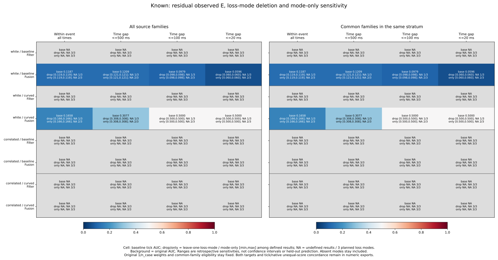
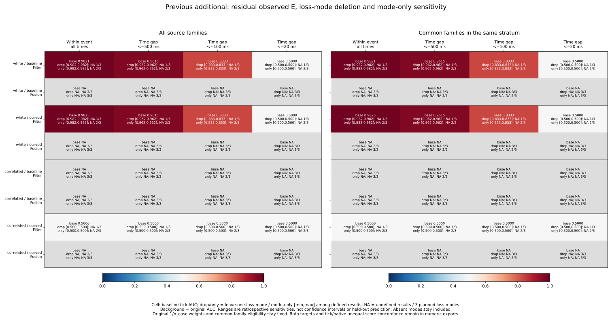
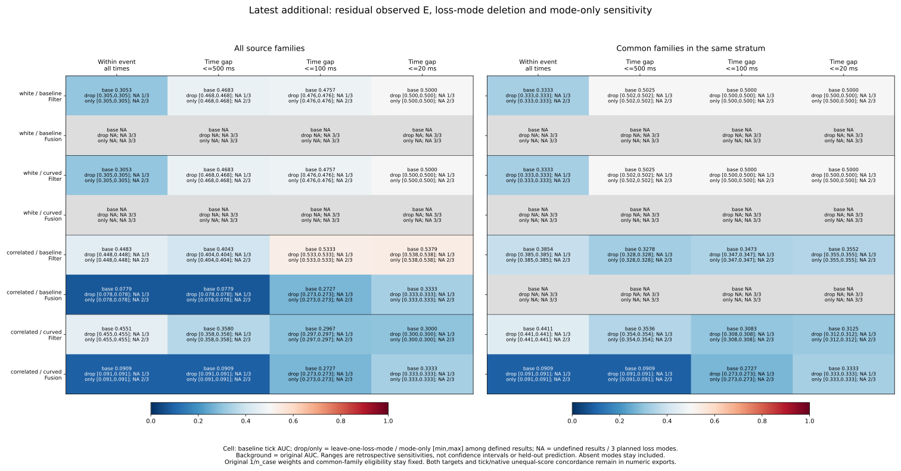
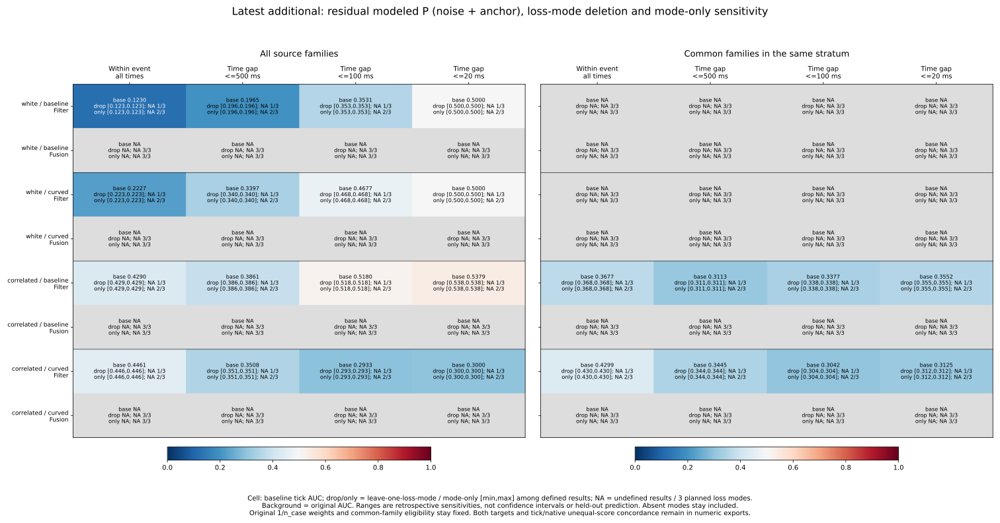
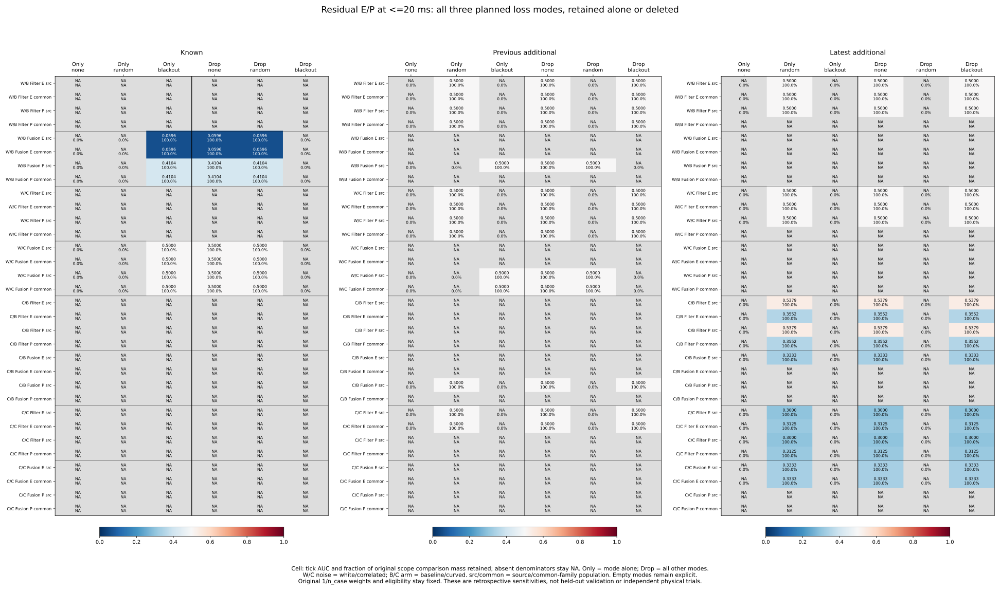
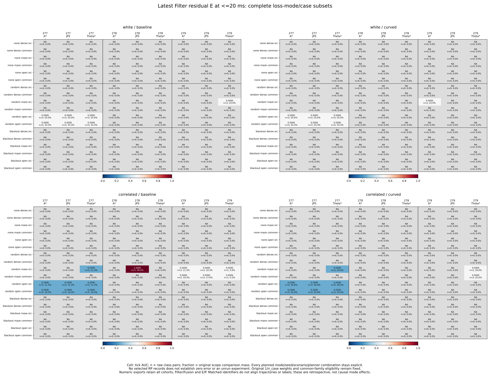

# Same-event loss-mode deletion and complete focused case subsets

The latest Filter diagnostic records are all from **random** loss mode. Splitting
the preceding seed/scenario/planner subsets by original loss mode therefore
preserves their sparse coverage and differing AUCs. For residual E,
residual_sigma and <=20 ms, correlated/baseline source AUC remains **.537891**;
random alone gives the same value, while deleting random makes AUC undefined.
Deleting none or blackout changes nothing because neither has selected Filter
records. These unchanged deletion endpoints do not establish stability across
loss modes, and missing records do not establish zero error.

The [protocol](protocol.md) was committed as **ae63b16** from main
**57027a4050af0b122384b17afe9c5a5cd020cfde**, before calculating loss-mode outcomes.
It extends the [planner study](../event-planner-influence/report.md), keeping
none, random and blackout exhaustive and distinct from estimator strata. No new
simulation, fitting, cutoff, score reversal or controller change was made.

## Fixed population, weights and complete cases

All 10,995 RP states, 157 represented cases, 972 planned cases, 324 planned
families, 32,985 source-view references and 3,997 census events remain in the
pinned preceding accounting. Aggregate effects retain every cohort, noise/arm,
five strata, both targets, three scores, E/P/U and source/common_family population.
Each of the 120 selection groups has three mode units and all 81 planned
mode/seed/scenario/planner audits. Across those groups, the numbers with
0/1/2/3 represented modes are **50/41/29/0**. The 9,720 leaf audits include
554 with selected records (442 random, 112 blackout) and 9,166 without.
These reused strata/populations are not independent experiments.

Original source RP availability, summed across noise/arm conditions without
duplicating strata or populations, is:

| Cohort | none states / cases | random states / cases | blackout states / cases |
| --- | ---: | ---: | ---: |
| Known | 0 / 0 | 1,275 / 32 | 1,162 / 16 |
| Previous additional | 0 / 0 | 2,792 / 44 | 1,381 / 8 |
| Latest additional | 0 / 0 | 3,650 / 46 | 735 / 11 |
| Total | 0 / 0 | 7,717 / 122 | 3,278 / 35 |

Mode none has no selected RP diagnostics in this source population. All planned
cases and their original status/outcome accounting remain pinned; the absence
does not show that no-loss experiments were never run, or that their errors or
risks were zero. No artificial no-loss observations are inserted.

Every comparison stays within one original full case, including loss mode,
and one saved event, at all-event or integer-microsecond gaps <=500/100/20 ms.
No pairs cross modes, cases, events or planners. Each state keeps its original
full-RP-parent 1/n_case weight before selecting stratum, population or mode.
Availability-only common-family eligibility is fixed before deletion. Neither
weights nor eligibility are recomputed after a mode is retained or removed.
Event tags do not represent complete Fusion ancestry or independent streams.

For mode m, concordant/tied/discordant comparison masses C_m/T_m/D_m give
M_m = C_m + T_m + D_m and N_m = C_m + T_m/2. Mode-only AUC is N_m/M_m;
deletion AUC is (sum N - N_m)/(sum M - M_m). Exact Fraction contributions
reproduce preceding baselines; mode or case AUCs are never averaged. Tick
scores remain at 1e-8 m, with strict saved native order and both unequal-score
concordances C/(C+D). Native order describes export precision, not physical
exactness. Both sigma scores keep identical tick/native metrics in all new
subsets; contrast retains its precision differences.

Undefined denominators stay blank. An absent or pair-free mode is a deletion
no-op with undefined mode-only AUC. Removing the sole supporting mode loses
support; it is not a zero AUC or a strict flip. Strict flips require two defined
exact rational values on opposite sides of .5. Reaching or leaving .5 does not
count. Every summary still includes all three planned modes.

## Latest Filter: all selected records are random

For residual E / residual_sigma / <=20 ms, source availability and AUCs are:

| Noise / arm | Source states / cases | Source raw pairs | Source AUC | Common raw pairs | Common AUC |
| --- | ---: | ---: | ---: | ---: | ---: |
| White / baseline | 786 / 9 | 8 | .500000 | 6 | .500000 |
| White / curved | 1,010 / 13 | 8 | .500000 | 6 | .500000 |
| Correlated / baseline | 947 / 11 | 14 | .537891 | 11 | .355172 |
| Correlated / curved | 768 / 10 | 10 | .300000 | 8 | .312500 |

Every selected state and comparison in these cells is random. In none / random /
blackout order, mode-only AUCs are NA / baseline / NA and deletion AUCs are
baseline / NA / baseline. Random supplies 100% of original comparison mass;
the other modes supply zero. This pattern also holds at all other scopes with
defined latest Filter AUCs. A point-valued deletion range here records two
no-ops and one undefined result, rather than three successful independent
mode checks. The modeled P label and other scores remain in the complete
outputs, with their own class support.

The seed/planner mismatch found previously remains within random itself. For
the same correlated/baseline/source Filter E condition and <=20 ms, the maze
leaves with selected records are:

| Mode | Seed | Planner | Full case | States | Raw pairs | AUC | Unequal concordance |
| --- | --- | --- | --- | ---: | ---: | ---: | ---: |
| random | 277 | Theta* | C0141 | 104 | 2 | .250000 | .000000 |
| random | 278 | JPS | C0149 | 20 | 1 | 1.000000 | 1.000000 |
| random | 279 | A* | C0157 | 104 | 2 | .500000 | NA |
| random | 279 | JPS | C0158 | 109 | 2 | .500000 | NA |
| random | 279 | Theta* | C0159 | 142 | 1 | .500000 | NA |

Random seed 277 A*/JPS and seed 278 A*/Theta* have no selected maze Filter
records; every corresponding none/blackout leaf is also empty. All 81 planned
leaves, including these omissions and the other scenarios, remain explicit in
the CSV and final figure. The C0149/F050 comparison still carries **30.179266%**
of the original scope's weighted comparison mass. Seed 279's three planners
have only tied-score comparisons. Thus .25 / 1 / .5 does not repeat the same
available planner over seeds, even after fixing loss mode to random.

Common-family selection already excludes the single-planner random maze
families at seeds 277 and 278. Mode deletion preserves that original selection.
Complete case IDs remove the preceding multi-case leaf ambiguity; they do not
align trajectories, state times or classes across different cases or planners.
These records do not establish a causal planner or loss-mode advantage.

## Records and comparison support differ

Latest Fusion residual E at <=20 ms illustrates the distinction:

| Noise / arm | random states / raw pairs | random AUC | blackout states / raw pairs | blackout AUC |
| --- | ---: | ---: | ---: | ---: |
| White / baseline | 50 / 0 | NA | 278 / 0 | NA |
| White / curved | 27 / 0 | NA | 255 / 0 | NA |
| Correlated / baseline | 25 / 3 | .333333 | 0 / 0 | NA |
| Correlated / curved | 37 / 3 | .333333 | 202 / 0 | NA |

Blackout contributes 735 latest RP states, all in Fusion, but no admissible
same-event residual E class pairs, even at the all-event gap. The three-pair
correlated Fusion results are random. Removing random loses their support;
removing blackout is an AUC no-op even where it removes selected records.
None remains empty. This residual E finding is not a claim that every other
target/label also lacks blackout pairs. Latest Fusion residual P remains
undefined as in the preceding study.

The supporting mode differs across cohorts. Known white Fusion residual E at
<=20 ms is supported only by blackout: baseline has 413 blackout states,
seven raw pairs and AUC **.059590**; curved has 701 states, six pairs and AUC
**.500000**. The corresponding random subsets have 90/322 states but zero
pairs. Deleting blackout loses support, while random/none deletions leave it
unchanged. These are the same dense/seed-271 histories identified earlier.
Known Filter residual E remains undefined.

Previous additional white Filter residual E is supported by random, while
its Fusion residual P support is in blackout; Fusion residual E is undefined.
Figures therefore retain every cohort, label and NA panel. Comparing their
defined ranges alone would hide changes in the mode providing class support.

Across the entire dependent aggregate grid:

| Cohort | Defined baseline tick AUC cells | Cells losing support under any deletion | Cells with any strict tick AUC flip | Cells supported by exactly 1 / 2 / 3 modes |
| --- | ---: | ---: | ---: | --- |
| Known | 336 | 336 | 0 | 336 / 0 / 0 |
| Previous additional | 564 | 528 | 0 | 528 / 36 / 0 |
| Latest additional | 756 | 708 | 25 | 708 / 48 / 0 |

Native AUC has the same defined/support-loss counts, with strict flips in
0/0/26 cells. All 48 latest two-mode-supported cells and all latest tick/native
strict flips occur in the all-stratum union. No individual estimator stratum
has a strict mode-deletion AUC flip. The union still compares states only
within their original case/event, but can include pairs spanning estimator
strata. Its mode differences include different state/class/stratum availability.
These counts reuse histories and are not independent successes or replications.
All U AUCs remain undefined because the RP source states lack the outside U class.

## Outputs and frozen figures

[mode-audit.csv](mode-audit.csv) keeps all 9,720 label-blind mode/seed/scenario/
planner leaves, selected case/family IDs and original case mass. Each nonempty
leaf has at most one full case. [mode-effects.csv](mode-effects.csv) keeps all
25,920 operations: unprefixed fields describe deletion, mode_ fields describe
the mode alone, and removed masses/shares describe that mode alone.
[sensitivity-summary.csv](sensitivity-summary.csv) retains all 8,640 baselines,
ranges, support/represented-unit counts and exact half/side counts.

[mode-cells.csv](mode-cells.csv) retains all 62,208 fixed residual_sigma,
Filter/Fusion, E/P leaf/scope rows across both targets, all scopes, cohorts,
noises, arms and populations. `case_id` names the selected full case or stays
blank for no selected states. Summing the three loss modes reproduces every
one of the 20,736 preceding focused planner leaves. Aggregate effects cover
all scores/labels/strata; other original case contributions remain accessible
in pinned preceding outputs.

The first four figures retain residual E for each cohort and latest residual P,
all scopes and both populations. The fifth shows each mode retained/deleted
for near-time residual E/P across cohorts. The sixth shows latest Filter E,
all four noise/arm panels, both populations and all 81 complete leaves,
annotated with AUC, raw pairs and original comparison-mass share.

The [summary export](summary-values.csv) keeps 768 full rows across both targets;
[mode values](mode-values.csv) keep 288 focused effects; [leaf values](mode-cell-values.csv)
keep 7,776 focused rows across all cohorts, Filter/Fusion and E/P. Six SVGs and
these CSVs are tracked; PNGs remain reproducible in scratch.

## Reproduction and verification

See the [README](../../README.md#same-event-loss-mode-deletion-and-complete-focused-case-subsets)
for sequential commands using tracked inputs, fresh directories and an unused
evidence filename, without Python -O. Collection uses the standard library,
plotting Matplotlib/NumPy and independent verification NumPy. No new Rust build
or simulation is required.

- **726 Python tests passed**, including 27 new tests for unequal original
  weights, multiple cases per mode, all 81 direct leaf subsets, single-case
  identity, prior planner closure, empty/absent/pair-free selections, missing
  classes, ties/native order, support loss, exact half/strict flips, original
  parent weights, fixed eligibility, time boundaries, full case/event/mode
  isolation, malformed identifiers, focused exports and nonmutation.
- **852,165 preceding baseline-field comparisons** and **829,440 preceding
  focused planner-field comparisons** pass, totaling **1,681,605** collector
  comparisons.
- **Five collector artifacts** (four CSVs and sources.json) repeat byte for byte.
  **16 figure artifacts** (six SVGs, six PNGs, three CSVs and provenance) repeat
  byte for byte; all six figures were inspected.
- **25,412,680 independent comparisons passed**. The standalone verifier imports
  no analyzers. It reconstructs 10,995 original states/21,990 targets and Decimal
  score order; rechecks preceding case/family, precision, seed, scenario and
  planner results; directly masks NumPy pairs for every retained/remaining mode
  and focused leaf with exact Fraction counts/weights; checks every new field,
  prior planner-leaf sums and all **8,832 numeric plot rows**; and verifies
  input/helper/script/protocol/output/plot hashes. Exact half and side decisions
  are independent of the collector's contribution subtraction.

[sources.json](sources.json), [plot-sources.json](plot-sources.json) and
[independent-verification.json](independent-verification.json) preserve precise
hashes and counts. Original planned case/family/event/loss/cutoff accounting and
preceding CSV bytes remain unchanged and pinned in place.

These observed diagnostic subsets are retrospective sensitivities, not confidence
intervals, jackknife errors, causal loss-mode effects, independent physical
replications or held-out predictive validation. No loss mode or planner is
selected for deployment. Historical held goals remain 140->140 and latest
62->60; no new live outcomes were measured.
