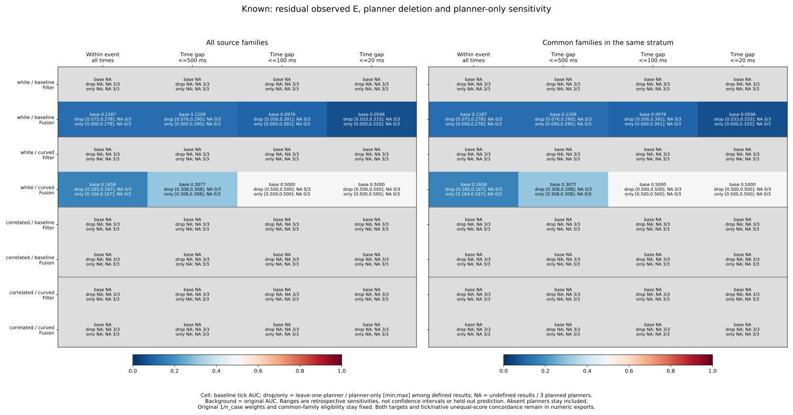
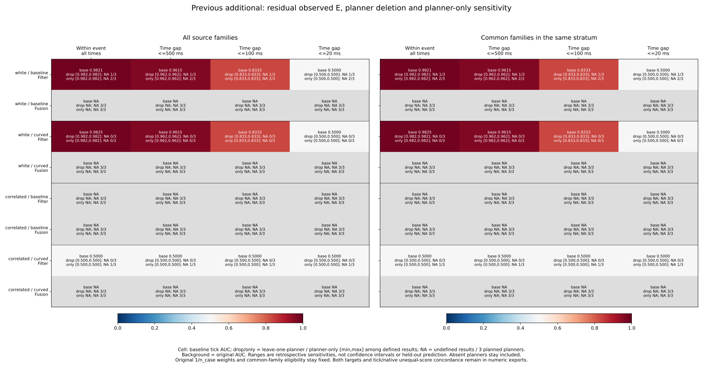
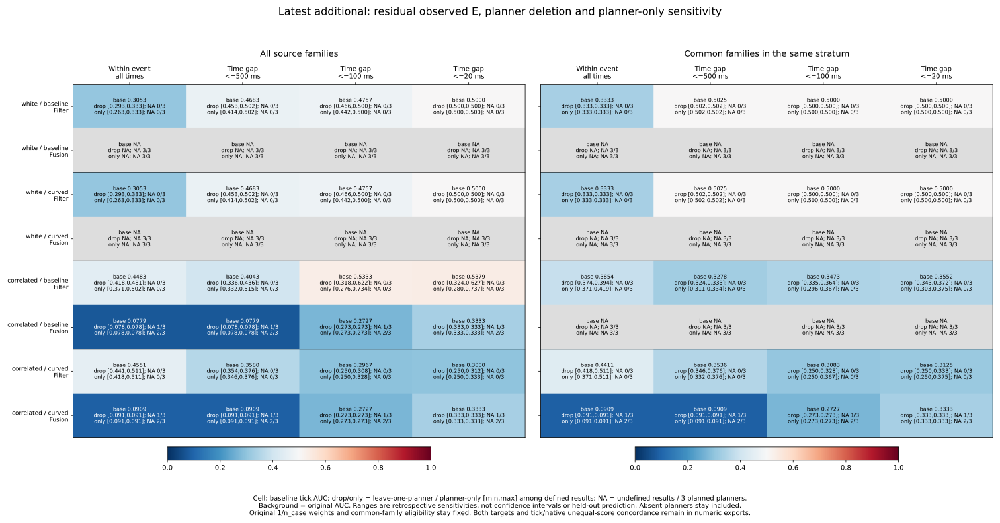
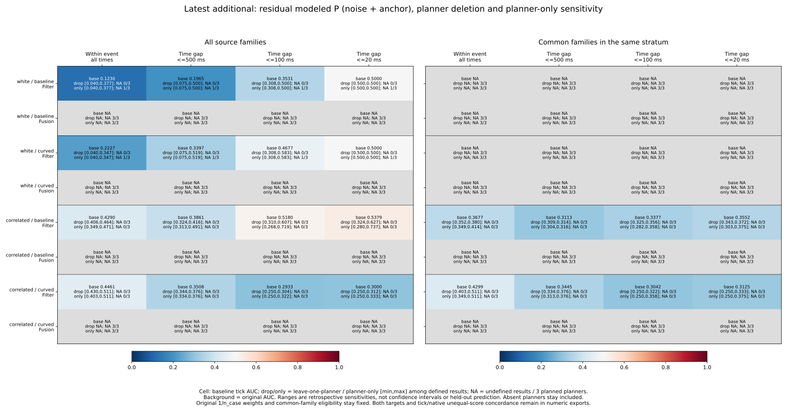
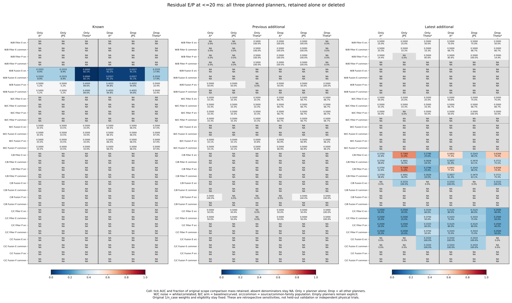
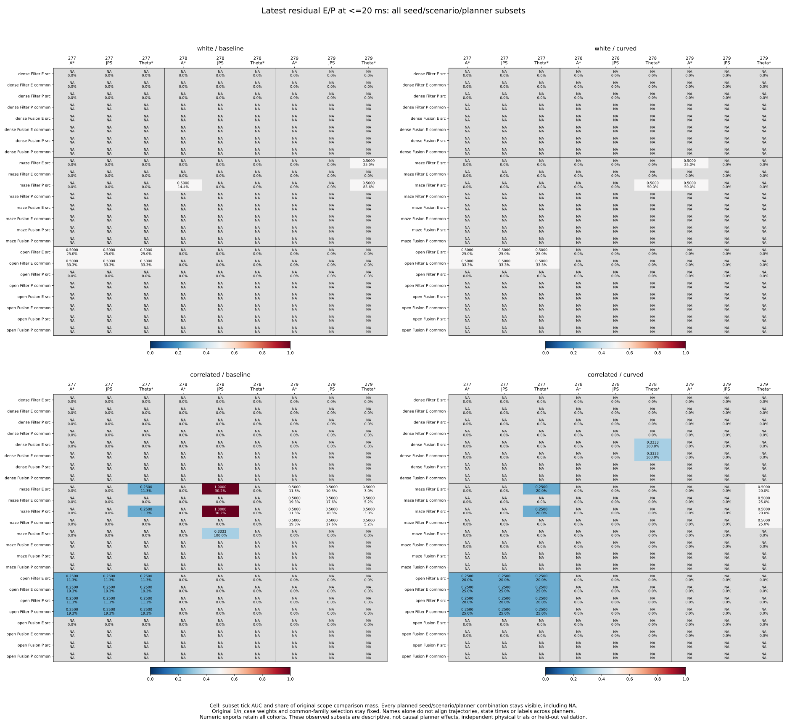

# Same-event planner deletion and seed/scenario/planner subsets

The latest correlated-noise baseline Filter result depends on planner inclusion,
but its apparent seed difference is not a repeated comparison of the same
planner. For residual E, residual_sigma and <=20 ms, source AUC is **.537891**;
JPS alone gives **.736916**, while removing JPS gives **.324282**. Within maze,
seed 277 has selected records only for Theta*, seed 278 only for JPS, and seed
279 supports all three planners with AUC .5 and no unequal scores. The single
seed-278 JPS comparison still supplies all concordant unequal-score mass.
This does not establish a planner advantage on matched trajectories or new seeds.

The [protocol](protocol.md) was committed as **567c252** from main
**64f3f3197f1c44fdb518af4a9fea64c5173bcb30**, before calculating planner outcomes.
It extends the [scenario study](../event-scenario-influence/report.md), keeping
A*, JPS and Theta* exhaustive, including absent and pair-free subsets. No new
simulation, fitting, cutoff, score reversal or controller change was made.

## Fixed population and full case identity

All 10,995 RP states, 157 represented cases, 972 planned cases, 324 planned
families, 32,985 source-view references and 3,997 census events remain in the
pinned preceding accounting. The aggregate effects cover every cohort,
noise/arm, five strata, both targets, three scores, E/P/U and source/common_family
population. Each original selection group has three planner units and 27
seed/scenario/planner audits, whether or not they have records or class pairs.

Across 120 selection groups, the numbers with 0/1/2/3 represented planners are
50/1/0/69. The 3,240 leaf audits include 505 with records and 2,735 without.
These reused strata/populations are not independent experiments. Forty-nine
represented leaves contain more than one full case: original random/blackout
loss modes remain distinct. Grouping by seed/scenario/planner does not merge
them into a single case. Full case and family IDs in the audit retain that
identity, even when a displayed subset aggregates several cases.

All class pairs remain within one full case and one saved event, at all-event
or integer-microsecond gaps <=500/100/20 ms. No cross-planner or cross-loss-mode
pair is added. Event tags are not complete Fusion ancestry or independent
physical streams. Each state keeps original full-RP-parent 1/n_case weight,
before selecting stratum, population or planner. Availability-only common-family
eligibility is fixed first; deleting one planner keeps the other two planners'
already selected cases. No weights or eligibility are recomputed.

For planner p, weighted concordant/tied/discordant masses W_p/T_p/L_p give
M_p = W_p + T_p + L_p and N_p = W_p + T_p/2. Planner-only AUC is N_p/M_p;
leave-one-planner AUC is (sum N - N_p)/(sum M - M_p). Exact Fraction per-case
contributions reproduce every preceding baseline field and sum by planner.
The collector never averages AUCs. Tick scores remain at 1e-8 m, native order
is strict saved-score order, and both unequal-score concordances W/(W+L)
remain available. Native order describes export precision, not physical exactness.

Undefined denominators stay blank. Removing a sole supporting planner loses
support, not a zero AUC or a strict-side flip. A strict flip requires two defined
exact rational values strictly on opposite sides of .5; reaching or leaving
.5 is not a flip. An absent or pair-free planner is a deletion no-op but has
undefined planner-only AUC. Every summary still has all three planned units.

## Latest near-time Filter results

These residual E / residual_sigma results use <=20 ms. Lists are in A* / JPS /
Theta* order. Leave-one values name the planner being removed. Both sigma
scores retain identical tick/native values throughout all new subsets.

| Noise / arm | Population | Baseline AUC | Planner-only AUCs | Leave-one AUCs |
| --- | --- | ---: | --- | --- |
| White / baseline | source | .500000 | .500000 / .500000 / .500000 | .500000 / .500000 / .500000 |
| White / curved | source | .500000 | .500000 / .500000 / .500000 | .500000 / .500000 / .500000 |
| White / baseline | common | .500000 | .500000 / .500000 / .500000 | .500000 / .500000 / .500000 |
| White / curved | common | .500000 | .500000 / .500000 / .500000 | .500000 / .500000 / .500000 |
| Correlated / baseline | source | .537891 | .375000 / .736916 / .279561 | .585457 / .324282 / .626928 |
| Correlated / baseline | common | .355172 | .375000 / .369135 / .302870 | .342696 / .347011 / .372135 |
| Correlated / curved | source | .300000 | .250000 / .250000 / .333333 | .312500 / .312500 / .250000 |
| Correlated / curved | common | .312500 | .250000 / .250000 / .375000 | .333333 / .333333 / .250000 |

For correlated/baseline/source the original comparison mass shares are
**22.600966% / 51.767269% / 25.631765%**, respectively. The planners have
3/4/4 selected cases, 2/3/3 pair-supporting cases and 4/5/5 raw pairs. Raw counts
and mass shares differ because original case weights are unequal. The
JPS-only conditional unequal-score concordance is **.842302**, while A* and
Theta* each give **0**. Pooled conditional concordance is **.571791**; after
removing A*/JPS/Theta* it becomes **.640341 / 0 / .727566**. The source AUC
strictly crosses below .5 only after JPS deletion in this cell.

Common-family selection had already excluded the single-planner maze cases in
seeds 277 and 278. All three planner-only and all three deletion AUCs then
stay below .5. Keeping the originally common families does not imply equal
saved windows, aligned state times, equal class support or causal planner effects.
For correlated/curved source and common populations all these values are also
below .5. No planner or population is chosen for deployment from these subsets.

## What remains within the same maze scenario

The following table includes every planned planner for every latest seed under
the same correlated/baseline/source Filter E condition and <=20 ms scope.
Zero selected records refer to this diagnostic selection, not to proof that a
planner was never run. Planned case/status accounting remains in the pinned
preceding bundle.

| Seed | Planner | Selected states | Full cases | Raw pairs | AUC | Unequal concordance |
| --- | --- | ---: | ---: | ---: | ---: | ---: |
| 277 | A* | 0 | 0 | 0 | NA | NA |
| 277 | JPS | 0 | 0 | 0 | NA | NA |
| 277 | Theta* | 104 | 1 | 2 | 0.250000 | 0.000000 |
| 278 | A* | 0 | 0 | 0 | NA | NA |
| 278 | JPS | 20 | 1 | 1 | 1.000000 | 1.000000 |
| 278 | Theta* | 0 | 0 | 0 | NA | NA |
| 279 | A* | 104 | 1 | 2 | 0.500000 | NA |
| 279 | JPS | 109 | 1 | 2 | 0.500000 | NA |
| 279 | Theta* | 142 | 1 | 1 | 0.500000 | NA |

The seed-278 JPS case is C0149/F050, already identified by the case/family,
seed and scenario studies. Its one comparison carries **30.179266%** of the
entire original scope's weighted mass. Seed 277's .25 maze result belongs to
Theta*, while seed 279 has only tied-score comparisons in every planner.
Thus the preceding .25 / 1 / .5 seed/scenario values do not repeat the same
available planner across all three seeds. Within the seed where all three are
available, conditional unequal-score concordance is undefined for every planner.
The data do not support a matched ranking advantage for JPS.

These subsets may still aggregate distinct original loss modes and cases; even
common-family availability does not align trajectories, timestamps or labels.
The full keys and event identities remain separate in every computation. A new
boundary test verifies that positive/negative states from different loss modes,
with otherwise identical seed/scenario/planner/event tags, create no class pairs.

## Other modes, labels and gaps

White source Filter E stays at AUC .5 after every planner deletion, but its
unequal-score support is concentrated in Theta* under baseline and A* under
curved. Deleting that sole unequal-supporting planner leaves only ties: AUC
stays .5 and conditional concordance becomes undefined. White common-family
E has three supporting planner cases in open/seed 277, all tied; deleting one
planner retains the other two and AUC .5. In contrast, the preceding deletion
of the whole open scenario removed all support. This also checks that common-
family eligibility was not reapplied after planner removal.

Latest white source P has near-time pair support only in A*/Theta* under
baseline and A*/JPS under curved, with AUC .5 in each defined subset. The missing
third planner's P metric stays undefined, even when it contributes E pairs.
White common P remains undefined. Supported latest correlated Filter P
near-time metrics match E. Latest Fusion P remains undefined within event.
The P label is the fixed noise-plus-anchor model, not an independent new outcome.

Latest Fusion E has all <=20 ms pair support in JPS/seed 278, under maze for
baseline source and dense for curved source/common. Its three raw comparisons
in one case give AUC 1/3. Removing JPS loses all support; A*/Theta* removals
keep the value even when those planners have selected records but no class pairs.
White Fusion E remains undefined.

Latest source Filter residual E / residual_sigma deletion ranges at all scopes:

| Noise / arm | All times within event | <=500 ms | <=100 ms | <=20 ms |
| --- | --- | --- | --- | --- |
| White / baseline and curved | [.293151,.333333] | [.453159,.502463] | [.465753,.500000] | [.500000,.500000] |
| Correlated / baseline | [.418097,.481330] | [.335639,.435799] | [.318283,.622090] | [.324282,.626928] |
| Correlated / curved | [.441077,.511244] | [.353596,.376179] | [.250000,.308333] | [.250000,.312500] |

All three AUC deletions are defined in these cells. The small white above-half
endpoint at <=500 ms stays an exact strict flip, not rounded to .5 in side
counts. These pair-distance scopes remain retrospective, not causal forecasts.

Known white Fusion E at <=20 ms has planner-only AUCs **1/3 / 1/3 / 0** under
baseline; removing A*/JPS/Theta* gives **.032720 / .032720 / 1/3**. Under curved,
all three planner-only and deletion AUCs are .5. Support comes from the same
dense/seed-271 family and does not establish independent planner trials. Known
Filter E remains undefined within event.

Previous additional white baseline Filter E is supported only in Theta*/dense/
seed 276, so removing Theta* loses support at every scope. White curved Filter
E has all three planner cases in that family; each planner-only and deletion
value equals its pooled all-event .982456 or <=20 ms .5. Correlated/curved E
has tied support in A*/JPS, with Theta* undefined alone and all deletions .5.
Previous additional Fusion E remains undefined; its P support is kept separately.

Across all targets/scores/labels/strata/populations/scopes:

| Cohort | Defined baseline tick AUC cells | Cells losing support under a deletion | Cells with any strict tick AUC flip | Cells supported by exactly 1 / 2 / 3 planners |
| --- | ---: | ---: | ---: | --- |
| Known | 336 | 144 | 24 | 144 / 0 / 192 |
| Previous additional | 564 | 228 | 0 | 228 / 108 / 228 |
| Latest additional | 756 | 60 | 114 | 60 / 96 / 600 |

These dependent cells reuse the same histories and are not independent successes
or replications. Native AUC has the same defined/support-loss counts and strict
flips in 24/0/120 cells for known/previous/latest cohorts. Native/tick differences
occur only for contrast; both sigma scores have identical new subset values.
All U AUCs remain undefined because RP source states lack the outside U class.

## Frozen outputs and figures

[planner-audit.csv](planner-audit.csv) contains every label-blind leaf, full case/
family IDs and original case mass. `unit_id` denotes the planner; seed and
scenario are explicit columns. Parent `planner_selection=all` identifies the
original mixed population. [planner-effects.csv](planner-effects.csv) keeps all
25,920 operations: unprefixed fields describe deletion, planner_ fields describe
the planner alone, and removed masses/shares describe that planner alone.
[sensitivity-summary.csv](sensitivity-summary.csv) retains all 8,640 baseline,
range, support-loss, represented/supported-unit and exact side-count summaries.

[planner-cells.csv](planner-cells.csv) retains all 20,736 fixed focused leaf/scope
rows: residual_sigma, Filter/Fusion, E/P, both targets, all scopes and cohorts/
noises/arms/populations. All 27 planned leaves are explicit. Summing planners
reproduces all 6,912 corresponding preceding seed/scenario rows. All aggregate
effects/summaries cover every original score/label/stratum; other case
contributions remain in the pinned preceding outputs.

The first four figures show residual E for each cohort and latest P, all scopes
and populations. The fifth shows all individual planner-only/deletion residual
E/P AUCs/shares at <=20 ms across cohorts. The sixth shows all latest seed/
scenario/planner subsets in the four noise/arm panels; numeric exports retain
all cohorts. Every predeclared panel and NA value is preserved.

The [summary export](summary-values.csv) keeps 768 full rows across both targets;
[planner values](planner-values.csv) keep 288 focused effects; [leaf values](planner-cell-values.csv)
keep 2,592 focused rows across all cohorts. Six SVGs and numeric exports are
tracked; PNGs remain reproducible in scratch.

## Reproduction and verification

See the [README](../../README.md#same-event-planner-deletion-and-seedscenarioplanner-subsets)
for sequential commands using tracked inputs, fresh directories and a new
evidence filename, without Python -O. Collection uses the standard library,
plotting Matplotlib/NumPy and independent verification NumPy. No new Rust build
or simulation is required.

- **699 Python tests passed**, including 25 new tests for hand-calculated unequal
  original weights, multi-seed/scenario planner groups, all 27 direct leaf subsets,
  prior seed/scenario closure, common-family survivors, empty/pair-free/missing
  classes, ties/native order, support loss, exact-half rules, parent stratum
  weights, time boundaries, full case/event/loss-mode isolation, bad identifiers,
  fixed focused exports and nonmutation.
- **852,165 preceding baseline-field comparisons** and **269,568 focused seed/
  scenario-field comparisons** pass, totaling **1,121,733** collector comparisons.
- **Five collector artifacts** (four CSVs and sources.json) repeat byte for byte.
  **16 figure artifacts** (six SVGs, six PNGs, three CSVs and provenance) repeat
  byte for byte; all six figures were inspected.
- **19,119,733 independent comparisons passed**. The standalone verifier imports
  no analyzers. It reconstructs 10,995 original states/21,990 targets and Decimal
  score order; rechecks preceding precision, case/family, seed and scenario
  artifacts; directly masks NumPy pairs for every retained/remaining planner and
  focused leaf; checks all new fields and preceding focused leaf sums; and
  verifies all 3,648 numeric plot rows plus input/helper/script/protocol/output/
  plot hashes. Exact Fraction counts/weights preserve half/side decisions
  independently of the collector's contribution subtraction.

[sources.json](sources.json), [plot-sources.json](plot-sources.json) and
[independent-verification.json](independent-verification.json) preserve precise
hashes and counts. All original planned case/family/event/loss/cutoff accounting
and preceding CSV bytes remain unchanged and pinned in place.

These already observed subsets are retrospective sensitivities, not confidence
intervals, jackknife errors, independent physical replications, causal planner
effects or held-out predictive validation. No winning planner is selected or
deployed. Historical held goals remain 140->140 and latest 62->60; no new live
outcomes were measured.
