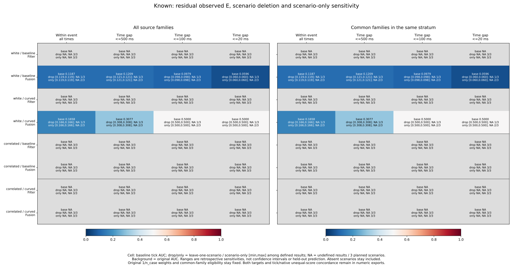
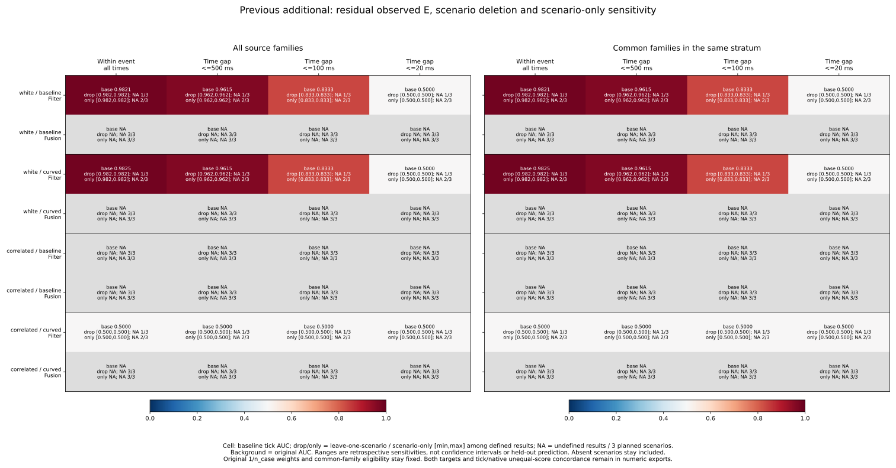
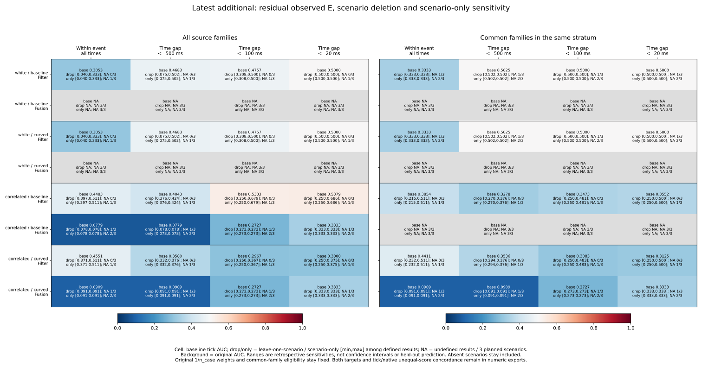
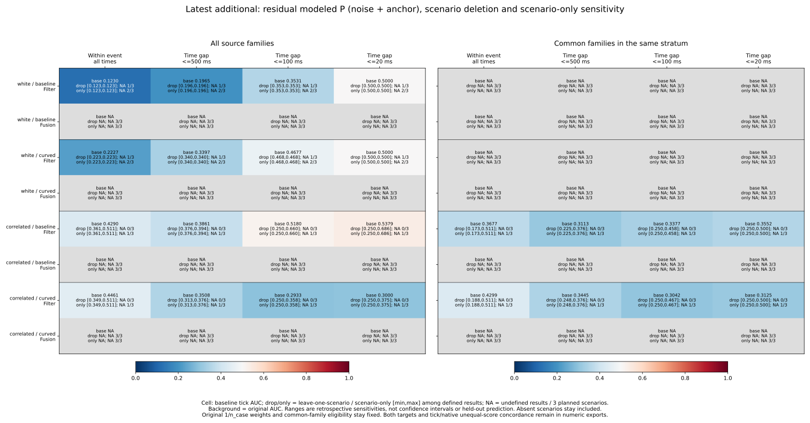
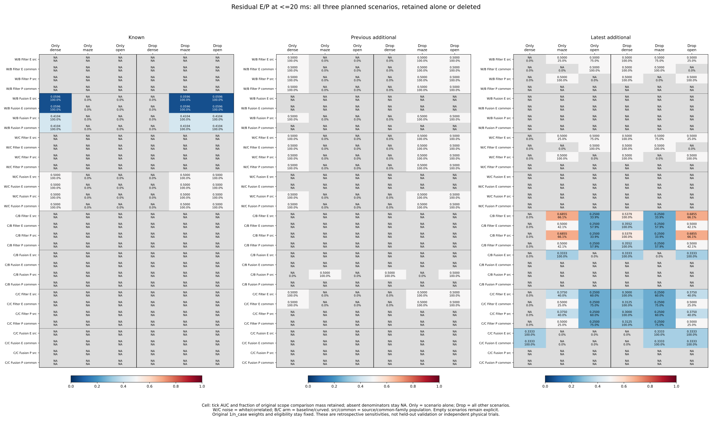
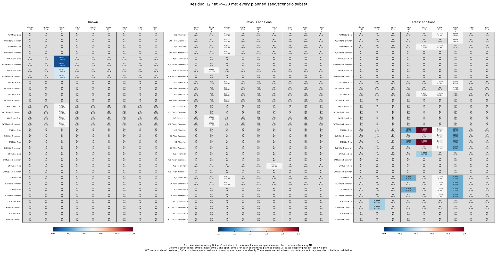

# Same-event scenario deletion and seed/scenario decomposition

The latest correlated-noise baseline Filter AUC depends on both the scenario
and the observed seed subset. For residual E, residual_sigma and <=20 ms,
source AUC is **.537891**. Keeping maze alone gives **.685549**; removing maze
leaves **.250000**. Within that same maze scenario, seeds 277/278/279 give
**.250000 / 1.000000 / .500000**. The seed-278 value still uses just one
positive/negative comparison in one case. Restricting the scenario name does
not make the three observed seed results agree or establish new-seed prediction.

The [protocol](protocol.md) was committed as **4d85a36** from main
**8eeb14645be9db36e7b4f1e29e583d3b960a3925** before computing scenario outcomes.
It extends the [seed sensitivity study](../event-seed-influence/report.md),
retaining every dense_50x50 / maze_50x50 / open_50x50 scenario and all nine
planned seed/scenario cells, without new simulation, fitting or control changes.

## Fixed populations and aggregation

The 10,995 RP states, 157 represented cases, 972 planned cases, 324 planned
families, 32,985 source-view references and 3,997 census events remain accounted
for in the pinned preceding inputs. Both targets, three scores, E/P/U, five
strata, both noises/arms and source/common_family populations remain available.
Mixed planners and availability-only common-family eligibility are fixed before
any subset operation. Removing one scenario removes all selected cases in it
across all three seeds; retaining it preserves those cases alone. All nine
seed/scenario subsets are also kept separately, including zero-record cells.

Each of the 120 selection groups has three scenario units and nine audit cells.
There are 1,080 seed/scenario audits: 198 with selected records, 882 without.
The counts of groups with 0/1/2/3 represented scenarios are 50/24/34/12. These
groups reuse the same states across strata/populations and are not independent
experiments. Selected records, cases and class-pair support are recorded
separately; a scenario with records can have no admissible class comparisons.

Pairs stay within the same full saved case and single event, with either its
full event history or integer-microsecond gaps <=500/100/20 ms. An event tag
is not complete Fusion ancestry or an independent physical stream. Every state
retains its original 1/n_case weight from the full RP parent history, before
stratum/population/scenario selection. Neither weights nor eligibility are
recomputed after removing a scenario. No cross-case, cross-event or cross-seed
pair is introduced.

For scenario s, weighted concordant/tied/discordant masses W_s/T_s/L_s give
M_s = W_s + T_s + L_s and N_s = W_s + T_s/2. Scenario-only AUC is N_s/M_s;
leave-one-scenario AUC is (sum N - N_s)/(sum M - M_s). Each scenario's masses
sum its three seed cells; all nine cells sum to the original baseline. The
collector uses exact Fraction weights and never averages cell AUCs. Both
1e-8 m tick and strict saved-score orders are retained, as are conditional
unequal-score concordances W/(W+L). Native order refers to saved export
precision, not exact physical scores.

Undefined denominators stay blank. Deleting a pair-free or absent scenario
is a metric no-op; retaining it gives undefined AUC. Removing the sole source
of pair support makes AUC undefined, not zero. A strict flip requires two
defined exact rational values strictly on opposite sides of .5; reaching or
leaving .5 does not count. Empty selections still have three effects and
nine audit/contribution rows per scope, without fabricated observations.

## Latest Filter results at <=20 ms

These residual E / residual_sigma results list scenarios in dense / maze / open
order. Leave-one values identify the scenario being removed. NA means undefined.
Both sigma scores keep identical tick/native values in every new subset.

| Noise / arm | Population | Baseline AUC | Scenario-only AUCs | Leave-one AUCs |
| --- | --- | ---: | --- | --- |
| White / baseline | source | .500000 | NA / .500000 / .500000 | .500000 / .500000 / .500000 |
| White / curved | source | .500000 | NA / .500000 / .500000 | .500000 / .500000 / .500000 |
| White / baseline | common | .500000 | NA / NA / .500000 | .500000 / .500000 / NA |
| White / curved | common | .500000 | NA / NA / .500000 | .500000 / .500000 / NA |
| Correlated / baseline | source | .537891 | NA / .685549 / .250000 | .537891 / .250000 / .685549 |
| Correlated / baseline | common | .355172 | NA / .500000 / .250000 | .355172 / .250000 / .500000 |
| Correlated / curved | source | .300000 | NA / .375000 / .250000 | .300000 / .250000 / .375000 |
| Correlated / curved | common | .312500 | NA / .500000 / .250000 | .312500 / .250000 / .500000 |

In correlated/baseline/source, maze accounts for **66.098550%** of original
weighted comparison mass and open for **33.901450%**. Dense has three selected
cases and 156 states but no within-event E pairs. Removing dense therefore
keeps .537891, while removing maze yields a strict above-to-below-half flip.
Removing open yields .685549. These are exhaustive fixed scenario operations,
not a choice to prefer maze for deployment.

The complete nine-cell breakdown for that condition is:

| Scenario | Seed | Selected states | Cases | Raw pairs | AUC | Original pair mass |
| --- | --- | ---: | ---: | ---: | ---: | ---: |
| dense | 277 | 0 | 0 | 0 | NA | 0.000000% |
| dense | 278 | 0 | 0 | 0 | NA | 0.000000% |
| dense | 279 | 156 | 3 | 0 | NA | 0.000000% |
| maze | 277 | 104 | 1 | 2 | 0.250000 | 11.300483% |
| maze | 278 | 20 | 1 | 1 | 1.000000 | 30.179266% |
| maze | 279 | 355 | 3 | 5 | 0.500000 | 24.618801% |
| open | 277 | 312 | 3 | 6 | 0.250000 | 33.901450% |
| open | 278 | 0 | 0 | 0 | NA | 0.000000% |
| open | 279 | 0 | 0 | 0 | NA | 0.000000% |

The maze-278 case is the C0149/F050 JPS case identified in the preceding
case/family and seed studies. It contributes one comparison but **30.179266%**
of the original weighted mass. Raw pair counts are not mass shares because
each case retains its original parent weight. The 277 maze/open cells both
have AUC .25; maze-279 has .5 with only tied scores. Thus different scenario
mixes do not fully account for the observed seed difference within maze.
The subset still contains different cases/planners and labels, so this is not
a causal attribution of variation to seed.

Maze's unequal-score concordance is **.842302**, while open's is **0**. The
pooled conditional value is **.571791**; removing maze leaves **0**, removing
open gives **.842302**, and removing dense leaves it unchanged. Common-family
selection had already excluded the single-planner maze cases in 277 and 278.
Its maze contribution consists of the three seed-279 planner cases, all ties
with AUC .5; its open contribution is the three seed-277 cases with AUC .25.
Deleting maze gives .25, deleting open reaches exactly .5, and neither is a
strict flip from the common baseline .355172.

For correlated/curved source, maze AUC .375 mixes a .25 cell in seed 277 and
a tied .5 cell in 279. Open has only the .25 seed-277 cell. Its deletion range
[.25,.375] stays below .5. Common-family maze is .5 and open .25, so the common
deletion range reaches .5 without crossing it.

White source E uses open-277 and maze-279 with 75%/25% comparison mass shares.
Open consists entirely of ties; maze contains the balanced unequal comparisons.
All AUC deletions stay .5, but removing maze makes unequal-score concordance
undefined. White common E has only open support, so removing open loses AUC
support. Flat AUC ranges do not imply the same support remains.

Latest white Filter P has all within-event class-pair support in maze, including
both seed-278 and seed-279 source cells. Removing maze makes P AUC undefined at
all four scopes; other scenario deletions retain the pooled value. This differs
from E's two supporting scenarios despite both having AUC .5 at <=20 ms.
White common P is undefined. Supported latest correlated Filter P cells have
the same near-time scenario/cell metrics as E. Latest Fusion P remains undefined
within event. P is the frozen noise-plus-anchor label, not a new outcome set.

## Other gaps, modes and cohorts

For latest source Filter residual E / residual_sigma, deletion ranges are:

| Noise / arm | All times within event | <=500 ms | <=100 ms | <=20 ms |
| --- | --- | --- | --- | --- |
| White / baseline and curved | [.040000,.333333] | [.075472,.502463] | [.307692,.500000] | [.500000,.500000] |
| Correlated / baseline | [.397186,.511244] | [.376179,.424031] | [.250000,.678577] | [.250000,.685549] |
| Correlated / curved | [.371173,.511244] | [.332412,.376179] | [.250000,.366667] | [.250000,.375000] |

All three deletions remain defined in these source cells; only two scenario-only
AUCs are defined. The small white above-half endpoint at <=500 ms remains an
exact strict flip in the saved counts, rather than being rounded to .5. These
pair-distance restrictions are fixed retrospective scopes, not causal forecasts.

Latest Fusion E's <=20 ms source baseline support is solely maze/seed 278;
curved source/common support is solely dense/seed 278. In each supported cell
three raw comparisons in one case give AUC 1/3. Removing that scenario loses
support and other deletions do nothing. This is not replicated support across
the three scenario names. White Fusion E and all latest Fusion P remain
undefined within event.

Known white Fusion E is supported only by dense/seed 271, under both arms and
populations. At <=20 ms baseline AUC is .059590 and curved .5. Removing dense
loses support at every scope; maze/open removals retain the original values.
Known Filter E remains undefined within event.

Previous additional white Filter E is supported only by dense/seed 276. All-event
AUC is .982143/.982456 for baseline/curved and both reach .5 at <=20 ms. Removing
dense loses support at every scope. Correlated/curved Filter E also has only
dense/276 support, entirely tied with AUC .5. Previous additional Fusion E is
undefined; its modeled-P support can arise in a different scenario, including
maze/276 for correlated baseline source. E/P accounting stays separate.

Across every target/score/label/stratum/population/scope cell:

| Cohort | Defined baseline tick AUC cells | Cells losing support under a scenario deletion | Cells with any strict tick AUC flip | Cells supported by exactly 1 / 2 / 3 scenarios |
| --- | ---: | ---: | ---: | --- |
| Known | 336 | 336 | 0 | 336 / 0 / 0 |
| Previous additional | 564 | 564 | 0 | 564 / 0 / 0 |
| Latest additional | 756 | 276 | 120 | 276 / 456 / 24 |

These are dependent reused cells, not independent successes or replications.
Native AUC has the same defined/support-loss counts and 119 latest cells with
strict flips; native versus tick differences occur only for contrast. Both
sigma scores preserve identical tick/native AUC and conditional values for
all scenario and seed/scenario subsets. All U AUCs remain undefined because
RP source states lack the outside U class. None of this changes held-goal or
collision outcomes.

## Frozen figures and numeric exports

The four range figures retain residual_sigma, Filter/Fusion, all scopes and
both populations for each cohort's residual E and latest P. They show baseline
AUC and scenario-only/deletion defined ranges, with undefined counts out of
three. The fifth shows individual scenario-only/deletion AUCs and retained
comparison shares at <=20 ms. The sixth shows all nine seed/scenario AUCs and
shares of the original comparison mass for the same residual E/P cells. Every
predeclared panel, including empty ones, is retained.

[scenario-audit.csv](scenario-audit.csv) keeps every label-blind seed/scenario
selection, original case mass and full case/family IDs. [scenario-effects.csv](scenario-effects.csv)
keeps all 25,920 scenario operations; unprefixed fields describe deletion and
scenario_ fields describe the scenario alone. Removed six C/T/D masses and
shares describe that scenario alone. [sensitivity-summary.csv](sensitivity-summary.csv)
keeps 8,640 baseline/range/support/side-count summaries, each with three units.
[seed-scenario-pairs.csv](seed-scenario-pairs.csv) keeps all 77,760 cell/scope
contributions with original availability, weights, six masses and four metrics.

The [summary export](summary-values.csv) keeps 768 full summary rows across
both targets. The [scenario export](scenario-values.csv) keeps 288 focused effect
rows, and the [seed/scenario export](seed-scenario-values.csv) keeps 864 focused
cell rows. All six SVGs and numeric exports are tracked; PNGs remain reproducible
in scratch.

## Reproduction and independent verification

See the [README](../../README.md#same-event-scenario-deletion-and-seedscenario-decomposition)
for sequential commands using tracked sources, fresh directories and an unused
evidence filename, without Python -O. Collection uses the standard library,
figures Matplotlib/NumPy, independent verification NumPy. No new Rust build,
simulation or raw rollout collection is required.

- **674 Python tests passed**, including 22 new tests for hand-calculated
  original weights, multi-case/family/seed scenarios, every retained/remaining
  score/label/target/scope, direct recomputation and exact closure of all nine
  cells, empty/pair-free/missing-class selections, ties/native precision,
  support loss, exact-half rules, fixed populations, original stratum weights,
  time boundaries, case/event isolation, bad identifiers and nonmutation.
- **852,165 preceding-field comparisons** match fixed source/case/family/time/
  score audits and every original precision-scope field.
- **Five collector artifacts** (four CSVs and sources.json) repeat byte for byte.
  **16 plot artifacts** (six SVGs, six PNGs, three CSVs and provenance) repeat
  byte for byte; all six figures were inspected.
- **15,436,288 independent comparisons passed**. The standalone verifier imports
  no analyzers. It reconstructs 10,995 original states/21,990 targets and Decimal
  score order, rechecks all preceding precision fields plus 56,304 case/family
  and 25,920 seed effects, and directly masks NumPy pairs for every retained and
  remaining scenario and all nine cells. Exact Fraction counts/weights preserve
  half/side comparisons independently of the collector's contribution subtraction.
  Every new field, all 1,920 numeric plot rows, and input/helper/script/protocol/
  output/plot hashes are checked.

[sources.json](sources.json), [plot-sources.json](plot-sources.json) and
[independent-verification.json](independent-verification.json) preserve hashes
and counts. All preceding CSVs and complete planned case/family/event/loss/cutoff
accounting remain unchanged and pinned in place.

These three named scenarios are saved environments, not independent map samples.
Seed/scenario subsets were already observed; their ranges are retrospective
sensitivities, not confidence intervals, jackknife errors, independent physical
replications or held-out predictive validation. Historical held goals remain
140->140 and latest 62->60. No new live outcomes were measured and no scenario
or seed was selected for deployment.
