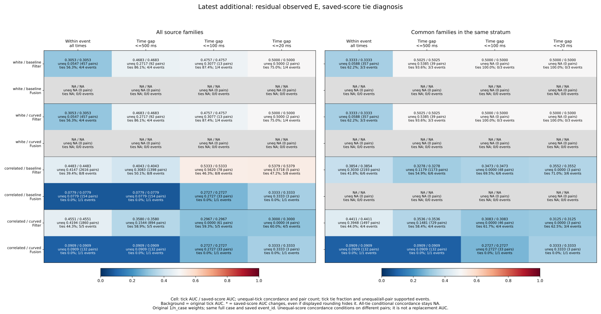
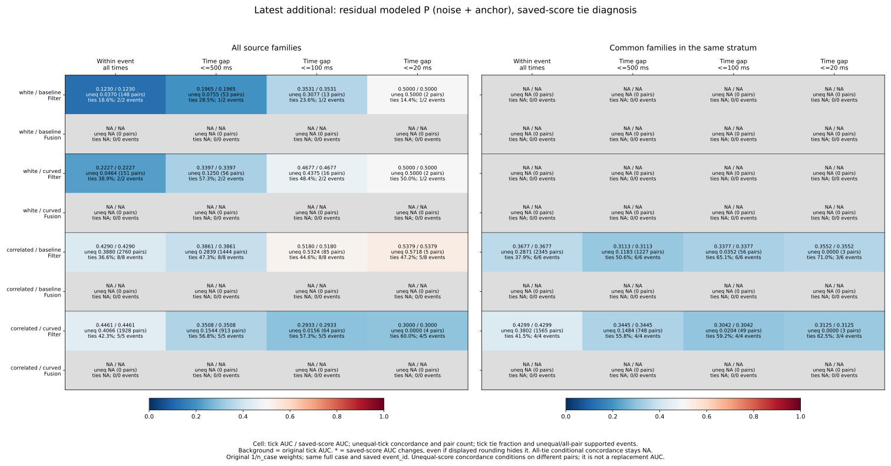
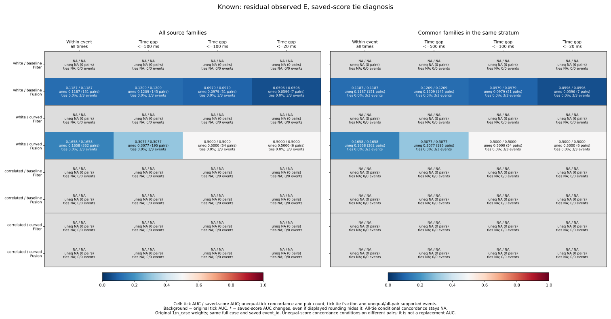
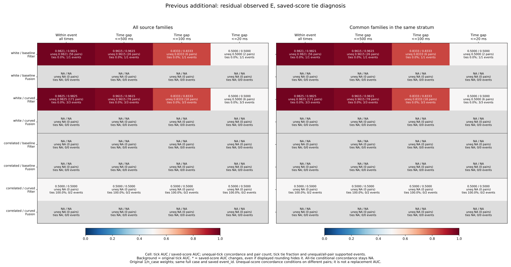
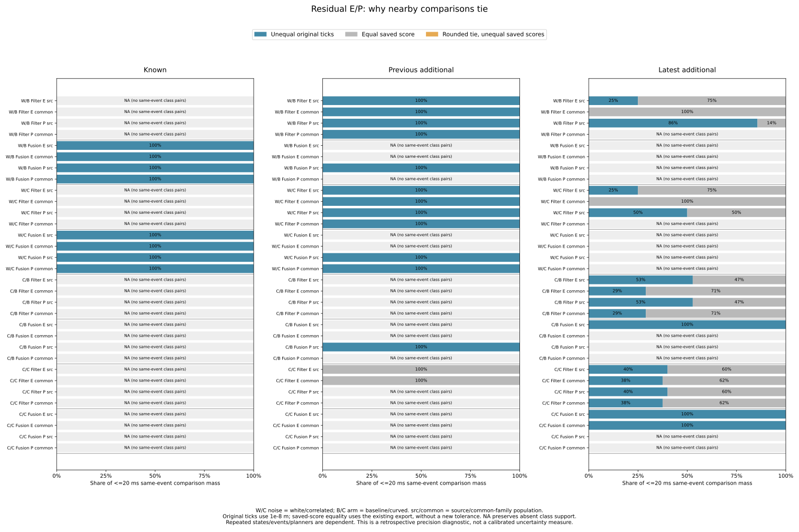

# Saved-score ties and conditional concordance

An AUC of .5 can conceal different comparison support. In the latest white-noise
Filter common-family population, every <=20 ms residual-E comparison has equal
saved model-sigma scores: AUC remains .5, but unequal-score concordance is
undefined. In the earlier additional white-noise Filter population, the same
near-time AUC .5 comes from balanced wins/losses with **no ties**. These cases
should not be interpreted as equivalent evidence of score resolution.

Saved-score precision does not change any midpoint_sigma or residual_sigma AUC
in this study. Their observed ties are equal saved values, not distinct exported
scores collapsed by the original tick grid. Strict saved-score ordering does
change 128 contrast-score scope cells; those remain a separate sensitivity
analysis, without replacing the original scores or cutoffs.

The [protocol](protocol.md) was committed as 47e8a5c from main
ae4d253268176260b68957fb6f4003e4fb3f68da before new tie outcomes. Original
[time-conditioned results](../event-temporal-rankings/report.md) and all their
CSV bytes remain unchanged. They are pinned inputs referenced in place, avoiding
another copy of the same census/accounting/reference tables.

## Definition and preserved population

Keep 32,985 pair references, all 10,995 RP states, 157 represented cases, 972
planned cases, 324 families and the complete 3,997-event census. Retain known
269/270/271, previous additional 274/275/276 and latest additional 277/278/279;
both noises/arms, five strata, two targets, three scores, E/P/U and both original
source/common_family populations. Each state retains its original 1/n_case
weight before stratum/population selection. No new simulation, fitting, cutoffs,
score reversal or estimator/control changes were made.

Only pairs with the same full case and the same single saved census event_id
are compared. This tag is not complete Fusion sample ancestry or an independent
information stream. Absolute saved state-time gaps retain the integer-microsecond
[0,20], (20,100], (100,500] and >500 ms bins; scopes retain all event times and
cumulative <=20/100/500 ms. No continuity, adjacency or future prediction is implied.

Original high-score/outside ordering uses the saved 1e-8 m ticks, giving half
credit for ties. Outside remains norm >.10 m with the closed inside disk.
Separately join the original saved score_m strings by source/full case/source
ID, check metadata and tick reconstruction, parse finite binary64 values and
use their strict order without another equality tolerance. Keep raw strings,
hex encodings and ticks in [score-audit.csv](score-audit.csv).

Five disjoint classes are tick-concordant, tick-discordant, tick-tied/native-
concordant, tick-tied/native-equal and tick-tied/native-discordant. Tick order
must be monotone in saved-score order. Original concordant/tied/discordant
masses C/T/D, numerator and denominator are preserved. For total pair mass W,
AUC=(C+T/2)/W. Native tie resolution changes AUC by
(resolved_concordant-resolved_discordant)/(2W), checked exactly with rational
case weights. Sum masses before division; never average event AUCs.

Unequal-score concordance is C/(C+D), blank when all comparisons tie. It keeps
original pair weights and does not renormalize cases. It conditions on a different
comparison population, often with fewer supporting cases/events, so it is not a
replacement AUC, a correction or a new performance guarantee. Pair counts and
supported event/case counts accompany both tick/native conditional results.

## Latest Filter residual E at <=20 ms

All values use residual_sigma. Tick and saved-score AUCs are identical in every
row below, including the ties. Tie shares use weighted pair mass; pair entries
are unweighted saved-state comparisons. The event fraction is unequal-score
supported events / events supporting any positive-negative pair, not all available
events or independent trials. Full/event mass coverage remains in the numeric
outputs and preceding time-conditioned report.

| Noise / arm | Population | AUC | Tick tie share | Unequal concordance | Unequal pair entries | Unequal/all-pair events |
| --- | --- | --- | --- | --- | --- | --- |
| white / baseline | source | 0.500000 | 75.000000% | 0.500000 | 2 | 1/4 |
| white / baseline | common_family | 0.500000 | 100.000000% | NA | 0 | 0/3 |
| white / curved | source | 0.500000 | 75.000000% | 0.500000 | 2 | 1/4 |
| white / curved | common_family | 0.500000 | 100.000000% | NA | 0 | 0/3 |
| correlated / baseline | source | 0.537891 | 47.219768% | 0.571791 | 5 | 5/8 |
| correlated / baseline | common_family | 0.355172 | 71.034429% | 0.000000 | 3 | 3/6 |
| correlated / curved | source | 0.300000 | 60.000000% | 0.000000 | 4 | 4/5 |
| correlated / curved | common_family | 0.312500 | 62.500000% | 0.000000 | 3 | 3/4 |

White-noise source AUC .5 includes 75% equal-score mass. Only two unequal pair
entries remain in one of four class-supported events/cases, with conditional
concordance .5. Common-family selection removes that unequal-score case, leaving
six pair entries in three cases/events, all tied. Its <=100 ms comparisons are
also all tied. The original .5 remains defined while conditional concordance is NA.

Correlated/baseline source AUC .537891 has 47.219768% tied mass and conditional
concordance .571791 on only five unequal pair entries in five of eight supporting
cases/events. Common-family AUC .355172 has 71.034429% tied mass; its three
unequal entries in three of six cases/events are all discordant, giving zero
conditional concordance. Correlated/curved has zero conditional concordance in
both populations, on four/three unequal pair entries; original AUC .300/.3125
comes entirely from half-credit on 60%/62.5% tied mass. This is not independent
replication or evidence that changing the score direction would generalize.

Over all event times, white-noise source .305263 combines 56.267943% tied mass
with conditional concordance .054705; common-family .333333 combines 62.222222%
ties with .058824. The other horizons, both populations and both estimator modes
are shown without selecting event histories after seeing the outcomes.

## Modeled P and Fusion

P is noise plus anchor, with its original labels retained separately from total
E and unmodeled drift/transport U. At <=20 ms the latest Filter modeled-P values
are as follows; tick and saved-score AUCs again agree exactly.

| Noise / arm | Population | AUC | Tick tie share | Unequal concordance | Unequal pair entries | Unequal/all-pair events |
| --- | --- | --- | --- | --- | --- | --- |
| white / baseline | source | 0.500000 | 14.357776% | 0.500000 | 2 | 1/2 |
| white / baseline | common_family | NA | NA | NA | 0 | 0/0 |
| white / curved | source | 0.500000 | 50.000000% | 0.500000 | 2 | 1/2 |
| white / curved | common_family | NA | NA | NA | 0 | 0/0 |
| correlated / baseline | source | 0.537891 | 47.219768% | 0.571791 | 5 | 5/8 |
| correlated / baseline | common_family | 0.355172 | 71.034429% | 0.000000 | 3 | 3/6 |
| correlated / curved | source | 0.300000 | 60.000000% | 0.000000 | 4 | 4/5 |
| correlated / curved | common_family | 0.312500 | 62.500000% | 0.000000 | 3 | 3/4 |

White-noise modeled-P source has two unequal entries in one of two supporting
cases/events. Its tie shares differ by arm and case weights; they are not the
fraction of unweighted pair entries. Common-family white P remains class-missing.
The correlated near-time P table matches the E ordering in these saved states.

Latest correlated Fusion residual E has no tied pairs in either supported
condition: its <=20 ms AUC and unequal concordance are both 1/3, on three entries
from one event/case. Baseline has only the source population; curved retains the
same supporting case under common-family selection. White Fusion E has no
within-event class pairs. Every latest Fusion P within-event scope remains NA.
Tie removal does not create missing class support or additional cases.

## Earlier cohorts distinguish equal AUCs

The complete source-population residual-E, residual_sigma table at <=20 ms is
retained here for both estimator modes and all four conditions. Common-family
results and all four horizons remain explicit in the figures and numeric data.

| Cohort | Noise / arm | Mode | AUC | Tick tie share | Unequal concordance | Unequal pair entries |
| --- | --- | --- | --- | --- | --- | --- |
| known | white / baseline | Filter | NA | NA | NA | 0 |
| known | white / baseline | Fusion | 0.059590 | 0.000000% | 0.059590 | 7 |
| known | white / curved | Filter | NA | NA | NA | 0 |
| known | white / curved | Fusion | 0.500000 | 0.000000% | 0.500000 | 6 |
| known | correlated / baseline | Filter | NA | NA | NA | 0 |
| known | correlated / baseline | Fusion | NA | NA | NA | 0 |
| known | correlated / curved | Filter | NA | NA | NA | 0 |
| known | correlated / curved | Fusion | NA | NA | NA | 0 |
| new | white / baseline | Filter | 0.500000 | 0.000000% | 0.500000 | 2 |
| new | white / baseline | Fusion | NA | NA | NA | 0 |
| new | white / curved | Filter | 0.500000 | 0.000000% | 0.500000 | 6 |
| new | white / curved | Fusion | NA | NA | NA | 0 |
| new | correlated / baseline | Filter | NA | NA | NA | 0 |
| new | correlated / baseline | Fusion | NA | NA | NA | 0 |
| new | correlated / curved | Filter | 0.500000 | 100.000000% | NA | 0 |
| new | correlated / curved | Fusion | NA | NA | NA | 0 |

The earlier additional white Filter .5 has one win/one loss for baseline and
three wins/three losses for curved, with no ties. The earlier correlated/curved
Filter .5 instead has two equal-score pair entries in two cases/events; unequal
concordance is NA. Known white/curved Fusion .5 has three wins/three losses,
not all ties. These equal aggregate AUCs describe different score behavior and
very limited support, rather than interchangeable assessments of discrimination.

## Precision sensitivity across all scores

These counts include all strata, targets, labels, populations and four cumulative
scopes. Repeated states, nested scopes and duplicate all/mode groups are not
independent experiments. Missing-class cells remain present, with blank AUC.

| Cohort | Score | Defined scope AUCs | All tick ties | Some rounded ties resolve | Native AUC changes |
| --- | --- | --- | --- | --- | --- |
| known | contrast | 112 | 0 | 0 | 0 |
| known | midpoint_sigma | 112 | 0 | 0 | 0 |
| known | residual_sigma | 112 | 0 | 0 | 0 |
| new | contrast | 188 | 148 | 0 | 0 |
| new | midpoint_sigma | 188 | 32 | 0 | 0 |
| new | residual_sigma | 188 | 32 | 0 | 0 |
| fresh | contrast | 252 | 82 | 192 | 128 |
| fresh | midpoint_sigma | 252 | 16 | 0 | 0 |
| fresh | residual_sigma | 252 | 16 | 0 | 0 |

Of 8,640 scope rows, 1,656 have class support; 326 of those are entirely tied at
tick precision. There are 1,330 defined tick-unequal concordances versus 1,396
at saved-score precision. All 192 scope cells with rounding-created ties are
latest contrast-score cells; only 128 have a nonzero net AUC change because
resolved wins/losses can cancel. Both sigma scores retain their original AUCs
and ties across every cohort. U remains class-missing throughout these RP states.

Saved-score ordering is a numerical sensitivity analysis of an existing export.
It does not establish a meaningful physical resolution, calibrated uncertainty,
new independent information or a better online score. No rounding tolerance or
new score direction was chosen from these outcomes. The predeclared five figures
remain focused on residual_sigma, with all scores/labels retained in the tables.

## Reproduction and verification

See the [README](../../README.md#saved-score-ties-and-conditional-concordance) for
commands. Use fresh directories/evidence filenames and run without Python -O.
Aggregation uses the standard library; plots need Matplotlib/NumPy and the
independent verifier needs NumPy. All required inputs are tracked in this repo;
no raw simulations or Rust rebuild are required.

- **618 Python tests passed**, including 15 new tests of five-way ordering,
  finite-score/metadata/rounding joins, all-tie versus mixed .5,
  case/event isolation, original unequal weights, missing classes, cache
  separation, time-bin closure and preceding-result regression.
- **508,350 preceding-field comparisons** match the fixed case/family audits,
  source/event mapping, time audit and every applicable cumulative/time-bin
  mass, AUC, support and denominator contribution. All preceding input CSVs
  remain byte-identical and are pinned in [sources.json](sources.json).
- **Four collector artifacts** (three CSVs and provenance) repeat byte for byte:
  10,995 score-audit rows, 8,640 scope rows and 8,640 time-bin rows. Five-way
  score masses exactly reconstruct the original event/time-bin masses.
- **13 plot artifacts** (five SVGs, five PNGs, two numeric CSVs and plot provenance)
  repeat byte for byte. All five figures were inspected. Numeric exports retain
  768 complete scope rows and 768 time-bin rows, both targets and E/P.
- **3,369,940 independent comparisons** pass. The standalone verifier imports no
  analyzers, reconstructs all 10,995 raw states/21,990 target rows and original
  weights, and rechecks all preceding case/family/event/time/ranking fields.
  It uses Decimal on the original score strings, verifies that their distinct
  sorted values remain strictly ordered in binary64, and uses Decimal-derived
  integer order ranks in direct NumPy positive-negative pair masks. This checks
  every new CSV field, all numeric plot values and source/helper/script/protocol/
  output/plot hashes. Unique saved values are 4,108 contrast, 146 midpoint sigma
  and 146 residual sigma, not independent observations.

[plot-sources.json](plot-sources.json) and
[independent-verification.json](independent-verification.json) record the exact
hashes and counts. SVGs/numeric tables are tracked; PNGs remain reproducible in
scratch. The preceding bundle's full census/accounting/loss/cutoff references
remain required pinned inputs, rather than being duplicated here.

This retrospective study changes no estimator or controller and adds no live
outcomes. Case/time/event/class conditioning and strict saved precision do not
provide confidence intervals or physical-world validation. Historical held goals
remain 140->140 and latest 62->60.
