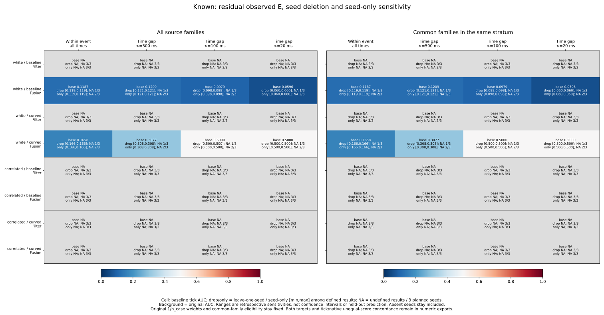
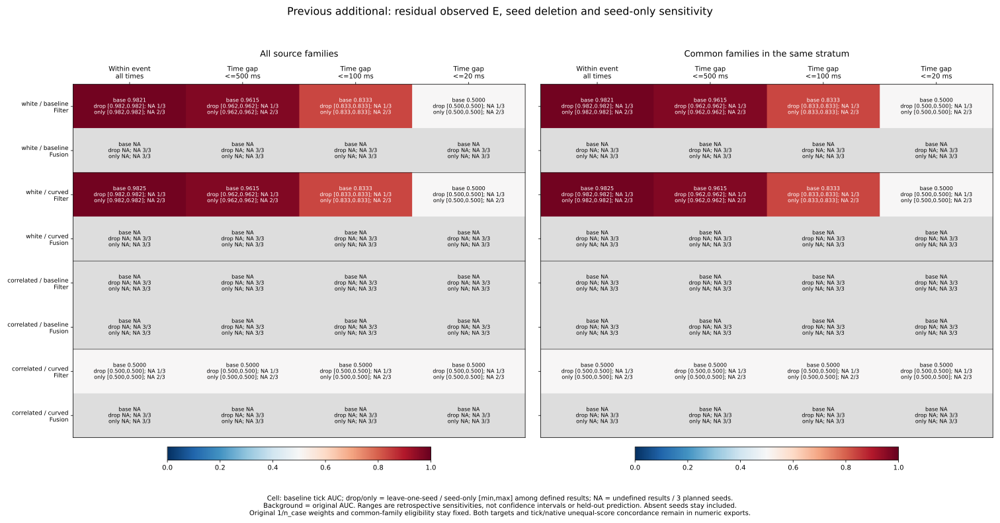
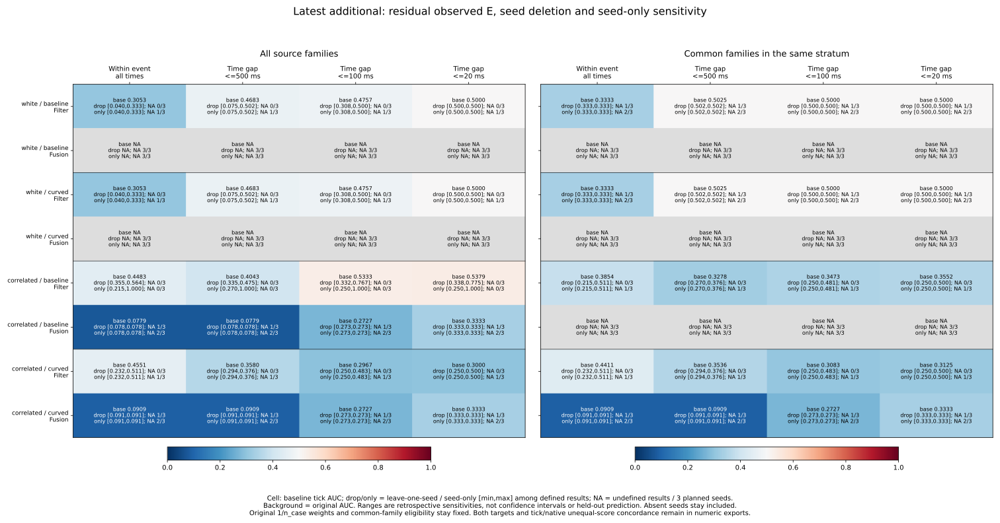
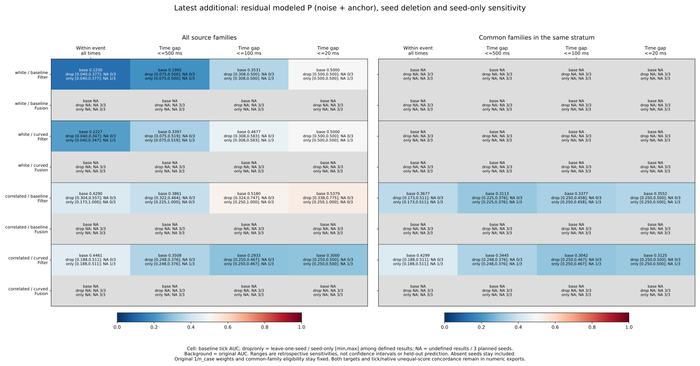
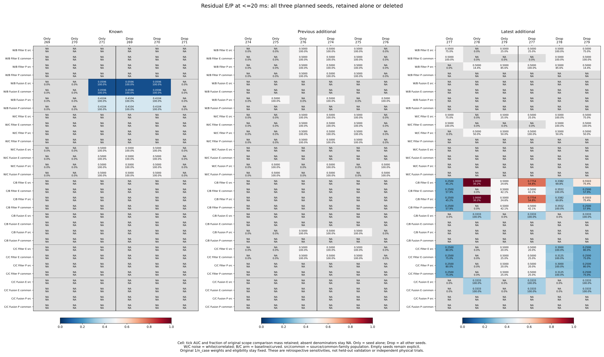

# Same-event seed deletion and seed-only sensitivity

The latest correlated-noise baseline Filter result remains sensitive to which
seed is included. For residual E, residual_sigma and <=20 ms same-event pairs,
source AUC is **0.537891**. Retaining seed 277 alone gives **0.250000**, seed 278
alone **1.000000**, and seed 279 alone **0.500000**. Deleting 278 drops the pooled
value to **0.338150**; deleting 277 raises it to **0.775368**. The seed-278 result
uses one positive/negative comparison in one case. These already observed seed
subsets do not establish predictive performance on a new seed.

The [protocol](protocol.md) was committed as **bad06ac** from main
**2b7e1d8bf6d4cf1a48f39c6ac8de1063cbb34d5e**, before any new seed outcomes.
This extends the [case/family deletion study](../event-unit-influence/report.md)
without new simulation, fitting, score reversal or control changes.

## Population, weights and missing values

All 10,995 RP states, 157 represented cases, 972 planned cases, 324 planned
families, 32,985 source-view references and 3,997 census events stay in the
pinned preceding accounting. Both targets, all three scores, E/P/U, five strata,
both noise types/arms and source/common_family populations remain available.
The selected populations and availability-only common-family eligibility are
fixed before any seed operation. A case has its full saved case key; a family
omits only planner. Every selected case in a seed is removed or retained together.

Each of the 120 selection groups has exactly three planned seed audits: known
269/270/271, previous additional 274/275/276, latest additional 277/278/279.
There are 360 audits, including 144 with records and 216 with none. The numbers
of selection groups with 0/1/2/3 represented seeds are 50/21/24/25. These groups
reuse strata/populations and are not 120 independent experiments. Pair-free
represented seeds and zero-record planned seeds remain distinct.

Comparisons remain within the same full case and single saved event, either
across its full history or at integer-microsecond gaps <=500/100/20 ms. Event
tags do not describe complete Fusion ancestry or independent physical streams.
Each retained state keeps its original 1/n_case weight from the full RP parent
history, before selecting stratum/population/seed. No weight is renormalized,
no family is made ineligible after removal, and no cross-case/seed pair is added.

For each scope, let W_s/T_s/L_s be weighted concordant/tied/discordant pair
masses in seed s, M_s their sum, and N_s = W_s + T_s/2. Seed-only AUC is N_s/M_s;
deleting s gives (sum N - N_s)/(sum M - M_s). The collector uses exact Fraction
weights and confirms additive closure across all three seeds. It never averages
seed AUCs. Tick order remains the original 1e-8 m quantization; native order is
strict saved-score order without a tolerance, describing export precision rather
than exact physical precision. Both unequal-score concordances W/(W+L) remain
available, with ties excluded from their own denominators.

All zero denominators stay blank. A seed-only AUC can be undefined even when
that seed has records; deleting an absent or pair-free seed is an explicit
metric no-op. Removing the sole comparison-supporting seed makes the result
undefined, not zero. Strict-side flips require two defined exact rational
values strictly on opposite sides of .5; a .5 departure is not counted as a
flip. All 8,640 summaries have three units, even for completely empty groups.

## Latest near-time Filter results

The table uses residual E, residual_sigma and <=20 ms. Lists are in seed order
277 / 278 / 279. A leave-one list names the seed being removed; NA is undefined.
Native values equal tick values for both sigma scores, including these subsets.

| Noise / arm | Population | Baseline AUC | Seed-only AUCs | Leave-one AUCs |
| --- | --- | ---: | --- | --- |
| White / baseline | source | .500000 | .500000 / NA / .500000 | .500000 / .500000 / .500000 |
| White / curved | source | .500000 | .500000 / NA / .500000 | .500000 / .500000 / .500000 |
| White / baseline | common | .500000 | .500000 / NA / NA | NA / .500000 / .500000 |
| White / curved | common | .500000 | .500000 / NA / NA | NA / .500000 / .500000 |
| Correlated / baseline | source | .537891 | .250000 / 1.000000 / .500000 | .775368 / .338150 / .550267 |
| Correlated / baseline | common | .355172 | .250000 / NA / .500000 | .500000 / .355172 / .250000 |
| Correlated / curved | source | .300000 | .250000 / NA / .500000 | .500000 / .300000 / .250000 |
| Correlated / curved | common | .312500 | .250000 / NA / .500000 | .500000 / .312500 / .250000 |

For correlated/baseline/source the comparison mass shares are **45.201933%**,
**30.179266%** and **24.618801%** for 277/278/279, respectively. The three seeds
have 4/1/6 selected cases and 4/1/3 pair-supporting cases. Their raw pair counts
are 8/1/5, which should not be confused with their original-weight mass shares.
Seed 278 is the C0149/F050 JPS maze_50x50 case identified by the preceding
unit study. Its sole comparison contributes all concordant unequal-score mass.
Seed 277 has conditional unequal-score concordance 0; seed 278 has 1; seed 279
has none because all its pairs tie. The pooled conditional value is **.571791**;
after deleting 277/278/279 it is **1 / 0 / .571791**, respectively. Keeping
support in all three AUC deletions does not make the score direction stable.

Common-family selection excludes the seed-278 case before any seed operation.
Its seed-only metrics are NA and its deletion does nothing. The remaining
277/279 AUCs are .25/.5, so deleting 277 reaches exactly .5, which is not a
strict flip. Curved correlated source/common results also range only from .25
to .5: reaching .5 does not supply an above-half result.

For white source E both arms keep AUC .5 for every deletion. Seed 277 supplies
75% of comparison mass, entirely tied; seed 279 supplies 25% and contains the
only unequal comparisons, balanced in direction. Deleting 279 leaves AUC .5
but makes unequal-score concordance undefined. White common E has all pair
support in seed 277; deleting it removes all support, while deleting 278/279
keeps .5. Flat ranges therefore have different support implications.

For supported latest Filter P cells the <=20 ms AUCs and seed effects match
E, but their support need not match. White source P has pairs only in 278/279,
with baseline mass shares 14.357776%/85.642224% and curved shares 50%/50%.
Seed 277 has no P class pairs despite contributing most E pair mass. White
common P is undefined throughout. Latest Fusion P is also undefined throughout
these within-event scopes. The P label is the frozen noise-plus-anchor model;
it is not an independent outcome or a new predictive validation set.

## All-event versus shorter gaps

For latest Filter residual E and residual_sigma, the source deletion ranges are:

| Noise / arm | All times within event | <=500 ms | <=100 ms | <=20 ms |
| --- | --- | --- | --- | --- |
| White / baseline and curved | [.040000,.333333] | [.075472,.502463] | [.307692,.500000] | [.500000,.500000] |
| Correlated / baseline | [.354858,.563657] | [.335236,.475322] | [.331550,.766958] | [.338150,.775368] |
| Correlated / curved | [.232143,.511244] | [.293750,.376179] | [.250000,.483333] | [.250000,.500000] |

All three AUC deletions are defined in each of these source cells. White seed
278 has no E pairs, so deleting it keeps the pooled value; seed-only E is defined
only in the other two seeds. Correlated/baseline has all three seeds supported,
while correlated/curved has only two. The tiny above-half white endpoint at
<=500 ms is retained, not rounded to .5 for strict-side counting. These scopes
are fixed retrospective pair-distance subsets, not causal time-series forecasts.

Latest correlated Fusion E has all its pair support in seed 278, under source
baseline and source/common curved. At <=20 ms its AUC is 1/3. Removing 278 makes
it undefined; other deletions retain 1/3. In curved source, seed 279 contributes
four selected cases but no E pairs. A seed with cases is not necessarily a seed
with informative within-event comparisons. White Fusion E is undefined.

## Earlier cohorts and full-grid coverage

Known white Fusion residual E has all pair support in seed 271, under both
arms/populations and all four scopes. Removing it loses support; removing
269/270 leaves the original value. At <=20 ms this is .059590 under baseline
and .5 under curved. The three planner cases supporting the known result are
all from the same seed/family. Known Filter E remains undefined within event.

Previous additional white Filter E has all pair support in seed 276, under both
arms/populations. Its all-event AUC is .982143/.982456 for baseline/curved and
both reach .5 at <=20 ms. Removing 276 loses support rather than showing a
stable high result on the other two seeds. Correlated/curved Filter E also
has sole support in 276, all ties with AUC .5. Previous additional Fusion E
remains undefined; its supported P cells arise in 275 (white) or 276
(correlated baseline source), illustrating why E/P support is kept separate.

Across every target/score/label/stratum/population/scope cell:

| Cohort | Defined baseline tick AUC cells | Cells losing AUC support under a deletion | Cells with any strict tick AUC flip | Cells supported by exactly 1 / 2 / 3 seeds |
| --- | ---: | ---: | ---: | --- |
| Known | 336 | 336 | 0 | 336 / 0 / 0 |
| Previous additional | 564 | 528 | 0 | 528 / 36 / 0 |
| Latest additional | 756 | 180 | 140 | 180 / 456 / 120 |

These counts repeat the same cases across labels, targets, strata and scopes;
they are not counts of independent successes or failed replications. Native
AUC has the same defined/support-loss counts, and 143 latest cells with strict
flips. Baseline native versus tick AUC differs in the inherited 128 cells,
only for contrast. Both sigma scores retain identical tick/native AUCs and
conditional values for every seed-only and deletion subset. All U rankings stay
undefined because they lack the outside class in the RP source states.

## Frozen figures and artifacts

All panels, including undefined ones, follow the protocol. The first four use
residual_sigma, Filter/Fusion and residual E (each cohort) or latest P. Cells
show original AUC, leave-one-seed and seed-only defined ranges, and undefined
counts out of three. The fifth uses all individual seed results at <=20 ms and
annotates comparison mass retained relative to that scope's original baseline.

[seed-audit.csv](seed-audit.csv) is label-blind and identifies each seed's selected
cases/families and original case mass. [seed-effects.csv](seed-effects.csv) keeps
all 25,920 comparisons. Unprefixed AUC/support/count fields describe the population
remaining after deletion; seed_ fields describe the retained seed alone. Removed
C/T/D masses and shares also describe the seed alone. [sensitivity-summary.csv](sensitivity-summary.csv)
keeps all 8,640 baseline/deletion/seed-only summaries, including represented and
supported seed counts, loss of denominators and exact side counts around .5.
The [summary export](summary-values.csv) contains 768 full rows across both
targets; the [individual export](seed-values.csv) contains 288 rows for the fifth
figure. The five SVGs and numeric exports are tracked; PNGs remain reproducible
in scratch.

## Reproduction and independent verification

See the [README](../../README.md#same-event-seed-deletion-and-seed-only-sensitivity)
for sequential commands using tracked inputs, fresh directories and a new
evidence file, without Python -O. Collection uses the standard library, plotting
Matplotlib/NumPy and independent verification NumPy; no new Rust build is needed.

- **652 Python tests passed**, including 19 new tests covering hand-calculated
  weights, grouping multiple cases/families by seed, direct remaining/retained
  recomputation at every score/label/target/scope, absent/pair-free seeds,
  empty selections, missing classes, ties/native order, support loss, exact-half
  rules, original stratum weights, fixed selection, time boundaries, event
  isolation, malformed/duplicate/unknown seeds and nonmutation.
- **852,165 preceding-field comparisons** match all fixed source/case/family/
  time/score audits and every original precision-scope field.
- **Four analysis artifacts** (three CSVs and sources.json) repeat byte for byte;
  **13 figure artifacts** (five SVGs, five PNGs, two CSVs and provenance) also
  repeat byte for byte. All five figures were inspected.
- **9,891,141 independent comparisons passed**. The standalone verifier imports
  no analyzers and reconstructs all 10,995 raw states/21,990 targets, original
  case weights, saved Decimal score order, preceding rankings/precision results,
  and all 56,304 case/family deletion rows. It directly masks NumPy positive/
  negative pairs for each remaining and retained seed, using exact Fraction
  counts/weights for half/side rules. It checks every new audit/effect/summary
  field, all 1,056 numeric plot rows and input/helper/script/protocol/output/
  plot hashes. It does not borrow the collector's contribution subtraction.

[sources.json](sources.json), [plot-sources.json](plot-sources.json) and
[independent-verification.json](independent-verification.json) preserve hashes
and counts. Every preceding CSV remains unchanged and pinned in place, including
all original planned case/family/event/loss/cutoff accounting.

These are retrospective sensitivities of three already observed seeds per
cohort. Their ranges are not confidence intervals, jackknife errors, independent
physical replications or held-out predictive validation. No seed is selected or
excluded for deployment. Historical held goals remain 140->140 and latest
62->60; no new live outcomes were measured.
