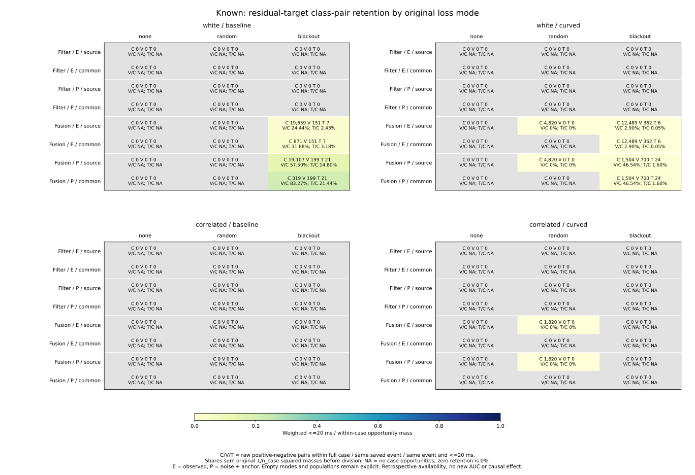
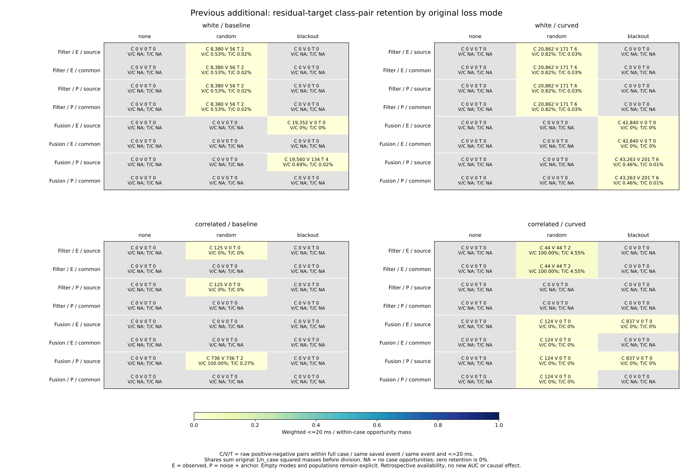
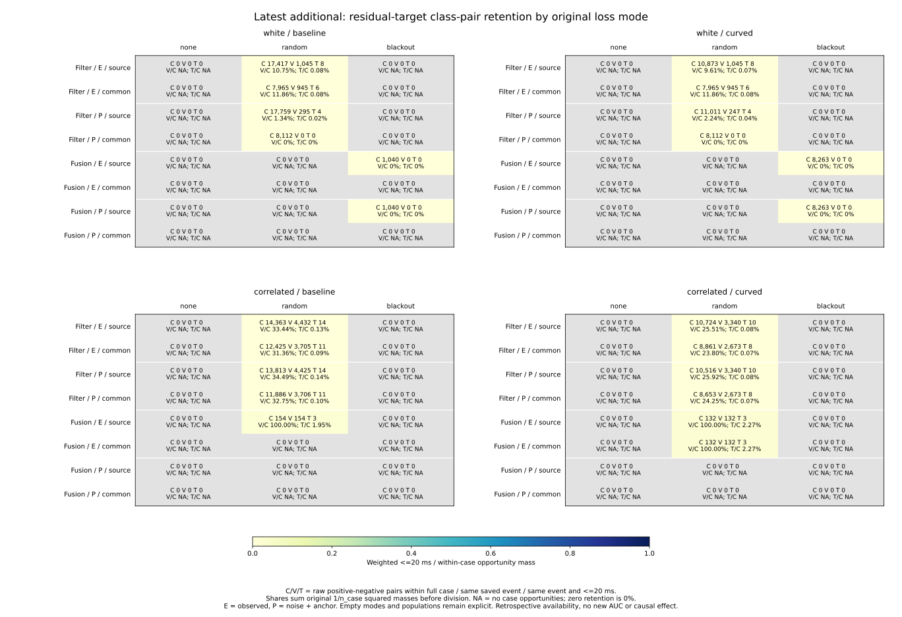
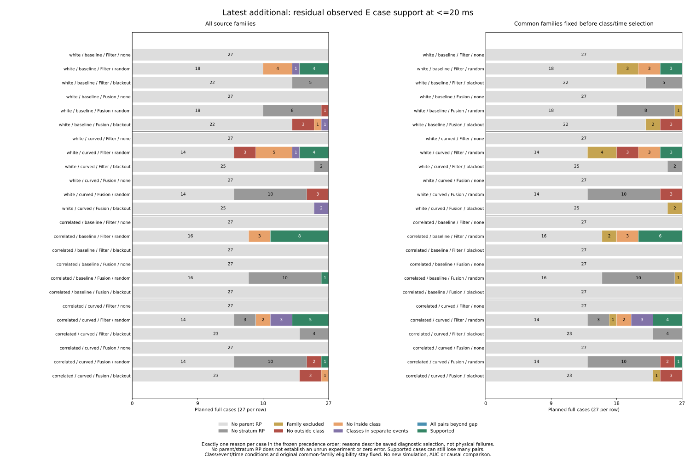

# Class-pair support attrition by case, event and time

The latest blackout Fusion records lack residual E comparisons for distinct
reasons. Under white noise, the cases with both classes have them in different
saved events. Under correlated/curved, all four represented cases are individually
one-class, even though pooling their states would show both classes. Neither
situation can be repaired by loosening the within-event time gap.

Latest random Filter E has a different limitation: its supported case count
does not change when imposing <=20 ms, yet only **0.074–0.133%** of the original
within-case opportunity mass remains on source support. A case can remain
supported while nearly all of its original class pairs are excluded. These
are availability findings on the existing diagnostics, with no new AUCs.

The [protocol](protocol.md) was committed as **7f85fc0** from main
**5151f46545a17ce3c8f0a26936586ec77eb85ace**, before computing these outcomes.
It extends the [loss-mode study](../event-loss-mode-influence/report.md).
All labels, event tags, time scopes, original parent weights and common-family
eligibility remain fixed. No simulation, fitting, cutoff, score reversal or
controller change was made.

## What the census retains

All 972 planned full cases, 324 families, 3,997 census events, 10,995 RP states
in 157 represented cases and 32,985 original source-view references remain in
the pinned accounting. Case IDs always name the planned full case, including
none/random/blackout mode, seed, scenario and planner; they are retained even
without selected diagnostic records. Every cohort, noise/arm, five strata,
both targets, E/P/U and source/common_family population remains in the tables.
An all_modes summary sums the three original modes without cross-case pairs.

Only 275 census events have references from these RP states. The other 3,722
are still in the label-blind coverage table with their original event kind and
received/scheduled/precision flags. Absence from the RP selection is not a
missing sensor observation, unrun experiment, physical failure or zero error.
Mode none remains explicit with no selected RP records.

The collector uses pinned case-strata and event-time-support ledgers. The
original time table contains only 550 nonempty event/stratum groups, while the
original label-blind event support includes all 275 x 5 groups. Empty entries
are retained from that ledger; a missing nonempty time row is rejected.
The independent verifier reconstructs the labels and counts from original
signed pose/projection components instead of trusting those support ledgers.

For a full case with original RP parent size n, selected outside/inside counts
p/q provide p*q within-case opportunities with mass p*q/n**2. This includes
different event tags solely as an availability denominator, not new admissible
ranking evidence. Same-event counts sum p_event*q_event, with the same original
weight, and split case opportunities exactly into same_event and other-event
parts. Time bounds are the original inclusive integer-microsecond <=500/100/20
ms limits. Pairs never cross cases, modes, planners or saved events when
reported as event/time support.

Masses are summed before calculating shares; neither states nor cases are
renormalized after stratum/population selection. In particular, raw count
ratios need not equal weighted retention. An absent opportunity denominator
gives a blank share. A positive denominator with no surviving pairs gives
zero retention, and neither value is an AUC. Event tags remain diagnostic
references, not complete Fusion ancestry or independent physical streams.

## One reason per planned case

For each scope, use this fixed precedence:

| Reason | Meaning |
| --- | --- |
| no_parent_rp | No original full-case RP diagnostic records |
| no_stratum_rp | Parent records exist, but none in the chosen stratum |
| family_ineligible | Pre-population stratum records exist, but the fixed common-family rule excludes the case |
| no_outside | Selected states have no outside class |
| no_inside | Selected states have no inside class |
| event_separated | The case has both classes, but no saved event has both |
| gap_excluded | Same-event pairs exist, but none survives this time bound |
| supported | At least one pair survives |

The first two reasons inspect original availability before population selection.
This precedence is an exhaustive audit convention, not a causal explanation of
simulator behavior. Each mode/noise/arm row accounts for 27 planned full cases;
all_modes accounts for 81. Positive means outside the original closed .10 m
disk. E is observed error, P is noise+anchor and U is drift+transport.

## Latest blackout Fusion: separate events or separate cases

For source Fusion residual E:

| Noise / arm | Selected states / cases | Within-case opportunities | Same-event pairs | Selected case reasons |
| --- | ---: | ---: | ---: | --- |
| White / baseline | 278 / 5 | 1,040 | 0 | 3 no_outside, 1 no_inside, 1 event_separated |
| White / curved | 255 / 2 | 8,263 | 0 | 2 event_separated |
| Correlated / baseline | 0 / 0 | 0 | 0 | No parent RP in all 27 planned cases |
| Correlated / curved | 202 / 4 | 0 | 0 | 3 no_outside, 1 no_inside |

Unrepresented parent cases fill the remainder of each 27-case row. All selected
blackout states are in Fusion, so blackout Filter records are absent at the
stratum stage. No <=20 ms pair is lost at the gap stage in this table: the
opportunity already disappears before that condition.

The three two-class white cases illustrate event separation directly:

| Full case | Arm / planner / seed | Event IDs with inside-only states | Event IDs with outside-only states | Case opportunities |
| --- | --- | --- | --- | ---: |
| C0266 | baseline / JPS / 279 | 3335: 20 | 3336: 52 | 1,040 |
| C0184 | curved / A* / 279 | 3327: 48; 3328: 63 | 3329: 68 | 7,548 |
| C0185 | curved / JPS / 279 | 3342: 11 | 3343: 65 | 715 |

Every listed event is one-class. Those cross-event opportunities do not supply
an event-conditioned comparison, regardless of the allowed time difference.
The fixed common-family population excludes these particular two-class white
cases; it does not create new local support.

Under correlated/curved, C0019/C0020/C0021 have 52/52/63 inside states and C0022
has 35 outside states. Each has one referenced event and only one class. The
pooled 35 outside and 167 inside states must not be multiplied to manufacture
5,845 within-case pairs: the classes are in different full cases. The actual
within-case opportunity count is zero. This differs from the white cases,
where within-case opportunities are positive but event retention is exactly 0%.

## Latest random Filter: case support hides pair attrition

Residual E counts and weighted retention are below. Raw counts follow
case opportunities -> same-event -> same-event and <=20 ms. Percentages use
original weighted masses, rather than ratios of the raw columns.

| Noise / arm | Population | Raw count sequence | Event / case mass | <=20 ms / event mass | <=20 ms / case mass |
| --- | --- | --- | ---: | ---: | ---: |
| White / baseline | source | 17,417 -> 1,045 -> 8 | 10.751679% | .765550% | .082310% |
| White / curved | source | 10,873 -> 1,045 -> 8 | 9.610963% | .765550% | .073577% |
| Correlated / baseline | source | 14,363 -> 4,432 -> 14 | 33.437952% | .396350% | .132531% |
| Correlated / curved | source | 10,724 -> 3,340 -> 10 | 25.512043% | .299401% | .076383% |
| White / baseline | common | 7,965 -> 945 -> 6 | 11.864407% | .634921% | .075330% |
| White / curved | common | 7,965 -> 945 -> 6 | 11.864407% | .634921% | .075330% |
| Correlated / baseline | common | 12,425 -> 3,705 -> 11 | 31.358923% | .297801% | .093387% |
| Correlated / curved | common | 8,861 -> 2,673 -> 8 | 23.804739% | .299289% | .071245% |

Source supported cases remain **4/4/8/5** at both same-event and <=20 ms;
common supported cases remain **3/3/6/4**. Thus none of these already supported
cases gets gap_excluded, although 99.23–99.70% of source same-event comparison
mass is removed by the <=20 ms restriction. The preceding near-time AUCs and
seed/planner effects describe this small surviving comparison population.

Other planned random source Filter cases receive these <=20 ms reasons:

| Noise / arm | No parent | No stratum | No outside | No inside | Event separated | Supported |
| --- | ---: | ---: | ---: | ---: | ---: | ---: |
| White / baseline | 18 | 0 | 0 | 4 | 1 | 4 |
| White / curved | 14 | 0 | 3 | 5 | 1 | 4 |
| Correlated / baseline | 16 | 0 | 0 | 3 | 0 | 8 |
| Correlated / curved | 14 | 3 | 0 | 2 | 3 | 5 |

None and blackout do not add latest Filter support. Common-family eligibility
is still the original availability rule and is not refit using labels or time
support. Its exclusions change denominators; they do not align case trajectories
or convert the selected comparisons into independent replications.

## Other cohorts and labels remain visible

Known Filter residual E/P has no within-case opportunities. Known white Fusion
E retains blackout event support, with 7/6 near-time pairs under baseline/curved.
Its curved random source subset has 4,820 within-case opportunities and no
event pairs. Previous additional white Filter E retains random support, while
white Fusion E has 19,352/42,840 blackout case opportunities that all vanish at
the event step. White Fusion P instead retains 4/6 blackout near-time pairs.
Previous additional correlated/baseline Fusion P has two random near-time
pairs, while its E support is absent. Labels therefore cannot be substituted
for one another, or a supporting mode generalized over noise conditions.

All targets, U labels and estimator strata remain in the numeric outputs. U
has no outside RP class. The figures preserve every frozen E/P panel, none
mode and NA opportunity share; they do not select favorable combinations.

## Artifacts and reproduction

[case-support.csv](case-support.csv) keeps all **58,320** planned case/stratum/
target/label/population rows, class counts, original mass, opportunity/event/time
pairs and reasons. [event-support.csv](event-support.csv) keeps **16,500** rows
over all 275 referenced events, including empty strata and excluded populations.
[event-coverage.csv](event-coverage.csv) keeps **3,997** original census events
with flags, full case IDs and per-stratum RP counts.
[support-summary.csv](support-summary.csv) keeps **2,880** aggregate rows across
all three modes plus all_modes, exhaustive reason counts and weighted shares.
The [plot export](plot-values.csv) keeps the **288** full summary rows used by
all four figures. SVGs are tracked; PNGs remain reproducible scratch outputs.

See the [README commands](../../README.md#class-pair-support-attrition-by-case-event-and-time)
for sequential commands with new directories and an unused evidence filename,
without Python -O. Collection uses the standard library, figures require
Matplotlib/NumPy and independent verification requires NumPy.

- **759 Python tests passed**, including 33 new tests for all reason stages and
  precedence, unequal original parent weights, summing masses before shares,
  fixed eligibility, empty selections, event/case/mode separation, zero versus
  undefined retention, source nonmutation, rejected inconsistent/duplicate/
  unknown inputs, label-blind empty event completion, original flags, inclusive
  20/100/500 ms boundaries plus one microsecond, and the closed-disk label rule.
- **216,000 preceding support-field comparisons** pass in both collection and
  independent verification, covering every mode effect and all_modes precision
  support across all three scores, targets, labels, strata, scopes and populations.
- **Five collector artifacts** repeat byte for byte. **Ten plot artifacts**
  (four SVGs, four PNGs, one numeric CSV and provenance) repeat byte for byte.
  All four final figures were inspected.
- **4,198,097 independent comparisons passed**. The standalone verifier imports
  no analyzers, reconstructs 10,995 raw states and 21,990 target labels from
  original signed components, derives availability-only common families, and
  directly masks within-case event/time pairs with NumPy and exact Fraction
  parent weights. It checks every case/event/coverage/summary field, all 288
  plotted rows, preceding support closure and input/helper/script/protocol/
  output/plot hashes. No unrelated preceding AUCs need to be recomputed.

[sources.json](sources.json), [plot-sources.json](plot-sources.json) and
[independent-verification.json](independent-verification.json) retain exact
hashes and counts. All preceding results remain unchanged and pinned in place.
These retrospective diagnostic subsets do not establish causal loss-mode
effects, independent physical trials, confidence intervals, calibration or
held-out prediction. Historical held goals remain 140->140 and latest 62->60;
no new live outcomes were measured.
